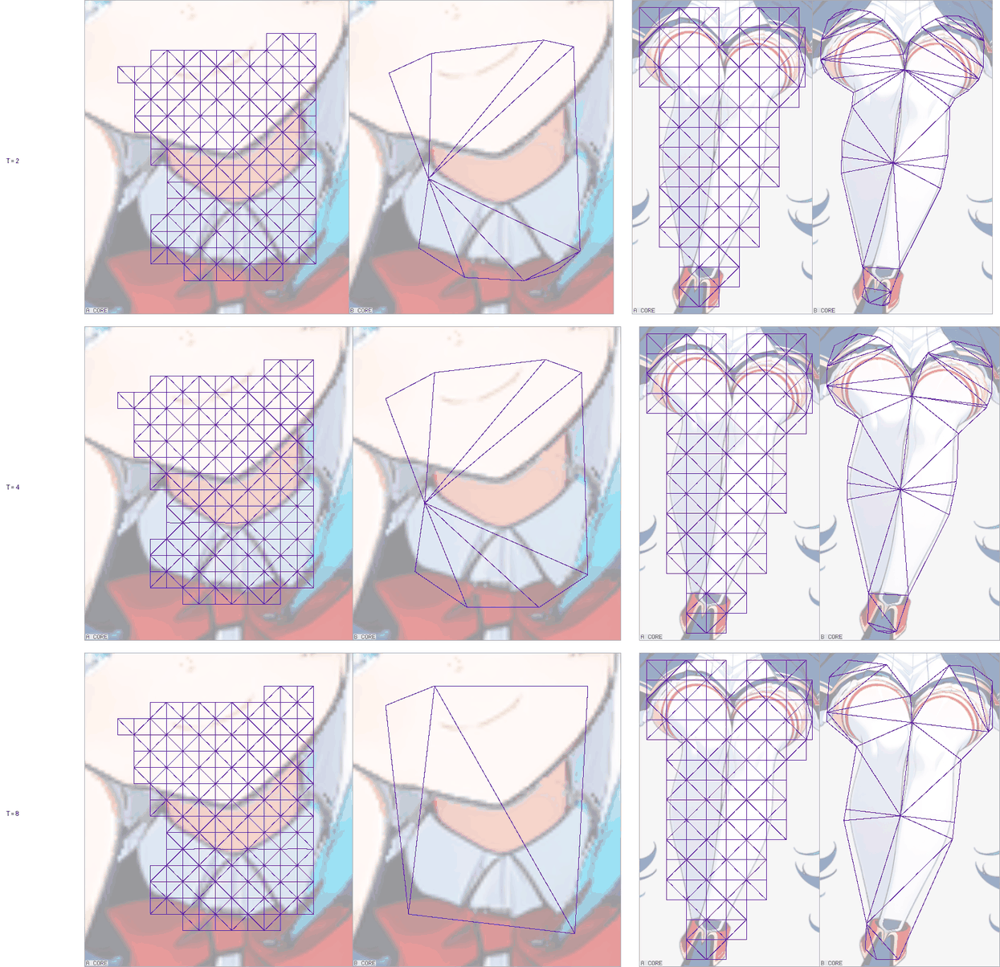
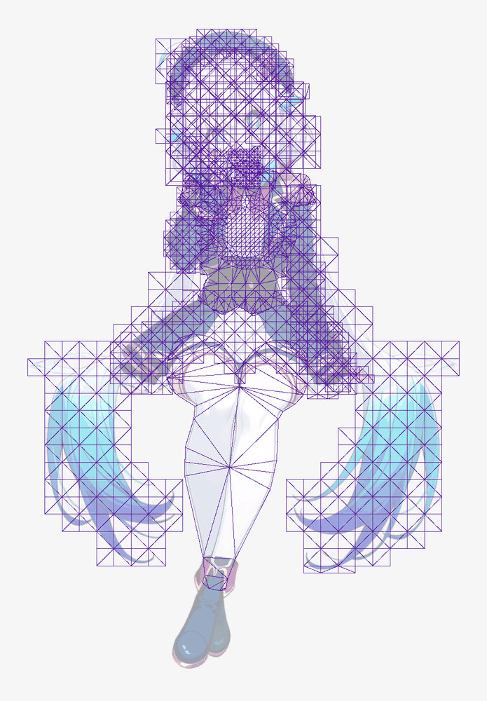

# Arm 3: a blunt contour outline with ribs only (issue #265, Stage A2)

Generated by `tools/density_survey.ts --page-arm3` over `--run … --arm3 …` documents; every figure is the tool's. Each named `grid` mesh becomes a `contour` mesh at tolerance T ∈ {2, 4, 8} rig px and margin T (matched to the tolerance, not a guarantee of coverage: T 8 fails `CONTOUR_COVERAGE` on scarf handwear_r, 1 of 21,404 art px, while T 2 and T 4 cover; the stage's own check holds every cell), background spacing 4096 (no lattice point survives), and `ribs` at stations ∈ {0, 1} on every chain its segments name. Nothing else moves; no `stray` is added. A refusal is the cell's result. "Overdraw" is the mesh's setup-pose area over its art area (alpha above 8, the mesh's own threshold); "displacement" is the largest posed distance against arm 0 over the idle (the Stage A rule). Bars: the nine of `check`.

The pictures (trailer; rig-c 2.43.0's `rigc inspect --show art,mesh --dim`, installed beside this tree for the pictures only), read before the tables:

- `density-arm3-parts.png` — neck (left pair) and legwear (right pair) at T 2, 4 and 8, stations 0, each arm 0 (A) beside arm 3 (B), from the cells that switch that part alone: `rigc inspect --candidate <work>/arm0/check/build --compare <cell>/check/build --show art,mesh --dim --overlay-slot <part> --zoom slot:<part>:10 --max 520`. handwear_l has no arm-3 build (below).
- `density-arm3-figure.png` — the whole figure of the legwear cell at T 2, stations 0: `rigc inspect --candidate <cell>/check/build --show art,mesh --dim --max 1400`.





## trailer

| arm | build | refused by | Σ triangles | vs arm 0 | triangles on the switched parts (arm 0) | overdraw, figure | overdraw, switched parts (arm 0) | BREATH_VISIBLE | BLINK_NO_HOLE | CHAIN_LAG | TIP_OVER_ROOT | STILL_REGIONS_DARK | TEXTURE_STRETCH | largest displacement on the switched parts (rig px) |
| --- | --- | --- | ---: | ---: | ---: | ---: | ---: | --- | --- | --- | --- | --- | --- | --- |
| 0 | PASS | — | 3081 | 100.0 % | — | 1.435 | — | PASS | PASS | PASS | PASS min 2.756 | PASS | PASS 1.226 | — |
| 3 neck+handwear_l+legwear (T 2, st 0) | exit 1 | CONTOUR_ONE_ISLAND | — | — | — | — | — | — | — | — | — | — | — | — |
| 3 neck+handwear_l+legwear (T 2, st 1) | exit 1 | CONTOUR_ONE_ISLAND, CONTOUR_RIB_ART | — | — | — | — | — | — | — | — | — | — | — | — |
| 3 neck+handwear_l+legwear (T 4, st 0) | exit 1 | CONTOUR_ONE_ISLAND | — | — | — | — | — | — | — | — | — | — | — | — |
| 3 neck+handwear_l+legwear (T 4, st 1) | exit 1 | CONTOUR_ONE_ISLAND, CONTOUR_RIB_ART | — | — | — | — | — | — | — | — | — | — | — | — |
| 3 neck+handwear_l+legwear (T 8, st 0) | exit 1 | CONTOUR_ONE_ISLAND | — | — | — | — | — | — | — | — | — | — | — | — |
| 3 neck+handwear_l+legwear (T 8, st 1) | exit 1 | CONTOUR_ONE_ISLAND, CONTOUR_RIB_ART | — | — | — | — | — | — | — | — | — | — | — | — |
| 3 neck (T 2, st 0) | PASS | — | 2807 | 91.1 % | 8 (282) | 1.435 | 1.160 (1.219) | PASS | PASS | PASS | PASS min 2.756 | PASS | PASS 1.226 | 0.165 (neck, frame 17) |
| 3 neck (T 2, st 1) | PASS | — | 2807 | 91.1 % | 8 (282) | 1.435 | 1.160 (1.219) | PASS | PASS | PASS | PASS min 2.756 | PASS | PASS 1.226 | 0.165 (neck, frame 17) |
| 3 neck (T 4, st 0) | PASS | — | 2806 | 91.1 % | 7 (282) | 1.436 | 1.299 (1.219) | PASS | PASS | PASS | PASS min 2.756 | PASS | PASS 1.226 | 0.158 (neck, frame 17) |
| 3 neck (T 4, st 1) | PASS | — | 2806 | 91.1 % | 7 (282) | 1.436 | 1.299 (1.219) | PASS | PASS | PASS | PASS min 2.756 | PASS | PASS 1.226 | 0.158 (neck, frame 17) |
| 3 neck (T 8, st 0) | PASS | — | 2802 | 90.9 % | 3 (282) | 1.437 | 1.416 (1.219) | PASS | PASS | PASS | PASS min 2.756 | PASS | PASS 1.226 | 0.417 (neck, frame 17) |
| 3 neck (T 8, st 1) | PASS | — | 2802 | 90.9 % | 3 (282) | 1.437 | 1.416 (1.219) | PASS | PASS | PASS | PASS min 2.756 | PASS | PASS 1.226 | 0.417 (neck, frame 17) |
| 3 handwear_l (T 2, st 0) | exit 1 | CONTOUR_ONE_ISLAND | — | — | — | — | — | — | — | — | — | — | — | — |
| 3 handwear_l (T 2, st 1) | exit 1 | CONTOUR_ONE_ISLAND | — | — | — | — | — | — | — | — | — | — | — | — |
| 3 handwear_l (T 4, st 0) | exit 1 | CONTOUR_ONE_ISLAND | — | — | — | — | — | — | — | — | — | — | — | — |
| 3 handwear_l (T 4, st 1) | exit 1 | CONTOUR_ONE_ISLAND | — | — | — | — | — | — | — | — | — | — | — | — |
| 3 handwear_l (T 8, st 0) | exit 1 | CONTOUR_ONE_ISLAND | — | — | — | — | — | — | — | — | — | — | — | — |
| 3 handwear_l (T 8, st 1) | exit 1 | CONTOUR_ONE_ISLAND | — | — | — | — | — | — | — | — | — | — | — | — |
| 3 legwear (T 2, st 0) | PASS | — | 2950 | 95.7 % | 45 (176) | 1.397 | 1.039 (1.311) | PASS | PASS | PASS | PASS min 2.756 | PASS | PASS 1.226 | 0.578 (legwear, frame 9) |
| 3 legwear (T 2, st 1) | exit 1 | CONTOUR_RIB_ART | — | — | — | — | — | — | — | — | — | — | — | — |
| 3 legwear (T 4, st 0) | PASS | — | 2938 | 95.4 % | 33 (176) | 1.402 | 1.077 (1.311) | PASS | PASS | PASS | PASS min 2.756 | PASS | PASS 1.226 | 0.571 (legwear, frame 9) |
| 3 legwear (T 4, st 1) | exit 1 | CONTOUR_RIB_ART | — | — | — | — | — | — | — | — | — | — | — | — |
| 3 legwear (T 8, st 0) | PASS | — | 2928 | 95.0 % | 23 (176) | 1.410 | 1.136 (1.311) | PASS | PASS | PASS | PASS min 2.756 | PASS | PASS 1.226 | 0.693 (legwear, frame 9) |
| 3 legwear (T 8, st 1) | exit 1 | CONTOUR_RIB_ART | — | — | — | — | — | — | — | — | — | — | — | — |

Per switched part (arm 0's own row first):

| arm | part | vertices | hull | triangles | mesh area px² | art px | overdraw | displacement vs arm 0 | TEXTURE_STRETCH severity |
| --- | --- | ---: | ---: | ---: | ---: | ---: | ---: | ---: | ---: |
| 0 | neck | 170 | 56 | 282 | 3525.0 | 2892 | 1.219 | — | 1.016 |
| 3 neck+handwear_l+legwear (T 2, st 0) | neck | — | — | — | — | — | — | — | — |
| 3 neck+handwear_l+legwear (T 2, st 1) | neck | — | — | — | — | — | — | — | — |
| 3 neck+handwear_l+legwear (T 4, st 0) | neck | — | — | — | — | — | — | — | — |
| 3 neck+handwear_l+legwear (T 4, st 1) | neck | — | — | — | — | — | — | — | — |
| 3 neck+handwear_l+legwear (T 8, st 0) | neck | — | — | — | — | — | — | — | — |
| 3 neck+handwear_l+legwear (T 8, st 1) | neck | — | — | — | — | — | — | — | — |
| 3 neck (T 2, st 0) | neck | 10 | 10 | 8 | 3354.5 | 2892 | 1.160 | 0.165 | 1.016 |
| 3 neck (T 2, st 1) | neck | 10 | 10 | 8 | 3354.5 | 2892 | 1.160 | 0.165 | 1.016 |
| 3 neck (T 4, st 0) | neck | 9 | 9 | 7 | 3757.5 | 2892 | 1.299 | 0.158 | 1.015 |
| 3 neck (T 4, st 1) | neck | 9 | 9 | 7 | 3757.5 | 2892 | 1.299 | 0.158 | 1.015 |
| 3 neck (T 8, st 0) | neck | 5 | 5 | 3 | 4096.0 | 2892 | 1.416 | 0.417 | 1.011 |
| 3 neck (T 8, st 1) | neck | 5 | 5 | 3 | 4096.0 | 2892 | 1.416 | 0.417 | 1.011 |
| 0 | handwear_l | 154 | 70 | 236 | 26490.0 | 19033 | 1.392 | — | 1.019 |
| 3 neck+handwear_l+legwear (T 2, st 0) | handwear_l | — | — | — | — | — | — | — | — |
| 3 neck+handwear_l+legwear (T 2, st 1) | handwear_l | — | — | — | — | — | — | — | — |
| 3 neck+handwear_l+legwear (T 4, st 0) | handwear_l | — | — | — | — | — | — | — | — |
| 3 neck+handwear_l+legwear (T 4, st 1) | handwear_l | — | — | — | — | — | — | — | — |
| 3 neck+handwear_l+legwear (T 8, st 0) | handwear_l | — | — | — | — | — | — | — | — |
| 3 neck+handwear_l+legwear (T 8, st 1) | handwear_l | — | — | — | — | — | — | — | — |
| 3 handwear_l (T 2, st 0) | handwear_l | — | — | — | — | — | — | — | — |
| 3 handwear_l (T 2, st 1) | handwear_l | — | — | — | — | — | — | — | — |
| 3 handwear_l (T 4, st 0) | handwear_l | — | — | — | — | — | — | — | — |
| 3 handwear_l (T 4, st 1) | handwear_l | — | — | — | — | — | — | — | — |
| 3 handwear_l (T 8, st 0) | handwear_l | — | — | — | — | — | — | — | — |
| 3 handwear_l (T 8, st 1) | handwear_l | — | — | — | — | — | — | — | — |
| 0 | legwear | 114 | 50 | 176 | 77310.0 | 58955 | 1.311 | — | 1.031 |
| 3 neck+handwear_l+legwear (T 2, st 0) | legwear | — | — | — | — | — | — | — | — |
| 3 neck+handwear_l+legwear (T 2, st 1) | legwear | — | — | — | — | — | — | — | — |
| 3 neck+handwear_l+legwear (T 4, st 0) | legwear | — | — | — | — | — | — | — | — |
| 3 neck+handwear_l+legwear (T 4, st 1) | legwear | — | — | — | — | — | — | — | — |
| 3 neck+handwear_l+legwear (T 8, st 0) | legwear | — | — | — | — | — | — | — | — |
| 3 neck+handwear_l+legwear (T 8, st 1) | legwear | — | — | — | — | — | — | — | — |
| 3 legwear (T 2, st 0) | legwear | 45 | 43 | 45 | 61270.0 | 58955 | 1.039 | 0.578 | 1.018 |
| 3 legwear (T 2, st 1) | legwear | — | — | — | — | — | — | — | — |
| 3 legwear (T 4, st 0) | legwear | 33 | 31 | 33 | 63491.0 | 58955 | 1.077 | 0.571 | 1.018 |
| 3 legwear (T 4, st 1) | legwear | — | — | — | — | — | — | — | — |
| 3 legwear (T 8, st 0) | legwear | 23 | 21 | 23 | 66954.5 | 58955 | 1.136 | 0.693 | 1.016 |
| 3 legwear (T 8, st 1) | legwear | — | — | — | — | — | — | — | — |

Refusals, as the stage printed them:

- arm 3 neck+handwear_l+legwear (T 2, st 0):
  - `[rig]   FAIL  CONTOUR_ONE_ISLAND: contour mesh "handwear_l" — its art (alpha above 8) is 2 separate 4-connected islands — 19032 px at (4, 4), 1 px at (13, 23); one island is required, because rig-c takes one closed outline per mesh. Nothing was discarded; the lattice mode stays available for this part`

- arm 3 neck+handwear_l+legwear (T 2, st 1):
  - `[rig]   FAIL  CONTOUR_ONE_ISLAND: contour mesh "handwear_l" — its art (alpha above 8) is 2 separate 4-connected islands — 19032 px at (4, 4), 1 px at (13, 23); one island is required, because rig-c takes one closed outline per mesh. Nothing was discarded; the lattice mode stays available for this part`
  - `[rig]   FAIL  CONTOUR_RIB_ART: contour mesh "legwear", rib leg link 0 station 1 — station 1 of the link is at (119.5, 164) in the part image (pixel (119, 164), alpha 0), not art (alpha above 8); a rib is the part's cross-section through the chain, so its point must lie on the part's art, inside the outline — move the chain onto the part, or leave the chain "leg" out of ribs`

- arm 3 neck+handwear_l+legwear (T 4, st 0):
  - `[rig]   FAIL  CONTOUR_ONE_ISLAND: contour mesh "handwear_l" — its art (alpha above 8) is 2 separate 4-connected islands — 19032 px at (4, 4), 1 px at (13, 23); one island is required, because rig-c takes one closed outline per mesh. Nothing was discarded; the lattice mode stays available for this part`

- arm 3 neck+handwear_l+legwear (T 4, st 1):
  - `[rig]   FAIL  CONTOUR_ONE_ISLAND: contour mesh "handwear_l" — its art (alpha above 8) is 2 separate 4-connected islands — 19032 px at (4, 4), 1 px at (13, 23); one island is required, because rig-c takes one closed outline per mesh. Nothing was discarded; the lattice mode stays available for this part`
  - `[rig]   FAIL  CONTOUR_RIB_ART: contour mesh "legwear", rib leg link 0 station 1 — station 1 of the link is at (119.5, 164) in the part image (pixel (119, 164), alpha 0), not art (alpha above 8); a rib is the part's cross-section through the chain, so its point must lie on the part's art, inside the outline — move the chain onto the part, or leave the chain "leg" out of ribs`

- arm 3 neck+handwear_l+legwear (T 8, st 0):
  - `[rig]   FAIL  CONTOUR_ONE_ISLAND: contour mesh "handwear_l" — its art (alpha above 8) is 2 separate 4-connected islands — 19032 px at (4, 4), 1 px at (13, 23); one island is required, because rig-c takes one closed outline per mesh. Nothing was discarded; the lattice mode stays available for this part`

- arm 3 neck+handwear_l+legwear (T 8, st 1):
  - `[rig]   FAIL  CONTOUR_ONE_ISLAND: contour mesh "handwear_l" — its art (alpha above 8) is 2 separate 4-connected islands — 19032 px at (4, 4), 1 px at (13, 23); one island is required, because rig-c takes one closed outline per mesh. Nothing was discarded; the lattice mode stays available for this part`
  - `[rig]   FAIL  CONTOUR_RIB_ART: contour mesh "legwear", rib leg link 0 station 1 — station 1 of the link is at (119.5, 164) in the part image (pixel (119, 164), alpha 0), not art (alpha above 8); a rib is the part's cross-section through the chain, so its point must lie on the part's art, inside the outline — move the chain onto the part, or leave the chain "leg" out of ribs`

- arm 3 handwear_l (T 2, st 0):
  - `[rig]   FAIL  CONTOUR_ONE_ISLAND: contour mesh "handwear_l" — its art (alpha above 8) is 2 separate 4-connected islands — 19032 px at (4, 4), 1 px at (13, 23); one island is required, because rig-c takes one closed outline per mesh. Nothing was discarded; the lattice mode stays available for this part`

- arm 3 handwear_l (T 2, st 1):
  - `[rig]   FAIL  CONTOUR_ONE_ISLAND: contour mesh "handwear_l" — its art (alpha above 8) is 2 separate 4-connected islands — 19032 px at (4, 4), 1 px at (13, 23); one island is required, because rig-c takes one closed outline per mesh. Nothing was discarded; the lattice mode stays available for this part`

- arm 3 handwear_l (T 4, st 0):
  - `[rig]   FAIL  CONTOUR_ONE_ISLAND: contour mesh "handwear_l" — its art (alpha above 8) is 2 separate 4-connected islands — 19032 px at (4, 4), 1 px at (13, 23); one island is required, because rig-c takes one closed outline per mesh. Nothing was discarded; the lattice mode stays available for this part`

- arm 3 handwear_l (T 4, st 1):
  - `[rig]   FAIL  CONTOUR_ONE_ISLAND: contour mesh "handwear_l" — its art (alpha above 8) is 2 separate 4-connected islands — 19032 px at (4, 4), 1 px at (13, 23); one island is required, because rig-c takes one closed outline per mesh. Nothing was discarded; the lattice mode stays available for this part`

- arm 3 handwear_l (T 8, st 0):
  - `[rig]   FAIL  CONTOUR_ONE_ISLAND: contour mesh "handwear_l" — its art (alpha above 8) is 2 separate 4-connected islands — 19032 px at (4, 4), 1 px at (13, 23); one island is required, because rig-c takes one closed outline per mesh. Nothing was discarded; the lattice mode stays available for this part`

- arm 3 handwear_l (T 8, st 1):
  - `[rig]   FAIL  CONTOUR_ONE_ISLAND: contour mesh "handwear_l" — its art (alpha above 8) is 2 separate 4-connected islands — 19032 px at (4, 4), 1 px at (13, 23); one island is required, because rig-c takes one closed outline per mesh. Nothing was discarded; the lattice mode stays available for this part`

- arm 3 legwear (T 2, st 1):
  - `[rig]   FAIL  CONTOUR_RIB_ART: contour mesh "legwear", rib leg link 0 station 1 — station 1 of the link is at (119.5, 164) in the part image (pixel (119, 164), alpha 0), not art (alpha above 8); a rib is the part's cross-section through the chain, so its point must lie on the part's art, inside the outline — move the chain onto the part, or leave the chain "leg" out of ribs`

- arm 3 legwear (T 4, st 1):
  - `[rig]   FAIL  CONTOUR_RIB_ART: contour mesh "legwear", rib leg link 0 station 1 — station 1 of the link is at (119.5, 164) in the part image (pixel (119, 164), alpha 0), not art (alpha above 8); a rib is the part's cross-section through the chain, so its point must lie on the part's art, inside the outline — move the chain onto the part, or leave the chain "leg" out of ribs`

- arm 3 legwear (T 8, st 1):
  - `[rig]   FAIL  CONTOUR_RIB_ART: contour mesh "legwear", rib leg link 0 station 1 — station 1 of the link is at (119.5, 164) in the part image (pixel (119, 164), alpha 0), not art (alpha above 8); a rib is the part's cross-section through the chain, so its point must lie on the part's art, inside the outline — move the chain onto the part, or leave the chain "leg" out of ribs`

What `ribs` cannot express (no row is placed; the mesh is weighted as declared):

- neck: segment(s) chest, head are bone segments, not chains; ribs take chains only, so no row is placed across them — the weights of head and chest cross at (403, 319.5) rig px, along x = 403
- handwear_l: segment(s) chest are bone segments, not chains; ribs take chains only, so no row is placed across them
- legwear: segment(s) hip are bone segments, not chains; ribs take chains only, so no row is placed across them

Every arm's `check` lines, as the build printed them:

<details><summary>arm 0</summary>

```
loop: idle 49 frame(s) at 12 fps, f0000 vs f0048 (t = 4s): max |d| 0 (0 required)
seam: setup pose at 847x1216, scale 1.0089: mean |d| 0.154 (<= 1.0), 0 px over 40, 0.00 rig px (the count / s²; <= 50), 0 px over 80 (reported)
BREATH_VISIBLE: PASS — declared_not_planted shoes; torso_parts topwear; torso_heat_mean 14.231; torso_floor 3.809; feet_parts none; feet_heat_max null; feet_ceiling 0
BLINK_NO_HOLE: PASS — eye_parts eyewhite_r | eyewhite_l; closed group eyes scaley 0.12 from 2.37s to 2.454s; idle_frames_closed 29; box_px 6120; hole_px 0; hole_bar 0; patch_max 28; patch_px_over_40 0
CHAIN_LAG: PASS — chains neck > head_ctl: period 4s, phase 0.080 0.120, amp 0.350 0.900 | bang_r0_ctl > bang_r1_ctl: period 4s, phase 0.180 0.280, amp 1.000 2.200 | bang_c0_ctl > bang_c1_ctl: period 4s, phase 0.180 0.280, amp 0.800 1.760 | bang_l0_ctl > bang_l1_ctl: period 4s, phase 0.180 0.280, amp 1.000 2.200 | hairpin_tassel0_ctl > hairpin_tassel1_ctl: period 2s, phase 0.200 0.320, amp 4.000 7.
TIP_OVER_ROOT: PASS — declared_rises handwear_r; instrument geometry; parts part handwear_l, root_rig_px 0.92, tip_rig_px 4.377, ratio 4.759 | part bottomwear, root_rig_px 0.25, tip_rig_px 1.097, ratio 4.39 | part handwear_r, tip_half upper, root_rig_px 1.275, tip_rig_px 3.514, ratio 2.756; ratio_floor 1.4725
STILL_REGIONS_DARK: PASS — face parts face, head_bone head, instrument geometry, still_slots slot face, max_rig_px 4.477e-13, rms_rig_px 1.315e-13, max_rig_px 4.477e-13, at null, rms_rig_px 1.315e-13, tolerance_rig_px 2.286e-11, crossing slot hair_front, depth_rig_px 4, area_rig_px2 206.563, frame 47, driven_slots none; feet declared_not_planted shoes, unmeasured every "footwear" part ("shoes") is
TEXTURE_STRETCH: PASS — meshes 10; triangles 3081; frames 49; severity 1.226; severity_ceiling 1.926544; worst slot hairpin, triangle 150, vertices 115 | 20 | 19, edge 20 | 19, frame 36, ratio 0.816; max_ratio 1.187; min_ratio 0.816; per_mesh slot hair_long, triangles 578, max_ratio 1.077, max_at triangle 449 (vertices 65 64 338), edge 65-64, idle frame 8, min_ratio 0.92, min_at triangle 449 (vert
RECOMPOSITE_HOLES: REPORTED — error_px 19523; uncovered_error_px 4396; hole_count 1213; largest px 402, box 334,960 16x55, borders shoes 47 px | legwear 32 px
check: PASS; 9 of 9 bar(s) measured, 0 skipped
```

</details>

<details><summary>arm 3 neck+handwear_l+legwear (T 2, st 0)</summary>

```
moved: neck grid 5 -> contour T 2 margin 2 spacing 4096, no ribs
moved: handwear_l grid 15 -> contour T 2 margin 2 spacing 4096, ribs sleeve_l stations 0
moved: legwear grid 30 -> contour T 2 margin 2 spacing 4096, ribs leg stations 0
```

</details>

<details><summary>arm 3 neck+handwear_l+legwear (T 2, st 1)</summary>

```
moved: neck grid 5 -> contour T 2 margin 2 spacing 4096, no ribs
moved: handwear_l grid 15 -> contour T 2 margin 2 spacing 4096, ribs sleeve_l stations 1
moved: legwear grid 30 -> contour T 2 margin 2 spacing 4096, ribs leg stations 1
```

</details>

<details><summary>arm 3 neck+handwear_l+legwear (T 4, st 0)</summary>

```
moved: neck grid 5 -> contour T 4 margin 4 spacing 4096, no ribs
moved: handwear_l grid 15 -> contour T 4 margin 4 spacing 4096, ribs sleeve_l stations 0
moved: legwear grid 30 -> contour T 4 margin 4 spacing 4096, ribs leg stations 0
```

</details>

<details><summary>arm 3 neck+handwear_l+legwear (T 4, st 1)</summary>

```
moved: neck grid 5 -> contour T 4 margin 4 spacing 4096, no ribs
moved: handwear_l grid 15 -> contour T 4 margin 4 spacing 4096, ribs sleeve_l stations 1
moved: legwear grid 30 -> contour T 4 margin 4 spacing 4096, ribs leg stations 1
```

</details>

<details><summary>arm 3 neck+handwear_l+legwear (T 8, st 0)</summary>

```
moved: neck grid 5 -> contour T 8 margin 8 spacing 4096, no ribs
moved: handwear_l grid 15 -> contour T 8 margin 8 spacing 4096, ribs sleeve_l stations 0
moved: legwear grid 30 -> contour T 8 margin 8 spacing 4096, ribs leg stations 0
```

</details>

<details><summary>arm 3 neck+handwear_l+legwear (T 8, st 1)</summary>

```
moved: neck grid 5 -> contour T 8 margin 8 spacing 4096, no ribs
moved: handwear_l grid 15 -> contour T 8 margin 8 spacing 4096, ribs sleeve_l stations 1
moved: legwear grid 30 -> contour T 8 margin 8 spacing 4096, ribs leg stations 1
```

</details>

<details><summary>arm 3 neck (T 2, st 0)</summary>

```
moved: neck grid 5 -> contour T 2 margin 2 spacing 4096, no ribs
loop: idle 49 frame(s) at 12 fps, f0000 vs f0048 (t = 4s): max |d| 0 (0 required)
seam: setup pose at 847x1216, scale 1.0089: mean |d| 0.154 (<= 1.0), 0 px over 40, 0.00 rig px (the count / s²; <= 50), 0 px over 80 (reported)
BREATH_VISIBLE: PASS — declared_not_planted shoes; torso_parts topwear; torso_heat_mean 14.231; torso_floor 3.809; feet_parts none; feet_heat_max null; feet_ceiling 0
BLINK_NO_HOLE: PASS — eye_parts eyewhite_r | eyewhite_l; closed group eyes scaley 0.12 from 2.37s to 2.454s; idle_frames_closed 29; box_px 6120; hole_px 0; hole_bar 0; patch_max 28; patch_px_over_40 0
CHAIN_LAG: PASS — chains neck > head_ctl: period 4s, phase 0.080 0.120, amp 0.350 0.900 | bang_r0_ctl > bang_r1_ctl: period 4s, phase 0.180 0.280, amp 1.000 2.200 | bang_c0_ctl > bang_c1_ctl: period 4s, phase 0.180 0.280, amp 0.800 1.760 | bang_l0_ctl > bang_l1_ctl: period 4s, phase 0.180 0.280, amp 1.000 2.200 | hairpin_tassel0_ctl > hairpin_tassel1_ctl: period 2s, phase 0.200 0.320, amp 4.000 7.
TIP_OVER_ROOT: PASS — declared_rises handwear_r; instrument geometry; parts part handwear_l, root_rig_px 0.92, tip_rig_px 4.377, ratio 4.759 | part bottomwear, root_rig_px 0.25, tip_rig_px 1.097, ratio 4.39 | part handwear_r, tip_half upper, root_rig_px 1.275, tip_rig_px 3.514, ratio 2.756; ratio_floor 1.4725
STILL_REGIONS_DARK: PASS — face parts face, head_bone head, instrument geometry, still_slots slot face, max_rig_px 4.477e-13, rms_rig_px 1.315e-13, max_rig_px 4.477e-13, at null, rms_rig_px 1.315e-13, tolerance_rig_px 2.286e-11, crossing slot hair_front, depth_rig_px 4, area_rig_px2 206.563, frame 47, driven_slots none; feet declared_not_planted shoes, unmeasured every "footwear" part ("shoes") is
TEXTURE_STRETCH: PASS — meshes 10; triangles 2807; frames 49; severity 1.226; severity_ceiling 1.926544; worst slot hairpin, triangle 150, vertices 115 | 20 | 19, edge 20 | 19, frame 36, ratio 0.816; max_ratio 1.187; min_ratio 0.816; per_mesh slot hair_long, triangles 578, max_ratio 1.077, max_at triangle 449 (vertices 65 64 338), edge 65-64, idle frame 8, min_ratio 0.92, min_at triangle 449 (vert
RECOMPOSITE_HOLES: REPORTED — error_px 19523; uncovered_error_px 4396; hole_count 1213; largest px 402, box 334,960 16x55, borders shoes 47 px | legwear 32 px
check: PASS; 9 of 9 bar(s) measured, 0 skipped
```

</details>

<details><summary>arm 3 neck (T 2, st 1)</summary>

```
moved: neck grid 5 -> contour T 2 margin 2 spacing 4096, no ribs
loop: idle 49 frame(s) at 12 fps, f0000 vs f0048 (t = 4s): max |d| 0 (0 required)
seam: setup pose at 847x1216, scale 1.0089: mean |d| 0.154 (<= 1.0), 0 px over 40, 0.00 rig px (the count / s²; <= 50), 0 px over 80 (reported)
BREATH_VISIBLE: PASS — declared_not_planted shoes; torso_parts topwear; torso_heat_mean 14.231; torso_floor 3.809; feet_parts none; feet_heat_max null; feet_ceiling 0
BLINK_NO_HOLE: PASS — eye_parts eyewhite_r | eyewhite_l; closed group eyes scaley 0.12 from 2.37s to 2.454s; idle_frames_closed 29; box_px 6120; hole_px 0; hole_bar 0; patch_max 28; patch_px_over_40 0
CHAIN_LAG: PASS — chains neck > head_ctl: period 4s, phase 0.080 0.120, amp 0.350 0.900 | bang_r0_ctl > bang_r1_ctl: period 4s, phase 0.180 0.280, amp 1.000 2.200 | bang_c0_ctl > bang_c1_ctl: period 4s, phase 0.180 0.280, amp 0.800 1.760 | bang_l0_ctl > bang_l1_ctl: period 4s, phase 0.180 0.280, amp 1.000 2.200 | hairpin_tassel0_ctl > hairpin_tassel1_ctl: period 2s, phase 0.200 0.320, amp 4.000 7.
TIP_OVER_ROOT: PASS — declared_rises handwear_r; instrument geometry; parts part handwear_l, root_rig_px 0.92, tip_rig_px 4.377, ratio 4.759 | part bottomwear, root_rig_px 0.25, tip_rig_px 1.097, ratio 4.39 | part handwear_r, tip_half upper, root_rig_px 1.275, tip_rig_px 3.514, ratio 2.756; ratio_floor 1.4725
STILL_REGIONS_DARK: PASS — face parts face, head_bone head, instrument geometry, still_slots slot face, max_rig_px 4.477e-13, rms_rig_px 1.315e-13, max_rig_px 4.477e-13, at null, rms_rig_px 1.315e-13, tolerance_rig_px 2.286e-11, crossing slot hair_front, depth_rig_px 4, area_rig_px2 206.563, frame 47, driven_slots none; feet declared_not_planted shoes, unmeasured every "footwear" part ("shoes") is
TEXTURE_STRETCH: PASS — meshes 10; triangles 2807; frames 49; severity 1.226; severity_ceiling 1.926544; worst slot hairpin, triangle 150, vertices 115 | 20 | 19, edge 20 | 19, frame 36, ratio 0.816; max_ratio 1.187; min_ratio 0.816; per_mesh slot hair_long, triangles 578, max_ratio 1.077, max_at triangle 449 (vertices 65 64 338), edge 65-64, idle frame 8, min_ratio 0.92, min_at triangle 449 (vert
RECOMPOSITE_HOLES: REPORTED — error_px 19523; uncovered_error_px 4396; hole_count 1213; largest px 402, box 334,960 16x55, borders shoes 47 px | legwear 32 px
check: PASS; 9 of 9 bar(s) measured, 0 skipped
```

</details>

<details><summary>arm 3 neck (T 4, st 0)</summary>

```
moved: neck grid 5 -> contour T 4 margin 4 spacing 4096, no ribs
loop: idle 49 frame(s) at 12 fps, f0000 vs f0048 (t = 4s): max |d| 0 (0 required)
seam: setup pose at 847x1216, scale 1.0089: mean |d| 0.154 (<= 1.0), 0 px over 40, 0.00 rig px (the count / s²; <= 50), 0 px over 80 (reported)
BREATH_VISIBLE: PASS — declared_not_planted shoes; torso_parts topwear; torso_heat_mean 14.231; torso_floor 3.809; feet_parts none; feet_heat_max null; feet_ceiling 0
BLINK_NO_HOLE: PASS — eye_parts eyewhite_r | eyewhite_l; closed group eyes scaley 0.12 from 2.37s to 2.454s; idle_frames_closed 29; box_px 6120; hole_px 0; hole_bar 0; patch_max 28; patch_px_over_40 0
CHAIN_LAG: PASS — chains neck > head_ctl: period 4s, phase 0.080 0.120, amp 0.350 0.900 | bang_r0_ctl > bang_r1_ctl: period 4s, phase 0.180 0.280, amp 1.000 2.200 | bang_c0_ctl > bang_c1_ctl: period 4s, phase 0.180 0.280, amp 0.800 1.760 | bang_l0_ctl > bang_l1_ctl: period 4s, phase 0.180 0.280, amp 1.000 2.200 | hairpin_tassel0_ctl > hairpin_tassel1_ctl: period 2s, phase 0.200 0.320, amp 4.000 7.
TIP_OVER_ROOT: PASS — declared_rises handwear_r; instrument geometry; parts part handwear_l, root_rig_px 0.92, tip_rig_px 4.377, ratio 4.759 | part bottomwear, root_rig_px 0.25, tip_rig_px 1.097, ratio 4.39 | part handwear_r, tip_half upper, root_rig_px 1.275, tip_rig_px 3.514, ratio 2.756; ratio_floor 1.4725
STILL_REGIONS_DARK: PASS — face parts face, head_bone head, instrument geometry, still_slots slot face, max_rig_px 4.477e-13, rms_rig_px 1.315e-13, max_rig_px 4.477e-13, at null, rms_rig_px 1.315e-13, tolerance_rig_px 2.286e-11, crossing slot hair_front, depth_rig_px 4, area_rig_px2 206.563, frame 47, driven_slots none; feet declared_not_planted shoes, unmeasured every "footwear" part ("shoes") is
TEXTURE_STRETCH: PASS — meshes 10; triangles 2806; frames 49; severity 1.226; severity_ceiling 1.926544; worst slot hairpin, triangle 150, vertices 115 | 20 | 19, edge 20 | 19, frame 36, ratio 0.816; max_ratio 1.187; min_ratio 0.816; per_mesh slot hair_long, triangles 578, max_ratio 1.077, max_at triangle 449 (vertices 65 64 338), edge 65-64, idle frame 8, min_ratio 0.92, min_at triangle 449 (vert
RECOMPOSITE_HOLES: REPORTED — error_px 19523; uncovered_error_px 4396; hole_count 1213; largest px 402, box 334,960 16x55, borders shoes 47 px | legwear 32 px
check: PASS; 9 of 9 bar(s) measured, 0 skipped
```

</details>

<details><summary>arm 3 neck (T 4, st 1)</summary>

```
moved: neck grid 5 -> contour T 4 margin 4 spacing 4096, no ribs
loop: idle 49 frame(s) at 12 fps, f0000 vs f0048 (t = 4s): max |d| 0 (0 required)
seam: setup pose at 847x1216, scale 1.0089: mean |d| 0.154 (<= 1.0), 0 px over 40, 0.00 rig px (the count / s²; <= 50), 0 px over 80 (reported)
BREATH_VISIBLE: PASS — declared_not_planted shoes; torso_parts topwear; torso_heat_mean 14.231; torso_floor 3.809; feet_parts none; feet_heat_max null; feet_ceiling 0
BLINK_NO_HOLE: PASS — eye_parts eyewhite_r | eyewhite_l; closed group eyes scaley 0.12 from 2.37s to 2.454s; idle_frames_closed 29; box_px 6120; hole_px 0; hole_bar 0; patch_max 28; patch_px_over_40 0
CHAIN_LAG: PASS — chains neck > head_ctl: period 4s, phase 0.080 0.120, amp 0.350 0.900 | bang_r0_ctl > bang_r1_ctl: period 4s, phase 0.180 0.280, amp 1.000 2.200 | bang_c0_ctl > bang_c1_ctl: period 4s, phase 0.180 0.280, amp 0.800 1.760 | bang_l0_ctl > bang_l1_ctl: period 4s, phase 0.180 0.280, amp 1.000 2.200 | hairpin_tassel0_ctl > hairpin_tassel1_ctl: period 2s, phase 0.200 0.320, amp 4.000 7.
TIP_OVER_ROOT: PASS — declared_rises handwear_r; instrument geometry; parts part handwear_l, root_rig_px 0.92, tip_rig_px 4.377, ratio 4.759 | part bottomwear, root_rig_px 0.25, tip_rig_px 1.097, ratio 4.39 | part handwear_r, tip_half upper, root_rig_px 1.275, tip_rig_px 3.514, ratio 2.756; ratio_floor 1.4725
STILL_REGIONS_DARK: PASS — face parts face, head_bone head, instrument geometry, still_slots slot face, max_rig_px 4.477e-13, rms_rig_px 1.315e-13, max_rig_px 4.477e-13, at null, rms_rig_px 1.315e-13, tolerance_rig_px 2.286e-11, crossing slot hair_front, depth_rig_px 4, area_rig_px2 206.563, frame 47, driven_slots none; feet declared_not_planted shoes, unmeasured every "footwear" part ("shoes") is
TEXTURE_STRETCH: PASS — meshes 10; triangles 2806; frames 49; severity 1.226; severity_ceiling 1.926544; worst slot hairpin, triangle 150, vertices 115 | 20 | 19, edge 20 | 19, frame 36, ratio 0.816; max_ratio 1.187; min_ratio 0.816; per_mesh slot hair_long, triangles 578, max_ratio 1.077, max_at triangle 449 (vertices 65 64 338), edge 65-64, idle frame 8, min_ratio 0.92, min_at triangle 449 (vert
RECOMPOSITE_HOLES: REPORTED — error_px 19523; uncovered_error_px 4396; hole_count 1213; largest px 402, box 334,960 16x55, borders shoes 47 px | legwear 32 px
check: PASS; 9 of 9 bar(s) measured, 0 skipped
```

</details>

<details><summary>arm 3 neck (T 8, st 0)</summary>

```
moved: neck grid 5 -> contour T 8 margin 8 spacing 4096, no ribs
loop: idle 49 frame(s) at 12 fps, f0000 vs f0048 (t = 4s): max |d| 0 (0 required)
seam: setup pose at 847x1216, scale 1.0089: mean |d| 0.154 (<= 1.0), 0 px over 40, 0.00 rig px (the count / s²; <= 50), 0 px over 80 (reported)
BREATH_VISIBLE: PASS — declared_not_planted shoes; torso_parts topwear; torso_heat_mean 14.231; torso_floor 3.809; feet_parts none; feet_heat_max null; feet_ceiling 0
BLINK_NO_HOLE: PASS — eye_parts eyewhite_r | eyewhite_l; closed group eyes scaley 0.12 from 2.37s to 2.454s; idle_frames_closed 29; box_px 6120; hole_px 0; hole_bar 0; patch_max 28; patch_px_over_40 0
CHAIN_LAG: PASS — chains neck > head_ctl: period 4s, phase 0.080 0.120, amp 0.350 0.900 | bang_r0_ctl > bang_r1_ctl: period 4s, phase 0.180 0.280, amp 1.000 2.200 | bang_c0_ctl > bang_c1_ctl: period 4s, phase 0.180 0.280, amp 0.800 1.760 | bang_l0_ctl > bang_l1_ctl: period 4s, phase 0.180 0.280, amp 1.000 2.200 | hairpin_tassel0_ctl > hairpin_tassel1_ctl: period 2s, phase 0.200 0.320, amp 4.000 7.
TIP_OVER_ROOT: PASS — declared_rises handwear_r; instrument geometry; parts part handwear_l, root_rig_px 0.92, tip_rig_px 4.377, ratio 4.759 | part bottomwear, root_rig_px 0.25, tip_rig_px 1.097, ratio 4.39 | part handwear_r, tip_half upper, root_rig_px 1.275, tip_rig_px 3.514, ratio 2.756; ratio_floor 1.4725
STILL_REGIONS_DARK: PASS — face parts face, head_bone head, instrument geometry, still_slots slot face, max_rig_px 4.477e-13, rms_rig_px 1.315e-13, max_rig_px 4.477e-13, at null, rms_rig_px 1.315e-13, tolerance_rig_px 2.286e-11, crossing slot hair_front, depth_rig_px 4, area_rig_px2 206.563, frame 47, driven_slots none; feet declared_not_planted shoes, unmeasured every "footwear" part ("shoes") is
TEXTURE_STRETCH: PASS — meshes 10; triangles 2802; frames 49; severity 1.226; severity_ceiling 1.926544; worst slot hairpin, triangle 150, vertices 115 | 20 | 19, edge 20 | 19, frame 36, ratio 0.816; max_ratio 1.187; min_ratio 0.816; per_mesh slot hair_long, triangles 578, max_ratio 1.077, max_at triangle 449 (vertices 65 64 338), edge 65-64, idle frame 8, min_ratio 0.92, min_at triangle 449 (vert
RECOMPOSITE_HOLES: REPORTED — error_px 19523; uncovered_error_px 4396; hole_count 1213; largest px 402, box 334,960 16x55, borders shoes 47 px | legwear 32 px
check: PASS; 9 of 9 bar(s) measured, 0 skipped
```

</details>

<details><summary>arm 3 neck (T 8, st 1)</summary>

```
moved: neck grid 5 -> contour T 8 margin 8 spacing 4096, no ribs
loop: idle 49 frame(s) at 12 fps, f0000 vs f0048 (t = 4s): max |d| 0 (0 required)
seam: setup pose at 847x1216, scale 1.0089: mean |d| 0.154 (<= 1.0), 0 px over 40, 0.00 rig px (the count / s²; <= 50), 0 px over 80 (reported)
BREATH_VISIBLE: PASS — declared_not_planted shoes; torso_parts topwear; torso_heat_mean 14.231; torso_floor 3.809; feet_parts none; feet_heat_max null; feet_ceiling 0
BLINK_NO_HOLE: PASS — eye_parts eyewhite_r | eyewhite_l; closed group eyes scaley 0.12 from 2.37s to 2.454s; idle_frames_closed 29; box_px 6120; hole_px 0; hole_bar 0; patch_max 28; patch_px_over_40 0
CHAIN_LAG: PASS — chains neck > head_ctl: period 4s, phase 0.080 0.120, amp 0.350 0.900 | bang_r0_ctl > bang_r1_ctl: period 4s, phase 0.180 0.280, amp 1.000 2.200 | bang_c0_ctl > bang_c1_ctl: period 4s, phase 0.180 0.280, amp 0.800 1.760 | bang_l0_ctl > bang_l1_ctl: period 4s, phase 0.180 0.280, amp 1.000 2.200 | hairpin_tassel0_ctl > hairpin_tassel1_ctl: period 2s, phase 0.200 0.320, amp 4.000 7.
TIP_OVER_ROOT: PASS — declared_rises handwear_r; instrument geometry; parts part handwear_l, root_rig_px 0.92, tip_rig_px 4.377, ratio 4.759 | part bottomwear, root_rig_px 0.25, tip_rig_px 1.097, ratio 4.39 | part handwear_r, tip_half upper, root_rig_px 1.275, tip_rig_px 3.514, ratio 2.756; ratio_floor 1.4725
STILL_REGIONS_DARK: PASS — face parts face, head_bone head, instrument geometry, still_slots slot face, max_rig_px 4.477e-13, rms_rig_px 1.315e-13, max_rig_px 4.477e-13, at null, rms_rig_px 1.315e-13, tolerance_rig_px 2.286e-11, crossing slot hair_front, depth_rig_px 4, area_rig_px2 206.563, frame 47, driven_slots none; feet declared_not_planted shoes, unmeasured every "footwear" part ("shoes") is
TEXTURE_STRETCH: PASS — meshes 10; triangles 2802; frames 49; severity 1.226; severity_ceiling 1.926544; worst slot hairpin, triangle 150, vertices 115 | 20 | 19, edge 20 | 19, frame 36, ratio 0.816; max_ratio 1.187; min_ratio 0.816; per_mesh slot hair_long, triangles 578, max_ratio 1.077, max_at triangle 449 (vertices 65 64 338), edge 65-64, idle frame 8, min_ratio 0.92, min_at triangle 449 (vert
RECOMPOSITE_HOLES: REPORTED — error_px 19523; uncovered_error_px 4396; hole_count 1213; largest px 402, box 334,960 16x55, borders shoes 47 px | legwear 32 px
check: PASS; 9 of 9 bar(s) measured, 0 skipped
```

</details>

<details><summary>arm 3 handwear_l (T 2, st 0)</summary>

```
moved: handwear_l grid 15 -> contour T 2 margin 2 spacing 4096, ribs sleeve_l stations 0
```

</details>

<details><summary>arm 3 handwear_l (T 2, st 1)</summary>

```
moved: handwear_l grid 15 -> contour T 2 margin 2 spacing 4096, ribs sleeve_l stations 1
```

</details>

<details><summary>arm 3 handwear_l (T 4, st 0)</summary>

```
moved: handwear_l grid 15 -> contour T 4 margin 4 spacing 4096, ribs sleeve_l stations 0
```

</details>

<details><summary>arm 3 handwear_l (T 4, st 1)</summary>

```
moved: handwear_l grid 15 -> contour T 4 margin 4 spacing 4096, ribs sleeve_l stations 1
```

</details>

<details><summary>arm 3 handwear_l (T 8, st 0)</summary>

```
moved: handwear_l grid 15 -> contour T 8 margin 8 spacing 4096, ribs sleeve_l stations 0
```

</details>

<details><summary>arm 3 handwear_l (T 8, st 1)</summary>

```
moved: handwear_l grid 15 -> contour T 8 margin 8 spacing 4096, ribs sleeve_l stations 1
```

</details>

<details><summary>arm 3 legwear (T 2, st 0)</summary>

```
moved: legwear grid 30 -> contour T 2 margin 2 spacing 4096, ribs leg stations 0
loop: idle 49 frame(s) at 12 fps, f0000 vs f0048 (t = 4s): max |d| 0 (0 required)
seam: setup pose at 847x1216, scale 1.0089: mean |d| 0.154 (<= 1.0), 0 px over 40, 0.00 rig px (the count / s²; <= 50), 0 px over 80 (reported)
BREATH_VISIBLE: PASS — declared_not_planted shoes; torso_parts topwear; torso_heat_mean 14.232; torso_floor 3.809; feet_parts none; feet_heat_max null; feet_ceiling 0
BLINK_NO_HOLE: PASS — eye_parts eyewhite_r | eyewhite_l; closed group eyes scaley 0.12 from 2.37s to 2.454s; idle_frames_closed 29; box_px 6120; hole_px 0; hole_bar 0; patch_max 28; patch_px_over_40 0
CHAIN_LAG: PASS — chains neck > head_ctl: period 4s, phase 0.080 0.120, amp 0.350 0.900 | bang_r0_ctl > bang_r1_ctl: period 4s, phase 0.180 0.280, amp 1.000 2.200 | bang_c0_ctl > bang_c1_ctl: period 4s, phase 0.180 0.280, amp 0.800 1.760 | bang_l0_ctl > bang_l1_ctl: period 4s, phase 0.180 0.280, amp 1.000 2.200 | hairpin_tassel0_ctl > hairpin_tassel1_ctl: period 2s, phase 0.200 0.320, amp 4.000 7.
TIP_OVER_ROOT: PASS — declared_rises handwear_r; instrument geometry; parts part handwear_l, root_rig_px 0.92, tip_rig_px 4.377, ratio 4.759 | part bottomwear, root_rig_px 0.25, tip_rig_px 1.097, ratio 4.39 | part handwear_r, tip_half upper, root_rig_px 1.275, tip_rig_px 3.514, ratio 2.756; ratio_floor 1.4725
STILL_REGIONS_DARK: PASS — face parts face, head_bone head, instrument geometry, still_slots slot face, max_rig_px 4.477e-13, rms_rig_px 1.315e-13, max_rig_px 4.477e-13, at null, rms_rig_px 1.315e-13, tolerance_rig_px 2.286e-11, crossing slot hair_front, depth_rig_px 4, area_rig_px2 206.563, frame 47, driven_slots none; feet declared_not_planted shoes, unmeasured every "footwear" part ("shoes") is
TEXTURE_STRETCH: PASS — meshes 10; triangles 2950; frames 49; severity 1.226; severity_ceiling 1.926544; worst slot hairpin, triangle 150, vertices 115 | 20 | 19, edge 20 | 19, frame 36, ratio 0.816; max_ratio 1.187; min_ratio 0.816; per_mesh slot hair_long, triangles 578, max_ratio 1.077, max_at triangle 449 (vertices 65 64 338), edge 65-64, idle frame 8, min_ratio 0.92, min_at triangle 449 (vert
RECOMPOSITE_HOLES: REPORTED — error_px 19523; uncovered_error_px 4396; hole_count 1213; largest px 402, box 334,960 16x55, borders shoes 47 px | legwear 32 px
check: PASS; 9 of 9 bar(s) measured, 0 skipped
```

</details>

<details><summary>arm 3 legwear (T 2, st 1)</summary>

```
moved: legwear grid 30 -> contour T 2 margin 2 spacing 4096, ribs leg stations 1
```

</details>

<details><summary>arm 3 legwear (T 4, st 0)</summary>

```
moved: legwear grid 30 -> contour T 4 margin 4 spacing 4096, ribs leg stations 0
loop: idle 49 frame(s) at 12 fps, f0000 vs f0048 (t = 4s): max |d| 0 (0 required)
seam: setup pose at 847x1216, scale 1.0089: mean |d| 0.154 (<= 1.0), 0 px over 40, 0.00 rig px (the count / s²; <= 50), 0 px over 80 (reported)
BREATH_VISIBLE: PASS — declared_not_planted shoes; torso_parts topwear; torso_heat_mean 14.231; torso_floor 3.809; feet_parts none; feet_heat_max null; feet_ceiling 0
BLINK_NO_HOLE: PASS — eye_parts eyewhite_r | eyewhite_l; closed group eyes scaley 0.12 from 2.37s to 2.454s; idle_frames_closed 29; box_px 6120; hole_px 0; hole_bar 0; patch_max 28; patch_px_over_40 0
CHAIN_LAG: PASS — chains neck > head_ctl: period 4s, phase 0.080 0.120, amp 0.350 0.900 | bang_r0_ctl > bang_r1_ctl: period 4s, phase 0.180 0.280, amp 1.000 2.200 | bang_c0_ctl > bang_c1_ctl: period 4s, phase 0.180 0.280, amp 0.800 1.760 | bang_l0_ctl > bang_l1_ctl: period 4s, phase 0.180 0.280, amp 1.000 2.200 | hairpin_tassel0_ctl > hairpin_tassel1_ctl: period 2s, phase 0.200 0.320, amp 4.000 7.
TIP_OVER_ROOT: PASS — declared_rises handwear_r; instrument geometry; parts part handwear_l, root_rig_px 0.92, tip_rig_px 4.377, ratio 4.759 | part bottomwear, root_rig_px 0.25, tip_rig_px 1.097, ratio 4.39 | part handwear_r, tip_half upper, root_rig_px 1.275, tip_rig_px 3.514, ratio 2.756; ratio_floor 1.4725
STILL_REGIONS_DARK: PASS — face parts face, head_bone head, instrument geometry, still_slots slot face, max_rig_px 4.477e-13, rms_rig_px 1.315e-13, max_rig_px 4.477e-13, at null, rms_rig_px 1.315e-13, tolerance_rig_px 2.286e-11, crossing slot hair_front, depth_rig_px 4, area_rig_px2 206.563, frame 47, driven_slots none; feet declared_not_planted shoes, unmeasured every "footwear" part ("shoes") is
TEXTURE_STRETCH: PASS — meshes 10; triangles 2938; frames 49; severity 1.226; severity_ceiling 1.926544; worst slot hairpin, triangle 150, vertices 115 | 20 | 19, edge 20 | 19, frame 36, ratio 0.816; max_ratio 1.187; min_ratio 0.816; per_mesh slot hair_long, triangles 578, max_ratio 1.077, max_at triangle 449 (vertices 65 64 338), edge 65-64, idle frame 8, min_ratio 0.92, min_at triangle 449 (vert
RECOMPOSITE_HOLES: REPORTED — error_px 19523; uncovered_error_px 4396; hole_count 1213; largest px 402, box 334,960 16x55, borders shoes 47 px | legwear 32 px
check: PASS; 9 of 9 bar(s) measured, 0 skipped
```

</details>

<details><summary>arm 3 legwear (T 4, st 1)</summary>

```
moved: legwear grid 30 -> contour T 4 margin 4 spacing 4096, ribs leg stations 1
```

</details>

<details><summary>arm 3 legwear (T 8, st 0)</summary>

```
moved: legwear grid 30 -> contour T 8 margin 8 spacing 4096, ribs leg stations 0
loop: idle 49 frame(s) at 12 fps, f0000 vs f0048 (t = 4s): max |d| 0 (0 required)
seam: setup pose at 847x1216, scale 1.0089: mean |d| 0.154 (<= 1.0), 0 px over 40, 0.00 rig px (the count / s²; <= 50), 0 px over 80 (reported)
BREATH_VISIBLE: PASS — declared_not_planted shoes; torso_parts topwear; torso_heat_mean 14.231; torso_floor 3.809; feet_parts none; feet_heat_max null; feet_ceiling 0
BLINK_NO_HOLE: PASS — eye_parts eyewhite_r | eyewhite_l; closed group eyes scaley 0.12 from 2.37s to 2.454s; idle_frames_closed 29; box_px 6120; hole_px 0; hole_bar 0; patch_max 28; patch_px_over_40 0
CHAIN_LAG: PASS — chains neck > head_ctl: period 4s, phase 0.080 0.120, amp 0.350 0.900 | bang_r0_ctl > bang_r1_ctl: period 4s, phase 0.180 0.280, amp 1.000 2.200 | bang_c0_ctl > bang_c1_ctl: period 4s, phase 0.180 0.280, amp 0.800 1.760 | bang_l0_ctl > bang_l1_ctl: period 4s, phase 0.180 0.280, amp 1.000 2.200 | hairpin_tassel0_ctl > hairpin_tassel1_ctl: period 2s, phase 0.200 0.320, amp 4.000 7.
TIP_OVER_ROOT: PASS — declared_rises handwear_r; instrument geometry; parts part handwear_l, root_rig_px 0.92, tip_rig_px 4.377, ratio 4.759 | part bottomwear, root_rig_px 0.25, tip_rig_px 1.097, ratio 4.39 | part handwear_r, tip_half upper, root_rig_px 1.275, tip_rig_px 3.514, ratio 2.756; ratio_floor 1.4725
STILL_REGIONS_DARK: PASS — face parts face, head_bone head, instrument geometry, still_slots slot face, max_rig_px 4.477e-13, rms_rig_px 1.315e-13, max_rig_px 4.477e-13, at null, rms_rig_px 1.315e-13, tolerance_rig_px 2.286e-11, crossing slot hair_front, depth_rig_px 4, area_rig_px2 206.563, frame 47, driven_slots none; feet declared_not_planted shoes, unmeasured every "footwear" part ("shoes") is
TEXTURE_STRETCH: PASS — meshes 10; triangles 2928; frames 49; severity 1.226; severity_ceiling 1.926544; worst slot hairpin, triangle 150, vertices 115 | 20 | 19, edge 20 | 19, frame 36, ratio 0.816; max_ratio 1.187; min_ratio 0.816; per_mesh slot hair_long, triangles 578, max_ratio 1.077, max_at triangle 449 (vertices 65 64 338), edge 65-64, idle frame 8, min_ratio 0.92, min_at triangle 449 (vert
RECOMPOSITE_HOLES: REPORTED — error_px 19523; uncovered_error_px 4396; hole_count 1213; largest px 402, box 334,960 16x55, borders shoes 47 px | legwear 32 px
check: PASS; 9 of 9 bar(s) measured, 0 skipped
```

</details>

<details><summary>arm 3 legwear (T 8, st 1)</summary>

```
moved: legwear grid 30 -> contour T 8 margin 8 spacing 4096, ribs leg stations 1
```

</details>

## The island census (`--islands`)

The contour mode refuses a part whose art is more than one 4-connected island unless a `stray` is declared, and arm 3 declares none. So a whole-figure arm 3 builds only where every `grid` part reads 1 below. Each example is read off its own arm-0 build (`bun tools/density_survey.ts --islands <key> <arm-0 build dir> <config>`).

### demo: 5 of 9 grid parts are one island

- hair_back: 4 island(s) — 73858, 2, 1, 1 px
- hair_front: 1 island(s)
- hairpin: 3 island(s) — 2995, 2769, 490 px
- earring: 5 island(s) — 406, 342, 8, 2, 1 px
- neck: 1 island(s)
- handwear_r: 1 island(s)
- handwear_l: 1 island(s)
- topwear: 1 island(s)
- bottomwear: 2 island(s) — 77566, 2 px

### scarf: 5 of 5 grid parts are one island

- hair_back: 1 island(s)
- hair_front: 1 island(s)
- handwear_r: 1 island(s)
- handwear_l: 1 island(s)
- topwear: 1 island(s)

### trailer: 4 of 9 grid parts are one island

- hair_back: 1 island(s)
- hair_front: 2 island(s) — 26460, 2 px
- hairpin: 1 island(s)
- neck: 1 island(s)
- handwear_r: 3 island(s) — 13263, 2, 1 px
- handwear_l: 2 island(s) — 19032, 1 px
- bottomwear: 9 island(s) — 43191, 1, 1, 1, 1, 1, 1, 1, 1 px
- hair_long: 40 island(s) — 158946, 2, 2, 2, 2, 2, 2, 1, 1, 1, 1, 1, 1, 1, 1, 1, 1, 1, 1, 1, 1, 1, 1, 1, 1, 1, 1, 1, 1, 1, 1, 1, 1, 1, 1, 1, 1, 1, 1, 1 px
- legwear: 1 island(s)
