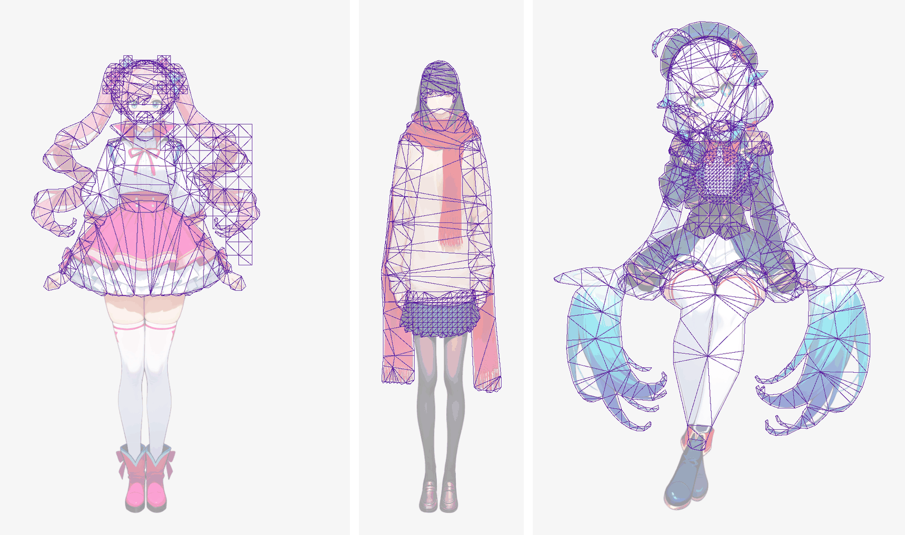
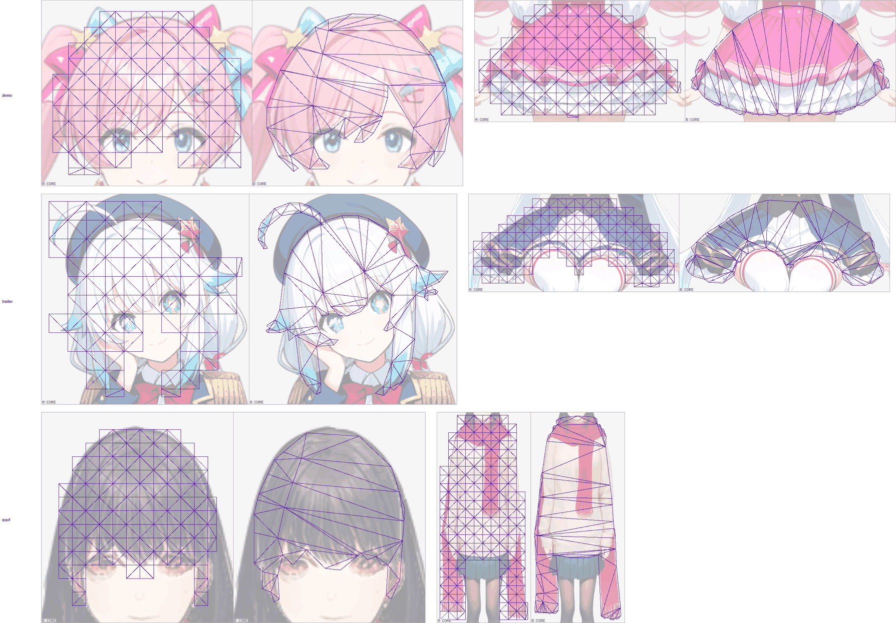

# The drafted outline mesh on the whole figure (issue #265, Stage B)

> Measured on rig-c 2.40.0 (`bun.lock` at the merge of PR #274). rig-c 2.45.2 fixed `rigc render`'s physics clock (core#1380), so figures read through `rigc render` move under it: on demo `tools/tear_survey.ts` reads 2.428 → 2.426 and 1.823 → 1.844 (rig-c 2.40.0 against 2.47.0), a move in the second and third decimal that flips no verdict there; no verdict on this page sits within 0.021 of its line, the larger of the two moves. This page is a record and is not re-run (#311).

Generated by `tools/density_survey.ts --page-draft` over `--run … --draft` documents; every figure is the tool's. The draft is `tools/contourdraft.ts` (`draftContourMesh`) applied to every `grid` mesh of each example's config on arm 0's own part images: a contour outline at T = max(1, round(H / 554)) with margin T, interior from `ribs` only, dust dropped by a drafted `stray`, ribs lowered or dropped where the rig stage refuses them, and a part with real pieces or any other refusal kept on `grid`. Overdraw is the mesh's setup-pose area over its art (alpha above 8); displacement is the largest posed distance against arm 0 over the idle.

The pictures (rig-c 2.43.0's `rigc inspect --show art,mesh --dim`, installed beside this tree for the pictures only; the drafted builds were rebuilt on macOS with the same triangle totals), read before the tables:

- `density-draft-figure.png` — demo, scarf and the trailer, each drafted figure whole (`--max 1200`).
- `density-draft-fringe-skirt.png` — per example, the fringe (`hair_front`) and the skirt (`bottomwear`; scarf: `topwear`, which carries its robe chains), arm 0 (A) beside the draft (B): `--compare <draft build> --overlay-slot <part> --zoom slot:<part>:10 --max 560`.





## demo

T = 2.

| arm | build | Σ triangles | vs arm 0 | overdraw, figure | BREATH_VISIBLE | BLINK_NO_HOLE | CHAIN_LAG | TIP_OVER_ROOT | STILL_REGIONS_DARK | TEXTURE_STRETCH | seam mean / px>40 | largest displacement vs arm 0 (rig px) |
| --- | --- | ---: | ---: | ---: | --- | --- | --- | --- | --- | --- | --- | --- |
| 0 | PASS | 1816 | 100.0 % | 1.726 | PASS | PASS | PASS | PASS min 2.395 | PASS | PASS 1.169 | 0.147 / 0 | — |
| draft (T 2) | PASS | 715 | 39.4 % | 1.323 | PASS | PASS | PASS | PASS min 2.128 | PASS | PASS 1.123 | 0.149 / 0 | 2.242 (bottomwear, frame 10) |

| part | drafted | ribs: N of M chains, S stations | triangles arm 0 → draft | overdraw arm 0 → draft | displacement vs arm 0 | TEXTURE_STRETCH arm 0 → draft |
| --- | --- | --- | ---: | ---: | ---: | ---: |
| hair_back | contour | 2 of 2, 0 | 226 → 163 | 1.952 → 1.143 | 0.684 | 1.062 → 1.071 |
| hair_front | contour | 1 of 3, 1 | 204 → 59 | 1.422 → 1.103 | 0.872 | 1.097 → 1.123 |
| hairpin | grid | — | 190 → 190 | 1.817 → 1.817 | 0.000 | 1.008 → 1.008 |
| earring | grid | — | 102 → 102 | 77.318 → 77.318 | 0.000 | 1.008 → 1.008 |
| neck | contour | 0 of 0, — | 244 → 7 | 1.123 → 1.137 | 0.270 | 1.016 → 1.016 |
| handwear_r | contour | 1 of 1, 1 | 156 → 53 | 1.538 → 1.071 | 0.141 | 1.026 → 1.016 |
| handwear_l | contour | 1 of 1, 1 | 154 → 52 | 1.527 → 1.068 | 0.119 | 1.025 → 1.017 |
| topwear | contour | 0 of 0, — | 248 → 28 | 1.250 → 1.043 | 2.177 | 1.095 → 1.018 |
| bottomwear | contour | 0 of 3, — | 292 → 61 | 1.164 → 1.026 | 2.242 | 1.169 → 1.015 |

The draft's note per part, as written:

- hair_back: contour at tolerance 2, margin 2, interior from ribs only (spacing 4096); stray 2 drops 3 dust island(s) of 2, 1, 1 px; ribs on 2 of 2 chain(s): hairback_r stations 0, hairback_l stations 0; stations lowered on the stage's refusals, in order: hairback_r 1 -> 0 (CONTOUR_RIB_ART at rib hairback_r link 1 station 1); hairback_l 1 -> 0 (CONTOUR_RIB_ART at rib hairback_l link 1 station 1); bone segment(s) head get no row (ribs take chains only)
- hair_front: contour at tolerance 2, margin 2, interior from ribs only (spacing 4096); ribs on 1 of 3 chain(s): bang_r stations 1, bang_c none, bang_l none; stations lowered on the stage's refusals, in order: bang_c 1 -> 0 (CONTOUR_RIB_CROSSING: rib bang_c link 0 station 0 meets rib bang_r link 0 station 0); bang_l 1 -> 0 (CONTOUR_RIB_CROSSING: rib bang_l link 0 station 0 meets rib bang_r link 0 station 0); bang_c 0 -> none (CONTOUR_RIB_CROSSING: rib bang_c link 0 station 0 meets rib bang_r link 0 station 0); bang_l 0 -> none (CONTOUR_RIB_CROSSING: rib bang_l link 0 station 0 meets rib bang_r link 0 station 0); bone segment(s) head get no row (ribs take chains only)
- hairpin: stays grid — its art is 3 islands (2995, 2769, 490 px); 2 beside the largest are real pieces, not dust (dust: at most 4 px and at most 0.1 % of the part's 6254 art px), and the contour mode meshes one island
- earring: stays grid — its art is 5 islands (406, 342, 8, 2, 1 px); 4 beside the largest are real pieces, not dust (dust: at most 4 px and at most 0.1 % of the part's 759 art px), and the contour mode meshes one island
- neck: contour at tolerance 2, margin 2, interior from ribs only (spacing 4096); no chain, so no ribs; bone segment(s) chest, head get no row (ribs take chains only)
- handwear_r: contour at tolerance 2, margin 2, interior from ribs only (spacing 4096); ribs on 1 of 1 chain(s): sleeve_r stations 1; bone segment(s) chest get no row (ribs take chains only)
- handwear_l: contour at tolerance 2, margin 2, interior from ribs only (spacing 4096); ribs on 1 of 1 chain(s): sleeve_l stations 1; bone segment(s) chest get no row (ribs take chains only)
- topwear: contour at tolerance 2, margin 2, interior from ribs only (spacing 4096); no chain, so no ribs; bone segment(s) chest, hip get no row (ribs take chains only)
- bottomwear: contour at tolerance 2, margin 2, interior from ribs only (spacing 4096); stray 2 drops 1 dust island(s) of 2 px; ribs on 0 of 3 chain(s): skirt_r none, skirt_c none, skirt_l none; stations lowered on the stage's refusals, in order: skirt_r 1 -> 0 (CONTOUR_RIB_CROSSING: rib skirt_r link 2 station 0 meets rib skirt_r link 0 station 0); skirt_c 1 -> 0 (CONTOUR_RIB_CROSSING: rib skirt_c link 0 station 0 meets rib skirt_r link 0 station 0); skirt_l 1 -> 0 (CONTOUR_RIB_CROSSING: rib skirt_l link 0 station 0 meets rib skirt_r link 0 station 0); skirt_r 0 -> none (CONTOUR_RIB_CROSSING: rib skirt_r link 2 station 0 meets rib skirt_r link 0 station 0); skirt_c 0 -> none (CONTOUR_RIB_CROSSING: rib skirt_c link 0 station 0 meets rib skirt_r link 0 station 0); skirt_l 0 -> none (CONTOUR_RIB_CROSSING: rib skirt_l link 0 station 0 meets rib skirt_r link 0 station 0); bone segment(s) chest, hip get no row (ribs take chains only)

Every arm's `check` lines, as the build printed them:

<details><summary>arm 0</summary>

```
loop: idle 41 frame(s) at 12 fps, f0000 vs f0040 (t = 3.333333333333333s): max |d| 0 (0 required)
seam: setup pose at 654x1216, scale 0.9438: mean |d| 0.147 (<= 1.0), 0 px over 40, 0.00 rig px (the count / s²; <= 50), 0 px over 80 (reported)
BREATH_VISIBLE: PASS — torso_parts topwear; torso_heat_mean 29.905; torso_floor 3.809; feet_parts shoes; feet_heat_max 0; feet_ceiling 0
BLINK_NO_HOLE: PASS — eye_parts eyewhite_r | eyewhite_l; closed group eyes scaley 0.12 from 2.37s to 2.454s; idle_frames_closed 29; box_px 2024; hole_px 0; hole_bar 0; patch_max 11; patch_px_over_40 0
CHAIN_LAG: PASS — chains neck > head_ctl: period 3.333s, phase 0.080 0.120, amp 0.350 0.900 | hairback_r0_ctl > hairback_r1_ctl > hairback_r2_ctl: period 3.333s, phase 0.200 0.280 0.360, amp 0.600 1.400 2.400 | hairback_l0_ctl > hairback_l1_ctl > hairback_l2_ctl: period 3.333s, phase 0.700 0.780 0.860, amp 0.600 1.400 2.400 | bang_r0_ctl > bang_r1_ctl: period 3.333s, phase 0.180 0.280, amp 1.000 2
TIP_OVER_ROOT: PASS — instrument geometry; parts part handwear_l, root_rig_px 1.703, tip_rig_px 7.249, ratio 4.256 | part handwear_r, root_rig_px 1.691, tip_rig_px 7.155, ratio 4.232 | part bottomwear, root_rig_px 0.397, tip_rig_px 0.952, ratio 2.395; ratio_floor 1.4725
STILL_REGIONS_DARK: PASS — face parts face, head_bone head, instrument geometry, still_slots slot face, max_rig_px 4.205e-13, rms_rig_px 1.139e-13, max_rig_px 4.205e-13, at null, rms_rig_px 1.139e-13, tolerance_rig_px 2.286e-11, crossing slot hair_front, depth_rig_px 2.763, area_rig_px2 104.888, frame 0, driven_slots none; feet parts shoes, instrument geometry, still_slots slot shoes, max_rig_px 0
TEXTURE_STRETCH: PASS — meshes 9; triangles 1816; frames 41; severity 1.169; severity_ceiling 1.926544; worst slot bottomwear, triangle 6, vertices 3 | 63 | 4, edge 63 | 4, frame 10, ratio 1.169; max_ratio 1.169; min_ratio 0.912; per_mesh slot hair_back, triangles 226, max_ratio 1.062, max_at triangle 185 (vertices 139 56 55), edge 56-55, idle frame 7, min_ratio 0.947, min_at triangle 215 (vertice
RECOMPOSITE_HOLES: REPORTED — error_px 14570; uncovered_error_px 2939; hole_count 1020; largest px 48, box 204,519 27x25, borders bottomwear 69 px
check: PASS; 9 of 9 bar(s) measured, 0 skipped
```

</details>

<details><summary>arm draft (T 2)</summary>

```
loop: idle 41 frame(s) at 12 fps, f0000 vs f0040 (t = 3.333333333333333s): max |d| 0 (0 required)
seam: setup pose at 650x1216, scale 0.9438: mean |d| 0.149 (<= 1.0), 0 px over 40, 0.00 rig px (the count / s²; <= 50), 0 px over 80 (reported)
BREATH_VISIBLE: PASS — torso_parts topwear; torso_heat_mean 27.572; torso_floor 3.809; feet_parts shoes; feet_heat_max 0; feet_ceiling 0
BLINK_NO_HOLE: PASS — eye_parts eyewhite_r | eyewhite_l; closed group eyes scaley 0.12 from 2.37s to 2.454s; idle_frames_closed 29; box_px 2001; hole_px 0; hole_bar 0; patch_max 10; patch_px_over_40 0
CHAIN_LAG: PASS — chains neck > head_ctl: period 3.333s, phase 0.080 0.120, amp 0.350 0.900 | hairback_r0_ctl > hairback_r1_ctl > hairback_r2_ctl: period 3.333s, phase 0.200 0.280 0.360, amp 0.600 1.400 2.400 | hairback_l0_ctl > hairback_l1_ctl > hairback_l2_ctl: period 3.333s, phase 0.700 0.780 0.860, amp 0.600 1.400 2.400 | bang_r0_ctl > bang_r1_ctl: period 3.333s, phase 0.180 0.280, amp 1.000 2
TIP_OVER_ROOT: PASS — instrument geometry; parts part handwear_l, root_rig_px 1.733, tip_rig_px 7.295, ratio 4.209 | part handwear_r, root_rig_px 1.704, tip_rig_px 7.205, ratio 4.227 | part bottomwear, root_rig_px 0.447, tip_rig_px 0.95, ratio 2.128; ratio_floor 1.4725
STILL_REGIONS_DARK: PASS — face parts face, head_bone head, instrument geometry, still_slots slot face, max_rig_px 4.205e-13, rms_rig_px 1.139e-13, max_rig_px 4.205e-13, at null, rms_rig_px 1.139e-13, tolerance_rig_px 2.286e-11, crossing slot hair_front, depth_rig_px 2.721, area_rig_px2 110.498, frame 0, driven_slots none; feet parts shoes, instrument geometry, still_slots slot shoes, max_rig_px 0
TEXTURE_STRETCH: PASS — meshes 9; triangles 715; frames 41; severity 1.123; severity_ceiling 1.926544; worst slot hair_front, triangle 30, vertices 23 | 25 | 24, edge 24 | 23, frame 20, ratio 0.89; max_ratio 1.118; min_ratio 0.89; per_mesh slot hair_back, triangles 163, max_ratio 1.068, max_at triangle 129 (vertices 103 119 111), edge 119-111, idle frame 24, min_ratio 0.934, min_at triangle 129 (v
RECOMPOSITE_HOLES: REPORTED — error_px 14570; uncovered_error_px 2939; hole_count 1020; largest px 48, box 204,519 27x25, borders bottomwear 69 px
check: PASS; 9 of 9 bar(s) measured, 0 skipped
```

</details>

## scarf

T = 2.

| arm | build | Σ triangles | vs arm 0 | overdraw, figure | BREATH_VISIBLE | BLINK_NO_HOLE | CHAIN_LAG | TIP_OVER_ROOT | STILL_REGIONS_DARK | TEXTURE_STRETCH | seam mean / px>40 | largest displacement vs arm 0 (rig px) |
| --- | --- | ---: | ---: | ---: | --- | --- | --- | --- | --- | --- | --- | --- |
| 0 | PASS | 2633 | 100.0 % | 1.207 | PASS | PASS | PASS | PASS min 1.534 | PASS | PASS 1.098 | 0.206 / 2 | — |
| draft (T 2) | PASS | 539 | 20.5 % | 1.047 | PASS | PASS | PASS | PASS min 1.534 | PASS | PASS 1.109 | 0.208 / 2 | 2.890 (topwear, frame 10) |

| part | drafted | ribs: N of M chains, S stations | triangles arm 0 → draft | overdraw arm 0 → draft | displacement vs arm 0 | TEXTURE_STRETCH arm 0 → draft |
| --- | --- | --- | ---: | ---: | ---: | ---: |
| hair_back | contour | 0 of 0, — | 264 → 23 | 1.223 → 1.063 | 0.249 | 1.027 → 1.016 |
| hair_front | contour | 1 of 3, 1 | 226 → 41 | 1.331 → 1.127 | 0.573 | 1.098 → 1.086 |
| handwear_r | contour | 1 of 1, 1 | 642 → 46 | 1.214 → 1.080 | 0.217 | 1.021 → 1.016 |
| handwear_l | contour | 1 of 1, 1 | 822 → 50 | 1.188 → 1.079 | 0.215 | 1.023 → 1.017 |
| topwear | contour | 1 of 2, 1 | 392 → 92 | 1.227 → 1.034 | 2.890 | 1.061 → 1.109 |

The draft's note per part, as written:

- hair_back: contour at tolerance 2, margin 2, interior from ribs only (spacing 4096); no chain, so no ribs; bone segment(s) head, bun get no row (ribs take chains only)
- hair_front: contour at tolerance 2, margin 2, interior from ribs only (spacing 4096); ribs on 1 of 3 chain(s): bang_r stations 1, bang_c none, bang_l none; stations lowered on the stage's refusals, in order: bang_c 1 -> 0 (CONTOUR_RIB_CROSSING: rib bang_c link 0 station 0 meets rib bang_r link 0 station 0); bang_l 1 -> 0 (CONTOUR_RIB_CROSSING: rib bang_l link 0 station 0 meets rib bang_r link 0 station 0); bang_c 0 -> none (CONTOUR_RIB_CROSSING: rib bang_c link 0 station 0 meets rib bang_r link 0 station 0); bang_l 0 -> none (CONTOUR_RIB_CROSSING: rib bang_l link 0 station 0 meets rib bang_r link 0 station 0); bone segment(s) head get no row (ribs take chains only)
- handwear_r: contour at tolerance 2, margin 2, interior from ribs only (spacing 4096); ribs on 1 of 1 chain(s): sleeve_r stations 1; bone segment(s) chest get no row (ribs take chains only)
- handwear_l: contour at tolerance 2, margin 2, interior from ribs only (spacing 4096); ribs on 1 of 1 chain(s): sleeve_l stations 1; bone segment(s) chest get no row (ribs take chains only)
- topwear: contour at tolerance 2, margin 2, interior from ribs only (spacing 4096); ribs on 1 of 2 chain(s): robe_r stations 1, robe_l none; stations lowered on the stage's refusals, in order: robe_l 1 -> 0 (CONTOUR_RIB_CROSSING: rib robe_l link 0 station 0 meets rib robe_r link 0 station 0); robe_l 0 -> none (CONTOUR_RIB_CROSSING: rib robe_l link 0 station 0 meets rib robe_r link 0 station 0); bone segment(s) chest, hip get no row (ribs take chains only)

Every arm's `check` lines, as the build printed them:

<details><summary>arm 0</summary>

```
loop: idle 41 frame(s) at 12 fps, f0000 vs f0040 (t = 3.333333333333333s): max |d| 0 (0 required)
seam: setup pose at 392x1216, scale 1.0107: mean |d| 0.206 (<= 1.0), 2 px over 40, 1.96 rig px (the count / s²; <= 50), 0 px over 80 (reported)
BREATH_VISIBLE: PASS — torso_parts topwear; torso_heat_mean 16.263; torso_floor 3.809; feet_parts shoes; feet_heat_max 0; feet_ceiling 0
BLINK_NO_HOLE: PASS — eye_parts eyewhite_r | eyewhite_l; closed group eyes scaley 0.12 from 2.37s to 2.454s; idle_frames_closed 29; box_px 1088; hole_px 0; hole_bar 0; patch_max 9; patch_px_over_40 0
CHAIN_LAG: PASS — chains neck > head_ctl: period 3.333s, phase 0.080 0.120, amp 0.350 0.900 | bang_r0_ctl > bang_r1_ctl: period 3.333s, phase 0.180 0.280, amp 1.000 2.200 | bang_c0_ctl > bang_c1_ctl: period 3.333s, phase 0.180 0.280, amp 0.800 1.760 | bang_l0_ctl > bang_l1_ctl: period 3.333s, phase 0.180 0.280, amp 1.000 2.200 | sleeve_r0_ctl > sleeve_r1_ctl > sleeve_r2_ctl: period 3.333s, phase 0
TIP_OVER_ROOT: PASS — instrument geometry; parts part handwear_r, root_rig_px 0.992, tip_rig_px 6.106, ratio 6.152 | part handwear_l, root_rig_px 1.131, tip_rig_px 5.678, ratio 5.022 | part bottomwear, root_rig_px 0.096, tip_rig_px 0.148, ratio 1.534; ratio_floor 1.4725
STILL_REGIONS_DARK: PASS — face parts face, head_bone head, instrument geometry, still_slots slot face, max_rig_px 4.427e-13, rms_rig_px 1.22e-13, max_rig_px 4.427e-13, at null, rms_rig_px 1.22e-13, tolerance_rig_px 2.286e-11, crossing slot hair_front, depth_rig_px 2.474, area_rig_px2 31.845, frame 0, driven_slots none; feet parts shoes, instrument geometry, still_slots slot shoes, max_rig_px 0, r
TEXTURE_STRETCH: PASS — meshes 6; triangles 2633; frames 41; severity 1.098; severity_ceiling 1.926544; worst slot hair_front, triangle 215, vertices 142 | 32 | 31, edge 32 | 31, frame 19, ratio 1.098; max_ratio 1.098; min_ratio 0.912; per_mesh slot hair_back, triangles 264, max_ratio 1.027, max_at triangle 167 (vertices 116 124 125), edge 124-125, idle frame 17, min_ratio 0.982, min_at triangle 1
RECOMPOSITE_HOLES: REPORTED — error_px 7834; uncovered_error_px 1365; hole_count 291; largest px 63, box 347,803 3x60, borders topwear 61 px
check: PASS; 9 of 9 bar(s) measured, 0 skipped
```

</details>

<details><summary>arm draft (T 2)</summary>

```
loop: idle 41 frame(s) at 12 fps, f0000 vs f0040 (t = 3.333333333333333s): max |d| 0 (0 required)
seam: setup pose at 387x1216, scale 1.0107: mean |d| 0.208 (<= 1.0), 2 px over 40, 1.96 rig px (the count / s²; <= 50), 0 px over 80 (reported)
BREATH_VISIBLE: PASS — torso_parts topwear; torso_heat_mean 16.373; torso_floor 3.809; feet_parts shoes; feet_heat_max 0; feet_ceiling 0
BLINK_NO_HOLE: PASS — eye_parts eyewhite_r | eyewhite_l; closed group eyes scaley 0.12 from 2.37s to 2.454s; idle_frames_closed 29; box_px 1088; hole_px 0; hole_bar 0; patch_max 7; patch_px_over_40 0
CHAIN_LAG: PASS — chains neck > head_ctl: period 3.333s, phase 0.080 0.120, amp 0.350 0.900 | bang_r0_ctl > bang_r1_ctl: period 3.333s, phase 0.180 0.280, amp 1.000 2.200 | bang_c0_ctl > bang_c1_ctl: period 3.333s, phase 0.180 0.280, amp 0.800 1.760 | bang_l0_ctl > bang_l1_ctl: period 3.333s, phase 0.180 0.280, amp 1.000 2.200 | sleeve_r0_ctl > sleeve_r1_ctl > sleeve_r2_ctl: period 3.333s, phase 0
TIP_OVER_ROOT: PASS — instrument geometry; parts part handwear_r, root_rig_px 1.019, tip_rig_px 6.134, ratio 6.017 | part handwear_l, root_rig_px 1.164, tip_rig_px 5.7, ratio 4.896 | part bottomwear, root_rig_px 0.096, tip_rig_px 0.148, ratio 1.534; ratio_floor 1.4725
STILL_REGIONS_DARK: PASS — face parts face, head_bone head, instrument geometry, still_slots slot face, max_rig_px 4.427e-13, rms_rig_px 1.22e-13, max_rig_px 4.427e-13, at null, rms_rig_px 1.22e-13, tolerance_rig_px 2.286e-11, crossing slot hair_front, depth_rig_px 2.457, area_rig_px2 30.331, frame 0, driven_slots none; feet parts shoes, instrument geometry, still_slots slot shoes, max_rig_px 0, r
TEXTURE_STRETCH: PASS — meshes 6; triangles 539; frames 41; severity 1.109; severity_ceiling 1.926544; worst slot topwear, triangle 53, vertices 39 | 41 | 40, edge 41 | 40, frame 31, ratio 0.902; max_ratio 1.101; min_ratio 0.902; per_mesh slot hair_back, triangles 23, max_ratio 1.016, max_at triangle 20 (vertices 17 19 18), edge 18-17, idle frame 16, min_ratio 0.991, min_at triangle 20 (vertices 1
RECOMPOSITE_HOLES: REPORTED — error_px 7834; uncovered_error_px 1365; hole_count 291; largest px 63, box 347,803 3x60, borders topwear 61 px
check: PASS; 9 of 9 bar(s) measured, 0 skipped
```

</details>

## trailer

T = 2.

| arm | build | Σ triangles | vs arm 0 | overdraw, figure | BREATH_VISIBLE | BLINK_NO_HOLE | CHAIN_LAG | TIP_OVER_ROOT | STILL_REGIONS_DARK | TEXTURE_STRETCH | seam mean / px>40 | largest displacement vs arm 0 (rig px) |
| --- | --- | ---: | ---: | ---: | --- | --- | --- | --- | --- | --- | --- | --- |
| 0 | PASS | 3081 | 100.0 % | 1.435 | PASS | PASS | PASS | PASS min 2.756 | PASS | PASS 1.226 | 0.154 / 0 | — |
| draft (T 2) | PASS | 1297 | 42.1 % | 1.080 | PASS | PASS | PASS | PASS min 2.744 | PASS | PASS 1.378 | 0.153 / 0 | 1.380 (hairpin, frame 24) |

| part | drafted | ribs: N of M chains, S stations | triangles arm 0 → draft | overdraw arm 0 → draft | displacement vs arm 0 | TEXTURE_STRETCH arm 0 → draft |
| --- | --- | --- | ---: | ---: | ---: | ---: |
| hair_back | contour | 0 of 0, — | 194 → 32 | 1.257 → 1.041 | 0.393 | 1.022 → 1.017 |
| hair_front | contour | 0 of 3, — | 148 → 88 | 1.842 → 1.118 | 0.770 | 1.092 → 1.085 |
| hairpin | contour | 0 of 1, — | 178 → 34 | 1.464 → 1.126 | 1.380 | 1.226 → 1.147 |
| neck | contour | 0 of 0, — | 282 → 8 | 1.219 → 1.160 | 0.165 | 1.016 → 1.016 |
| handwear_r | contour | 1 of 1, 1 | 294 → 44 | 1.326 → 1.076 | 0.117 | 1.016 → 1.014 |
| handwear_l | contour | 0 of 1, — | 236 → 34 | 1.392 → 1.079 | 0.122 | 1.019 → 1.014 |
| bottomwear | contour | 2 of 3, 0/1 | 344 → 78 | 1.271 → 1.048 | 0.881 | 1.097 → 1.027 |
| hair_long | contour | 2 of 2, 1 | 578 → 283 | 1.626 → 1.118 | 0.997 | 1.087 → 1.378 |
| legwear | contour | 1 of 1, 0 | 176 → 45 | 1.311 → 1.039 | 0.578 | 1.031 → 1.018 |

The draft's note per part, as written:

- hair_back: contour at tolerance 2, margin 2, interior from ribs only (spacing 4096); no chain, so no ribs; bone segment(s) head, bun get no row (ribs take chains only)
- hair_front: contour at tolerance 2, margin 2, interior from ribs only (spacing 4096); stray 2 drops 1 dust island(s) of 2 px; ribs on 0 of 3 chain(s): bang_r none, bang_c none, bang_l none; stations lowered on the stage's refusals, in order: bang_r 1 -> 0 (CONTOUR_RIB_ART at rib bang_r link 0 station 0); bang_c 1 -> 0 (CONTOUR_RIB_ART at rib bang_c link 0 station 0); bang_l 1 -> 0 (CONTOUR_RIB_ART at rib bang_l link 0 station 0); bang_r 0 -> none (CONTOUR_RIB_ART at rib bang_r link 0 station 0); bang_c 0 -> none (CONTOUR_RIB_ART at rib bang_c link 0 station 0); bang_l 0 -> none (CONTOUR_RIB_ART at rib bang_l link 0 station 0); bone segment(s) head get no row (ribs take chains only)
- hairpin: contour at tolerance 2, margin 2, interior from ribs only (spacing 4096); ribs on 0 of 1 chain(s): hairpin_tassel none; stations lowered on the stage's refusals, in order: hairpin_tassel 1 -> 0 (CONTOUR_RIB_ART at rib hairpin_tassel link 1 station 0); hairpin_tassel 0 -> none (CONTOUR_RIB_ART at rib hairpin_tassel link 1 station 0); bone segment(s) hairpin get no row (ribs take chains only)
- neck: contour at tolerance 2, margin 2, interior from ribs only (spacing 4096); no chain, so no ribs; bone segment(s) chest, head get no row (ribs take chains only)
- handwear_r: contour at tolerance 2, margin 2, interior from ribs only (spacing 4096); stray 2 drops 2 dust island(s) of 2, 1 px; ribs on 1 of 1 chain(s): sleeve_r stations 1
- handwear_l: contour at tolerance 2, margin 2, interior from ribs only (spacing 4096); stray 1 drops 1 dust island(s) of 1 px; ribs on 0 of 1 chain(s): sleeve_l none; stations lowered on the stage's refusals, in order: sleeve_l 1 -> 0 (CONTOUR_RIB_ART at rib sleeve_l link 0 station 0); sleeve_l 0 -> none (CONTOUR_RIB_ART at rib sleeve_l link 0 station 0); bone segment(s) chest get no row (ribs take chains only)
- bottomwear: contour at tolerance 2, margin 2, interior from ribs only (spacing 4096); stray 1 drops 8 dust island(s) of 1, 1, 1, 1, 1, 1, 1, 1 px; ribs on 2 of 3 chain(s): skirt_r stations 1, skirt_c none, skirt_l stations 0; stations lowered on the stage's refusals, in order: skirt_c 1 -> 0 (CONTOUR_RIB_ART at rib skirt_c link 1 station 1); skirt_c 0 -> none (CONTOUR_RIB_CROSSING: rib skirt_c link 0 station 0 meets rib skirt_r link 0 station 0); skirt_l 1 -> 0 (CONTOUR_RIB_CROSSING: rib skirt_l link 0 station 0 meets rib skirt_c link 0 station 0); bone segment(s) chest, hip get no row (ribs take chains only)
- hair_long: contour at tolerance 2, margin 2, interior from ribs only (spacing 4096); stray 2 drops 39 dust island(s) of 2, 2, 2, 2, 2, 2, 1, 1, 1, 1, 1, 1, 1, 1, 1, 1, 1, 1, 1, 1, 1, 1, 1, 1, 1, 1, 1, 1, 1, 1, 1, 1, 1, 1, 1, 1, 1, 1, 1 px; ribs on 2 of 2 chain(s): tail_r stations 1, tail_l stations 1; bone segment(s) head, chest get no row (ribs take chains only)
- legwear: contour at tolerance 2, margin 2, interior from ribs only (spacing 4096); ribs on 1 of 1 chain(s): leg stations 0; stations lowered on the stage's refusals, in order: leg 1 -> 0 (CONTOUR_RIB_ART at rib leg link 0 station 1); bone segment(s) hip get no row (ribs take chains only)

Every arm's `check` lines, as the build printed them:

<details><summary>arm 0</summary>

```
loop: idle 49 frame(s) at 12 fps, f0000 vs f0048 (t = 4s): max |d| 0 (0 required)
seam: setup pose at 847x1216, scale 1.0089: mean |d| 0.154 (<= 1.0), 0 px over 40, 0.00 rig px (the count / s²; <= 50), 0 px over 80 (reported)
BREATH_VISIBLE: PASS — declared_not_planted shoes; torso_parts topwear; torso_heat_mean 14.231; torso_floor 3.809; feet_parts none; feet_heat_max null; feet_ceiling 0
BLINK_NO_HOLE: PASS — eye_parts eyewhite_r | eyewhite_l; closed group eyes scaley 0.12 from 2.37s to 2.454s; idle_frames_closed 29; box_px 6120; hole_px 0; hole_bar 0; patch_max 28; patch_px_over_40 0
CHAIN_LAG: PASS — chains neck > head_ctl: period 4s, phase 0.080 0.120, amp 0.350 0.900 | bang_r0_ctl > bang_r1_ctl: period 4s, phase 0.180 0.280, amp 1.000 2.200 | bang_c0_ctl > bang_c1_ctl: period 4s, phase 0.180 0.280, amp 0.800 1.760 | bang_l0_ctl > bang_l1_ctl: period 4s, phase 0.180 0.280, amp 1.000 2.200 | hairpin_tassel0_ctl > hairpin_tassel1_ctl: period 2s, phase 0.200 0.320, amp 4.000 7.
TIP_OVER_ROOT: PASS — declared_rises handwear_r; instrument geometry; parts part handwear_l, root_rig_px 0.92, tip_rig_px 4.377, ratio 4.759 | part bottomwear, root_rig_px 0.25, tip_rig_px 1.097, ratio 4.39 | part handwear_r, tip_half upper, root_rig_px 1.275, tip_rig_px 3.514, ratio 2.756; ratio_floor 1.4725
STILL_REGIONS_DARK: PASS — face parts face, head_bone head, instrument geometry, still_slots slot face, max_rig_px 4.477e-13, rms_rig_px 1.315e-13, max_rig_px 4.477e-13, at null, rms_rig_px 1.315e-13, tolerance_rig_px 2.286e-11, crossing slot hair_front, depth_rig_px 4, area_rig_px2 206.563, frame 47, driven_slots none; feet declared_not_planted shoes, unmeasured every "footwear" part ("shoes") is
TEXTURE_STRETCH: PASS — meshes 10; triangles 3081; frames 49; severity 1.226; severity_ceiling 1.926544; worst slot hairpin, triangle 150, vertices 115 | 20 | 19, edge 20 | 19, frame 36, ratio 0.816; max_ratio 1.187; min_ratio 0.816; per_mesh slot hair_long, triangles 578, max_ratio 1.077, max_at triangle 449 (vertices 65 64 338), edge 65-64, idle frame 8, min_ratio 0.92, min_at triangle 449 (vert
RECOMPOSITE_HOLES: REPORTED — error_px 19523; uncovered_error_px 4396; hole_count 1213; largest px 402, box 334,960 16x55, borders shoes 47 px | legwear 32 px
check: PASS; 9 of 9 bar(s) measured, 0 skipped
```

</details>

<details><summary>arm draft (T 2)</summary>

```
loop: idle 49 frame(s) at 12 fps, f0000 vs f0048 (t = 4s): max |d| 0 (0 required)
seam: setup pose at 847x1216, scale 1.0107: mean |d| 0.153 (<= 1.0), 0 px over 40, 0.00 rig px (the count / s²; <= 50), 0 px over 80 (reported)
BREATH_VISIBLE: PASS — declared_not_planted shoes; torso_parts topwear; torso_heat_mean 14.193; torso_floor 3.809; feet_parts none; feet_heat_max null; feet_ceiling 0
BLINK_NO_HOLE: PASS — eye_parts eyewhite_r | eyewhite_l; closed group eyes scaley 0.12 from 2.37s to 2.454s; idle_frames_closed 29; box_px 6222; hole_px 0; hole_bar 0; patch_max 28; patch_px_over_40 0
CHAIN_LAG: PASS — chains neck > head_ctl: period 4s, phase 0.080 0.120, amp 0.350 0.900 | bang_r0_ctl > bang_r1_ctl: period 4s, phase 0.180 0.280, amp 1.000 2.200 | bang_c0_ctl > bang_c1_ctl: period 4s, phase 0.180 0.280, amp 0.800 1.760 | bang_l0_ctl > bang_l1_ctl: period 4s, phase 0.180 0.280, amp 1.000 2.200 | hairpin_tassel0_ctl > hairpin_tassel1_ctl: period 2s, phase 0.200 0.320, amp 4.000 7.
TIP_OVER_ROOT: PASS — declared_rises handwear_r; instrument geometry; parts part handwear_l, root_rig_px 0.944, tip_rig_px 4.395, ratio 4.657 | part bottomwear, root_rig_px 0.256, tip_rig_px 1.102, ratio 4.305 | part handwear_r, tip_half upper, root_rig_px 1.281, tip_rig_px 3.515, ratio 2.744; ratio_floor 1.4725
STILL_REGIONS_DARK: PASS — face parts face, head_bone head, instrument geometry, still_slots slot face, max_rig_px 4.477e-13, rms_rig_px 1.315e-13, max_rig_px 4.477e-13, at null, rms_rig_px 1.315e-13, tolerance_rig_px 2.286e-11, crossing slot hair_front, depth_rig_px 4.167, area_rig_px2 209.283, frame 47, driven_slots none; feet declared_not_planted shoes, unmeasured every "footwear" part ("shoes"
TEXTURE_STRETCH: PASS — meshes 10; triangles 1297; frames 49; severity 1.378; severity_ceiling 1.926544; worst slot hair_long, triangle 127, vertices 98 | 100 | 99, edge 99 | 98, frame 28, ratio 0.726; max_ratio 1.326; min_ratio 0.726; per_mesh slot hair_long, triangles 283, max_ratio 1.326, max_at triangle 127 (vertices 98 100 99), edge 99-98, idle frame 6, min_ratio 0.726, min_at triangle 127 (v
RECOMPOSITE_HOLES: REPORTED — error_px 19523; uncovered_error_px 4396; hole_count 1213; largest px 402, box 334,960 16x55, borders shoes 47 px | legwear 32 px
check: PASS; 9 of 9 bar(s) measured, 0 skipped
```

</details>
