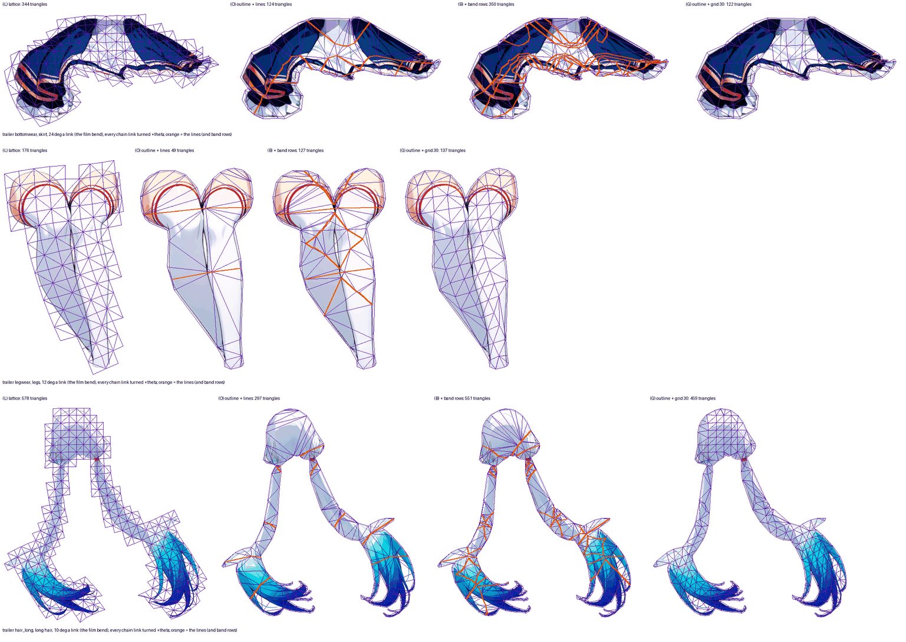

# Edges where the motion differs (issue #265, Stage D)

> Measured on rig-c 2.40.0 (`bun.lock` at the merge of PR #282). rig-c 2.45.2 fixed `rigc render`'s physics clock (core#1380), which moved render-read figures by up to 0.021 (`tools/tear_survey.ts` on demo: 2.428 → 2.426 and 1.823 → 1.844, rig-c 2.40.0 against 2.47.0); on this page arm (G)'s idle worst vs the lattice, read as Stage C's line, is 0.997 (`hair_long`) vs 1.0 = 0.003, under that 0.021, so its verdict is the verdict of that date only. The decision it fed, the traced outline around a coarse grid as the candidate, is held live per part by `rig-parts mesh-draft`'s gate on the installed rig-c at every run: `MD01` (a candidate that holds every reading is drafted), `MD02` (one that fails a reading keeps its lattice byte for byte) and `MD04` (each reading past its line fails, exactly at it passes with margin 0). This page is a record and is not re-run (#311).

Generated by `tools/edge_survey.ts --page`; every figure is the tool's. The arms are in its header: (L) the lattice; (O) Stage B's traced outline plus the boundaries of the part's dominant-bone map (cells of 2 px, simplified at T), triangulated with those lines as constrained edges by this tool (`contourMesh` takes no interior constrained edge — #160 Stage B's gap); (B) (O) plus both edges of every falloff band (second weight at least 0.25); (G) the traced outline with the contour mode's own interior grid at round(H / 37). Every arm is read at the idle and at the bend set of `tools/bend_survey.ts` (15° a link; the trailer also at the film's bends), against the dense reference (the art sampled and skinned by the part's own rule at each sample). Columns over the lattice's parts: triangles, every `check` bar, figure overdraw, the idle's worst displacement against the lattice (Stage C's line), and against the dense reference the worst displacement and inverted triangles at the idle and at each bend set.

## demo

T = 2; (G)'s spacing 32.

| arm | build | Σ triangles | vs lattice | BREATH_VISIBLE | BLINK_NO_HOLE | CHAIN_LAG | TIP_OVER_ROOT | STILL_REGIONS_DARK | TEXTURE_STRETCH | seam | overdraw | idle worst vs lattice | idle vs dense: worst / inverted | bend fallback: worst / inverted (worst part) |
| --- | --- | ---: | ---: | --- | --- | --- | --- | --- | --- | --- | ---: | --- | --- | --- |
| L | PASS | 1816 | 100.0 % | PASS | PASS | PASS | PASS min 2.428 | PASS | PASS 1.097 | 0.147 / 0 | 1.726 | — | 1.26 / 0 | 16.41 / 1 (bottomwear) |
| O | PASS | 883 | 48.6 % | PASS | PASS | PASS | PASS min 2.269 | PASS | PASS 1.123 | 0.149 / 0 | 1.323 | 2.177 (topwear) | 2.61 / 0 | 18.90 / 6 (bottomwear) |
| B | PASS | 1699 | 93.6 % | PASS | PASS | PASS | PASS min 2.364 | PASS | PASS 1.219 | 0.149 / 0 | 1.323 | 1.438 (topwear) | 1.44 / 0 | 23.13 / 43 (bottomwear) |
| G | PASS | 921 | 50.7 % | PASS | PASS | PASS | PASS min 2.233 | PASS | PASS 1.123 | 0.149 / 0 | 1.323 | 0.872 (hair_front) | 1.50 / 0 | 17.65 / 1 (bottomwear) |

Per lattice part: triangles, and against the dense reference the worst displacement / inverted triangles at the idle and at each bend set — L / O / B / G.

| part | triangles | idle | bend fallback |
| --- | --- | --- | --- |
| hair_back | 226 / 203 / 375 / 209 | 0.71, 0 / 0.89, 0 / 0.89, 0 / 0.66, 0 | 6.17, 0 / 7.53, 2 / 7.25, 4 / 5.32, 0 |
| hair_front | 204 / 79 / 185 / 53 | 0.67, 0 / 0.54, 0 / 0.49, 0 / 0.67, 0 | 8.84, 1 / 5.95, 1 / 5.75, 3 / 6.34, 1 |
| hairpin | 190 / 190 / 190 / 190 | 0.00, 0 / 0.00, 0 / 0.00, 0 / 0.00, 0 | — / — / — / — |
| earring | 102 / 102 / 102 / 102 | 0.00, 0 / 0.00, 0 / 0.00, 0 / 0.00, 0 | — / — / — / — |
| neck | 244 / 11 / 25 / 7 | 0.03, 0 / 0.14, 0 / 0.06, 0 / 0.27, 0 | — / — / — / — |
| handwear_r | 156 / 47 / 107 / 49 | 0.13, 0 / 0.28, 0 / 0.24, 0 / 0.37, 0 | 2.07, 0 / 6.37, 1 / 4.49, 3 / 4.27, 0 |
| handwear_l | 154 / 46 / 104 / 44 | 0.12, 0 / 0.30, 0 / 0.23, 0 / 0.31, 0 | 2.23, 0 / 5.86, 1 / 4.26, 5 / 4.20, 0 |
| topwear | 248 / 32 / 112 / 78 | 1.26, 0 / 2.61, 0 / 1.44, 0 / 1.50, 0 | — / — / — / — |
| bottomwear | 292 / 173 / 499 / 189 | 0.42, 0 / 0.50, 0 / 0.70, 0 / 0.48, 0 | 16.41, 0 / 18.90, 1 / 23.13, 28 / 17.65, 0 |

Arm O, per part: hair_back outline + lines (6 line(s), 26 line edge(s), 173 vertices (141 on the outline)); hair_front outline + lines (13 line(s), 15 line edge(s), 63 vertices (45 on the outline)); hairpin grid (hairpin: stays grid — its art is 3 islands (2995, 2769, 490 px); 2 beside the largest are real pieces, not dust (dust: at most 4 px and at most 0.1 % of the part's 6254 art px), and the contour mode meshes one island); earring grid (earring: stays grid — its art is 5 islands (406, 342, 8, 2, 1 px); 4 beside the largest are real pieces, not dust (dust: at most 4 px and at most 0.1 % of the part's 759 art px), and the contour mode meshes one island); neck outline + lines (1 line(s), 1 line edge(s), 11 vertices (9 on the outline)); handwear_r outline + lines (3 line(s), 6 line edge(s), 40 vertices (31 on the outline)); handwear_l outline + lines (3 line(s), 6 line edge(s), 39 vertices (30 on the outline)); topwear outline + lines (1 line(s), 1 line edge(s), 32 vertices (30 on the outline)); bottomwear outline + lines (19 line(s), 57 line edge(s), 119 vertices (63 on the outline)).

Arm B, per part: hair_back outline + lines + band rows (19 line(s), 99 line edge(s), 259 vertices (141 on the outline)); hair_front outline + lines + band rows (33 line(s), 64 line edge(s), 116 vertices (45 on the outline)); hairpin grid (hairpin: stays grid — its art is 3 islands (2995, 2769, 490 px); 2 beside the largest are real pieces, not dust (dust: at most 4 px and at most 0.1 % of the part's 6254 art px), and the contour mode meshes one island); earring grid (earring: stays grid — its art is 5 islands (406, 342, 8, 2, 1 px); 4 beside the largest are real pieces, not dust (dust: at most 4 px and at most 0.1 % of the part's 759 art px), and the contour mode meshes one island); neck outline + lines + band rows (3 line(s), 6 line edge(s), 18 vertices (9 on the outline)); handwear_r outline + lines + band rows (9 line(s), 30 line edge(s), 70 vertices (31 on the outline)); handwear_l outline + lines + band rows (9 line(s), 29 line edge(s), 68 vertices (30 on the outline)); topwear outline + lines + band rows (4 line(s), 38 line edge(s), 72 vertices (30 on the outline)); bottomwear outline + lines + band rows (70 line(s), 228 line edge(s), 282 vertices (63 on the outline)).

Arm G, per part: hair_back contour, spacing 32 (stray 2); hair_front contour, spacing 32; hairpin grid (hairpin: stays grid — its art is 3 islands (2995, 2769, 490 px); 2 beside the largest are real pieces, not dust (dust: at most 4 px and at most 0.1 % of the part's 6254 art px), and the contour mode meshes one island); earring grid (earring: stays grid — its art is 5 islands (406, 342, 8, 2, 1 px); 4 beside the largest are real pieces, not dust (dust: at most 4 px and at most 0.1 % of the part's 759 art px), and the contour mode meshes one island); neck contour, spacing 32; handwear_r contour, spacing 32; handwear_l contour, spacing 32; topwear contour, spacing 32; bottomwear contour, spacing 32 (stray 2).

## scarf

T = 2; (G)'s spacing 30.

| arm | build | Σ triangles | vs lattice | BREATH_VISIBLE | BLINK_NO_HOLE | CHAIN_LAG | TIP_OVER_ROOT | STILL_REGIONS_DARK | TEXTURE_STRETCH | seam | overdraw | idle worst vs lattice | idle vs dense: worst / inverted | bend fallback: worst / inverted (worst part) |
| --- | --- | ---: | ---: | --- | --- | --- | --- | --- | --- | --- | ---: | --- | --- | --- |
| L | PASS | 2654 | 100.0 % | PASS | PASS | PASS | PASS min 1.925 | PASS | PASS 1.337 | 0.206 / 2 | 1.221 | — | 2.41 / 0 | 10.60 / 36 (topwear) |
| O | exit 1 | 380 | 14.3 % | PASS | PASS | PASS | FAIL min 1.287 | PASS | PASS 1.128 | 0.208 / 2 | 1.049 | 7.086 (topwear) | 7.16 / 0 | 38.65 / 33 (topwear) |
| B | exit 1 | 1252 | 47.2 % | PASS | PASS | PASS | FAIL min 1.305 | PASS | PASS 1.589 | 0.208 / 2 | 1.049 | 3.629 (topwear) | 5.11 / 0 | 36.40 / 129 (topwear) |
| G | exit 1 | 532 | 20.0 % | PASS | PASS | PASS | FAIL min 1.067 | PASS | PASS 1.251 | 0.208 / 2 | 1.049 | 4.550 (topwear) | 5.86 / 0 | 20.19 / 17 (topwear) |

Per lattice part: triangles, and against the dense reference the worst displacement / inverted triangles at the idle and at each bend set — L / O / B / G.

| part | triangles | idle | bend fallback |
| --- | --- | --- | --- |
| hair_back | 264 / 27 / 59 / 47 | 0.09, 0 / 0.31, 0 / 0.25, 0 / 0.26, 0 | — / — / — / — |
| hair_front | 226 / 55 / 177 / 29 | 0.56, 0 / 0.66, 0 / 0.27, 0 / 0.70, 0 | 7.69, 1 / 8.93, 1 / 3.44, 11 / 9.86, 1 |
| handwear_r | 642 / 40 / 108 / 42 | 0.07, 0 / 0.26, 0 / 0.26, 0 / 0.26, 0 | 1.09, 0 / 5.19, 3 / 5.27, 4 / 6.33, 0 |
| handwear_l | 822 / 42 / 122 / 54 | 0.06, 0 / 0.30, 0 / 0.27, 0 / 0.15, 0 | 1.39, 0 / 5.12, 0 / 4.97, 2 / 2.60, 0 |
| topwear | 392 / 118 / 470 / 300 | 2.41, 0 / 7.16, 0 / 5.11, 0 / 5.86, 0 | 10.60, 35 / 38.65, 25 / 36.40, 94 / 20.19, 15 |
| bottomwear | 308 / 98 / 316 / 60 | 0.16, 0 / 0.21, 0 / 0.17, 0 / 0.26, 0 | 7.02, 0 / 8.99, 4 / 7.47, 18 / 10.41, 1 |

Arm O, per part: hair_back outline + lines (1 line(s), 1 line edge(s), 27 vertices (25 on the outline)); hair_front outline + lines (11 line(s), 14 line edge(s), 42 vertices (27 on the outline)); handwear_r outline + lines (3 line(s), 6 line edge(s), 33 vertices (24 on the outline)); handwear_l outline + lines (3 line(s), 5 line edge(s), 36 vertices (28 on the outline)); topwear outline + lines (16 line(s), 25 line edge(s), 91 vertices (62 on the outline)); bottomwear outline + lines (22 line(s), 38 line edge(s), 66 vertices (32 on the outline)).
- `[check]   TIP_OVER_ROOT: FAIL — instrument geometry; parts part handwear_r, root_rig_px 3.543, tip_rig_px 7.131, ratio 2.013 | part handwear_l, root_rig_px 3.507, tip_rig_px 6.753, ratio 1.925 | part bottomwear, root_rig_px 0.107, tip_rig_px 0.138, ratio 1.287; ratio_floor 1.4725`
- `[check]   FAIL  CHECK_TIP_OVER_ROOT: part "bottomwear", box 317,642 195x116 rig px, posed by the idle's geometry — the art in its lower half travels 0.138 rig px and in its upper half 0.107 rig px (ratio 1.287); a ratio >= 1.4725 is required — the chain's amplitudes do not grow toward the tip, or the mesh is not weighted to the chain`
- `TIP_OVER_ROOT: FAIL — instrument geometry; parts part handwear_r, root_rig_px 3.543, tip_rig_px 7.131, ratio 2.013 | part handwear_l, root_rig_px 3.507, tip_rig_px 6.753, ratio 1.925 | part bottomwear, root_rig_px 0.107, tip_rig_px 0.138, ratio 1.287; ratio_floor 1.4725`
- `check: FAIL — 1 bar(s) not met; 9 of 9 bar(s) measured, 0 skipped`

Arm B, per part: hair_back outline + lines + band rows (3 line(s), 15 line edge(s), 43 vertices (25 on the outline)); hair_front outline + lines + band rows (56 line(s), 83 line edge(s), 103 vertices (27 on the outline)); handwear_r outline + lines + band rows (9 line(s), 34 line edge(s), 67 vertices (24 on the outline)); handwear_l outline + lines + band rows (9 line(s), 39 line edge(s), 76 vertices (28 on the outline)); topwear outline + lines + band rows (35 line(s), 192 line edge(s), 267 vertices (62 on the outline)); bottomwear outline + lines + band rows (61 line(s), 157 line edge(s), 175 vertices (32 on the outline)).
- `[check]   TIP_OVER_ROOT: FAIL — instrument geometry; parts part handwear_r, root_rig_px 3.558, tip_rig_px 7.105, ratio 1.997 | part handwear_l, root_rig_px 3.49, tip_rig_px 6.72, ratio 1.926 | part bottomwear, root_rig_px 0.104, tip_rig_px 0.135, ratio 1.305; ratio_floor 1.4725`
- `[check]   FAIL  CHECK_TIP_OVER_ROOT: part "bottomwear", box 317,642 195x116 rig px, posed by the idle's geometry — the art in its lower half travels 0.135 rig px and in its upper half 0.104 rig px (ratio 1.305); a ratio >= 1.4725 is required — the chain's amplitudes do not grow toward the tip, or the mesh is not weighted to the chain`
- `TIP_OVER_ROOT: FAIL — instrument geometry; parts part handwear_r, root_rig_px 3.558, tip_rig_px 7.105, ratio 1.997 | part handwear_l, root_rig_px 3.49, tip_rig_px 6.72, ratio 1.926 | part bottomwear, root_rig_px 0.104, tip_rig_px 0.135, ratio 1.305; ratio_floor 1.4725`
- `check: FAIL — 1 bar(s) not met; 9 of 9 bar(s) measured, 0 skipped`

Arm G, per part: hair_back contour, spacing 30; hair_front contour, spacing 30; handwear_r contour, spacing 30; handwear_l contour, spacing 30; topwear contour, spacing 30; bottomwear contour, spacing 30.
- `[check]   TIP_OVER_ROOT: FAIL — instrument geometry; parts part handwear_r, root_rig_px 3.563, tip_rig_px 7.178, ratio 2.014 | part handwear_l, root_rig_px 3.502, tip_rig_px 6.766, ratio 1.932 | part bottomwear, root_rig_px 0.127, tip_rig_px 0.135, ratio 1.067; ratio_floor 1.4725`
- `[check]   FAIL  CHECK_TIP_OVER_ROOT: part "bottomwear", box 317,642 195x116 rig px, posed by the idle's geometry — the art in its lower half travels 0.135 rig px and in its upper half 0.127 rig px (ratio 1.067); a ratio >= 1.4725 is required — the chain's amplitudes do not grow toward the tip, or the mesh is not weighted to the chain`
- `TIP_OVER_ROOT: FAIL — instrument geometry; parts part handwear_r, root_rig_px 3.563, tip_rig_px 7.178, ratio 2.014 | part handwear_l, root_rig_px 3.502, tip_rig_px 6.766, ratio 1.932 | part bottomwear, root_rig_px 0.127, tip_rig_px 0.135, ratio 1.067; ratio_floor 1.4725`
- `check: FAIL — 1 bar(s) not met; 9 of 9 bar(s) measured, 0 skipped`

## trailer

T = 2; (G)'s spacing 30.

| arm | build | Σ triangles | vs lattice | BREATH_VISIBLE | BLINK_NO_HOLE | CHAIN_LAG | TIP_OVER_ROOT | STILL_REGIONS_DARK | TEXTURE_STRETCH | seam | overdraw | idle worst vs lattice | idle vs dense: worst / inverted | bend fallback: worst / inverted (worst part) | bend film: worst / inverted (worst part) |
| --- | --- | ---: | ---: | --- | --- | --- | --- | --- | --- | --- | ---: | --- | --- | --- | --- |
| L | PASS | 3081 | 100.0 % | PASS | PASS | PASS | PASS min 2.756 | PASS | PASS 1.226 | 0.154 / 0 | 1.435 | — | 1.26 / 0 | 17.38 / 6 (hair_long) | 11.75 / 7 (hair_long) |
| O | PASS | 1425 | 46.3 % | PASS | PASS | PASS | PASS min 2.747 | PASS | PASS 1.378 | 0.153 / 0 | 1.080 | 1.380 (hairpin) | 1.36 / 0 | 19.54 / 21 (hair_long) | 14.57 / 16 (bottomwear) |
| B | PASS | 2307 | 74.9 % | PASS | PASS | PASS | PASS min 2.745 | PASS | PASS 1.378 | 0.153 / 0 | 1.080 | 1.380 (hairpin) | 1.36 / 0 | 19.54 / 42 (hair_long) | 13.23 / 32 (hair_long) |
| G | PASS | 1729 | 56.1 % | PASS | PASS | PASS | PASS min 2.74 | PASS | PASS 1.378 | 0.153 / 0 | 1.080 | 0.997 (hair_long) | 1.26 / 0 | 19.54 / 13 (hair_long) | 13.23 / 11 (hair_long) |

Per lattice part: triangles, and against the dense reference the worst displacement / inverted triangles at the idle and at each bend set — L / O / B / G.

| part | triangles | idle | bend fallback | bend film |
| --- | --- | --- | --- | --- |
| hair_back | 194 / 36 / 90 / 98 | 0.19, 0 / 0.50, 0 / 0.24, 0 / 0.32, 0 | — / — / — / — | — / — / — / — |
| hair_front | 148 / 130 / 300 / 110 | 1.14, 0 / 1.10, 0 / 0.74, 0 / 1.26, 0 | 15.11, 2 / 14.13, 3 / 7.10, 10 / 16.82, 0 | 9.13, 0 / 8.53, 1 / 4.29, 4 / 10.15, 0 |
| hairpin | 178 / 46 / 80 / 42 | 1.26, 0 / 1.36, 0 / 1.36, 0 / 1.26, 0 | 4.04, 0 / 4.35, 1 / 4.35, 1 / 4.04, 0 | 4.04, 0 / 4.35, 1 / 4.35, 1 / 4.04, 0 |
| neck | 282 / 12 / 30 / 10 | 0.01, 0 / 0.10, 0 / 0.06, 0 / 0.16, 0 | — / — / — / — | — / — / — / — |
| handwear_r | 294 / 38 / 58 / 44 | 0.05, 0 / 0.20, 0 / 0.20, 0 / 0.08, 0 | 0.90, 0 / 3.26, 0 / 3.37, 0 / 1.30, 0 | 1.90, 0 / 6.88, 0 / 7.11, 0 / 2.75, 0 |
| handwear_l | 236 / 42 / 70 / 56 | 0.08, 0 / 0.14, 0 / 0.14, 0 / 0.08, 0 | 3.45, 0 / 5.27, 1 / 5.27, 2 / 3.81, 0 | 3.45, 0 / 5.27, 1 / 5.27, 2 / 3.81, 0 |
| bottomwear | 344 / 124 / 350 / 122 | 0.46, 0 / 1.08, 0 / 1.14, 0 / 0.82, 0 | 6.51, 0 / 9.01, 1 / 7.19, 6 / 8.35, 0 | 10.27, 5 / 14.57, 4 / 11.33, 12 / 13.14, 2 |
| hair_long | 578 / 297 / 551 / 459 | 1.12, 0 / 1.17, 0 / 1.17, 0 / 1.17, 0 | 17.38, 4 / 19.54, 15 / 19.54, 21 / 19.54, 13 | 11.75, 2 / 13.23, 9 / 13.23, 11 / 13.23, 9 |
| legwear | 176 / 49 / 127 / 137 | 0.26, 0 / 0.59, 0 / 1.06, 0 / 0.53, 0 | 2.55, 0 / 4.75, 0 / 9.34, 2 / 4.33, 0 | 2.04, 0 / 3.81, 0 / 7.50, 2 / 3.47, 0 |

Arm O, per part: hair_back outline + lines (1 line(s), 1 line edge(s), 36 vertices (34 on the outline)); hair_front outline + lines (13 line(s), 16 line edge(s), 111 vertices (90 on the outline)); hairpin outline + lines (2 line(s), 4 line edge(s), 42 vertices (36 on the outline)); neck outline + lines (1 line(s), 1 line edge(s), 12 vertices (10 on the outline)); handwear_r outline + lines (1 line(s), 4 line edge(s), 35 vertices (30 on the outline)); handwear_l outline + lines (2 line(s), 2 line edge(s), 40 vertices (36 on the outline)); bottomwear outline + lines (10 line(s), 31 line edge(s), 91 vertices (56 on the outline)); hair_long outline + lines (11 line(s), 30 line edge(s), 260 vertices (221 on the outline)); legwear outline + lines (2 line(s), 4 line edge(s), 45 vertices (39 on the outline)).

Arm B, per part: hair_back outline + lines + band rows (3 line(s), 26 line edge(s), 63 vertices (34 on the outline)); hair_front outline + lines + band rows (37 line(s), 87 line edge(s), 196 vertices (90 on the outline)); hairpin outline + lines + band rows (6 line(s), 17 line edge(s), 59 vertices (36 on the outline)); neck outline + lines + band rows (3 line(s), 8 line edge(s), 21 vertices (10 on the outline)); handwear_r outline + lines + band rows (3 line(s), 12 line edge(s), 45 vertices (30 on the outline)); handwear_l outline + lines + band rows (5 line(s), 13 line edge(s), 54 vertices (36 on the outline)); bottomwear outline + lines + band rows (27 line(s), 135 line edge(s), 204 vertices (56 on the outline)); hair_long outline + lines + band rows (30 line(s), 141 line edge(s), 387 vertices (221 on the outline)); legwear outline + lines + band rows (5 line(s), 41 line edge(s), 84 vertices (39 on the outline)).

Arm G, per part: hair_back contour, spacing 30; hair_front contour, spacing 30 (stray 2); hairpin contour, spacing 30; neck contour, spacing 30; handwear_r contour, spacing 30 (stray 2); handwear_l contour, spacing 30 (stray 1); bottomwear contour, spacing 30 (stray 1); hair_long contour, spacing 30 (stray 2); legwear contour, spacing 30.
