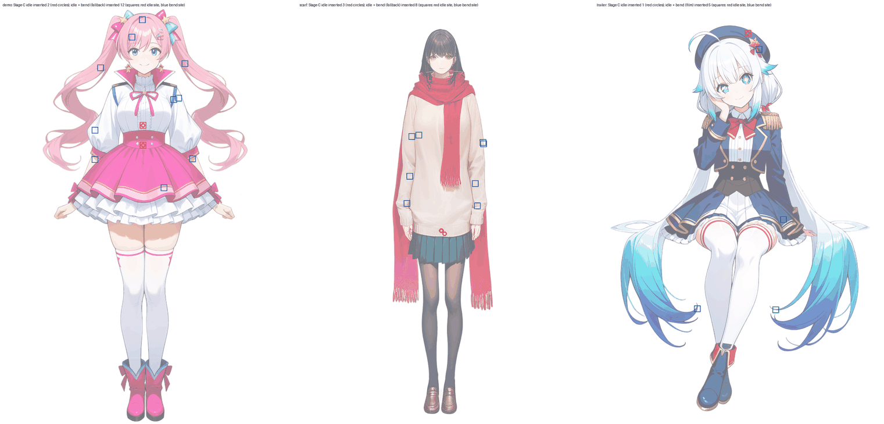
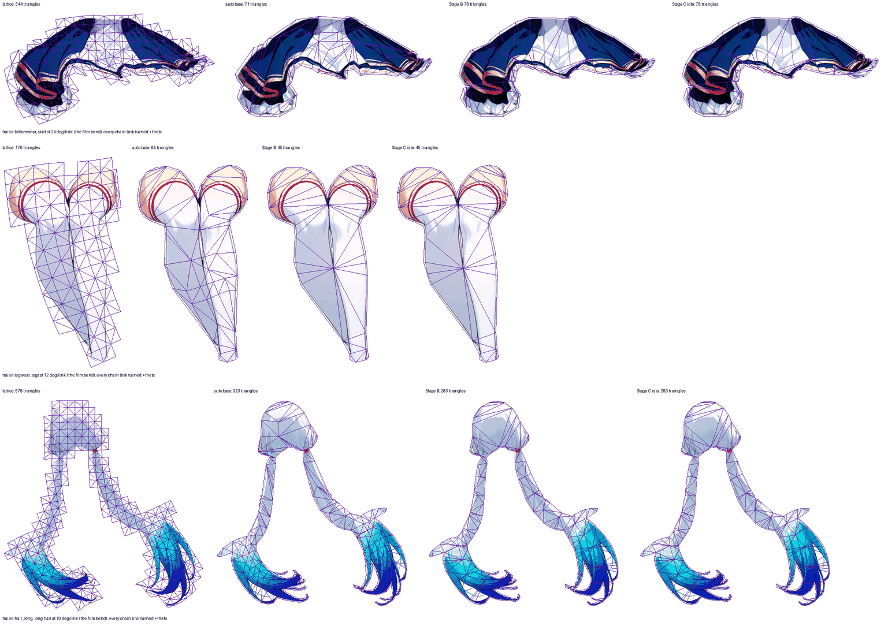

# Insertion where the motion says (issue #265, Stage C, arm 5)

> Measured on rig-c 2.40.0 (`bun.lock` at the merge of PR #278). rig-c 2.45.2 fixed `rigc render`'s physics clock (core#1380), which moved render-read figures by up to 0.021 (`tools/tear_survey.ts` on demo: 2.428 → 2.426 and 1.823 → 1.844, rig-c 2.40.0 against 2.47.0); on this page arm 5's PASS and `hair_long`'s 0 insertions rest on the trailer's `hair_long` idle 0.997 vs 1 = 0.003, under that 0.021, so its verdict is the verdict of that date only. The decision it fed, the idle line of 1 rig px against the lattice, is held live per part by `rig-parts mesh-draft`'s gate, which reads it on the installed rig-c at every run and prints its margin: `MD03` (a candidate past the idle line keeps its lattice) and `MD04` (each reading past its line fails, exactly at it passes with margin 0). This page is a record and is not re-run (#311).

Generated by `tools/density_survey.ts --page-insert` over `--run … --insert` documents; every figure is the tool's. Arm 5 starts from Stage B's draft (`tools/contourdraft.ts`: outline, surviving ribs) and, on every part the draft turned to `contour`, inserts one vertex at a time where the posed displacement against the dense reference — arm 0's own lattice, posed by `rigc render --geometry` — is largest, weighted by the part's rule, re-triangulated with the outline and ribs locked, until the largest displacement is within the bound (1 rig px) or 64 vertices were inserted (the cap; reaching it is the part's refusal); an insertion that leaves the reading worse above the bound is undone and its site skipped, and 256 undone stop the part ("attempts"). An author's own contour mesh (a soft region's) and a part the draft kept on `grid` are not touched. "Where" classifies each inserted vertex by its two heaviest bones: at a joint (within 8 px of a bound segment's end), inside one bone (second weight under 0.25), along one chain, between two chains, on a crossing of two bone segments, or between a chain and a bone segment. Time is the insertion loop's wall time on the run's machine (not reproducible to the byte).

The pictures, read before the tables: `density-stageC-figure.png` — each example's figure (its arm-0 recomposite, faded) with every vertex Stage C inserted marked (circles: at the idle bound; squares: on idle ∪ bend, red for an idle site and blue for a bend site); `density-stageC-film.png` — the trailer's skirt, legs and long hair at the film's bends, lattice, auto base, Stage B and Stage C at the idle side by side, each mesh drawn over its own texture (`tools/bend_survey.ts` poses, this tool's skinning). The bend set is `docs/evidence/density-bend.md`.





## demo

| arm | build | Σ triangles | vs arm 0 | inserted | parts at the cap | overdraw, figure | parts above their arm-0 overdraw by more than 5 % | BREATH_VISIBLE | BLINK_NO_HOLE | CHAIN_LAG | TIP_OVER_ROOT | STILL_REGIONS_DARK | TEXTURE_STRETCH | largest displacement vs arm 0 (rig px) | insertion time (ms) |
| --- | --- | ---: | ---: | ---: | --- | ---: | --- | --- | --- | --- | --- | --- | --- | --- | ---: |
| 0 | PASS | 1816 | 100.0 % | — | — | 1.726 | — | PASS | PASS | PASS | PASS min 2.428 | PASS | PASS 1.097 | — | — |
| draft (T 2) | PASS | 715 | 39.4 % | — | — | 1.323 | none | PASS | PASS | PASS | PASS min 2.179 | PASS | PASS 1.123 | 2.177 (topwear, frame 10) | — |
| 5 (bound 1) | PASS | 719 | 39.6 % | 2 | none | 1.323 | none | PASS | PASS | PASS | PASS min 2.179 | PASS | PASS 1.123 | 0.885 (bottomwear, frame 8) | 40 |

Per drafted part: triangles (arm 0 / draft / 5 (bound 1)), vertices inserted, and the largest displacement against arm 0 before and after.

| part | triangles | 5 (bound 1): inserted, displacement before → after | TEXTURE_STRETCH arm 0 / draft / 5 (bound 1) |
| --- | --- | --- | --- |
| hair_back | 226 / 163 / 163 | 0, 0.684 → 0.684 | 1.062 / 1.071 / 1.071 |
| handwear_l | 154 / 52 / 52 | 0, 0.119 → 0.119 | 1.025 / 1.017 / 1.017 |
| handwear_r | 156 / 53 / 53 | 0, 0.141 → 0.141 | 1.026 / 1.016 / 1.016 |
| neck | 244 / 7 / 7 | 0, 0.270 → 0.270 | 1.016 / 1.016 / 1.016 |
| bottomwear | 292 / 61 / 61 | 0, 0.885 → 0.885 | 1.019 / 1.015 / 1.015 |
| topwear | 248 / 28 / 32 | 2, 2.177 → 0.784 | 1.095 / 1.018 / 1.071 |
| hair_front | 204 / 59 / 59 | 0, 0.872 → 0.872 | 1.097 / 1.123 / 1.123 |

Inserted vertices, arm 5 (bound 1) (rig px, in insertion order; the displacement there before it went in, its frame, its two heaviest bones):

- topwear: (410, 359) 2.177 f10 [chest 0.92576, hip 0.07424] idle: inside chest; (410, 416) 1.169 f10 [hip 0.76254, chest 0.23746] idle: inside hip

Controls, arm 5 (bound 1): the draft's own weights recomputed and its posed vertices re-skinned from the frames' bone transforms agree to 3.6e-5 (largest of either, over every part).

Every arm's `check` lines, as the build printed them:

<details><summary>arm 0</summary>

```
loop: idle 41 frame(s) at 12 fps, f0000 vs f0040 (t = 3.333333333333333s): max |d| 0 (0 required)
seam: setup pose at 654x1216, scale 0.9438: mean |d| 0.147 (<= 1.0), 0 px over 40, 0.00 rig px (the count / s²; <= 50), 0 px over 80 (reported)
BREATH_VISIBLE: PASS — torso_parts topwear; torso_heat_mean 29.905; torso_floor 3.809; feet_parts shoes; feet_heat_max 0; feet_ceiling 0
BLINK_NO_HOLE: PASS — eye_parts eyewhite_r | eyewhite_l; closed group eyes scaley 0.12 from 2.37s to 2.454s; idle_frames_closed 29; box_px 2024; hole_px 0; hole_bar 0; patch_max 11; patch_px_over_40 0
CHAIN_LAG: PASS — chains neck > head_ctl: period 3.333s, phase 0.080 0.120, amp 0.350 0.900 | hairback_r0_ctl > hairback_r1_ctl > hairback_r2_ctl: period 3.333s, phase 0.200 0.280 0.360, amp 0.600 1.400 2.400 | hairback_l0_ctl > hairback_l1_ctl > hairback_l2_ctl: period 3.333s, phase 0.700 0.780 0.860, amp 0.600 1.400 2.400 | bang_r0_ctl > bang_r1_ctl: period 3.333s, phase 0.180 0.280, amp 1.000 2
TIP_OVER_ROOT: PASS — instrument geometry; parts part handwear_l, root_rig_px 1.703, tip_rig_px 7.249, ratio 4.256 | part handwear_r, root_rig_px 1.691, tip_rig_px 7.155, ratio 4.232 | part bottomwear, root_rig_px 0.392, tip_rig_px 0.952, ratio 2.428; ratio_floor 1.4725
STILL_REGIONS_DARK: PASS — face parts face, head_bone head, instrument geometry, still_slots slot face, max_rig_px 4.205e-13, rms_rig_px 1.139e-13, max_rig_px 4.205e-13, at null, rms_rig_px 1.139e-13, tolerance_rig_px 2.286e-11, crossing slot hair_front, depth_rig_px 2.763, area_rig_px2 104.888, frame 0, driven_slots none; feet parts shoes, instrument geometry, still_slots slot shoes, max_rig_px 0
TEXTURE_STRETCH: PASS — meshes 9; triangles 1816; frames 41; severity 1.097; severity_ceiling 1.926544; worst slot hair_front, triangle 175, vertices 121 | 33 | 32, edge 33 | 32, frame 20, ratio 0.912; max_ratio 1.096; min_ratio 0.912; per_mesh slot hair_back, triangles 226, max_ratio 1.062, max_at triangle 185 (vertices 139 56 55), edge 56-55, idle frame 7, min_ratio 0.947, min_at triangle 215 (v
RECOMPOSITE_HOLES: REPORTED — error_px 14570; uncovered_error_px 2939; hole_count 1020; largest px 48, box 204,519 27x25, borders bottomwear 69 px
check: PASS; 9 of 9 bar(s) measured, 0 skipped
```

</details>

<details><summary>arm draft (T 2)</summary>

```
loop: idle 41 frame(s) at 12 fps, f0000 vs f0040 (t = 3.333333333333333s): max |d| 0 (0 required)
seam: setup pose at 650x1216, scale 0.9438: mean |d| 0.149 (<= 1.0), 0 px over 40, 0.00 rig px (the count / s²; <= 50), 0 px over 80 (reported)
BREATH_VISIBLE: PASS — torso_parts topwear; torso_heat_mean 27.572; torso_floor 3.809; feet_parts shoes; feet_heat_max 0; feet_ceiling 0
BLINK_NO_HOLE: PASS — eye_parts eyewhite_r | eyewhite_l; closed group eyes scaley 0.12 from 2.37s to 2.454s; idle_frames_closed 29; box_px 2001; hole_px 0; hole_bar 0; patch_max 10; patch_px_over_40 0
CHAIN_LAG: PASS — chains neck > head_ctl: period 3.333s, phase 0.080 0.120, amp 0.350 0.900 | hairback_r0_ctl > hairback_r1_ctl > hairback_r2_ctl: period 3.333s, phase 0.200 0.280 0.360, amp 0.600 1.400 2.400 | hairback_l0_ctl > hairback_l1_ctl > hairback_l2_ctl: period 3.333s, phase 0.700 0.780 0.860, amp 0.600 1.400 2.400 | bang_r0_ctl > bang_r1_ctl: period 3.333s, phase 0.180 0.280, amp 1.000 2
TIP_OVER_ROOT: PASS — instrument geometry; parts part handwear_l, root_rig_px 1.733, tip_rig_px 7.295, ratio 4.209 | part handwear_r, root_rig_px 1.704, tip_rig_px 7.205, ratio 4.227 | part bottomwear, root_rig_px 0.436, tip_rig_px 0.95, ratio 2.179; ratio_floor 1.4725
STILL_REGIONS_DARK: PASS — face parts face, head_bone head, instrument geometry, still_slots slot face, max_rig_px 4.205e-13, rms_rig_px 1.139e-13, max_rig_px 4.205e-13, at null, rms_rig_px 1.139e-13, tolerance_rig_px 2.286e-11, crossing slot hair_front, depth_rig_px 2.721, area_rig_px2 110.498, frame 0, driven_slots none; feet parts shoes, instrument geometry, still_slots slot shoes, max_rig_px 0
TEXTURE_STRETCH: PASS — meshes 9; triangles 715; frames 41; severity 1.123; severity_ceiling 1.926544; worst slot hair_front, triangle 30, vertices 23 | 25 | 24, edge 24 | 23, frame 20, ratio 0.89; max_ratio 1.118; min_ratio 0.89; per_mesh slot hair_back, triangles 163, max_ratio 1.068, max_at triangle 129 (vertices 103 119 111), edge 119-111, idle frame 24, min_ratio 0.934, min_at triangle 129 (v
RECOMPOSITE_HOLES: REPORTED — error_px 14570; uncovered_error_px 2939; hole_count 1020; largest px 48, box 204,519 27x25, borders bottomwear 69 px
check: PASS; 9 of 9 bar(s) measured, 0 skipped
```

</details>

<details><summary>arm 5 (bound 1)</summary>

```
loop: idle 41 frame(s) at 12 fps, f0000 vs f0040 (t = 3.333333333333333s): max |d| 0 (0 required)
seam: setup pose at 650x1216, scale 0.9438: mean |d| 0.149 (<= 1.0), 0 px over 40, 0.00 rig px (the count / s²; <= 50), 0 px over 80 (reported)
BREATH_VISIBLE: PASS — torso_parts topwear; torso_heat_mean 29.29; torso_floor 3.809; feet_parts shoes; feet_heat_max 0; feet_ceiling 0
BLINK_NO_HOLE: PASS — eye_parts eyewhite_r | eyewhite_l; closed group eyes scaley 0.12 from 2.37s to 2.454s; idle_frames_closed 29; box_px 2001; hole_px 0; hole_bar 0; patch_max 10; patch_px_over_40 0
CHAIN_LAG: PASS — chains neck > head_ctl: period 3.333s, phase 0.080 0.120, amp 0.350 0.900 | hairback_r0_ctl > hairback_r1_ctl > hairback_r2_ctl: period 3.333s, phase 0.200 0.280 0.360, amp 0.600 1.400 2.400 | hairback_l0_ctl > hairback_l1_ctl > hairback_l2_ctl: period 3.333s, phase 0.700 0.780 0.860, amp 0.600 1.400 2.400 | bang_r0_ctl > bang_r1_ctl: period 3.333s, phase 0.180 0.280, amp 1.000 2
TIP_OVER_ROOT: PASS — instrument geometry; parts part handwear_l, root_rig_px 1.733, tip_rig_px 7.295, ratio 4.209 | part handwear_r, root_rig_px 1.704, tip_rig_px 7.205, ratio 4.227 | part bottomwear, root_rig_px 0.436, tip_rig_px 0.95, ratio 2.179; ratio_floor 1.4725
STILL_REGIONS_DARK: PASS — face parts face, head_bone head, instrument geometry, still_slots slot face, max_rig_px 4.205e-13, rms_rig_px 1.139e-13, max_rig_px 4.205e-13, at null, rms_rig_px 1.139e-13, tolerance_rig_px 2.286e-11, crossing slot hair_front, depth_rig_px 2.721, area_rig_px2 110.498, frame 0, driven_slots none; feet parts shoes, instrument geometry, still_slots slot shoes, max_rig_px 0
TEXTURE_STRETCH: PASS — meshes 9; triangles 719; frames 41; severity 1.123; severity_ceiling 1.926544; worst slot hair_front, triangle 30, vertices 23 | 25 | 24, edge 24 | 23, frame 20, ratio 0.89; max_ratio 1.118; min_ratio 0.89; per_mesh slot hair_back, triangles 163, max_ratio 1.068, max_at triangle 129 (vertices 103 119 111), edge 119-111, idle frame 24, min_ratio 0.934, min_at triangle 129 (v
RECOMPOSITE_HOLES: REPORTED — error_px 14570; uncovered_error_px 2939; hole_count 1020; largest px 48, box 204,519 27x25, borders bottomwear 69 px
check: PASS; 9 of 9 bar(s) measured, 0 skipped
```

</details>

## scarf

| arm | build | Σ triangles | vs arm 0 | inserted | parts at the cap | overdraw, figure | parts above their arm-0 overdraw by more than 5 % | BREATH_VISIBLE | BLINK_NO_HOLE | CHAIN_LAG | TIP_OVER_ROOT | STILL_REGIONS_DARK | TEXTURE_STRETCH | largest displacement vs arm 0 (rig px) | insertion time (ms) |
| --- | --- | ---: | ---: | ---: | --- | ---: | --- | --- | --- | --- | --- | --- | --- | --- | ---: |
| 0 | PASS | 2654 | 100.0 % | — | — | 1.221 | — | PASS | PASS | PASS | PASS min 1.925 | PASS | PASS 1.337 | — | — |
| draft (T 2) | PASS | 294 | 11.1 % | — | — | 1.049 | none | PASS | PASS | PASS | PASS min 1.917 | PASS | PASS 1.113 | 15.299 (topwear, frame 10) | — |
| 5 (bound 1) | PASS | 300 | 11.3 % | 3 | none | 1.049 | none | PASS | PASS | PASS | PASS min 1.917 | PASS | PASS 1.113 | 10.184 (topwear, frame 10) | 1825 |

Per drafted part: triangles (arm 0 / draft / 5 (bound 1)), vertices inserted, and the largest displacement against arm 0 before and after.

| part | triangles | 5 (bound 1): inserted, displacement before → after | TEXTURE_STRETCH arm 0 / draft / 5 (bound 1) |
| --- | --- | --- | --- |
| hair_back | 264 / 23 / 23 | 0, 0.250 → 0.250 | 1.027 / 1.016 / 1.016 |
| handwear_r | 642 / 46 / 46 | 0, 0.216 → 0.216 | 1.021 / 1.016 / 1.016 |
| handwear_l | 822 / 50 / 50 | 0, 0.215 → 0.215 | 1.023 / 1.017 / 1.017 |
| bottomwear | 308 / 42 / 42 | 0, 0.296 → 0.296 | 1.018 / 1.031 / 1.031 |
| topwear | 392 / 92 / 98 | 3 (stopped: attempts, 257 undone), 15.299 → 10.184 | 1.337 / 1.113 / 1.113 |
| hair_front | 226 / 41 / 41 | 0, 0.576 → 0.576 | 1.097 / 1.086 / 1.086 |

Inserted vertices, arm 5 (bound 1) (rig px, in insertion order; the displacement there before it went in, its frame, its two heaviest bones):

- topwear: (414, 661) 15.299 f10 [hip 0.9, chest 0.1] idle: inside hip; (423.67, 670.67) 10.495 f10 [hip 0.77282, chest 0.16405] idle: inside hip; (413.86, 661.6) 10.192 f10 [hip 0.90087, chest 0.09913] idle: inside hip

Controls, arm 5 (bound 1): the draft's own weights recomputed and its posed vertices re-skinned from the frames' bone transforms agree to 3.4e-5 (largest of either, over every part).

Every arm's `check` lines, as the build printed them:

<details><summary>arm 0</summary>

```
loop: idle 41 frame(s) at 12 fps, f0000 vs f0040 (t = 3.333333333333333s): max |d| 0 (0 required)
seam: setup pose at 392x1216, scale 1.0107: mean |d| 0.206 (<= 1.0), 2 px over 40, 1.96 rig px (the count / s²; <= 50), 0 px over 80 (reported)
BREATH_VISIBLE: PASS — torso_parts topwear; torso_heat_mean 30.836; torso_floor 3.809; feet_parts shoes; feet_heat_max 0; feet_ceiling 0
BLINK_NO_HOLE: PASS — eye_parts eyewhite_r | eyewhite_l; closed group eyes scaley 0.12 from 2.37s to 2.454s; idle_frames_closed 29; box_px 1088; hole_px 0; hole_bar 0; patch_max 9; patch_px_over_40 0
CHAIN_LAG: PASS — chains neck > head_ctl: period 3.333s, phase 0.080 0.120, amp 0.350 0.900 | bang_r0_ctl > bang_r1_ctl: period 3.333s, phase 0.180 0.280, amp 1.000 2.200 | bang_c0_ctl > bang_c1_ctl: period 3.333s, phase 0.180 0.280, amp 0.800 1.760 | bang_l0_ctl > bang_l1_ctl: period 3.333s, phase 0.180 0.280, amp 1.000 2.200 | sleeve_r0_ctl > sleeve_r1_ctl > sleeve_r2_ctl: period 3.333s, phase 0
TIP_OVER_ROOT: PASS — instrument geometry; parts part handwear_r, root_rig_px 3.54, tip_rig_px 7.1, ratio 2.006 | part handwear_l, root_rig_px 3.487, tip_rig_px 6.712, ratio 1.925 | part bottomwear, root_rig_px 0.04, tip_rig_px 0.139, ratio 3.487; ratio_floor 1.4725
STILL_REGIONS_DARK: PASS — face parts face, head_bone head, instrument geometry, still_slots slot face, max_rig_px 4.427e-13, rms_rig_px 1.311e-13, max_rig_px 4.427e-13, at null, rms_rig_px 1.311e-13, tolerance_rig_px 2.286e-11, crossing slot hair_front, depth_rig_px 2.524, area_rig_px2 31.845, frame 0, driven_slots none; feet parts shoes, instrument geometry, still_slots slot shoes, max_rig_px 0,
TEXTURE_STRETCH: PASS — meshes 6; triangles 2654; frames 41; severity 1.337; severity_ceiling 1.926544; worst slot topwear, triangle 273, vertices 196 | 204 | 205, edge 205 | 196, frame 10, ratio 1.337; max_ratio 1.337; min_ratio 0.912; per_mesh slot hair_back, triangles 264, max_ratio 1.027, max_at triangle 167 (vertices 116 124 125), edge 124-125, idle frame 17, min_ratio 0.982, min_at triangle 
RECOMPOSITE_HOLES: REPORTED — error_px 7834; uncovered_error_px 1365; hole_count 291; largest px 63, box 347,803 3x60, borders topwear 61 px
check: PASS; 9 of 9 bar(s) measured, 0 skipped
```

</details>

<details><summary>arm draft (T 2)</summary>

```
loop: idle 41 frame(s) at 12 fps, f0000 vs f0040 (t = 3.333333333333333s): max |d| 0 (0 required)
seam: setup pose at 387x1216, scale 1.0107: mean |d| 0.208 (<= 1.0), 2 px over 40, 1.96 rig px (the count / s²; <= 50), 0 px over 80 (reported)
BREATH_VISIBLE: PASS — torso_parts topwear; torso_heat_mean 31.387; torso_floor 3.809; feet_parts shoes; feet_heat_max 0; feet_ceiling 0
BLINK_NO_HOLE: PASS — eye_parts eyewhite_r | eyewhite_l; closed group eyes scaley 0.12 from 2.37s to 2.454s; idle_frames_closed 29; box_px 1088; hole_px 0; hole_bar 0; patch_max 7; patch_px_over_40 0
CHAIN_LAG: PASS — chains neck > head_ctl: period 3.333s, phase 0.080 0.120, amp 0.350 0.900 | bang_r0_ctl > bang_r1_ctl: period 3.333s, phase 0.180 0.280, amp 1.000 2.200 | bang_c0_ctl > bang_c1_ctl: period 3.333s, phase 0.180 0.280, amp 0.800 1.760 | bang_l0_ctl > bang_l1_ctl: period 3.333s, phase 0.180 0.280, amp 1.000 2.200 | sleeve_r0_ctl > sleeve_r1_ctl > sleeve_r2_ctl: period 3.333s, phase 0
TIP_OVER_ROOT: PASS — instrument geometry; parts part handwear_r, root_rig_px 3.543, tip_rig_px 7.135, ratio 2.014 | part handwear_l, root_rig_px 3.517, tip_rig_px 6.741, ratio 1.917 | part bottomwear, root_rig_px 0.047, tip_rig_px 0.142, ratio 3.032; ratio_floor 1.4725
STILL_REGIONS_DARK: PASS — face parts face, head_bone head, instrument geometry, still_slots slot face, max_rig_px 4.427e-13, rms_rig_px 1.311e-13, max_rig_px 4.427e-13, at null, rms_rig_px 1.311e-13, tolerance_rig_px 2.286e-11, crossing slot hair_front, depth_rig_px 2.507, area_rig_px2 30.331, frame 0, driven_slots none; feet parts shoes, instrument geometry, still_slots slot shoes, max_rig_px 0,
TEXTURE_STRETCH: PASS — meshes 6; triangles 294; frames 41; severity 1.113; severity_ceiling 1.926544; worst slot topwear, triangle 53, vertices 39 | 41 | 40, edge 41 | 40, frame 14, ratio 1.113; max_ratio 1.113; min_ratio 0.907; per_mesh slot hair_back, triangles 23, max_ratio 1.016, max_at triangle 20 (vertices 17 19 18), edge 18-17, idle frame 16, min_ratio 0.991, min_at triangle 20 (vertices 1
RECOMPOSITE_HOLES: REPORTED — error_px 7834; uncovered_error_px 1365; hole_count 291; largest px 63, box 347,803 3x60, borders topwear 61 px
check: PASS; 9 of 9 bar(s) measured, 0 skipped
```

</details>

<details><summary>arm 5 (bound 1)</summary>

```
loop: idle 41 frame(s) at 12 fps, f0000 vs f0040 (t = 3.333333333333333s): max |d| 0 (0 required)
seam: setup pose at 387x1216, scale 1.0107: mean |d| 0.208 (<= 1.0), 2 px over 40, 1.96 rig px (the count / s²; <= 50), 0 px over 80 (reported)
BREATH_VISIBLE: PASS — torso_parts topwear; torso_heat_mean 30.904; torso_floor 3.809; feet_parts shoes; feet_heat_max 0; feet_ceiling 0
BLINK_NO_HOLE: PASS — eye_parts eyewhite_r | eyewhite_l; closed group eyes scaley 0.12 from 2.37s to 2.454s; idle_frames_closed 29; box_px 1088; hole_px 0; hole_bar 0; patch_max 7; patch_px_over_40 0
CHAIN_LAG: PASS — chains neck > head_ctl: period 3.333s, phase 0.080 0.120, amp 0.350 0.900 | bang_r0_ctl > bang_r1_ctl: period 3.333s, phase 0.180 0.280, amp 1.000 2.200 | bang_c0_ctl > bang_c1_ctl: period 3.333s, phase 0.180 0.280, amp 0.800 1.760 | bang_l0_ctl > bang_l1_ctl: period 3.333s, phase 0.180 0.280, amp 1.000 2.200 | sleeve_r0_ctl > sleeve_r1_ctl > sleeve_r2_ctl: period 3.333s, phase 0
TIP_OVER_ROOT: PASS — instrument geometry; parts part handwear_r, root_rig_px 3.543, tip_rig_px 7.135, ratio 2.014 | part handwear_l, root_rig_px 3.517, tip_rig_px 6.741, ratio 1.917 | part bottomwear, root_rig_px 0.047, tip_rig_px 0.142, ratio 3.032; ratio_floor 1.4725
STILL_REGIONS_DARK: PASS — face parts face, head_bone head, instrument geometry, still_slots slot face, max_rig_px 4.427e-13, rms_rig_px 1.311e-13, max_rig_px 4.427e-13, at null, rms_rig_px 1.311e-13, tolerance_rig_px 2.286e-11, crossing slot hair_front, depth_rig_px 2.507, area_rig_px2 30.331, frame 0, driven_slots none; feet parts shoes, instrument geometry, still_slots slot shoes, max_rig_px 0,
TEXTURE_STRETCH: PASS — meshes 6; triangles 300; frames 41; severity 1.113; severity_ceiling 1.926544; worst slot topwear, triangle 51, vertices 39 | 41 | 40, edge 41 | 40, frame 14, ratio 1.113; max_ratio 1.113; min_ratio 0.907; per_mesh slot hair_back, triangles 23, max_ratio 1.016, max_at triangle 20 (vertices 17 19 18), edge 18-17, idle frame 16, min_ratio 0.991, min_at triangle 20 (vertices 1
RECOMPOSITE_HOLES: REPORTED — error_px 7834; uncovered_error_px 1365; hole_count 291; largest px 63, box 347,803 3x60, borders topwear 61 px
check: PASS; 9 of 9 bar(s) measured, 0 skipped
```

</details>

## trailer

| arm | build | Σ triangles | vs arm 0 | inserted | parts at the cap | overdraw, figure | parts above their arm-0 overdraw by more than 5 % | BREATH_VISIBLE | BLINK_NO_HOLE | CHAIN_LAG | TIP_OVER_ROOT | STILL_REGIONS_DARK | TEXTURE_STRETCH | largest displacement vs arm 0 (rig px) | insertion time (ms) |
| --- | --- | ---: | ---: | ---: | --- | ---: | --- | --- | --- | --- | --- | --- | --- | --- | ---: |
| 0 | PASS | 3081 | 100.0 % | — | — | 1.435 | — | PASS | PASS | PASS | PASS min 2.756 | PASS | PASS 1.226 | — | — |
| draft (T 2) | PASS | 1297 | 42.1 % | — | — | 1.080 | none | PASS | PASS | PASS | PASS min 2.744 | PASS | PASS 1.378 | 1.380 (hairpin, frame 24) | — |
| 5 (bound 1) | PASS | 1299 | 42.2 % | 1 | none | 1.080 | none | PASS | PASS | PASS | PASS min 2.744 | PASS | PASS 1.378 | 0.997 (hair_long, frame 6) | 61 |

Per drafted part: triangles (arm 0 / draft / 5 (bound 1)), vertices inserted, and the largest displacement against arm 0 before and after.

| part | triangles | 5 (bound 1): inserted, displacement before → after | TEXTURE_STRETCH arm 0 / draft / 5 (bound 1) |
| --- | --- | --- | --- |
| hair_long | 578 / 283 / 283 | 0, 0.997 → 0.997 | 1.087 / 1.378 / 1.378 |
| hair_back | 194 / 32 / 32 | 0, 0.393 → 0.393 | 1.022 / 1.017 / 1.017 |
| handwear_l | 236 / 34 / 34 | 0, 0.122 → 0.122 | 1.019 / 1.014 / 1.014 |
| legwear | 176 / 45 / 45 | 0, 0.578 → 0.578 | 1.031 / 1.018 / 1.018 |
| neck | 282 / 8 / 8 | 0, 0.165 → 0.165 | 1.016 / 1.016 / 1.016 |
| bottomwear | 344 / 78 / 78 | 0, 0.881 → 0.881 | 1.097 / 1.027 / 1.027 |
| handwear_r | 294 / 44 / 44 | 0, 0.117 → 0.117 | 1.016 / 1.014 / 1.014 |
| hairpin | 178 / 34 / 36 | 1, 1.380 → 0.950 | 1.226 / 1.147 / 1.147 |
| hair_front | 148 / 88 / 88 | 0, 0.770 → 0.770 | 1.092 / 1.085 / 1.085 |

Inserted vertices, arm 5 (bound 1) (rig px, in insertion order; the displacement there before it went in, its frame, its two heaviest bones):

- hairpin: (441, 95) 1.38 f24 [hairpin 1] idle: inside hairpin

Controls, arm 5 (bound 1): the draft's own weights recomputed and its posed vertices re-skinned from the frames' bone transforms agree to 1.1e-4 (largest of either, over every part).

Every arm's `check` lines, as the build printed them:

<details><summary>arm 0</summary>

```
loop: idle 49 frame(s) at 12 fps, f0000 vs f0048 (t = 4s): max |d| 0 (0 required)
seam: setup pose at 847x1216, scale 1.0089: mean |d| 0.154 (<= 1.0), 0 px over 40, 0.00 rig px (the count / s²; <= 50), 0 px over 80 (reported)
BREATH_VISIBLE: PASS — declared_not_planted shoes; torso_parts topwear; torso_heat_mean 14.231; torso_floor 3.809; feet_parts none; feet_heat_max null; feet_ceiling 0
BLINK_NO_HOLE: PASS — eye_parts eyewhite_r | eyewhite_l; closed group eyes scaley 0.12 from 2.37s to 2.454s; idle_frames_closed 29; box_px 6120; hole_px 0; hole_bar 0; patch_max 28; patch_px_over_40 0
CHAIN_LAG: PASS — chains neck > head_ctl: period 4s, phase 0.080 0.120, amp 0.350 0.900 | bang_r0_ctl > bang_r1_ctl: period 4s, phase 0.180 0.280, amp 1.000 2.200 | bang_c0_ctl > bang_c1_ctl: period 4s, phase 0.180 0.280, amp 0.800 1.760 | bang_l0_ctl > bang_l1_ctl: period 4s, phase 0.180 0.280, amp 1.000 2.200 | hairpin_tassel0_ctl > hairpin_tassel1_ctl: period 2s, phase 0.200 0.320, amp 4.000 7.
TIP_OVER_ROOT: PASS — declared_rises handwear_r; instrument geometry; parts part handwear_l, root_rig_px 0.92, tip_rig_px 4.377, ratio 4.759 | part bottomwear, root_rig_px 0.25, tip_rig_px 1.097, ratio 4.39 | part handwear_r, tip_half upper, root_rig_px 1.275, tip_rig_px 3.514, ratio 2.756; ratio_floor 1.4725
STILL_REGIONS_DARK: PASS — face parts face, head_bone head, instrument geometry, still_slots slot face, max_rig_px 4.477e-13, rms_rig_px 1.315e-13, max_rig_px 4.477e-13, at null, rms_rig_px 1.315e-13, tolerance_rig_px 2.286e-11, crossing slot hair_front, depth_rig_px 4, area_rig_px2 206.563, frame 47, driven_slots none; feet declared_not_planted shoes, unmeasured every "footwear" part ("shoes") is
TEXTURE_STRETCH: PASS — meshes 10; triangles 3081; frames 49; severity 1.226; severity_ceiling 1.926544; worst slot hairpin, triangle 150, vertices 115 | 20 | 19, edge 20 | 19, frame 36, ratio 0.816; max_ratio 1.187; min_ratio 0.816; per_mesh slot hair_long, triangles 578, max_ratio 1.077, max_at triangle 449 (vertices 65 64 338), edge 65-64, idle frame 8, min_ratio 0.92, min_at triangle 449 (vert
RECOMPOSITE_HOLES: REPORTED — error_px 19523; uncovered_error_px 4396; hole_count 1213; largest px 402, box 334,960 16x55, borders shoes 47 px | legwear 32 px
check: PASS; 9 of 9 bar(s) measured, 0 skipped
```

</details>

<details><summary>arm draft (T 2)</summary>

```
loop: idle 49 frame(s) at 12 fps, f0000 vs f0048 (t = 4s): max |d| 0 (0 required)
seam: setup pose at 847x1216, scale 1.0107: mean |d| 0.153 (<= 1.0), 0 px over 40, 0.00 rig px (the count / s²; <= 50), 0 px over 80 (reported)
BREATH_VISIBLE: PASS — declared_not_planted shoes; torso_parts topwear; torso_heat_mean 14.193; torso_floor 3.809; feet_parts none; feet_heat_max null; feet_ceiling 0
BLINK_NO_HOLE: PASS — eye_parts eyewhite_r | eyewhite_l; closed group eyes scaley 0.12 from 2.37s to 2.454s; idle_frames_closed 29; box_px 6222; hole_px 0; hole_bar 0; patch_max 28; patch_px_over_40 0
CHAIN_LAG: PASS — chains neck > head_ctl: period 4s, phase 0.080 0.120, amp 0.350 0.900 | bang_r0_ctl > bang_r1_ctl: period 4s, phase 0.180 0.280, amp 1.000 2.200 | bang_c0_ctl > bang_c1_ctl: period 4s, phase 0.180 0.280, amp 0.800 1.760 | bang_l0_ctl > bang_l1_ctl: period 4s, phase 0.180 0.280, amp 1.000 2.200 | hairpin_tassel0_ctl > hairpin_tassel1_ctl: period 2s, phase 0.200 0.320, amp 4.000 7.
TIP_OVER_ROOT: PASS — declared_rises handwear_r; instrument geometry; parts part handwear_l, root_rig_px 0.944, tip_rig_px 4.395, ratio 4.657 | part bottomwear, root_rig_px 0.256, tip_rig_px 1.102, ratio 4.305 | part handwear_r, tip_half upper, root_rig_px 1.281, tip_rig_px 3.515, ratio 2.744; ratio_floor 1.4725
STILL_REGIONS_DARK: PASS — face parts face, head_bone head, instrument geometry, still_slots slot face, max_rig_px 4.477e-13, rms_rig_px 1.315e-13, max_rig_px 4.477e-13, at null, rms_rig_px 1.315e-13, tolerance_rig_px 2.286e-11, crossing slot hair_front, depth_rig_px 4.167, area_rig_px2 209.283, frame 47, driven_slots none; feet declared_not_planted shoes, unmeasured every "footwear" part ("shoes"
TEXTURE_STRETCH: PASS — meshes 10; triangles 1297; frames 49; severity 1.378; severity_ceiling 1.926544; worst slot hair_long, triangle 127, vertices 98 | 100 | 99, edge 99 | 98, frame 28, ratio 0.726; max_ratio 1.326; min_ratio 0.726; per_mesh slot hair_long, triangles 283, max_ratio 1.326, max_at triangle 127 (vertices 98 100 99), edge 99-98, idle frame 6, min_ratio 0.726, min_at triangle 127 (v
RECOMPOSITE_HOLES: REPORTED — error_px 19523; uncovered_error_px 4396; hole_count 1213; largest px 402, box 334,960 16x55, borders shoes 47 px | legwear 32 px
check: PASS; 9 of 9 bar(s) measured, 0 skipped
```

</details>

<details><summary>arm 5 (bound 1)</summary>

```
loop: idle 49 frame(s) at 12 fps, f0000 vs f0048 (t = 4s): max |d| 0 (0 required)
seam: setup pose at 847x1216, scale 1.0107: mean |d| 0.153 (<= 1.0), 0 px over 40, 0.00 rig px (the count / s²; <= 50), 0 px over 80 (reported)
BREATH_VISIBLE: PASS — declared_not_planted shoes; torso_parts topwear; torso_heat_mean 14.193; torso_floor 3.809; feet_parts none; feet_heat_max null; feet_ceiling 0
BLINK_NO_HOLE: PASS — eye_parts eyewhite_r | eyewhite_l; closed group eyes scaley 0.12 from 2.37s to 2.454s; idle_frames_closed 29; box_px 6222; hole_px 0; hole_bar 0; patch_max 28; patch_px_over_40 0
CHAIN_LAG: PASS — chains neck > head_ctl: period 4s, phase 0.080 0.120, amp 0.350 0.900 | bang_r0_ctl > bang_r1_ctl: period 4s, phase 0.180 0.280, amp 1.000 2.200 | bang_c0_ctl > bang_c1_ctl: period 4s, phase 0.180 0.280, amp 0.800 1.760 | bang_l0_ctl > bang_l1_ctl: period 4s, phase 0.180 0.280, amp 1.000 2.200 | hairpin_tassel0_ctl > hairpin_tassel1_ctl: period 2s, phase 0.200 0.320, amp 4.000 7.
TIP_OVER_ROOT: PASS — declared_rises handwear_r; instrument geometry; parts part handwear_l, root_rig_px 0.944, tip_rig_px 4.395, ratio 4.657 | part bottomwear, root_rig_px 0.256, tip_rig_px 1.102, ratio 4.305 | part handwear_r, tip_half upper, root_rig_px 1.281, tip_rig_px 3.515, ratio 2.744; ratio_floor 1.4725
STILL_REGIONS_DARK: PASS — face parts face, head_bone head, instrument geometry, still_slots slot face, max_rig_px 4.477e-13, rms_rig_px 1.315e-13, max_rig_px 4.477e-13, at null, rms_rig_px 1.315e-13, tolerance_rig_px 2.286e-11, crossing slot hair_front, depth_rig_px 4.167, area_rig_px2 209.283, frame 47, driven_slots none; feet declared_not_planted shoes, unmeasured every "footwear" part ("shoes"
TEXTURE_STRETCH: PASS — meshes 10; triangles 1299; frames 49; severity 1.378; severity_ceiling 1.926544; worst slot hair_long, triangle 127, vertices 98 | 100 | 99, edge 99 | 98, frame 28, ratio 0.726; max_ratio 1.326; min_ratio 0.726; per_mesh slot hair_long, triangles 283, max_ratio 1.326, max_at triangle 127 (vertices 98 100 99), edge 99-98, idle frame 6, min_ratio 0.726, min_at triangle 127 (v
RECOMPOSITE_HOLES: REPORTED — error_px 19523; uncovered_error_px 4396; hole_count 1213; largest px 402, box 334,960 16x55, borders shoes 47 px | legwear 32 px
check: PASS; 9 of 9 bar(s) measured, 0 skipped
```

</details>
