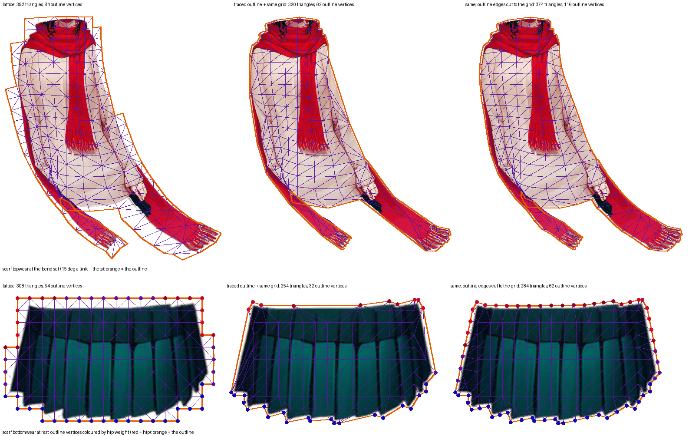

# Why scarf's topwear and bottomwear fail on every non-lattice arm (issue #265, diagnosis 1)

**The cause is one, it is the outline, and it is not scarf's own.** The traced outline is simplified by geometry alone (Douglas–Peucker at T). Where the art's edge is straight it keeps one long edge, and on scarf those straight edges run across places where the weight field changes along the boundary:

- **bottomwear:** the skirt's waist runs flat across the hip segment and all three skirt chains. At T 2 it carries 4–5 vertices; the lattice has one every 12 px.
- **topwear:**
  - The sweater's sides are a single edge from the shoulder to the robe.
  - The hem crosses the body's centre line at the chest–hip crossing between two corners weighted to the robes. One is at (390, 682): hip 0.66, chest 0.22, robe_r 0.12. The other is at (451, 683): hip 0.45, chest 0.22, robe_l 0.34.
  - The lattice has a corner at (414, 690) weighted hip 0.97.

The art along such an edge is interpolated between end vertices whose weights are not its own. The staircase lattice samples its boundary every grid step whatever the shape, so it carries the field there.

## Measured on scarf

These are local builds of this worktree's tree as it stood at the diagnosis (no change under `src/`), read with `tools/bend_survey.ts`'s dense reference and `check`'s own `halfTravels`. The cut outline was built with the construction `capOutline` and `cdt` now carry (`tools/outline_survey.ts`, `tools/edge_survey.ts`), at each part's own grid. The table is from that one diagnostic run, not from a page generator.

The traced outline has the **same interior grid** as the lattice: topwear 29, bottomwear 12 (`G1`).

| variant | bottomwear `TIP_OVER_ROOT` (root / tip / ratio, floor 1.4725) | topwear idle vs dense | topwear bend 15° vs dense | triangles (top / bottom) |
| --- | --- | ---: | ---: | --- |
| lattice | 0.040 / 0.139 / **3.487** | 1.51 | 10.60 | 392 / 308 |
| traced outline T2 m2 + same grid (G1) | 0.112 / 0.137 / **1.218** (fails) | 2.71 | 17.79 | 320 / 254 |
| G1 with every outline edge cut to at most the grid, cut points weighted by the rule (G1s) | 0.041 / 0.137 / **3.322** | **1.50** | **11.95** | 374 / 284 |

**Ruled out as the cause:**
- **The interior.**
  - On bottomwear, a denser interior at spacing 8 / 6 / 4 (566–1038 triangles) only reaches 1.80 / 2.25 / 2.85.
  - On topwear, spacing 14 (1328 triangles) reads 1.93 / 13.50 and still trails the lattice's 392.
  - The lattice is stable at every grid: 3.51–3.60 at grid 4–16.
- **The margin** is a minor factor: margin 3 → 1.686, worse than 2.
- **Tolerance 1** helps bottomwear (69 outline vertices: 2.614, passes). It does not help topwear (2.84 / 18.34): its hem and sides are straight within 1 px, so no tolerance keeps a vertex on them.
- **The robe ends** are not the cause: the worst samples sit at the hem centre (rig 414, 676) and on the sides, not at the robe tips.

## Where the samples sit

- The topwear's worst sample is at rig (414.5, 675.5), the hem centre, at frame 10 of the idle. In G1 the bend's worst sample is beside it.
- The bottomwear's root reading is carried by art at the box's sides near the mid line. Removing 8 px columns at the sides moves G1's root from 0.112 to 0.078.
