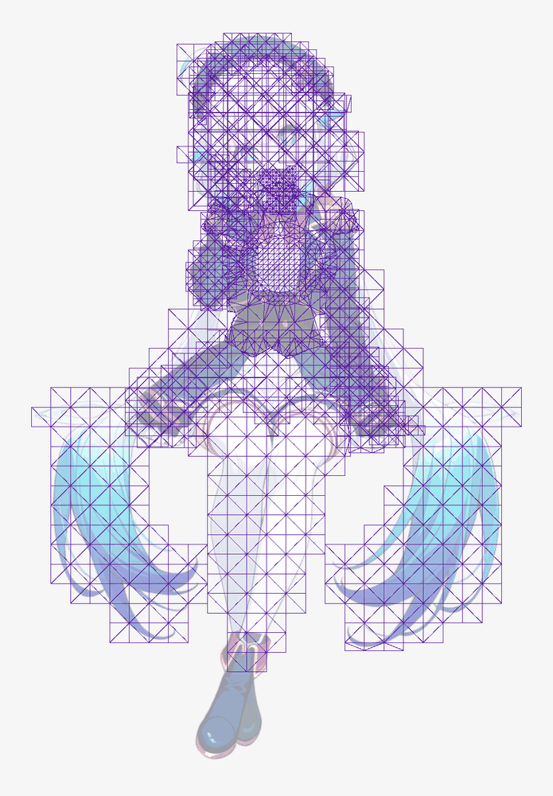
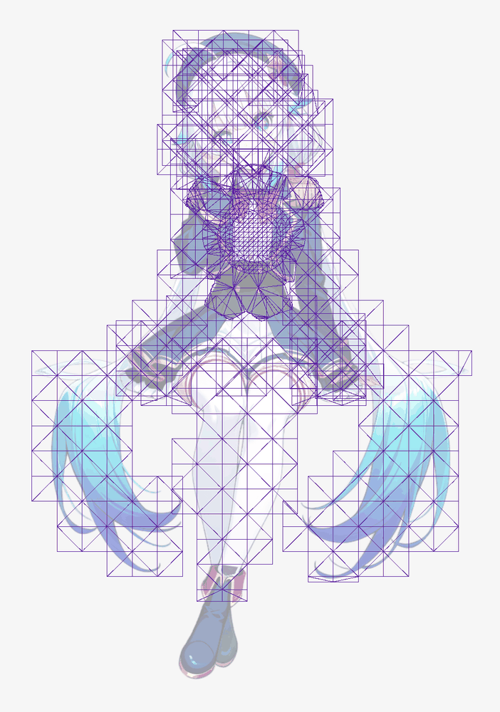
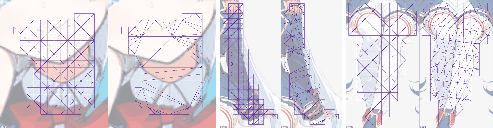

# Mesh density over the figure (issue #265, Stage A)

> Measured on rig-c 2.40.0 (`bun.lock` at the merge of PR #268). rig-c 2.45.2 fixed `rigc render`'s physics clock (core#1380), which moved render-read figures by up to 0.021 (`tools/tear_survey.ts` on demo: 2.428 → 2.426 and 1.823 → 1.844, rig-c 2.40.0 against 2.47.0); on this page arm 1 (c 37)'s PASS has demo `bottomwear` TIP_OVER_ROOT 1.489 vs 1.4725 = 0.0165, under that 0.021, so its verdict is the verdict of that date only. The decision it fed, the figure's spacing round(H / 37), is held live by the chain suite on every run: `CH04` (each example's `check.json` field by field against `expected/check.json`, regenerated on rig-c 2.47.1 by PR #310 with every status unchanged) and `CH06` (the proposal drafted at that spacing is the tracked one), with `CH17` and `PR99` holding the rule itself. This page is a record and is not re-run (#311).

Generated by `tools/density_survey.ts` (its header states the arms, the divisors and the displacement rule, all fixed before the run); this page is its `--page` output over the three examples' `--run` documents. Every figure is read from the build's own files: triangles and areas from `rigc render --geometry`'s setup pose (world units = rig px), the bars from `check.json`.

Arm 1: B = round(H / c), c ∈ {26, 37, 52}, H the figure's height. Arm 2: rows at k ∈ {1, 2, 3} stations, cut at H / 37.

The pictures (trailer, setup pose, every mesh drawn over the dimmed art) are drawn by rig-c 2.43.0's `rigc inspect`, newer than the 2.40.0 this tree pins, installed beside it for the pictures only; they read the builds `--run` writes under `--work`:

- `density-arm0.png` — arm 0: `rigc inspect --candidate <work>/arm0/check/build --show art,mesh --dim --max 1400`
- `density-arm1.png` — arm 1 at c 26 (B 43), the one B at which the trailer's line is met: the same over `<work>/arm1-c26/check/build`
- `density-arm2.png` — arm 2 at k 2, neck, handwear_l and legwear, each arm 0 (left, A) beside arm 2 (right, B): `rigc inspect --candidate <work>/arm0/check/build --compare <work>/arm2-k2/check/build --show art,mesh --dim --overlay-slot <part> --zoom slot:<part>:10 --max 700`, the three placed side by side

 



## demo

Figure height H = 1185 rig px (rows 26 to 1211).

| arm | B | build | Σ triangles | vs arm 0 | parts above 3x the figure | loop | seam mean / px>40 | BREATH_VISIBLE | BLINK_NO_HOLE | CHAIN_LAG | TIP_OVER_ROOT | STILL_REGIONS_DARK | TEXTURE_STRETCH | recomposite error px | largest displacement vs arm 0 (rig px) |
| --- | ---: | --- | ---: | ---: | --- | --- | --- | --- | --- | --- | --- | --- | --- | ---: | --- |
| 0 | — | PASS | 1816 | 100.0 % | neck 19.3x, hairpin 4.0x | 0 | 0.147 / 0 | PASS | PASS | PASS | PASS min 2.395 | PASS | PASS 1.169 | 14570 | — |
| 1 (c 26) | 46 | PASS | 538 | 29.6 % | none | 0 | 0.147 / 0 | PASS | PASS | PASS | PASS min 2.155 | PASS | PASS 1.104 | 14570 | 1.336 (bottomwear, frame 10) |
| 1 (c 37) | 32 | PASS | 980 | 54.0 % | none | 0 | 0.147 / 0 | PASS | PASS | PASS | PASS min 2.308 | PASS | PASS 1.14 | 14570 | 0.854 (hair_front, frame 20) |
| 1 (c 52) | 23 | PASS | 1630 | 89.8 % | none | 0 | 0.147 / 0 | PASS | PASS | PASS | PASS min 2.381 | PASS | PASS 1.175 | 14570 | 0.758 (bottomwear, frame 10) |

Per mesh: triangles, and density relative to the figure's (Σ triangles / Σ area over every mesh). Arm 0's mode is the config's.

| part | box px (parts.json) | bones | arm 0 mode | arm 0 tri | arm 1 (c 26) tri | arm 1 (c 37) tri | arm 1 (c 52) tri | arm 0 density | arm 1 (c 26) density | arm 1 (c 37) density | arm 1 (c 52) density | arm 1 (c 26) displ. | arm 1 (c 37) displ. | arm 1 (c 52) displ. |
| --- | --- | ---: | --- | ---: | ---: | ---: | ---: | ---: | ---: | ---: | ---: | ---: | ---: | ---: |
| neck | 42x74 | 2 | grid 5 | 244 | 4 | 12 | 16 | 19.30x | 1.03x | 1.43x | 1.10x | 0.146 | 0.163 | 0.106 |
| hairpin | 212x107 | 1 | grid 11 | 190 | 24 | 40 | 62 | 4.03x | 1.10x | 1.06x | 1.01x | 0.000 | 0.000 | 0.000 |
| hair_front | 161x138 | 7 | grid 14 | 204 | 30 | 52 | 90 | 2.49x | 1.19x | 1.09x | 1.08x | 0.734 | 0.854 | 0.435 |
| topwear | 191x237 | 2 | grid 19 | 248 | 54 | 94 | 174 | 1.36x | 1.11x | 1.02x | 1.02x | 0.747 | 0.614 | 0.464 |
| handwear_r | 208x385 | 4 | grid 21 | 156 | 48 | 80 | 136 | 1.13x | 1.02x | 1.02x | 1.02x | 0.260 | 0.109 | 0.140 |
| handwear_l | 207x385 | 4 | grid 21 | 154 | 46 | 78 | 134 | 1.11x | 0.98x | 1.01x | 0.99x | 0.184 | 0.148 | 0.121 |
| bottomwear | 449x247 | 11 | grid 25 | 292 | 104 | 194 | 348 | 0.78x | 0.99x | 0.97x | 0.99x | 1.336 | 0.548 | 0.758 |
| earring | 338x392 | 1 | grid 34 | 102 | 88 | 162 | 200 | 0.42x | 1.02x | 0.99x | 0.99x | 0.000 | 0.000 | 0.000 |
| hair_back | 590x457 | 7 | grid 36 | 226 | 140 | 268 | 470 | 0.38x | 0.92x | 0.98x | 0.98x | 0.669 | 0.680 | 0.687 |

Per mesh: `TEXTURE_STRETCH`'s severity for that mesh over the idle (`check.json` `per_mesh`; the bar is the figure's largest, against its ceiling).

| part | arm 0 | arm 1 (c 26) | arm 1 (c 37) | arm 1 (c 52) |
| --- | ---: | ---: | ---: | ---: |
| neck | 1.016 | 1.008 | 1.016 | 1.013 |
| hairpin | 1.008 | 1.008 | 1.008 | 1.008 |
| hair_front | 1.097 | 1.076 | 1.081 | 1.08 |
| topwear | 1.095 | 1.072 | 1.102 | 1.075 |
| handwear_r | 1.026 | 1.023 | 1.024 | 1.025 |
| handwear_l | 1.025 | 1.024 | 1.024 | 1.026 |
| bottomwear | 1.169 | 1.104 | 1.14 | 1.175 |
| earring | 1.008 | 1.008 | 1.008 | 1.008 |
| hair_back | 1.062 | 1.071 | 1.065 | 1.065 |

Every arm's `check` lines, as the build printed them:

<details><summary>arm 0</summary>

```
loop: idle 41 frame(s) at 12 fps, f0000 vs f0040 (t = 3.333333333333333s): max |d| 0 (0 required)
seam: setup pose at 654x1216, scale 0.9438: mean |d| 0.147 (<= 1.0), 0 px over 40, 0.00 rig px (the count / s²; <= 50), 0 px over 80 (reported)
BREATH_VISIBLE: PASS — torso_parts topwear; torso_heat_mean 29.905; torso_floor 3.809; feet_parts shoes; feet_heat_max 0; feet_ceiling 0
BLINK_NO_HOLE: PASS — eye_parts eyewhite_r | eyewhite_l; closed group eyes scaley 0.12 from 2.37s to 2.454s; idle_frames_closed 29; box_px 2024; hole_px 0; hole_bar 0; patch_max 11; patch_px_over_40 0
CHAIN_LAG: PASS — chains neck > head_ctl: period 3.333s, phase 0.080 0.120, amp 0.350 0.900 | hairback_r0_ctl > hairback_r1_ctl > hairback_r2_ctl: period 3.333s, phase 0.200 0.280 0.360, amp 0.600 1.400 2.400 | hairback_l0_ctl > hairback_l1_ctl > hairback_l2_ctl: period 3.333s, phase 0.700 0.780 0.860, amp 0.600 1.400 2.400 | bang_r0_ctl > bang_r1_ctl: period 3.333s, phase 0.180 0.280, amp 1.000 2
TIP_OVER_ROOT: PASS — instrument geometry; parts part handwear_l, root_rig_px 1.703, tip_rig_px 7.249, ratio 4.256 | part handwear_r, root_rig_px 1.691, tip_rig_px 7.155, ratio 4.232 | part bottomwear, root_rig_px 0.397, tip_rig_px 0.952, ratio 2.395; ratio_floor 1.4725
STILL_REGIONS_DARK: PASS — face parts face, head_bone head, instrument geometry, still_slots slot face, max_rig_px 4.205e-13, rms_rig_px 1.139e-13, max_rig_px 4.205e-13, at null, rms_rig_px 1.139e-13, tolerance_rig_px 2.286e-11, crossing slot hair_front, depth_rig_px 2.763, area_rig_px2 104.888, frame 0, driven_slots none; feet parts shoes, instrument geometry, still_slots slot shoes, max_rig_px 0
TEXTURE_STRETCH: PASS — meshes 9; triangles 1816; frames 41; severity 1.169; severity_ceiling 1.926544; worst slot bottomwear, triangle 6, vertices 3 | 63 | 4, edge 63 | 4, frame 10, ratio 1.169; max_ratio 1.169; min_ratio 0.912; per_mesh slot hair_back, triangles 226, max_ratio 1.062, max_at triangle 185 (vertices 139 56 55), edge 56-55, idle frame 7, min_ratio 0.947, min_at triangle 215 (vertice
RECOMPOSITE_HOLES: REPORTED — error_px 14570; uncovered_error_px 2939; hole_count 1020; largest px 48, box 204,519 27x25, borders bottomwear 69 px
check: PASS; 9 of 9 bar(s) measured, 0 skipped
```

</details>

<details><summary>arm 1 (c 26) (B 46)</summary>

```
moved: hair_back grid 36 -> 46
moved: hair_front grid 14 -> 46
moved: hairpin grid 11 -> 46
moved: earring grid 34 -> 46
moved: neck grid 5 -> 46
moved: handwear_r grid 21 -> 46
moved: handwear_l grid 21 -> 46
moved: topwear grid 19 -> 46
moved: bottomwear grid 25 -> 46
loop: idle 41 frame(s) at 12 fps, f0000 vs f0040 (t = 3.333333333333333s): max |d| 0 (0 required)
seam: setup pose at 654x1216, scale 0.9438: mean |d| 0.147 (<= 1.0), 0 px over 40, 0.00 rig px (the count / s²; <= 50), 0 px over 80 (reported)
BREATH_VISIBLE: PASS — torso_parts topwear; torso_heat_mean 29.823; torso_floor 3.809; feet_parts shoes; feet_heat_max 0; feet_ceiling 0
BLINK_NO_HOLE: PASS — eye_parts eyewhite_r | eyewhite_l; closed group eyes scaley 0.12 from 2.37s to 2.454s; idle_frames_closed 29; box_px 2024; hole_px 0; hole_bar 0; patch_max 11; patch_px_over_40 0
CHAIN_LAG: PASS — chains neck > head_ctl: period 3.333s, phase 0.080 0.120, amp 0.350 0.900 | hairback_r0_ctl > hairback_r1_ctl > hairback_r2_ctl: period 3.333s, phase 0.200 0.280 0.360, amp 0.600 1.400 2.400 | hairback_l0_ctl > hairback_l1_ctl > hairback_l2_ctl: period 3.333s, phase 0.700 0.780 0.860, amp 0.600 1.400 2.400 | bang_r0_ctl > bang_r1_ctl: period 3.333s, phase 0.180 0.280, amp 1.000 2
TIP_OVER_ROOT: PASS — instrument geometry; parts part handwear_l, root_rig_px 1.712, tip_rig_px 7.235, ratio 4.225 | part handwear_r, root_rig_px 1.71, tip_rig_px 7.123, ratio 4.166 | part bottomwear, root_rig_px 0.419, tip_rig_px 0.903, ratio 2.155; ratio_floor 1.4725
STILL_REGIONS_DARK: PASS — face parts face, head_bone head, instrument geometry, still_slots slot face, max_rig_px 4.205e-13, rms_rig_px 1.139e-13, max_rig_px 4.205e-13, at null, rms_rig_px 1.139e-13, tolerance_rig_px 2.286e-11, crossing slot hair_front, depth_rig_px 2.534, area_rig_px2 93.341, frame 0, driven_slots none; feet parts shoes, instrument geometry, still_slots slot shoes, max_rig_px 0,
TEXTURE_STRETCH: PASS — meshes 9; triangles 538; frames 41; severity 1.104; severity_ceiling 1.926544; worst slot bottomwear, triangle 4, vertices 2 | 34 | 3, edge 34 | 3, frame 10, ratio 1.104; max_ratio 1.104; min_ratio 0.933; per_mesh slot hair_back, triangles 140, max_ratio 1.071, max_at triangle 119 (vertices 44 46 45), edge 46-45, idle frame 7, min_ratio 0.941, min_at triangle 119 (vertices 
RECOMPOSITE_HOLES: REPORTED — error_px 14570; uncovered_error_px 2939; hole_count 1020; largest px 48, box 204,519 27x25, borders bottomwear 69 px
check: PASS; 9 of 9 bar(s) measured, 0 skipped
```

</details>

<details><summary>arm 1 (c 37) (B 32)</summary>

```
moved: hair_back grid 36 -> 32
moved: hair_front grid 14 -> 32
moved: hairpin grid 11 -> 32
moved: earring grid 34 -> 32
moved: neck grid 5 -> 32
moved: handwear_r grid 21 -> 32
moved: handwear_l grid 21 -> 32
moved: topwear grid 19 -> 32
moved: bottomwear grid 25 -> 32
loop: idle 41 frame(s) at 12 fps, f0000 vs f0040 (t = 3.333333333333333s): max |d| 0 (0 required)
seam: setup pose at 654x1216, scale 0.9438: mean |d| 0.147 (<= 1.0), 0 px over 40, 0.00 rig px (the count / s²; <= 50), 0 px over 80 (reported)
BREATH_VISIBLE: PASS — torso_parts topwear; torso_heat_mean 29.728; torso_floor 3.809; feet_parts shoes; feet_heat_max 0; feet_ceiling 0
BLINK_NO_HOLE: PASS — eye_parts eyewhite_r | eyewhite_l; closed group eyes scaley 0.12 from 2.37s to 2.454s; idle_frames_closed 29; box_px 2024; hole_px 0; hole_bar 0; patch_max 11; patch_px_over_40 0
CHAIN_LAG: PASS — chains neck > head_ctl: period 3.333s, phase 0.080 0.120, amp 0.350 0.900 | hairback_r0_ctl > hairback_r1_ctl > hairback_r2_ctl: period 3.333s, phase 0.200 0.280 0.360, amp 0.600 1.400 2.400 | hairback_l0_ctl > hairback_l1_ctl > hairback_l2_ctl: period 3.333s, phase 0.700 0.780 0.860, amp 0.600 1.400 2.400 | bang_r0_ctl > bang_r1_ctl: period 3.333s, phase 0.180 0.280, amp 1.000 2
TIP_OVER_ROOT: PASS — instrument geometry; parts part handwear_l, root_rig_px 1.713, tip_rig_px 7.234, ratio 4.223 | part handwear_r, root_rig_px 1.677, tip_rig_px 7.159, ratio 4.269 | part bottomwear, root_rig_px 0.4, tip_rig_px 0.923, ratio 2.308; ratio_floor 1.4725
STILL_REGIONS_DARK: PASS — face parts face, head_bone head, instrument geometry, still_slots slot face, max_rig_px 4.205e-13, rms_rig_px 1.139e-13, max_rig_px 4.205e-13, at null, rms_rig_px 1.139e-13, tolerance_rig_px 2.286e-11, crossing slot hair_front, depth_rig_px 2.607, area_rig_px2 104.493, frame 0, driven_slots none; feet parts shoes, instrument geometry, still_slots slot shoes, max_rig_px 0
TEXTURE_STRETCH: PASS — meshes 9; triangles 980; frames 41; severity 1.14; severity_ceiling 1.926544; worst slot bottomwear, triangle 4, vertices 2 | 48 | 3, edge 48 | 3, frame 10, ratio 1.14; max_ratio 1.14; min_ratio 0.928; per_mesh slot hair_back, triangles 268, max_ratio 1.065, max_at triangle 211 (vertices 68 70 69), edge 70-69, idle frame 7, min_ratio 0.944, min_at triangle 259 (vertices 182
RECOMPOSITE_HOLES: REPORTED — error_px 14570; uncovered_error_px 2939; hole_count 1020; largest px 48, box 204,519 27x25, borders bottomwear 69 px
check: PASS; 9 of 9 bar(s) measured, 0 skipped
```

</details>

<details><summary>arm 1 (c 52) (B 23)</summary>

```
moved: hair_back grid 36 -> 23
moved: hair_front grid 14 -> 23
moved: hairpin grid 11 -> 23
moved: earring grid 34 -> 23
moved: neck grid 5 -> 23
moved: handwear_r grid 21 -> 23
moved: handwear_l grid 21 -> 23
moved: topwear grid 19 -> 23
moved: bottomwear grid 25 -> 23
loop: idle 41 frame(s) at 12 fps, f0000 vs f0040 (t = 3.333333333333333s): max |d| 0 (0 required)
seam: setup pose at 654x1216, scale 0.9438: mean |d| 0.147 (<= 1.0), 0 px over 40, 0.00 rig px (the count / s²; <= 50), 0 px over 80 (reported)
BREATH_VISIBLE: PASS — torso_parts topwear; torso_heat_mean 29.868; torso_floor 3.809; feet_parts shoes; feet_heat_max 0; feet_ceiling 0
BLINK_NO_HOLE: PASS — eye_parts eyewhite_r | eyewhite_l; closed group eyes scaley 0.12 from 2.37s to 2.454s; idle_frames_closed 29; box_px 2024; hole_px 0; hole_bar 0; patch_max 11; patch_px_over_40 0
CHAIN_LAG: PASS — chains neck > head_ctl: period 3.333s, phase 0.080 0.120, amp 0.350 0.900 | hairback_r0_ctl > hairback_r1_ctl > hairback_r2_ctl: period 3.333s, phase 0.200 0.280 0.360, amp 0.600 1.400 2.400 | hairback_l0_ctl > hairback_l1_ctl > hairback_l2_ctl: period 3.333s, phase 0.700 0.780 0.860, amp 0.600 1.400 2.400 | bang_r0_ctl > bang_r1_ctl: period 3.333s, phase 0.180 0.280, amp 1.000 2
TIP_OVER_ROOT: PASS — instrument geometry; parts part handwear_l, root_rig_px 1.711, tip_rig_px 7.247, ratio 4.236 | part handwear_r, root_rig_px 1.693, tip_rig_px 7.159, ratio 4.228 | part bottomwear, root_rig_px 0.393, tip_rig_px 0.935, ratio 2.381; ratio_floor 1.4725
STILL_REGIONS_DARK: PASS — face parts face, head_bone head, instrument geometry, still_slots slot face, max_rig_px 4.205e-13, rms_rig_px 1.139e-13, max_rig_px 4.205e-13, at null, rms_rig_px 1.139e-13, tolerance_rig_px 2.286e-11, crossing slot hair_front, depth_rig_px 2.654, area_rig_px2 99.302, frame 0, driven_slots none; feet parts shoes, instrument geometry, still_slots slot shoes, max_rig_px 0,
TEXTURE_STRETCH: PASS — meshes 9; triangles 1630; frames 41; severity 1.175; severity_ceiling 1.926544; worst slot bottomwear, triangle 7, vertices 4 | 64 | 65, edge 65 | 4, frame 10, ratio 1.175; max_ratio 1.175; min_ratio 0.927; per_mesh slot hair_back, triangles 470, max_ratio 1.065, max_at triangle 391 (vertices 275 97 96), edge 97-96, idle frame 7, min_ratio 0.941, min_at triangle 455 (vertic
RECOMPOSITE_HOLES: REPORTED — error_px 14570; uncovered_error_px 2939; hole_count 1020; largest px 48, box 204,519 27x25, borders bottomwear 69 px
check: PASS; 9 of 9 bar(s) measured, 0 skipped
```

</details>

## scarf

Figure height H = 1106 rig px (rows 83 to 1189).

| arm | B | build | Σ triangles | vs arm 0 | parts above 3x the figure | loop | seam mean / px>40 | BREATH_VISIBLE | BLINK_NO_HOLE | CHAIN_LAG | TIP_OVER_ROOT | STILL_REGIONS_DARK | TEXTURE_STRETCH | recomposite error px | largest displacement vs arm 0 (rig px) |
| --- | ---: | --- | ---: | ---: | --- | --- | --- | --- | --- | --- | --- | --- | --- | ---: | --- |
| 0 | — | PASS | 2633 | 100.0 % | handwear_l 3.1x, hair_front 3.1x | 0 | 0.206 / 2 | PASS | PASS | PASS | PASS min 1.534 | PASS | PASS 1.098 | 7834 | — |
| 1 (c 26) | 43 | exit 1 | 403 | 15.3 % | bottomwear 3.0x | 0 | 0.205 / 2 | PASS | PASS | PASS | FAIL min 1.441 | PASS | PASS 1.061 | 7834 | 0.903 (hair_front, frame 20) |
| 1 (c 37) | 30 | PASS | 703 | 26.7 % | none | 0 | 0.205 / 2 | PASS | PASS | PASS | PASS min 1.489 | PASS | PASS 1.056 | 7834 | 0.850 (hair_front, frame 19) |
| 1 (c 52) | 21 | PASS | 1271 | 48.3 % | none | 0 | 0.209 / 2 | PASS | PASS | PASS | PASS min 1.514 | PASS | PASS 1.07 | 7834 | 0.383 (hair_front, frame 20) |

Arm 1 (c 26) (B 43): exit 1
- `[check]   TIP_OVER_ROOT: FAIL — instrument geometry; parts part handwear_r, root_rig_px 0.97, tip_rig_px 6.066, ratio 6.257 | part handwear_l, root_rig_px 1.111, tip_rig_px 5.681, ratio 5.112 | part bottomwear, root_rig_px 0.1, tip_rig_px 0.144, ratio 1.441; ratio_floor 1.4725`
- `[check]   FAIL  CHECK_TIP_OVER_ROOT: part "bottomwear", box 317,642 195x116 rig px, posed by the idle's geometry — the art in its lower half travels 0.144 rig px and in its upper half 0.1 rig px (ratio 1.441); a ratio >= 1.4725 is required — the chain's amplitudes do not grow toward the tip, or the mesh is not weighted to the chain`
- `TIP_OVER_ROOT: FAIL — instrument geometry; parts part handwear_r, root_rig_px 0.97, tip_rig_px 6.066, ratio 6.257 | part handwear_l, root_rig_px 1.111, tip_rig_px 5.681, ratio 5.112 | part bottomwear, root_rig_px 0.1, tip_rig_px 0.144, ratio 1.441; ratio_floor 1.4725`
- `check: FAIL — 1 bar(s) not met; 9 of 9 bar(s) measured, 0 skipped`

Per mesh: triangles, and density relative to the figure's (Σ triangles / Σ area over every mesh). Arm 0's mode is the config's.

| part | box px (parts.json) | bones | arm 0 mode | arm 0 tri | arm 1 (c 26) tri | arm 1 (c 37) tri | arm 1 (c 52) tri | arm 0 density | arm 1 (c 26) density | arm 1 (c 37) density | arm 1 (c 52) density | arm 1 (c 26) displ. | arm 1 (c 37) displ. | arm 1 (c 52) displ. |
| --- | --- | ---: | --- | ---: | ---: | ---: | ---: | ---: | ---: | ---: | ---: | ---: | ---: | ---: |
| hair_front | 85x96 | 7 | grid 8 | 226 | 16 | 22 | 44 | 3.14x | 1.25x | 1.01x | 1.07x | 0.903 | 0.850 | 0.383 |
| handwear_l | 84x431 | 4 | grid 8 | 822 | 44 | 82 | 142 | 3.10x | 0.87x | 0.92x | 0.97x | 0.142 | 0.117 | 0.106 |
| handwear_r | 92x431 | 4 | grid 9 | 642 | 48 | 84 | 142 | 2.45x | 0.91x | 0.95x | 0.97x | 0.139 | 0.139 | 0.083 |
| bottomwear | 195x116 | 11 | contour spacing 12 | 287 | 77 | 95 | 135 | 1.49x | 3.01x | 2.03x | 1.48x | 0.356 | 0.296 | 0.173 |
| hair_back | 122x174 | 2 | grid 12 | 264 | 28 | 48 | 98 | 1.38x | 0.91x | 0.93x | 0.99x | 0.231 | 0.249 | 0.222 |
| topwear | 291x690 | 10 | grid 29 | 392 | 190 | 372 | 710 | 0.24x | 0.82x | 0.92x | 0.95x | 0.803 | 0.527 | 0.302 |

Per mesh: `TEXTURE_STRETCH`'s severity for that mesh over the idle (`check.json` `per_mesh`; the bar is the figure's largest, against its ceiling).

| part | arm 0 | arm 1 (c 26) | arm 1 (c 37) | arm 1 (c 52) |
| --- | ---: | ---: | ---: | ---: |
| hair_front | 1.098 | 1.061 | 1.05 | 1.07 |
| handwear_l | 1.023 | 1.022 | 1.021 | 1.021 |
| handwear_r | 1.021 | 1.019 | 1.02 | 1.019 |
| bottomwear | 1.037 | 1.036 | 1.036 | 1.04 |
| hair_back | 1.027 | 1.015 | 1.014 | 1.019 |
| topwear | 1.061 | 1.049 | 1.056 | 1.058 |

Every arm's `check` lines, as the build printed them:

<details><summary>arm 0</summary>

```
loop: idle 41 frame(s) at 12 fps, f0000 vs f0040 (t = 3.333333333333333s): max |d| 0 (0 required)
seam: setup pose at 392x1216, scale 1.0107: mean |d| 0.206 (<= 1.0), 2 px over 40, 1.96 rig px (the count / s²; <= 50), 0 px over 80 (reported)
BREATH_VISIBLE: PASS — torso_parts topwear; torso_heat_mean 16.263; torso_floor 3.809; feet_parts shoes; feet_heat_max 0; feet_ceiling 0
BLINK_NO_HOLE: PASS — eye_parts eyewhite_r | eyewhite_l; closed group eyes scaley 0.12 from 2.37s to 2.454s; idle_frames_closed 29; box_px 1088; hole_px 0; hole_bar 0; patch_max 9; patch_px_over_40 0
CHAIN_LAG: PASS — chains neck > head_ctl: period 3.333s, phase 0.080 0.120, amp 0.350 0.900 | bang_r0_ctl > bang_r1_ctl: period 3.333s, phase 0.180 0.280, amp 1.000 2.200 | bang_c0_ctl > bang_c1_ctl: period 3.333s, phase 0.180 0.280, amp 0.800 1.760 | bang_l0_ctl > bang_l1_ctl: period 3.333s, phase 0.180 0.280, amp 1.000 2.200 | sleeve_r0_ctl > sleeve_r1_ctl > sleeve_r2_ctl: period 3.333s, phase 0
TIP_OVER_ROOT: PASS — instrument geometry; parts part handwear_r, root_rig_px 0.992, tip_rig_px 6.106, ratio 6.152 | part handwear_l, root_rig_px 1.131, tip_rig_px 5.678, ratio 5.022 | part bottomwear, root_rig_px 0.096, tip_rig_px 0.148, ratio 1.534; ratio_floor 1.4725
STILL_REGIONS_DARK: PASS — face parts face, head_bone head, instrument geometry, still_slots slot face, max_rig_px 4.427e-13, rms_rig_px 1.22e-13, max_rig_px 4.427e-13, at null, rms_rig_px 1.22e-13, tolerance_rig_px 2.286e-11, crossing slot hair_front, depth_rig_px 2.474, area_rig_px2 31.845, frame 0, driven_slots none; feet parts shoes, instrument geometry, still_slots slot shoes, max_rig_px 0, r
TEXTURE_STRETCH: PASS — meshes 6; triangles 2633; frames 41; severity 1.098; severity_ceiling 1.926544; worst slot hair_front, triangle 215, vertices 142 | 32 | 31, edge 32 | 31, frame 19, ratio 1.098; max_ratio 1.098; min_ratio 0.912; per_mesh slot hair_back, triangles 264, max_ratio 1.027, max_at triangle 167 (vertices 116 124 125), edge 124-125, idle frame 17, min_ratio 0.982, min_at triangle 1
RECOMPOSITE_HOLES: REPORTED — error_px 7834; uncovered_error_px 1365; hole_count 291; largest px 63, box 347,803 3x60, borders topwear 61 px
check: PASS; 9 of 9 bar(s) measured, 0 skipped
```

</details>

<details><summary>arm 1 (c 26) (B 43)</summary>

```
moved: hair_back grid 12 -> 43
moved: hair_front grid 8 -> 43
moved: handwear_r grid 9 -> 43
moved: handwear_l grid 8 -> 43
moved: topwear grid 29 -> 43
moved: bottomwear contour spacing 12 -> 43 (regions kept)
loop: idle 41 frame(s) at 12 fps, f0000 vs f0040 (t = 3.333333333333333s): max |d| 0 (0 required)
seam: setup pose at 392x1216, scale 1.0107: mean |d| 0.205 (<= 1.0), 2 px over 40, 1.96 rig px (the count / s²; <= 50), 0 px over 80 (reported)
BREATH_VISIBLE: PASS — torso_parts topwear; torso_heat_mean 16.093; torso_floor 3.809; feet_parts shoes; feet_heat_max 0; feet_ceiling 0
BLINK_NO_HOLE: PASS — eye_parts eyewhite_r | eyewhite_l; closed group eyes scaley 0.12 from 2.37s to 2.454s; idle_frames_closed 29; box_px 1088; hole_px 0; hole_bar 0; patch_max 9; patch_px_over_40 0
CHAIN_LAG: PASS — chains neck > head_ctl: period 3.333s, phase 0.080 0.120, amp 0.350 0.900 | bang_r0_ctl > bang_r1_ctl: period 3.333s, phase 0.180 0.280, amp 1.000 2.200 | bang_c0_ctl > bang_c1_ctl: period 3.333s, phase 0.180 0.280, amp 0.800 1.760 | bang_l0_ctl > bang_l1_ctl: period 3.333s, phase 0.180 0.280, amp 1.000 2.200 | sleeve_r0_ctl > sleeve_r1_ctl > sleeve_r2_ctl: period 3.333s, phase 0
TIP_OVER_ROOT: FAIL — instrument geometry; parts part handwear_r, root_rig_px 0.97, tip_rig_px 6.066, ratio 6.257 | part handwear_l, root_rig_px 1.111, tip_rig_px 5.681, ratio 5.112 | part bottomwear, root_rig_px 0.1, tip_rig_px 0.144, ratio 1.441; ratio_floor 1.4725
STILL_REGIONS_DARK: PASS — face parts face, head_bone head, instrument geometry, still_slots slot face, max_rig_px 4.427e-13, rms_rig_px 1.22e-13, max_rig_px 4.427e-13, at null, rms_rig_px 1.22e-13, tolerance_rig_px 2.286e-11, crossing slot hair_front, depth_rig_px 2.434, area_rig_px2 29.275, frame 0, driven_slots none; feet parts shoes, instrument geometry, still_slots slot shoes, max_rig_px 0, r
TEXTURE_STRETCH: PASS — meshes 6; triangles 403; frames 41; severity 1.061; severity_ceiling 1.926544; worst slot hair_front, triangle 15, vertices 6 | 8 | 7, edge 8 | 7, frame 19, ratio 1.061; max_ratio 1.061; min_ratio 0.947; per_mesh slot hair_back, triangles 28, max_ratio 1.015, max_at triangle 19 (vertices 20 12 11), edge 12-11, idle frame 16, min_ratio 0.993, min_at triangle 19 (vertices 20 
RECOMPOSITE_HOLES: REPORTED — error_px 7834; uncovered_error_px 1365; hole_count 291; largest px 63, box 347,803 3x60, borders topwear 61 px
check: FAIL — 1 bar(s) not met; 9 of 9 bar(s) measured, 0 skipped
```

</details>

<details><summary>arm 1 (c 37) (B 30)</summary>

```
moved: hair_back grid 12 -> 30
moved: hair_front grid 8 -> 30
moved: handwear_r grid 9 -> 30
moved: handwear_l grid 8 -> 30
moved: topwear grid 29 -> 30
moved: bottomwear contour spacing 12 -> 30 (regions kept)
loop: idle 41 frame(s) at 12 fps, f0000 vs f0040 (t = 3.333333333333333s): max |d| 0 (0 required)
seam: setup pose at 392x1216, scale 1.0107: mean |d| 0.205 (<= 1.0), 2 px over 40, 1.96 rig px (the count / s²; <= 50), 0 px over 80 (reported)
BREATH_VISIBLE: PASS — torso_parts topwear; torso_heat_mean 16.242; torso_floor 3.809; feet_parts shoes; feet_heat_max 0; feet_ceiling 0
BLINK_NO_HOLE: PASS — eye_parts eyewhite_r | eyewhite_l; closed group eyes scaley 0.12 from 2.37s to 2.454s; idle_frames_closed 29; box_px 1088; hole_px 0; hole_bar 0; patch_max 9; patch_px_over_40 0
CHAIN_LAG: PASS — chains neck > head_ctl: period 3.333s, phase 0.080 0.120, amp 0.350 0.900 | bang_r0_ctl > bang_r1_ctl: period 3.333s, phase 0.180 0.280, amp 1.000 2.200 | bang_c0_ctl > bang_c1_ctl: period 3.333s, phase 0.180 0.280, amp 0.800 1.760 | bang_l0_ctl > bang_l1_ctl: period 3.333s, phase 0.180 0.280, amp 1.000 2.200 | sleeve_r0_ctl > sleeve_r1_ctl > sleeve_r2_ctl: period 3.333s, phase 0
TIP_OVER_ROOT: PASS — instrument geometry; parts part handwear_r, root_rig_px 0.969, tip_rig_px 6.106, ratio 6.298 | part handwear_l, root_rig_px 1.114, tip_rig_px 5.685, ratio 5.104 | part bottomwear, root_rig_px 0.098, tip_rig_px 0.145, ratio 1.489; ratio_floor 1.4725
STILL_REGIONS_DARK: PASS — face parts face, head_bone head, instrument geometry, still_slots slot face, max_rig_px 4.427e-13, rms_rig_px 1.22e-13, max_rig_px 4.427e-13, at null, rms_rig_px 1.22e-13, tolerance_rig_px 2.286e-11, crossing slot hair_front, depth_rig_px 2.278, area_rig_px2 31.795, frame 0, driven_slots none; feet parts shoes, instrument geometry, still_slots slot shoes, max_rig_px 0, r
TEXTURE_STRETCH: PASS — meshes 6; triangles 703; frames 41; severity 1.056; severity_ceiling 1.926544; worst slot topwear, triangle 363, vertices 224 | 36 | 35, edge 36 | 35, frame 12, ratio 1.056; max_ratio 1.056; min_ratio 0.951; per_mesh slot hair_back, triangles 48, max_ratio 1.014, max_at triangle 39 (vertices 33 16 15), edge 16-15, idle frame 15, min_ratio 0.994, min_at triangle 39 (vertices
RECOMPOSITE_HOLES: REPORTED — error_px 7834; uncovered_error_px 1365; hole_count 291; largest px 63, box 347,803 3x60, borders topwear 61 px
check: PASS; 9 of 9 bar(s) measured, 0 skipped
```

</details>

<details><summary>arm 1 (c 52) (B 21)</summary>

```
moved: hair_back grid 12 -> 21
moved: hair_front grid 8 -> 21
moved: handwear_r grid 9 -> 21
moved: handwear_l grid 8 -> 21
moved: topwear grid 29 -> 21
moved: bottomwear contour spacing 12 -> 21 (regions kept)
loop: idle 41 frame(s) at 12 fps, f0000 vs f0040 (t = 3.333333333333333s): max |d| 0 (0 required)
seam: setup pose at 387x1216, scale 1.0107: mean |d| 0.209 (<= 1.0), 2 px over 40, 1.96 rig px (the count / s²; <= 50), 0 px over 80 (reported)
BREATH_VISIBLE: PASS — torso_parts topwear; torso_heat_mean 16.36; torso_floor 3.809; feet_parts shoes; feet_heat_max 0; feet_ceiling 0
BLINK_NO_HOLE: PASS — eye_parts eyewhite_r | eyewhite_l; closed group eyes scaley 0.12 from 2.37s to 2.454s; idle_frames_closed 29; box_px 1088; hole_px 0; hole_bar 0; patch_max 9; patch_px_over_40 0
CHAIN_LAG: PASS — chains neck > head_ctl: period 3.333s, phase 0.080 0.120, amp 0.350 0.900 | bang_r0_ctl > bang_r1_ctl: period 3.333s, phase 0.180 0.280, amp 1.000 2.200 | bang_c0_ctl > bang_c1_ctl: period 3.333s, phase 0.180 0.280, amp 0.800 1.760 | bang_l0_ctl > bang_l1_ctl: period 3.333s, phase 0.180 0.280, amp 1.000 2.200 | sleeve_r0_ctl > sleeve_r1_ctl > sleeve_r2_ctl: period 3.333s, phase 0
TIP_OVER_ROOT: PASS — instrument geometry; parts part handwear_r, root_rig_px 1, tip_rig_px 6.099, ratio 6.099 | part handwear_l, root_rig_px 1.123, tip_rig_px 5.682, ratio 5.061 | part bottomwear, root_rig_px 0.096, tip_rig_px 0.146, ratio 1.514; ratio_floor 1.4725
STILL_REGIONS_DARK: PASS — face parts face, head_bone head, instrument geometry, still_slots slot face, max_rig_px 4.427e-13, rms_rig_px 1.22e-13, max_rig_px 4.427e-13, at null, rms_rig_px 1.22e-13, tolerance_rig_px 2.286e-11, crossing slot hair_front, depth_rig_px 2.464, area_rig_px2 29.576, frame 0, driven_slots none; feet parts shoes, instrument geometry, still_slots slot shoes, max_rig_px 0, r
TEXTURE_STRETCH: PASS — meshes 6; triangles 1271; frames 41; severity 1.07; severity_ceiling 1.926544; worst slot hair_front, triangle 31, vertices 29 | 15 | 14, edge 15 | 14, frame 0, ratio 1.07; max_ratio 1.07; min_ratio 0.937; per_mesh slot hair_back, triangles 98, max_ratio 1.019, max_at triangle 65 (vertices 51 55 56), edge 55-56, idle frame 16, min_ratio 0.989, min_at triangle 65 (vertices 5
RECOMPOSITE_HOLES: REPORTED — error_px 7834; uncovered_error_px 1365; hole_count 291; largest px 63, box 347,803 3x60, borders topwear 61 px
check: PASS; 9 of 9 bar(s) measured, 0 skipped
```

</details>

## trailer

Figure height H = 1108 rig px (rows 73 to 1181).

| arm | B | build | Σ triangles | vs arm 0 | parts above 3x the figure | loop | seam mean / px>40 | BREATH_VISIBLE | BLINK_NO_HOLE | CHAIN_LAG | TIP_OVER_ROOT | STILL_REGIONS_DARK | TEXTURE_STRETCH | recomposite error px | largest displacement vs arm 0 (rig px) |
| --- | ---: | --- | ---: | ---: | --- | --- | --- | --- | --- | --- | --- | --- | --- | ---: | --- |
| 0 | — | PASS | 3081 | 100.0 % | neck 15.4x, topwear 3.0x (declared: soft region), handwear_r 3.2x | 0 | 0.154 / 0 | PASS | PASS | PASS | PASS min 2.756 | PASS | PASS 1.226 | 19523 | — |
| 1 (c 26) | 43 | PASS | 1357 | 44.0 % | topwear 7.5x (declared: soft region) | 0 | 0.153 / 0 | PASS | PASS | PASS | PASS min 2.712 | PASS | PASS 1.12 | 19523 | 1.623 (hairpin, frame 24) |
| 1 (c 37) | 30 | PASS | 1939 | 62.9 % | topwear 4.8x (declared: soft region) | 0 | 0.154 / 0 | PASS | PASS | PASS | PASS min 2.743 | PASS | PASS 1.122 | 19523 | 1.427 (hairpin, frame 0) |
| 1 (c 52) | 21 | PASS | 3137 | 101.8 % | none | 0 | 0.153 / 0 | PASS | PASS | PASS | PASS min 2.747 | PASS | PASS 1.131 | 19523 | 1.318 (hairpin, frame 24) |
| 2 (k 1) | — | PASS | 2675 | 86.8 % | neck 3.8x, topwear 3.5x (declared: soft region), handwear_r 3.7x | 0 | 0.154 / 0 | PASS | PASS | PASS | PASS min 2.756 | PASS | PASS 1.226 | 19523 | 0.650 (legwear, frame 33) |
| 2 (k 2) | — | PASS | 2729 | 88.6 % | neck 3.7x, topwear 3.4x (declared: soft region), handwear_r 3.6x | 0 | 0.154 / 0 | PASS | PASS | PASS | PASS min 2.756 | PASS | PASS 1.226 | 19523 | 0.323 (legwear, frame 10) |
| 2 (k 3) | — | PASS | 2801 | 90.9 % | neck 3.6x, topwear 3.3x (declared: soft region), handwear_r 3.5x | 0 | 0.154 / 0 | PASS | PASS | PASS | PASS min 2.756 | PASS | PASS 1.226 | 19523 | 0.323 (legwear, frame 10) |

Per mesh: triangles, and density relative to the figure's (Σ triangles / Σ area over every mesh). Arm 0's mode is the config's.

| part | box px (parts.json) | bones | arm 0 mode | arm 0 tri | arm 1 (c 26) tri | arm 1 (c 37) tri | arm 1 (c 52) tri | arm 2 (k 1) tri | arm 2 (k 2) tri | arm 2 (k 3) tri | arm 0 density | arm 1 (c 26) density | arm 1 (c 37) density | arm 1 (c 52) density | arm 2 (k 1) density | arm 2 (k 2) density | arm 2 (k 3) density | arm 1 (c 26) displ. | arm 1 (c 37) displ. | arm 1 (c 52) displ. | arm 2 (k 1) displ. | arm 2 (k 2) displ. | arm 2 (k 3) displ. |
| --- | --- | ---: | --- | ---: | ---: | ---: | ---: | ---: | ---: | ---: | ---: | ---: | ---: | ---: | ---: | ---: | ---: | ---: | ---: | ---: | ---: | ---: | ---: |
| neck | 54x69 | 2 | grid 5 | 282 | 8 | 12 | 24 | 60 | 60 | 60 | 15.44x | 0.86x | 0.83x | 0.93x | 3.78x | 3.71x | 3.61x | 0.134 | 0.154 | 0.075 | 0.053 | 0.053 | 0.053 |
| handwear_r | 110x231 | 2 | grid 11 | 294 | 32 | 52 | 98 | 294 | 294 | 294 | 3.23x | 0.63x | 0.72x | 0.89x | 3.71x | 3.64x | 3.55x | 0.153 | 0.096 | 0.069 | 0.000 | 0.000 | 0.000 |
| topwear | 236x267 | 2 | contour spacing 24 + region | 651 | 609 | 629 | 673 | 651 | 651 | 651 | 3.01x | 7.48x | 4.82x | 2.97x | 3.46x | 3.39x | 3.31x | 0.277 | 0.097 | 0.188 | 0.000 | 0.000 | 0.000 |
| hairpin | 217x132 | 3 | grid 13 | 178 | 32 | 46 | 88 | 178 | 178 | 178 | 2.29x | 0.65x | 0.76x | 0.87x | 2.64x | 2.58x | 2.52x | 1.623 | 1.427 | 1.318 | 0.000 | 0.000 | 0.000 |
| handwear_l | 153x352 | 3 | grid 15 | 236 | 44 | 72 | 130 | 98 | 108 | 130 | 1.72x | 0.60x | 0.72x | 0.85x | 0.82x | 0.89x | 1.04x | 0.100 | 0.084 | 0.071 | 0.127 | 0.125 | 0.125 |
| bottomwear | 420x180 | 8 | grid 18 | 344 | 78 | 140 | 258 | 344 | 344 | 344 | 1.21x | 0.61x | 0.74x | 0.84x | 1.39x | 1.36x | 1.33x | 1.039 | 0.668 | 0.597 | 0.000 | 0.000 | 0.000 |
| hair_back | 246x230 | 2 | grid 23 | 194 | 64 | 120 | 226 | 194 | 194 | 194 | 0.74x | 0.59x | 0.73x | 0.85x | 0.85x | 0.83x | 0.81x | 0.296 | 0.181 | 0.208 | 0.000 | 0.000 | 0.000 |
| hair_front | 259x263 | 7 | grid 26 | 148 | 76 | 114 | 216 | 148 | 148 | 148 | 0.59x | 0.61x | 0.71x | 0.85x | 0.67x | 0.66x | 0.64x | 0.931 | 0.688 | 0.623 | 0.000 | 0.000 | 0.000 |
| legwear | 241x442 | 3 | grid 30 | 176 | 94 | 176 | 344 | 130 | 174 | 224 | 0.44x | 0.58x | 0.73x | 0.85x | 0.37x | 0.49x | 0.61x | 0.367 | 0.000 | 0.198 | 0.650 | 0.323 | 0.323 |
| hair_long | 745x904 | 10 | grid 30 | 578 | 320 | 578 | 1080 | 578 | 578 | 578 | 0.43x | 0.56x | 0.72x | 0.84x | 0.50x | 0.49x | 0.47x | 0.877 | 0.000 | 0.820 | 0.000 | 0.000 | 0.000 |

Per mesh: `TEXTURE_STRETCH`'s severity for that mesh over the idle (`check.json` `per_mesh`; the bar is the figure's largest, against its ceiling).

| part | arm 0 | arm 1 (c 26) | arm 1 (c 37) | arm 1 (c 52) | arm 2 (k 1) | arm 2 (k 2) | arm 2 (k 3) |
| --- | ---: | ---: | ---: | ---: | ---: | ---: | ---: |
| neck | 1.016 | 1.014 | 1.015 | 1.015 | 1.016 | 1.016 | 1.016 |
| handwear_r | 1.016 | 1.013 | 1.014 | 1.014 | 1.016 | 1.016 | 1.016 |
| topwear | 1.065 | 1.065 | 1.065 | 1.065 | 1.065 | 1.065 | 1.065 |
| hairpin | 1.226 | 1.12 | 1.122 | 1.131 | 1.226 | 1.226 | 1.226 |
| handwear_l | 1.019 | 1.015 | 1.017 | 1.018 | 1.018 | 1.018 | 1.018 |
| bottomwear | 1.097 | 1.028 | 1.041 | 1.063 | 1.097 | 1.097 | 1.097 |
| hair_back | 1.022 | 1.012 | 1.017 | 1.023 | 1.022 | 1.022 | 1.022 |
| hair_front | 1.092 | 1.072 | 1.084 | 1.096 | 1.092 | 1.092 | 1.092 |
| legwear | 1.031 | 1.032 | 1.031 | 1.036 | 1.031 | 1.031 | 1.054 |
| hair_long | 1.087 | 1.073 | 1.087 | 1.12 | 1.087 | 1.087 | 1.087 |

Arm 2, per part: the mesh built, its rows (vertices on each, ends included) and the rows the rule dropped. The controls (arm 0's lattice recomputed, and its weights recomputed to within the largest difference shown) passed before any row was placed.

| arm | part | vertices | hull | triangles | weight control | rows kept | rows dropped |
| --- | --- | ---: | ---: | ---: | ---: | --- | --- |
| 2 (k 1) | neck | 60 | 58 | 60 | 2.0e-6 | head station 0 (4) | chest station 0: its point (15, 78) is outside the outline; chest station 1: its point (15, 134) is outside the outline; head station 1: its point (15, -8) is outside the outline |
| 2 (k 1) | handwear_l | 90 | 80 | 98 | 2.9e-5 | chest station 1 (3); sleeve_l0 station 0 (4); sleeve_l0 station 1 (4); sleeve_l1 station 0 (4); sleeve_l1 station 1 (5) | chest station 0: its point (19, -4) is outside the outline |
| 2 (k 1) | legwear | 96 | 60 | 130 | 1.3e-5 | hip station 1 (11); leg0 station 0 (11); leg0 station 1 (9); leg1 station 0 (8); leg1 station 1 (7) | hip station 0: its point (128, 14) is outside the outline |
| 2 (k 2) | neck | 60 | 58 | 60 | 2.0e-6 | head station 0 (4) | chest station 0: its point (15, 78) is outside the outline; chest station 1: its point (15, 115.33) is outside the outline; chest station 2: its point (15, 152.67) is outside the outline; head station 1: its point (15, 0.33) is outside the outline; head station 2: its point (15, -16.33) is outside the outline |
| 2 (k 2) | handwear_l | 97 | 84 | 108 | 2.9e-5 | chest station 1 (3); chest station 2 (3); sleeve_l0 station 0 (4); sleeve_l0 station 1 (4); sleeve_l0 station 2 (4); sleeve_l1 station 0 (4); sleeve_l1 station 2 (5) | chest station 0: its point (19, -4) is outside the outline; sleeve_l1 station 1: its point (76.33, 191.67) is outside the outline |
| 2 (k 2) | legwear | 121 | 66 | 174 | 1.3e-5 | hip station 1 (11); hip station 2 (11); leg0 station 0 (11); leg0 station 1 (8); leg0 station 2 (8); leg1 station 0 (8); leg1 station 1 (7); leg1 station 2 (7) | hip station 0: its point (128, 14) is outside the outline |
| 2 (k 3) | neck | 60 | 58 | 60 | 2.0e-6 | head station 0 (4) | chest station 0: its point (15, 78) is outside the outline; chest station 1: its point (15, 106) is outside the outline; chest station 2: its point (15, 134) is outside the outline; chest station 3: its point (15, 162) is outside the outline; head station 1: its point (15, 4.5) is outside the outline; head station 2: its point (15, -8) is outside the outline; head station 3: its point (15, -20.5) is outside the outline |
| 2 (k 3) | handwear_l | 111 | 90 | 130 | 2.9e-5 | chest station 2 (3); chest station 3 (3); sleeve_l0 station 0 (4); sleeve_l0 station 1 (4); sleeve_l0 station 2 (4); sleeve_l0 station 3 (4); sleeve_l1 station 0 (4); sleeve_l1 station 1 (5); sleeve_l1 station 2 (5); sleeve_l1 station 3 (5) | chest station 0: its point (19, -4) is outside the outline; chest station 1: its point (20.25, -0.25) is outside the outline |
| 2 (k 3) | legwear | 149 | 72 | 224 | 1.3e-5 | hip station 1 (11); hip station 2 (11); hip station 3 (11); leg0 station 0 (11); leg0 station 1 (10); leg0 station 2 (9); leg0 station 3 (8); leg1 station 0 (8); leg1 station 1 (7); leg1 station 2 (7); leg1 station 3 (6) | hip station 0: its point (128, 14) is outside the outline |

Every arm's `check` lines, as the build printed them:

<details><summary>arm 0</summary>

```
loop: idle 49 frame(s) at 12 fps, f0000 vs f0048 (t = 4s): max |d| 0 (0 required)
seam: setup pose at 847x1216, scale 1.0089: mean |d| 0.154 (<= 1.0), 0 px over 40, 0.00 rig px (the count / s²; <= 50), 0 px over 80 (reported)
BREATH_VISIBLE: PASS — declared_not_planted shoes; torso_parts topwear; torso_heat_mean 14.231; torso_floor 3.809; feet_parts none; feet_heat_max null; feet_ceiling 0
BLINK_NO_HOLE: PASS — eye_parts eyewhite_r | eyewhite_l; closed group eyes scaley 0.12 from 2.37s to 2.454s; idle_frames_closed 29; box_px 6120; hole_px 0; hole_bar 0; patch_max 28; patch_px_over_40 0
CHAIN_LAG: PASS — chains neck > head_ctl: period 4s, phase 0.080 0.120, amp 0.350 0.900 | bang_r0_ctl > bang_r1_ctl: period 4s, phase 0.180 0.280, amp 1.000 2.200 | bang_c0_ctl > bang_c1_ctl: period 4s, phase 0.180 0.280, amp 0.800 1.760 | bang_l0_ctl > bang_l1_ctl: period 4s, phase 0.180 0.280, amp 1.000 2.200 | hairpin_tassel0_ctl > hairpin_tassel1_ctl: period 2s, phase 0.200 0.320, amp 4.000 7.
TIP_OVER_ROOT: PASS — declared_rises handwear_r; instrument geometry; parts part handwear_l, root_rig_px 0.92, tip_rig_px 4.377, ratio 4.759 | part bottomwear, root_rig_px 0.25, tip_rig_px 1.097, ratio 4.39 | part handwear_r, tip_half upper, root_rig_px 1.275, tip_rig_px 3.514, ratio 2.756; ratio_floor 1.4725
STILL_REGIONS_DARK: PASS — face parts face, head_bone head, instrument geometry, still_slots slot face, max_rig_px 4.477e-13, rms_rig_px 1.315e-13, max_rig_px 4.477e-13, at null, rms_rig_px 1.315e-13, tolerance_rig_px 2.286e-11, crossing slot hair_front, depth_rig_px 4, area_rig_px2 206.563, frame 47, driven_slots none; feet declared_not_planted shoes, unmeasured every "footwear" part ("shoes") is
TEXTURE_STRETCH: PASS — meshes 10; triangles 3081; frames 49; severity 1.226; severity_ceiling 1.926544; worst slot hairpin, triangle 150, vertices 115 | 20 | 19, edge 20 | 19, frame 36, ratio 0.816; max_ratio 1.187; min_ratio 0.816; per_mesh slot hair_long, triangles 578, max_ratio 1.077, max_at triangle 449 (vertices 65 64 338), edge 65-64, idle frame 8, min_ratio 0.92, min_at triangle 449 (vert
RECOMPOSITE_HOLES: REPORTED — error_px 19523; uncovered_error_px 4396; hole_count 1213; largest px 402, box 334,960 16x55, borders shoes 47 px | legwear 32 px
check: PASS; 9 of 9 bar(s) measured, 0 skipped
```

</details>

<details><summary>arm 1 (c 26) (B 43)</summary>

```
moved: hair_back grid 23 -> 43
moved: hair_front grid 26 -> 43
moved: hairpin grid 13 -> 43
moved: neck grid 5 -> 43
moved: handwear_r grid 11 -> 43
moved: handwear_l grid 15 -> 43
moved: topwear contour spacing 24 -> 43 (regions kept)
moved: bottomwear grid 18 -> 43
moved: hair_long grid 30 -> 43
moved: legwear grid 30 -> 43
loop: idle 49 frame(s) at 12 fps, f0000 vs f0048 (t = 4s): max |d| 0 (0 required)
seam: setup pose at 850x1216, scale 1.0089: mean |d| 0.153 (<= 1.0), 0 px over 40, 0.00 rig px (the count / s²; <= 50), 0 px over 80 (reported)
BREATH_VISIBLE: PASS — declared_not_planted shoes; torso_parts topwear; torso_heat_mean 14.079; torso_floor 3.809; feet_parts none; feet_heat_max null; feet_ceiling 0
BLINK_NO_HOLE: PASS — eye_parts eyewhite_r | eyewhite_l; closed group eyes scaley 0.12 from 2.37s to 2.454s; idle_frames_closed 29; box_px 6120; hole_px 0; hole_bar 0; patch_max 28; patch_px_over_40 0
CHAIN_LAG: PASS — chains neck > head_ctl: period 4s, phase 0.080 0.120, amp 0.350 0.900 | bang_r0_ctl > bang_r1_ctl: period 4s, phase 0.180 0.280, amp 1.000 2.200 | bang_c0_ctl > bang_c1_ctl: period 4s, phase 0.180 0.280, amp 0.800 1.760 | bang_l0_ctl > bang_l1_ctl: period 4s, phase 0.180 0.280, amp 1.000 2.200 | hairpin_tassel0_ctl > hairpin_tassel1_ctl: period 2s, phase 0.200 0.320, amp 4.000 7.
TIP_OVER_ROOT: PASS — declared_rises handwear_r; instrument geometry; parts part handwear_l, root_rig_px 0.93, tip_rig_px 4.364, ratio 4.691 | part bottomwear, root_rig_px 0.239, tip_rig_px 1.091, ratio 4.559 | part handwear_r, tip_half upper, root_rig_px 1.302, tip_rig_px 3.53, ratio 2.712; ratio_floor 1.4725
STILL_REGIONS_DARK: PASS — face parts face, head_bone head, instrument geometry, still_slots slot face, max_rig_px 4.477e-13, rms_rig_px 1.315e-13, max_rig_px 4.477e-13, at null, rms_rig_px 1.315e-13, tolerance_rig_px 2.286e-11, crossing slot hair_front, depth_rig_px 3.898, area_rig_px2 197.451, frame 47, driven_slots none; feet declared_not_planted shoes, unmeasured every "footwear" part ("shoes"
TEXTURE_STRETCH: PASS — meshes 10; triangles 1357; frames 49; severity 1.12; severity_ceiling 1.926544; worst slot hairpin, triangle 25, vertices 26 | 12 | 11, edge 11 | 26, frame 36, ratio 0.893; max_ratio 1.105; min_ratio 0.893; per_mesh slot hair_long, triangles 320, max_ratio 1.073, max_at triangle 319 (vertices 38 40 39), edge 39-38, idle frame 6, min_ratio 0.932, min_at triangle 319 (vertice
RECOMPOSITE_HOLES: REPORTED — error_px 19523; uncovered_error_px 4396; hole_count 1213; largest px 402, box 334,960 16x55, borders shoes 47 px | legwear 32 px
check: PASS; 9 of 9 bar(s) measured, 0 skipped
```

</details>

<details><summary>arm 1 (c 37) (B 30)</summary>

```
moved: hair_back grid 23 -> 30
moved: hair_front grid 26 -> 30
moved: hairpin grid 13 -> 30
moved: neck grid 5 -> 30
moved: handwear_r grid 11 -> 30
moved: handwear_l grid 15 -> 30
moved: topwear contour spacing 24 -> 30 (regions kept)
moved: bottomwear grid 18 -> 30
moved: hair_long grid 30 -> 30
moved: legwear grid 30 -> 30
loop: idle 49 frame(s) at 12 fps, f0000 vs f0048 (t = 4s): max |d| 0 (0 required)
seam: setup pose at 847x1216, scale 1.0089: mean |d| 0.154 (<= 1.0), 0 px over 40, 0.00 rig px (the count / s²; <= 50), 0 px over 80 (reported)
BREATH_VISIBLE: PASS — declared_not_planted shoes; torso_parts topwear; torso_heat_mean 14.213; torso_floor 3.809; feet_parts none; feet_heat_max null; feet_ceiling 0
BLINK_NO_HOLE: PASS — eye_parts eyewhite_r | eyewhite_l; closed group eyes scaley 0.12 from 2.37s to 2.454s; idle_frames_closed 29; box_px 6120; hole_px 0; hole_bar 0; patch_max 28; patch_px_over_40 0
CHAIN_LAG: PASS — chains neck > head_ctl: period 4s, phase 0.080 0.120, amp 0.350 0.900 | bang_r0_ctl > bang_r1_ctl: period 4s, phase 0.180 0.280, amp 1.000 2.200 | bang_c0_ctl > bang_c1_ctl: period 4s, phase 0.180 0.280, amp 0.800 1.760 | bang_l0_ctl > bang_l1_ctl: period 4s, phase 0.180 0.280, amp 1.000 2.200 | hairpin_tassel0_ctl > hairpin_tassel1_ctl: period 2s, phase 0.200 0.320, amp 4.000 7.
TIP_OVER_ROOT: PASS — declared_rises handwear_r; instrument geometry; parts part handwear_l, root_rig_px 0.912, tip_rig_px 4.373, ratio 4.796 | part bottomwear, root_rig_px 0.252, tip_rig_px 1.053, ratio 4.179 | part handwear_r, tip_half upper, root_rig_px 1.284, tip_rig_px 3.522, ratio 2.743; ratio_floor 1.4725
STILL_REGIONS_DARK: PASS — face parts face, head_bone head, instrument geometry, still_slots slot face, max_rig_px 4.477e-13, rms_rig_px 1.315e-13, max_rig_px 4.477e-13, at null, rms_rig_px 1.315e-13, tolerance_rig_px 2.286e-11, crossing slot hair_front, depth_rig_px 3.973, area_rig_px2 203.079, frame 47, driven_slots none; feet declared_not_planted shoes, unmeasured every "footwear" part ("shoes"
TEXTURE_STRETCH: PASS — meshes 10; triangles 1939; frames 49; severity 1.122; severity_ceiling 1.926544; worst slot hairpin, triangle 40, vertices 14 | 13 | 38, edge 14 | 13, frame 36, ratio 0.891; max_ratio 1.106; min_ratio 0.891; per_mesh slot hair_long, triangles 578, max_ratio 1.077, max_at triangle 449 (vertices 65 64 338), edge 65-64, idle frame 8, min_ratio 0.92, min_at triangle 449 (vertic
RECOMPOSITE_HOLES: REPORTED — error_px 19523; uncovered_error_px 4396; hole_count 1213; largest px 402, box 334,960 16x55, borders shoes 47 px | legwear 32 px
check: PASS; 9 of 9 bar(s) measured, 0 skipped
```

</details>

<details><summary>arm 1 (c 52) (B 21)</summary>

```
moved: hair_back grid 23 -> 21
moved: hair_front grid 26 -> 21
moved: hairpin grid 13 -> 21
moved: neck grid 5 -> 21
moved: handwear_r grid 11 -> 21
moved: handwear_l grid 15 -> 21
moved: topwear contour spacing 24 -> 21 (regions kept)
moved: bottomwear grid 18 -> 21
moved: hair_long grid 30 -> 21
moved: legwear grid 30 -> 21
loop: idle 49 frame(s) at 12 fps, f0000 vs f0048 (t = 4s): max |d| 0 (0 required)
seam: setup pose at 850x1216, scale 1.0089: mean |d| 0.153 (<= 1.0), 0 px over 40, 0.00 rig px (the count / s²; <= 50), 0 px over 80 (reported)
BREATH_VISIBLE: PASS — declared_not_planted shoes; torso_parts topwear; torso_heat_mean 14.289; torso_floor 3.809; feet_parts none; feet_heat_max null; feet_ceiling 0
BLINK_NO_HOLE: PASS — eye_parts eyewhite_r | eyewhite_l; closed group eyes scaley 0.12 from 2.37s to 2.454s; idle_frames_closed 29; box_px 6120; hole_px 0; hole_bar 0; patch_max 28; patch_px_over_40 0
CHAIN_LAG: PASS — chains neck > head_ctl: period 4s, phase 0.080 0.120, amp 0.350 0.900 | bang_r0_ctl > bang_r1_ctl: period 4s, phase 0.180 0.280, amp 1.000 2.200 | bang_c0_ctl > bang_c1_ctl: period 4s, phase 0.180 0.280, amp 0.800 1.760 | bang_l0_ctl > bang_l1_ctl: period 4s, phase 0.180 0.280, amp 1.000 2.200 | hairpin_tassel0_ctl > hairpin_tassel1_ctl: period 2s, phase 0.200 0.320, amp 4.000 7.
TIP_OVER_ROOT: PASS — declared_rises handwear_r; instrument geometry; parts part handwear_l, root_rig_px 0.921, tip_rig_px 4.371, ratio 4.748 | part bottomwear, root_rig_px 0.252, tip_rig_px 1.096, ratio 4.343 | part handwear_r, tip_half upper, root_rig_px 1.282, tip_rig_px 3.521, ratio 2.747; ratio_floor 1.4725
STILL_REGIONS_DARK: PASS — face parts face, head_bone head, instrument geometry, still_slots slot face, max_rig_px 4.477e-13, rms_rig_px 1.315e-13, max_rig_px 4.477e-13, at null, rms_rig_px 1.315e-13, tolerance_rig_px 2.286e-11, crossing slot hair_front, depth_rig_px 4.086, area_rig_px2 205.512, frame 47, driven_slots none; feet declared_not_planted shoes, unmeasured every "footwear" part ("shoes"
TEXTURE_STRETCH: PASS — meshes 10; triangles 3137; frames 49; severity 1.131; severity_ceiling 1.926544; worst slot hairpin, triangle 57, vertices 22 | 21 | 61, edge 22 | 21, frame 36, ratio 0.884; max_ratio 1.119; min_ratio 0.884; per_mesh slot hair_long, triangles 1080, max_ratio 1.104, max_at triangle 836 (vertices 176 178 177), edge 178-177, idle frame 9, min_ratio 0.893, min_at triangle 836 (
RECOMPOSITE_HOLES: REPORTED — error_px 19523; uncovered_error_px 4396; hole_count 1213; largest px 402, box 334,960 16x55, borders shoes 47 px | legwear 32 px
check: PASS; 9 of 9 bar(s) measured, 0 skipped
```

</details>

<details><summary>arm 2 (k 1)</summary>

```
moved: neck, handwear_l, legwear: rows at k 1, cut at 29.946 px
loop: idle 49 frame(s) at 12 fps, f0000 vs f0048 (t = 4s): max |d| 0 (0 required)
seam: setup pose at 847x1216, scale 1.0089: mean |d| 0.154 (<= 1.0), 0 px over 40, 0.00 rig px (the count / s²; <= 50), 0 px over 80 (reported)
BREATH_VISIBLE: PASS — declared_not_planted shoes; torso_parts topwear; torso_heat_mean 14.231; torso_floor 3.809; feet_parts none; feet_heat_max null; feet_ceiling 0
BLINK_NO_HOLE: PASS — eye_parts eyewhite_r | eyewhite_l; closed group eyes scaley 0.12 from 2.37s to 2.454s; idle_frames_closed 29; box_px 6120; hole_px 0; hole_bar 0; patch_max 28; patch_px_over_40 0
CHAIN_LAG: PASS — chains neck > head_ctl: period 4s, phase 0.080 0.120, amp 0.350 0.900 | bang_r0_ctl > bang_r1_ctl: period 4s, phase 0.180 0.280, amp 1.000 2.200 | bang_c0_ctl > bang_c1_ctl: period 4s, phase 0.180 0.280, amp 0.800 1.760 | bang_l0_ctl > bang_l1_ctl: period 4s, phase 0.180 0.280, amp 1.000 2.200 | hairpin_tassel0_ctl > hairpin_tassel1_ctl: period 2s, phase 0.200 0.320, amp 4.000 7.
TIP_OVER_ROOT: PASS — declared_rises handwear_r; instrument geometry; parts part handwear_l, root_rig_px 0.912, tip_rig_px 4.37, ratio 4.79 | part bottomwear, root_rig_px 0.25, tip_rig_px 1.097, ratio 4.39 | part handwear_r, tip_half upper, root_rig_px 1.275, tip_rig_px 3.514, ratio 2.756; ratio_floor 1.4725
STILL_REGIONS_DARK: PASS — face parts face, head_bone head, instrument geometry, still_slots slot face, max_rig_px 4.477e-13, rms_rig_px 1.315e-13, max_rig_px 4.477e-13, at null, rms_rig_px 1.315e-13, tolerance_rig_px 2.286e-11, crossing slot hair_front, depth_rig_px 4, area_rig_px2 206.563, frame 47, driven_slots none; feet declared_not_planted shoes, unmeasured every "footwear" part ("shoes") is
TEXTURE_STRETCH: PASS — meshes 10; triangles 2675; frames 49; severity 1.226; severity_ceiling 1.926544; worst slot hairpin, triangle 150, vertices 115 | 20 | 19, edge 20 | 19, frame 36, ratio 0.816; max_ratio 1.187; min_ratio 0.816; per_mesh slot hair_long, triangles 578, max_ratio 1.077, max_at triangle 449 (vertices 65 64 338), edge 65-64, idle frame 8, min_ratio 0.92, min_at triangle 449 (vert
RECOMPOSITE_HOLES: REPORTED — error_px 19523; uncovered_error_px 4396; hole_count 1213; largest px 402, box 334,960 16x55, borders shoes 47 px | legwear 32 px
check: PASS; 9 of 9 bar(s) measured, 0 skipped
```

</details>

<details><summary>arm 2 (k 2)</summary>

```
moved: neck, handwear_l, legwear: rows at k 2, cut at 29.946 px
loop: idle 49 frame(s) at 12 fps, f0000 vs f0048 (t = 4s): max |d| 0 (0 required)
seam: setup pose at 847x1216, scale 1.0089: mean |d| 0.154 (<= 1.0), 0 px over 40, 0.00 rig px (the count / s²; <= 50), 0 px over 80 (reported)
BREATH_VISIBLE: PASS — declared_not_planted shoes; torso_parts topwear; torso_heat_mean 14.231; torso_floor 3.809; feet_parts none; feet_heat_max null; feet_ceiling 0
BLINK_NO_HOLE: PASS — eye_parts eyewhite_r | eyewhite_l; closed group eyes scaley 0.12 from 2.37s to 2.454s; idle_frames_closed 29; box_px 6120; hole_px 0; hole_bar 0; patch_max 28; patch_px_over_40 0
CHAIN_LAG: PASS — chains neck > head_ctl: period 4s, phase 0.080 0.120, amp 0.350 0.900 | bang_r0_ctl > bang_r1_ctl: period 4s, phase 0.180 0.280, amp 1.000 2.200 | bang_c0_ctl > bang_c1_ctl: period 4s, phase 0.180 0.280, amp 0.800 1.760 | bang_l0_ctl > bang_l1_ctl: period 4s, phase 0.180 0.280, amp 1.000 2.200 | hairpin_tassel0_ctl > hairpin_tassel1_ctl: period 2s, phase 0.200 0.320, amp 4.000 7.
TIP_OVER_ROOT: PASS — declared_rises handwear_r; instrument geometry; parts part handwear_l, root_rig_px 0.918, tip_rig_px 4.375, ratio 4.768 | part bottomwear, root_rig_px 0.25, tip_rig_px 1.097, ratio 4.39 | part handwear_r, tip_half upper, root_rig_px 1.275, tip_rig_px 3.514, ratio 2.756; ratio_floor 1.4725
STILL_REGIONS_DARK: PASS — face parts face, head_bone head, instrument geometry, still_slots slot face, max_rig_px 4.477e-13, rms_rig_px 1.315e-13, max_rig_px 4.477e-13, at null, rms_rig_px 1.315e-13, tolerance_rig_px 2.286e-11, crossing slot hair_front, depth_rig_px 4, area_rig_px2 206.563, frame 47, driven_slots none; feet declared_not_planted shoes, unmeasured every "footwear" part ("shoes") is
TEXTURE_STRETCH: PASS — meshes 10; triangles 2729; frames 49; severity 1.226; severity_ceiling 1.926544; worst slot hairpin, triangle 150, vertices 115 | 20 | 19, edge 20 | 19, frame 36, ratio 0.816; max_ratio 1.187; min_ratio 0.816; per_mesh slot hair_long, triangles 578, max_ratio 1.077, max_at triangle 449 (vertices 65 64 338), edge 65-64, idle frame 8, min_ratio 0.92, min_at triangle 449 (vert
RECOMPOSITE_HOLES: REPORTED — error_px 19523; uncovered_error_px 4396; hole_count 1213; largest px 402, box 334,960 16x55, borders shoes 47 px | legwear 32 px
check: PASS; 9 of 9 bar(s) measured, 0 skipped
```

</details>

<details><summary>arm 2 (k 3)</summary>

```
moved: neck, handwear_l, legwear: rows at k 3, cut at 29.946 px
loop: idle 49 frame(s) at 12 fps, f0000 vs f0048 (t = 4s): max |d| 0 (0 required)
seam: setup pose at 847x1216, scale 1.0089: mean |d| 0.154 (<= 1.0), 0 px over 40, 0.00 rig px (the count / s²; <= 50), 0 px over 80 (reported)
BREATH_VISIBLE: PASS — declared_not_planted shoes; torso_parts topwear; torso_heat_mean 14.231; torso_floor 3.809; feet_parts none; feet_heat_max null; feet_ceiling 0
BLINK_NO_HOLE: PASS — eye_parts eyewhite_r | eyewhite_l; closed group eyes scaley 0.12 from 2.37s to 2.454s; idle_frames_closed 29; box_px 6120; hole_px 0; hole_bar 0; patch_max 28; patch_px_over_40 0
CHAIN_LAG: PASS — chains neck > head_ctl: period 4s, phase 0.080 0.120, amp 0.350 0.900 | bang_r0_ctl > bang_r1_ctl: period 4s, phase 0.180 0.280, amp 1.000 2.200 | bang_c0_ctl > bang_c1_ctl: period 4s, phase 0.180 0.280, amp 0.800 1.760 | bang_l0_ctl > bang_l1_ctl: period 4s, phase 0.180 0.280, amp 1.000 2.200 | hairpin_tassel0_ctl > hairpin_tassel1_ctl: period 2s, phase 0.200 0.320, amp 4.000 7.
TIP_OVER_ROOT: PASS — declared_rises handwear_r; instrument geometry; parts part handwear_l, root_rig_px 0.916, tip_rig_px 4.371, ratio 4.77 | part bottomwear, root_rig_px 0.25, tip_rig_px 1.097, ratio 4.39 | part handwear_r, tip_half upper, root_rig_px 1.275, tip_rig_px 3.514, ratio 2.756; ratio_floor 1.4725
STILL_REGIONS_DARK: PASS — face parts face, head_bone head, instrument geometry, still_slots slot face, max_rig_px 4.477e-13, rms_rig_px 1.315e-13, max_rig_px 4.477e-13, at null, rms_rig_px 1.315e-13, tolerance_rig_px 2.286e-11, crossing slot hair_front, depth_rig_px 4, area_rig_px2 206.563, frame 47, driven_slots none; feet declared_not_planted shoes, unmeasured every "footwear" part ("shoes") is
TEXTURE_STRETCH: PASS — meshes 10; triangles 2801; frames 49; severity 1.226; severity_ceiling 1.926544; worst slot hairpin, triangle 150, vertices 115 | 20 | 19, edge 20 | 19, frame 36, ratio 0.816; max_ratio 1.187; min_ratio 0.816; per_mesh slot hair_long, triangles 578, max_ratio 1.077, max_at triangle 449 (vertices 65 64 338), edge 65-64, idle frame 8, min_ratio 0.92, min_at triangle 449 (vert
RECOMPOSITE_HOLES: REPORTED — error_px 19523; uncovered_error_px 4396; hole_count 1213; largest px 402, box 334,960 16x55, borders shoes 47 px | legwear 32 px
check: PASS; 9 of 9 bar(s) measured, 0 skipped
```

</details>
