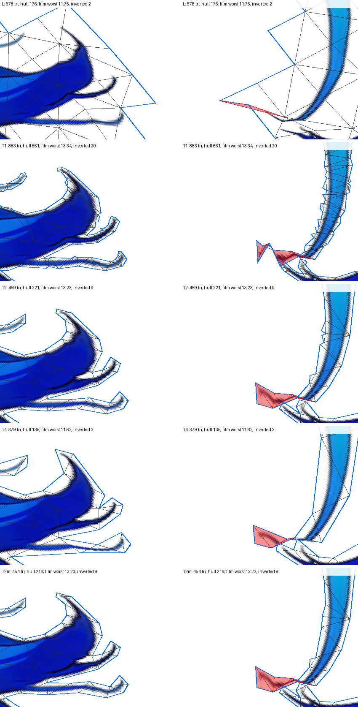

# The curled tips are a tear in the weight rule (issue #265, diagnosis)

> Measured on rig-c 2.40.0 (`bun.lock` at the merge of PR #283). rig-c 2.45.2 fixed `rigc render`'s physics clock (core#1380), so figures read through `rigc render` move under it: on demo `tools/tear_survey.ts` reads 2.428 → 2.426 and 1.823 → 1.844 (rig-c 2.40.0 against 2.47.0), a move in the second and third decimal that flips no verdict there; no verdict on this page sits within 0.021 of its line, the larger of the two moves. This page is a record and is not re-run (#311).

Stage D's (G) — the traced outline with a coarse interior grid — read worse than the lattice on the trailer's
`hair_long` at the bends, in every traced arm alike (19.54 against 17.38 at 15°, 13 inverted triangles against 4).
This page asks what the lattice's staircase carries at the strand tips that a traced outline does not, on that one
part: the outline at T 1, 2 and 4, and T 2 with its shortest edges merged.

## Reading

- **The outline is not the cause.** None of the four outlines moves the tips the way the question expected. More
  outline vertices make it worse (T1: 661 hull vertices, 19.71 and 30 inverted at 15°), fewer make it a little
  better (T4: 135, 17.16 and 9), merging the five edges under 2T changes nothing (T2m reads as T2 to the hundredth).
  The premise is also contradicted on the count: the lattice has *fewer* boundary vertices than T2 (176 against 221),
  and at the curls it wraps whole strand tips in 30 px cells (picture).
- **The reference itself tears there.** The part's weight rule keeps the four largest influences and drops any under
  0.03 (`DEFAULT_LIMITS`). The inner curls lie 105–110 px from the nearest segment, where the raw weights flatten:
  at the T2 worst site, (296.5, 885.5), the fourth and fifth nearest segments are `tail_r0` at 316 px and the other
  tail's `tail_l3` at 318 px, so the fourth place changes hands within a few pixels (the site keeps `tail_r0`; the
  outline vertex 4.5 px away keeps `tail_l3` at 0.084), and the floor drops and admits bones near 0.03 the same way. At a bend those bones are hundreds of px apart, so the field jumps: two reference
  samples 3 px apart at that site land **30.18 px** apart at 15° and 21.35 px apart at the film's bends. No mesh can
  follow a jump; a triangle whose corners straddle it is smeared (the lattice's worst sits in a half cell whose long side
  is 42 px) or, when it is small enough, folded (every distinct inverted triangle of the traced variants has all three
  corners on the outline, and all but one sit in the strand tips; T1's one other is at the top of the part). That is why the finer outline folds more: it resolves the tear into more small triangles.
- **Lifting the cap and the floor removes it, for every mesh.** The same builds read with the rule uncapped and
  unfloored on the vertices and on the reference alike: no inverted triangle in any variant, and the worst at 15°
  falls from 17–20 px to 5.55–7.24 px (the lattice 5.64, T2 6.68, T1 5.55). Lifting only one leaves the other's tear
  (no cap: 17.68 px gap, 19–57 inverted; no floor: the cap's 30.18 px gap stands). Two causes, one mechanism: a
  discontinuity in which bones a vertex keeps.
- **For the (G) line.** Under the rule as built, T4 is within 10 % of the lattice at the film's bends (11.62 against
  11.75) with one inversion more (3 against 2) and a stretch of 18.79 against 3.48; no variant has no more inversions than the lattice at 15°. Under the
  uncapped rule, T2 reads 6.68 against the lattice's 5.64 at 15° (+18 %) and 4.26 against 3.79 at the film's bends
  (+12 %); T1 reads under the lattice on both. These are diagnoses, not proposals: the cap and the floor are the
  rig's weight rule for every part, and changing them is not this page's to decide.

The picture: the trailer's `hair_long` at the film's bends (+θ on every link), two crops — the right tail's inner curls
(left column) and the left tail's (right column) — for L, T1, T2, T4 and T2m from the top. The flung flap in the right
column is the tear: one strand tip carried by the other tail's last link.

Generated by `tools/tip_survey.ts --page`; every figure below is the tool's. Variants are in its header: L the lattice; T1, T2, T4 the traced outline at tolerance = margin = T with the contour mode's interior grid at round(H / 37) (T2 is Stage D's (G) on this part); T2c T2's vertices triangulated again by `cdt` (the control for the merged variant's triangulator); T2m T2's outline with every edge shorter than 2T merged to its midpoint. Only the named part's mesh changes; every other part keeps its lattice. Readings are against Stage C's dense reference, at the idle and at the bend sets of `tools/bend_survey.ts`.

## trailer, hair_long

T = 2; the interior spacing 30.

| variant | check | triangles | hull vertices | outline edges min / median / max | edges under T / 2T / 4T | smallest angle under 10° | outline-only triangles | idle: worst / inverted (distinct triangles; with all corners on the outline) | fallback: worst / inverted (distinct triangles; with all corners on the outline) | film: worst / inverted (distinct triangles; with all corners on the outline) | fallback: stretch | film: stretch |
| --- | --- | ---: | ---: | --- | --- | ---: | ---: | --- | --- | --- | ---: | ---: |
| L | PASS | 578 | 176 | 12.00 / 30.00 / 30.00 | 0 / 0 / 0 | 0 | 22 | 1.12 / 0 (0; 0) | 17.38 / 4 (4; 0) | 11.75 / 2 (2; 0) | 6.97 | 3.48 |
| T1 | PASS | 883 | 661 | 2.00 / 6.00 / 61.19 | 27 / 216 / 396 | 102 | 415 | 1.18 / 0 (0; 0) | 19.71 / 30 (29; 29) | 13.34 / 20 (20; 20) | 7.89 | 5.63 |
| T2 | PASS | 459 | 221 | 3.00 / 20.00 / 133.15 | 0 / 5 / 25 | 2 | 109 | 1.17 / 0 (0; 0) | 19.54 / 13 (13; 13) | 13.23 / 9 (9; 9) | 8.20 | 5.03 |
| T4 | PASS | 379 | 135 | 7.07 / 33.53 / 172.35 | 0 / 0 / 2 | 4 | 61 | 1.06 / 0 (0; 0) | 17.16 / 9 (9; 9) | 11.62 / 3 (3; 3) | 4.66 | 18.79 |
| T2c | PASS | 459 | 221 | 3.00 / 20.00 / 133.15 | 0 / 5 / 25 | 2 | 109 | 1.17 / 0 (0; 0) | 19.54 / 13 (13; 13) | 13.23 / 9 (9; 9) | 8.20 | 5.03 |
| T2m | PASS | 454 | 216 | 4.12 / 20.22 / 133.15 | 0 / 0 / 19 | 1 | 104 | 1.17 / 0 (0; 0) | 19.54 / 13 (13; 13) | 13.23 / 9 (9; 9) | 8.20 | 5.03 |

- **L** — the lattice, grid 30.
  - idle: worst 1.12 at (233.50, 990.50), tail_r3, 10.50 px in from the outline, 14.85 px from a vertex; its triangle: 2 corners on the outline, longest edge 42.43, smallest angle 45.0°; 17668 samples in the mesh, 0 outside.
    the five worst, 8 px apart: 1.12 (233.50, 990.50) tail_r3; 1.09 (515.50, 888.50) tail_l3; 1.05 (572.50, 987.50) tail_l3; 0.98 (587.50, 999.50) tail_l3; 0.93 (296.50, 885.50) tail_r3.
  - fallback: worst 17.38 at (515.50, 888.50), tail_l3, 22.50 px in from the outline, 10.61 px from a vertex; its triangle: 2 corners on the outline, longest edge 42.43, smallest angle 45.0°; 17668 samples in the mesh, 0 outside.
    inverted: (503.00, 871.00) 2/3 on the outline, 45.0°, 42.43 px; (533.00, 901.00) 0/3 on the outline, 45.0°, 42.43 px; (603.00, 1005.00) 2/3 on the outline, 21.8°, 32.31 px; (303.00, 871.00) 2/3 on the outline, 45.0°, 42.43 px.
    the five worst, 8 px apart: 17.38 (515.50, 888.50) tail_l3; 15.76 (296.50, 885.50) tail_r3; 13.15 (281.50, 900.50) tail_r3; 12.69 (509.50, 882.50) tail_l3; 12.29 (233.50, 990.50) tail_r3.
  - film: worst 11.75 at (515.50, 888.50), tail_l3, 22.50 px in from the outline, 10.61 px from a vertex; its triangle: 2 corners on the outline, longest edge 42.43, smallest angle 45.0°; 17668 samples in the mesh, 0 outside.
    inverted: (503.00, 871.00) 2/3 on the outline, 45.0°, 42.43 px; (303.00, 871.00) 2/3 on the outline, 45.0°, 42.43 px.
    the five worst, 8 px apart: 11.75 (515.50, 888.50) tail_l3; 10.68 (296.50, 885.50) tail_r3; 8.91 (281.50, 900.50) tail_r3; 8.58 (509.50, 882.50) tail_l3; 8.36 (233.50, 990.50) tail_r3.
- **T1** — contourMesh tolerance 1, margin 1, spacing 30, stray 2 (uncovered 0).
  - idle: worst 1.18 at (296.50, 885.50), tail_r3, 3.35 px in from the outline, 3.54 px from a vertex; its triangle: 3 corners on the outline, longest edge 12.00, smallest angle 45.0°; 17663 samples in the mesh, 5 outside.
    the five worst, 8 px apart: 1.18 (296.50, 885.50) tail_r3; 1.00 (521.50, 888.50) tail_l3; 0.81 (512.50, 885.50) tail_l3; 0.80 (284.50, 897.50) tail_r3; 0.78 (572.50, 987.50) tail_l3.
  - fallback: worst 19.71 at (296.50, 885.50), tail_r3, 3.35 px in from the outline, 3.54 px from a vertex; its triangle: 3 corners on the outline, longest edge 12.00, smallest angle 45.0°; 17663 samples in the mesh, 5 outside.
    inverted: (585.00, 999.00) 3/3 on the outline, 56.6°, 12.53 px; (579.33, 998.33) 3/3 on the outline, 36.4°, 12.04 px; (577.67, 990.67) 3/3 on the outline, 55.3°, 7.07 px; (572.33, 986.67) 3/3 on the outline, 39.6°, 11.40 px; (576.00, 988.00) 3/3 on the outline, 22.7°, 7.28 px; (556.33, 936.00) 3/3 on the outline, 4.5°, 31.58 px; (529.67, 888.67) 3/3 on the outline, 30.3°, 20.00 px; (514.67, 887.33) 3/3 on the outline, 38.4°, 11.70 px; (522.33, 886.33) 3/3 on the outline, 30.3°, 14.00 px; (511.33, 884.00) 3/3 on the outline, 39.0°, 9.49 px; (503.67, 878.00) 3/3 on the outline, 34.5°, 7.62 px; (506.00, 879.33) 3/3 on the outline, 49.8°, 7.62 px; (210.00, 987.67) 3/3 on the outline, 16.9°, 5.83 px; (598.00, 891.67) 3/3 on the outline, 14.0°, 5.83 px; (614.67, 829.33) 3/3 on the outline, 14.5°, 6.40 px; (284.00, 894.33) 3/3 on the outline, 36.2°, 16.28 px; (282.67, 901.67) 3/3 on the outline, 32.0°, 18.68 px; (279.00, 905.67) 3/3 on the outline, 13.0°, 23.02 px; (288.67, 892.00) 3/3 on the outline, 9.2°, 16.49 px; (289.00, 897.67) 3/3 on the outline, 11.9°, 15.30 px; (293.67, 883.67) 3/3 on the outline, 45.0°, 12.00 px; (293.33, 891.33) 3/3 on the outline, 40.6°, 17.89 px; (297.67, 879.67) 3/3 on the outline, 45.0°, 12.00 px; (259.67, 950.33) 3/3 on the outline, 38.6°, 15.13 px; (249.33, 950.00) 3/3 on the outline, 22.0°, 22.14 px; (232.67, 991.67) 3/3 on the outline, 47.3°, 11.40 px; (227.33, 992.67) 3/3 on the outline, 50.3°, 12.08 px; (118.33, 929.00) 3/3 on the outline, 10.3°, 10.00 px; (355.33, 116.33) 3/3 on the outline, 6.6°, 11.70 px.
    the five worst, 8 px apart: 19.71 (296.50, 885.50) tail_r3; 16.23 (521.50, 888.50) tail_l3; 13.16 (284.50, 897.50) tail_r3; 13.08 (512.50, 885.50) tail_l3; 12.31 (269.50, 909.50) tail_r3.
  - film: worst 13.34 at (296.50, 885.50), tail_r3, 3.35 px in from the outline, 3.54 px from a vertex; its triangle: 3 corners on the outline, longest edge 12.00, smallest angle 45.0°; 17663 samples in the mesh, 5 outside.
    inverted: (579.33, 998.33) 3/3 on the outline, 36.4°, 12.04 px; (572.33, 986.67) 3/3 on the outline, 39.6°, 11.40 px; (576.00, 988.00) 3/3 on the outline, 22.7°, 7.28 px; (529.67, 888.67) 3/3 on the outline, 30.3°, 20.00 px; (514.67, 887.33) 3/3 on the outline, 38.4°, 11.70 px; (522.33, 886.33) 3/3 on the outline, 30.3°, 14.00 px; (511.33, 884.00) 3/3 on the outline, 39.0°, 9.49 px; (503.67, 878.00) 3/3 on the outline, 34.5°, 7.62 px; (506.00, 879.33) 3/3 on the outline, 49.8°, 7.62 px; (556.33, 936.00) 3/3 on the outline, 4.5°, 31.58 px; (598.00, 891.67) 3/3 on the outline, 14.0°, 5.83 px; (614.67, 829.33) 3/3 on the outline, 14.5°, 6.40 px; (284.00, 894.33) 3/3 on the outline, 36.2°, 16.28 px; (279.00, 905.67) 3/3 on the outline, 13.0°, 23.02 px; (288.67, 892.00) 3/3 on the outline, 9.2°, 16.49 px; (289.00, 897.67) 3/3 on the outline, 11.9°, 15.30 px; (293.67, 883.67) 3/3 on the outline, 45.0°, 12.00 px; (293.33, 891.33) 3/3 on the outline, 40.6°, 17.89 px; (297.67, 879.67) 3/3 on the outline, 45.0°, 12.00 px; (118.33, 929.00) 3/3 on the outline, 10.3°, 10.00 px.
    the five worst, 8 px apart: 13.34 (296.50, 885.50) tail_r3; 10.98 (521.50, 888.50) tail_l3; 8.91 (284.50, 897.50) tail_r3; 8.84 (512.50, 885.50) tail_l3; 8.34 (269.50, 909.50) tail_r3.
- **T2** — contourMesh tolerance 2, margin 2, spacing 30, stray 2 (uncovered 0).
  - idle: worst 1.17 at (296.50, 885.50), tail_r3, 4.30 px in from the outline, 4.53 px from a vertex; its triangle: 3 corners on the outline, longest edge 15.03, smallest angle 45.4°; 17668 samples in the mesh, 0 outside.
    the five worst, 8 px apart: 1.17 (296.50, 885.50) tail_r3; 0.99 (518.50, 888.50) tail_l3; 0.97 (509.50, 882.50) tail_l3; 0.87 (233.50, 990.50) tail_r3; 0.83 (287.50, 894.50) tail_r3.
  - fallback: worst 19.54 at (296.50, 885.50), tail_r3, 4.30 px in from the outline, 4.53 px from a vertex; its triangle: 3 corners on the outline, longest edge 15.03, smallest angle 45.4°; 17668 samples in the mesh, 0 outside.
    inverted: (586.00, 998.00) 3/3 on the outline, 25.8°, 34.44 px; (529.67, 889.00) 3/3 on the outline, 36.9°, 20.00 px; (513.33, 887.33) 3/3 on the outline, 39.1°, 11.70 px; (521.00, 885.67) 3/3 on the outline, 40.0°, 18.03 px; (507.33, 882.33) 3/3 on the outline, 34.9°, 13.04 px; (506.67, 877.67) 3/3 on the outline, 26.2°, 13.00 px; (286.00, 892.33) 3/3 on the outline, 29.2°, 19.70 px; (282.00, 902.33) 3/3 on the outline, 42.8°, 27.66 px; (293.00, 883.67) 3/3 on the outline, 45.4°, 15.03 px; (294.00, 890.67) 3/3 on the outline, 56.9°, 15.03 px; (298.00, 879.33) 3/3 on the outline, 48.4°, 12.04 px; (259.67, 950.00) 3/3 on the outline, 46.3°, 15.13 px; (249.33, 950.33) 3/3 on the outline, 29.1°, 22.14 px.
    the five worst, 8 px apart: 19.54 (296.50, 885.50) tail_r3; 16.16 (518.50, 888.50) tail_l3; 15.74 (509.50, 882.50) tail_l3; 13.89 (284.50, 897.50) tail_r3; 12.67 (269.50, 909.50) tail_r3.
  - film: worst 13.23 at (296.50, 885.50), tail_r3, 4.30 px in from the outline, 4.53 px from a vertex; its triangle: 3 corners on the outline, longest edge 15.03, smallest angle 45.4°; 17668 samples in the mesh, 0 outside.
    inverted: (529.67, 889.00) 3/3 on the outline, 36.9°, 20.00 px; (513.33, 887.33) 3/3 on the outline, 39.1°, 11.70 px; (521.00, 885.67) 3/3 on the outline, 40.0°, 18.03 px; (507.33, 882.33) 3/3 on the outline, 34.9°, 13.04 px; (506.67, 877.67) 3/3 on the outline, 26.2°, 13.00 px; (286.00, 892.33) 3/3 on the outline, 29.2°, 19.70 px; (293.00, 883.67) 3/3 on the outline, 45.4°, 15.03 px; (294.00, 890.67) 3/3 on the outline, 56.9°, 15.03 px; (298.00, 879.33) 3/3 on the outline, 48.4°, 12.04 px.
    the five worst, 8 px apart: 13.23 (296.50, 885.50) tail_r3; 10.94 (518.50, 888.50) tail_l3; 10.64 (509.50, 882.50) tail_l3; 9.41 (284.50, 897.50) tail_r3; 8.58 (269.50, 909.50) tail_r3.
- **T4** — contourMesh tolerance 4, margin 4, spacing 30, stray 2 (uncovered 0).
  - idle: worst 1.06 at (518.50, 888.50), tail_l3, 4.50 px in from the outline, 6.36 px from a vertex; its triangle: 3 corners on the outline, longest edge 20.81, smallest angle 38.4°; 17668 samples in the mesh, 0 outside.
    the five worst, 8 px apart: 1.06 (518.50, 888.50) tail_l3; 0.92 (296.50, 888.50) tail_r3; 0.82 (509.50, 882.50) tail_l3; 0.81 (554.50, 942.50) tail_l3; 0.80 (272.50, 906.50) tail_r3.
  - fallback: worst 17.16 at (518.50, 888.50), tail_l3, 4.50 px in from the outline, 6.36 px from a vertex; its triangle: 3 corners on the outline, longest edge 20.81, smallest angle 38.4°; 17668 samples in the mesh, 0 outside.
    inverted: (563.67, 985.00) 3/3 on the outline, 35.5°, 25.81 px; (576.33, 986.67) 3/3 on the outline, 43.9°, 21.59 px; (529.33, 889.00) 3/3 on the outline, 35.2°, 29.00 px; (508.67, 883.33) 3/3 on the outline, 34.8°, 21.93 px; (519.33, 884.67) 3/3 on the outline, 38.4°, 20.81 px; (506.00, 876.33) 3/3 on the outline, 36.7°, 14.32 px; (294.33, 887.00) 3/3 on the outline, 43.2°, 27.89 px; (287.67, 900.00) 3/3 on the outline, 40.8°, 27.02 px; (235.00, 994.67) 3/3 on the outline, 34.2°, 32.39 px.
    the five worst, 8 px apart: 17.16 (518.50, 888.50) tail_l3; 14.97 (296.50, 888.50) tail_r3; 13.34 (272.50, 906.50) tail_r3; 13.24 (509.50, 882.50) tail_l3; 11.78 (551.50, 921.50) tail_l3.
  - film: worst 11.62 at (518.50, 888.50), tail_l3, 4.50 px in from the outline, 6.36 px from a vertex; its triangle: 3 corners on the outline, longest edge 20.81, smallest angle 38.4°; 17668 samples in the mesh, 0 outside.
    inverted: (508.67, 883.33) 3/3 on the outline, 34.8°, 21.93 px; (519.33, 884.67) 3/3 on the outline, 38.4°, 20.81 px; (506.00, 876.33) 3/3 on the outline, 36.7°, 14.32 px.
    the five worst, 8 px apart: 11.62 (518.50, 888.50) tail_l3; 10.11 (296.50, 888.50) tail_r3; 9.03 (272.50, 906.50) tail_r3; 8.95 (509.50, 882.50) tail_l3; 7.94 (551.50, 921.50) tail_l3.
- **T2c** — T2's vertices, triangulated by cdt (trianglesNotInContourMesh 0).
  - idle: worst 1.17 at (296.50, 885.50), tail_r3, 4.30 px in from the outline, 4.53 px from a vertex; its triangle: 3 corners on the outline, longest edge 15.03, smallest angle 45.4°; 17668 samples in the mesh, 0 outside.
    the five worst, 8 px apart: 1.17 (296.50, 885.50) tail_r3; 0.99 (518.50, 888.50) tail_l3; 0.97 (509.50, 882.50) tail_l3; 0.87 (233.50, 990.50) tail_r3; 0.83 (287.50, 894.50) tail_r3.
  - fallback: worst 19.54 at (296.50, 885.50), tail_r3, 4.30 px in from the outline, 4.53 px from a vertex; its triangle: 3 corners on the outline, longest edge 15.03, smallest angle 45.4°; 17668 samples in the mesh, 0 outside.
    inverted: (586.00, 998.00) 3/3 on the outline, 25.8°, 34.44 px; (513.33, 887.33) 3/3 on the outline, 39.1°, 11.70 px; (507.33, 882.33) 3/3 on the outline, 34.9°, 13.04 px; (506.67, 877.67) 3/3 on the outline, 26.2°, 13.00 px; (529.67, 889.00) 3/3 on the outline, 36.9°, 20.00 px; (521.00, 885.67) 3/3 on the outline, 40.0°, 18.03 px; (293.00, 883.67) 3/3 on the outline, 45.4°, 15.03 px; (298.00, 879.33) 3/3 on the outline, 48.4°, 12.04 px; (286.00, 892.33) 3/3 on the outline, 29.2°, 19.70 px; (294.00, 890.67) 3/3 on the outline, 56.9°, 15.03 px; (282.00, 902.33) 3/3 on the outline, 42.8°, 27.66 px; (259.67, 950.00) 3/3 on the outline, 46.3°, 15.13 px; (249.33, 950.33) 3/3 on the outline, 29.1°, 22.14 px.
    the five worst, 8 px apart: 19.54 (296.50, 885.50) tail_r3; 16.16 (518.50, 888.50) tail_l3; 15.74 (509.50, 882.50) tail_l3; 13.89 (284.50, 897.50) tail_r3; 12.67 (269.50, 909.50) tail_r3.
  - film: worst 13.23 at (296.50, 885.50), tail_r3, 4.30 px in from the outline, 4.53 px from a vertex; its triangle: 3 corners on the outline, longest edge 15.03, smallest angle 45.4°; 17668 samples in the mesh, 0 outside.
    inverted: (513.33, 887.33) 3/3 on the outline, 39.1°, 11.70 px; (507.33, 882.33) 3/3 on the outline, 34.9°, 13.04 px; (506.67, 877.67) 3/3 on the outline, 26.2°, 13.00 px; (529.67, 889.00) 3/3 on the outline, 36.9°, 20.00 px; (521.00, 885.67) 3/3 on the outline, 40.0°, 18.03 px; (293.00, 883.67) 3/3 on the outline, 45.4°, 15.03 px; (298.00, 879.33) 3/3 on the outline, 48.4°, 12.04 px; (286.00, 892.33) 3/3 on the outline, 29.2°, 19.70 px; (294.00, 890.67) 3/3 on the outline, 56.9°, 15.03 px.
    the five worst, 8 px apart: 13.23 (296.50, 885.50) tail_r3; 10.94 (518.50, 888.50) tail_l3; 10.64 (509.50, 882.50) tail_l3; 9.41 (284.50, 897.50) tail_r3; 8.58 (269.50, 909.50) tail_r3.
- **T2m** — T2's outline with every edge under 4 px merged to its midpoint (5 merged, 0 skipped to keep the art covered), its interior kept, triangulated by cdt (merged 5, skipped 0, uncovered 0, interiorDropped 0).
  - idle: worst 1.17 at (296.50, 885.50), tail_r3, 4.30 px in from the outline, 4.53 px from a vertex; its triangle: 3 corners on the outline, longest edge 15.03, smallest angle 45.4°; 17668 samples in the mesh, 0 outside.
    the five worst, 8 px apart: 1.17 (296.50, 885.50) tail_r3; 0.99 (518.50, 888.50) tail_l3; 0.97 (509.50, 882.50) tail_l3; 0.87 (233.50, 990.50) tail_r3; 0.83 (287.50, 894.50) tail_r3.
  - fallback: worst 19.54 at (296.50, 885.50), tail_r3, 4.30 px in from the outline, 4.53 px from a vertex; its triangle: 3 corners on the outline, longest edge 15.03, smallest angle 45.4°; 17668 samples in the mesh, 0 outside.
    inverted: (586.00, 998.00) 3/3 on the outline, 25.8°, 34.44 px; (513.33, 887.33) 3/3 on the outline, 39.1°, 11.70 px; (507.33, 882.33) 3/3 on the outline, 34.9°, 13.04 px; (506.67, 877.67) 3/3 on the outline, 26.2°, 13.00 px; (529.67, 889.00) 3/3 on the outline, 36.9°, 20.00 px; (521.00, 885.67) 3/3 on the outline, 40.0°, 18.03 px; (293.00, 883.67) 3/3 on the outline, 45.4°, 15.03 px; (298.00, 879.33) 3/3 on the outline, 48.4°, 12.04 px; (286.00, 892.33) 3/3 on the outline, 29.2°, 19.70 px; (294.00, 890.67) 3/3 on the outline, 56.9°, 15.03 px; (282.00, 902.33) 3/3 on the outline, 42.8°, 27.66 px; (259.67, 950.00) 3/3 on the outline, 46.3°, 15.13 px; (249.33, 950.33) 3/3 on the outline, 29.1°, 22.14 px.
    the five worst, 8 px apart: 19.54 (296.50, 885.50) tail_r3; 16.16 (518.50, 888.50) tail_l3; 15.74 (509.50, 882.50) tail_l3; 13.89 (284.50, 897.50) tail_r3; 12.67 (269.50, 909.50) tail_r3.
  - film: worst 13.23 at (296.50, 885.50), tail_r3, 4.30 px in from the outline, 4.53 px from a vertex; its triangle: 3 corners on the outline, longest edge 15.03, smallest angle 45.4°; 17668 samples in the mesh, 0 outside.
    inverted: (513.33, 887.33) 3/3 on the outline, 39.1°, 11.70 px; (507.33, 882.33) 3/3 on the outline, 34.9°, 13.04 px; (506.67, 877.67) 3/3 on the outline, 26.2°, 13.00 px; (529.67, 889.00) 3/3 on the outline, 36.9°, 20.00 px; (521.00, 885.67) 3/3 on the outline, 40.0°, 18.03 px; (293.00, 883.67) 3/3 on the outline, 45.4°, 15.03 px; (298.00, 879.33) 3/3 on the outline, 48.4°, 12.04 px; (286.00, 892.33) 3/3 on the outline, 29.2°, 19.70 px; (294.00, 890.67) 3/3 on the outline, 56.9°, 15.03 px.
    the five worst, 8 px apart: 13.23 (296.50, 885.50) tail_r3; 10.94 (518.50, 888.50) tail_l3; 10.64 (509.50, 882.50) tail_l3; 9.41 (284.50, 897.50) tail_r3; 8.58 (269.50, 909.50) tail_r3.

The same meshes and builds, read under the weight rule as built and with its cap, its floor or both lifted — on the vertices and on the reference alike (worst / inverted; idle, 15°, film):

| variant | as built | no cap (floor 0.03 kept) | no floor (cap 4 kept) | uncapped |
| --- | --- | --- | --- | --- |
| L | 1.12 / 0; 17.38 / 4; 11.75 / 2 | 0.94 / 0; 13.24 / 19; 9.01 / 1 | 1.09 / 0; 17.38 / 3; 11.75 / 2 | 0.41 / 0; 5.64 / 0; 3.79 / 0 |
| T1 | 1.18 / 0; 19.71 / 30; 13.34 / 20 | 0.89 / 0; 12.03 / 57; 8.08 / 26 | 1.18 / 0; 19.71 / 15; 13.34 / 13 | 0.40 / 0; 5.55 / 0; 3.68 / 0 |
| T2 | 1.17 / 0; 19.54 / 13; 13.23 / 9 | 0.96 / 0; 13.43 / 28; 9.03 / 10 | 1.17 / 0; 19.54 / 10; 13.23 / 9 | 0.47 / 0; 6.68 / 0; 4.26 / 0 |
| T4 | 1.06 / 0; 17.16 / 9; 11.62 / 3 | 0.91 / 0; 13.43 / 19; 9.08 / 4 | 1.06 / 0; 17.16 / 6; 11.62 / 3 | 0.47 / 0; 7.24 / 0; 4.57 / 0 |
| T2c | 1.17 / 0; 19.54 / 13; 13.23 / 9 | 0.96 / 0; 13.43 / 28; 9.03 / 10 | 1.17 / 0; 19.54 / 10; 13.23 / 9 | 0.47 / 0; 6.68 / 0; 4.26 / 0 |
| T2m | 1.17 / 0; 19.54 / 13; 13.23 / 9 | 0.96 / 0; 13.43 / 28; 9.03 / 10 | 1.17 / 0; 19.54 / 10; 13.23 / 9 | 0.47 / 0; 6.77 / 0; 4.32 / 0 |

The reference's own largest gap between two neighbouring samples (posed distance, rig px; their rest distance is the stride), where it is, whether the two keep different bones, and how many neighbouring pairs keep different bones:

| set | rule | gap | rest | at | the two keep different bones | pairs keeping different bones |
| --- | --- | ---: | ---: | --- | --- | ---: |
| idle | as built (cap 4, floor 0.03) | 4.55 | 3 | (296.50, 887.00) | yes | 2425 of 33801 |
| idle | no cap (floor 0.03 kept) | 4.21 | 3 | (262.00, 927.50) | yes | 2612 of 33801 |
| idle | no floor (cap 4 kept) | 4.55 | 3 | (296.50, 887.00) | yes | 291 of 33801 |
| idle | uncapped | 3.23 | 3 | (274.00, 951.50) | no | 0 of 33801 |
| fallback | as built (cap 4, floor 0.03) | 30.18 | 3 | (296.50, 887.00) | yes | 2425 of 33801 |
| fallback | no cap (floor 0.03 kept) | 17.68 | 3 | (541.00, 885.50) | yes | 2612 of 33801 |
| fallback | no floor (cap 4 kept) | 30.18 | 3 | (296.50, 887.00) | yes | 291 of 33801 |
| fallback | uncapped | 4.63 | 3 | (535.00, 936.50) | no | 0 of 33801 |
| film | as built (cap 4, floor 0.03) | 21.35 | 3 | (296.50, 887.00) | yes | 2425 of 33801 |
| film | no cap (floor 0.03 kept) | 12.82 | 3 | (541.00, 885.50) | yes | 2612 of 33801 |
| film | no floor (cap 4 kept) | 21.35 | 3 | (296.50, 887.00) | yes | 291 of 33801 |
| film | uncapped | 4.11 | 3 | (541.00, 939.50) | no | 0 of 33801 |

Each mesh read at each mesh's own worst sample (rows: whose worst sample; columns: the mesh read there).

idle:

| site of | L | T1 | T2 | T4 | T2c | T2m |
| --- | ---: | ---: | ---: | ---: | ---: | ---: |
| L | 1.12 | 0.73 | 0.87 | 0.15 | 0.87 | 0.87 |
| T1 | 0.93 | 1.18 | 1.17 | 0.53 | 1.17 | 1.17 |
| T2 | 0.93 | 1.18 | 1.17 | 0.53 | 1.17 | 1.17 |
| T4 | 0.48 | 1.00 | 0.99 | 1.06 | 0.99 | 0.99 |
| T2c | 0.93 | 1.18 | 1.17 | 0.53 | 1.17 | 1.17 |
| T2m | 0.93 | 1.18 | 1.17 | 0.53 | 1.17 | 1.17 |

fallback:

| site of | L | T1 | T2 | T4 | T2c | T2m |
| --- | ---: | ---: | ---: | ---: | ---: | ---: |
| L | 17.38 | 5.08 | 7.90 | 9.15 | 7.90 | 7.90 |
| T1 | 15.76 | 19.71 | 19.54 | 9.03 | 19.54 | 19.54 |
| T2 | 15.76 | 19.71 | 19.54 | 9.03 | 19.54 | 19.54 |
| T4 | 7.93 | 16.22 | 16.16 | 17.16 | 16.16 | 16.16 |
| T2c | 15.76 | 19.71 | 19.54 | 9.03 | 19.54 | 19.54 |
| T2m | 15.76 | 19.71 | 19.54 | 9.03 | 19.54 | 19.54 |

film:

| site of | L | T1 | T2 | T4 | T2c | T2m |
| --- | ---: | ---: | ---: | ---: | ---: | ---: |
| L | 11.75 | 3.44 | 5.34 | 6.19 | 5.34 | 5.34 |
| T1 | 10.68 | 13.34 | 13.23 | 6.13 | 13.23 | 13.23 |
| T2 | 10.68 | 13.34 | 13.23 | 6.13 | 13.23 | 13.23 |
| T4 | 5.37 | 10.98 | 10.94 | 11.62 | 10.94 | 10.94 |
| T2c | 10.68 | 13.34 | 13.23 | 6.13 | 13.23 | 13.23 |
| T2m | 10.68 | 13.34 | 13.23 | 6.13 | 13.23 | 13.23 |
