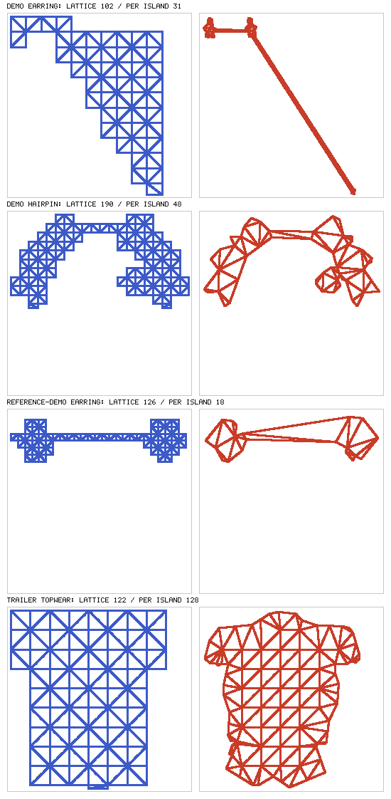

# A draft per island (issue #326, Stage A)

> Measured on `@rig-c/parts` 1.13.1 with rig-c 2.47.1 (`bun.lock` at this commit), over the four public examples (`bun run fetch-examples`) and the trailer's figure (`rig-c/trailer` 6e2de45, `inputs/`). The exam's two paintings, which the card also names, are not on this page (see *Not measured*). Every figure below is `tools/island_draft_survey.ts`'s. Two runs wrote the same JSON on every figure (on demo and reference-demo after the `check` reading was added; on the other three before it, which adds only `"check": null` there).

## The line, stated before measuring

The card's Stage A asks three things and sets the bar for Stage B: "If the saving is real". Read as a line before any number was taken:

1. **Count**: the parts whose art holds two or more real islands by `dustOf`'s rule (`src/meshdraft.ts`: every 4-connected island of alpha above 8 past the largest that is more than 4 px or more than 0.1 % of the part's art). Counted over every part; mesh-draft reads only the lattice entries among them.
2. **Triangles**: for each such lattice part, the lattice's triangles against the sum of mesh-draft's own candidate per island (`candidateMesh` at the figure's T and S, built by the rig stage's `contourMesh` on the part's image with the other real islands cleared). The saving is **real** on a part when the islands, joined into the one attachment Spine and rig-c take, have fewer triangles than the lattice.
3. **Motion**: for those parts, mesh-draft's five readings through its own instruments (`compareMeshesInMotion` over the idle and the 15° bend set against the lattice and the dense reference; `check` for the bars; the triangle line). The saving is worth Stage B when a lighter join also passes all five — said per part, and said when a reading had nothing to discriminate.

If one attachment cannot hold several outlines, say what refuses it and what it would take (the card: "a finding, not a failure").

## How it was measured

`tools/island_draft_survey.ts`, run once per figure over the assembled parts (`rig-parts assemble` with the figure's own config), then `--page`. The examples' configs are used as they ship; the trailer's holds no lattice, so `--lattice-all` gives every mesh entry a lattice at the figure's spacing (`figureGrid`, 30 here), keeping `r`, `segments`, `exponent`, `rule` and a lattice-shaped `influences` — the lattice config AUTHORING §3 (*Which mode comes out smaller*) built for the same figure.

- **One attachment.** Spine's mesh has one `hull`, and rig-c's compile reads one outline per mesh (`traceOutline` then `checkHullOrder`, rig-c `src/mesh.ts`, whose doc names "two islands" among what it refuses). The islands' meshes concatenated as they stand were handed to rigc's gate to confirm it: the last table below is its refusal. The tool then joins the islands with a **bridge**: a quad between the nearest pair of outline vertices whose join passes `contourTopologyProblems` (`src/contour.ts`: one closed outline, hull first and in order, no self-crossing, triangles tiling the outline exactly). The outline walks island A, crosses to B, walks B and crosses back; each bridge adds two triangles and keeps Euler's count, 2·V − hull − 2, that rig-c and Spine's binary reader hold a mesh to.
- **Outlines that meet.** Each island's candidate is grown by its margin T, so two islands closer than about 2T get outlines that touch or overlap, and no bridge can make them one simple loop (`outlinesMeet`, exact in integers). Such islands were meshed as one, joined by the shortest 4-connected pixel path between them set to art (the "path px" column): an emulation of tracing their grown union as one island. It adds those path pixels to the art the outline is traced from and nothing else.
- **Weights.** Every part measured here is on the distance rule, so a vertex's weights depend on its position and the segments only, and the per-island build weights each vertex exactly as a build over the whole part would. Under `rule: "heat"` the per-island solve would differ from one over both islands; no part here exercised it.



## Results

| figure | H (px) | T | S | parts | lattice parts | lattice parts with 2+ real islands | other parts with 2+ real islands |
| --- | ---: | ---: | ---: | ---: | ---: | --- | --- |
| demo | 1185 | 2 | 32 | 23 | 9 | earring (grid; 406 + 342 + 8 + 2 + 1 px); hairpin (grid; 2995 + 2769 + 490 px) | shoes (none; 20936 + 16 px, +11 dust) |
| reference-demo | 1187 | 2 | 32 | 22 | 8 | earring (grid; 342 + 274 px) | lash_l (none; 339 + 1 px) |
| reference-sample | 1105 | 2 | 30 | 20 | 4 | none | mouth (none; 90 + 2 + 2 px); lash_r (none; 204 + 106 px) |
| scarf | 1106 | 2 | 30 | 24 | 6 | none | legwear (none; 20819 + 20800 px); brow_r (none; 29 + 1 px); brow_l (none; 22 + 4 + 2 px); mouth (none; 34 + 1 px) |
| trailer (every mesh a lattice at S) | 1108 | 2 | 30 | 23 | 10 | topwear (grid; 40830 + 41 px, +1 dust) | brow_r (none; 35 + 3 + 1 px) |

Per lattice part kept for a real piece: the lattice, each island's candidate (mesh-draft's, on the part's image with the other real islands cleared), their sum, and the islands joined by bridges into one attachment.

| figure | part | rule | lattice grid | lattice triangles | lattice overdraw | islands (px: triangles, overdraw) | Σ islands | outlines that meet, meshed as one (islands px; path px; triangles) | joined (+2 per bridge) | joined overdraw | bridge gap (px) | rigc, unbridged | rigc, bridged |
| --- | --- | --- | ---: | ---: | ---: | --- | ---: | --- | ---: | ---: | --- | --- | --- |
| demo | earring | distance | 34 | 102 | 77.318 | 406: 12, 1.499; 342: 12, 1.575; 8: 2, 4; 2: 2, 8; 1: 2, 13 | 30 | 8 + 2 + 1; 3; 3 | 31 | 4.826 | 67.067, 408.574 | exit 1 | exit 0 |
| demo | hairpin | distance | 11 | 190 | 1.817 | 2995: 19, 1.142; 2769: 17, 1.179; 490: 5, 1.319 | 41 | 2995 + 490; 4; 29 | 48 | 1.245 | 49.041 | exit 1 | exit 0 |
| reference-demo | earring | distance | 5 | 126 | 2.557 | 342: 7, 1.576; 274: 9, 1.799 | 16 | none | 18 | 2.906 | 64.031 | exit 1 | exit 0 |
| trailer | topwear | distance | 30 | 122 | 1.325 | 40830: 126, 1.043; 41: 2, 2.195 | 128 | 40830 + 41; 1; 128 | 128 | 1.044 |  | — (one unit) | exit 0 |

mesh-draft's five readings on the joined mesh, where it is lighter than the lattice (reading 1: `check` over the lattice rig with the part's attachment replaced, problems laid on the part by `partsNamed`):

- demo earring: PASS (check: lattice rig PASS, with the joined mesh PASS)
  - pass bars: every check bar reading the part passed
  - pass idle: 0 rig px from the lattice over the idle; at most 1 is required
  - pass bend inverted: the part's segments name no chain link, so its bend set is empty and there is nothing to read
  - pass bend worst: the part's segments name no chain link, so its bend set is empty and there is nothing to read
  - pass triangles: 31 triangle(s) against the lattice's 102; no more than the lattice's is required (--more-triangles lifts this line)
- demo hairpin: PASS (check: lattice rig PASS, with the joined mesh PASS)
  - pass bars: every check bar reading the part passed
  - pass idle: 0 rig px from the lattice over the idle; at most 1 is required
  - pass bend inverted: the part's segments name no chain link, so its bend set is empty and there is nothing to read
  - pass bend worst: the part's segments name no chain link, so its bend set is empty and there is nothing to read
  - pass triangles: 48 triangle(s) against the lattice's 190; no more than the lattice's is required (--more-triangles lifts this line)
- reference-demo earring: PASS (check: lattice rig PASS, with the joined mesh PASS)
  - pass bars: every check bar reading the part passed
  - pass idle: 0 rig px from the lattice over the idle; at most 1 is required
  - pass bend inverted: the part's segments name no chain link, so its bend set is empty and there is nothing to read
  - pass bend worst: the part's segments name no chain link, so its bend set is empty and there is nothing to read
  - pass triangles: 18 triangle(s) against the lattice's 126; no more than the lattice's is required (--more-triangles lifts this line)

rigc's lines on the unbridged concatenation (one per part, the first that names the outline):

- demo earring: exit 1 — `rigc compile error: skin "default" slot "earring" attachment "earring": the triangles' outline is not one closed loop: the walk from vertex 0 closes after 14 of 33 boundary vertices`
- demo hairpin: exit 1 — `rigc compile error: skin "default" slot "hairpin" attachment "hairpin": the triangles' outline is not one closed loop: the walk from vertex 0 closes after 31 of 50 boundary vertices`
- reference-demo earring: exit 1 — `rigc compile error: skin "default" slot "earring" attachment "earring": the triangles' outline is not one closed loop: the walk from vertex 0 closes after 9 of 20 boundary vertices`

## The answer

1. **Count.** Over the five figures, four lattice parts hold two or more real islands: demo `earring` (five: two drops and three specks of 8, 2 and 1 px that are real only because the 0.1 % share caps dust at 0.76 px on a 759 px part), demo `hairpin` (three), reference-demo `earring` (two drops) and the trailer's `topwear` under the lattice config (40830 px and a 41 px piece). Every other multi-island part is not a mesh in its config (a region: `shoes`, `legwear` on scarf, brows, lashes, mouths), so mesh-draft never reads it; scarf `legwear` (20819 + 20800 px, the two-leg case the card describes) is one of them.
2. **Triangles.** On the three earring and hairpin parts the join is far lighter than the lattice: 102 → 31, 190 → 48 and 126 → 18 triangles, with overdraw 77.32 → 4.83, 1.82 → 1.24 and 2.56 → 2.91. The trailer's `topwear` is not: its 41 px piece sits within the margin of the body, so it is meshed with it as one unit (128 triangles) against the lattice's 122, and the triangle line would keep the lattice. The reference-demo earring's overdraw rises (2.56 → 2.91): its lattice at grid 5 hugs the art, and the bridge spans the 64 px between the drops.
3. **Motion.** All three lighter joins pass all five readings: `check` PASS with the joined mesh in the rig, the idle 0 rig px from the lattice, the triangle line. The motion readings had **nothing to discriminate** on these parts: each is weighted to one bone (`earring`'s one segment, `hairpin`'s two segments on the one bone `hairpin`), so every vertex follows that bone rigidly under either mesh, the idle reads 0 by construction and the bend set is empty (no chain link). The case where per-island weighting matters — two islands pulled by different bones, the card's shoes and legs — exists on no lattice part of these figures.

So the saving is real on the parts that have it here (69.6 %, 74.7 % and 85.7 % fewer triangles), and one attachment can hold several islands **only through a bridge**: rig-c refuses two outlines in one mesh by name (`the triangles' outline is not one closed loop`), and a bridged outline passes rigc's gate and `check`. Two things Stage B has to settle that this measurement exposed:

- **Islands closer than the margin** (demo `earring`'s specks, demo `hairpin`'s 490 px piece against its 2995 px neighbour, the trailer's `topwear` piece): per-island outlines overlap. They have to be traced as one grown silhouette — the contour mode grows by T before it traces, so growing first and counting islands after would merge them — and this page emulated that with a pixel path; Stage B should do it in the trace, not in the art.
- **What a bridge spans**: demo `earring`'s join crosses 408 px to reach its lowest speck. The bridge is two thin triangles and drew nothing on `check`, but it is mesh where there is no art, and on a part whose islands ride different bones it would stretch between them. Whether a bridge is acceptable is a reading Stage B's fixture has to carry (two islands on two bones), since nothing public here measures it.

## Not measured

- **The exam's two paintings** (`rig-c/exam`; the card's `shoes` 62 and `legwear` 236 triangles on painting 71002). This run read only the public examples and the trailer, as the task named them; the exam's figures, where the multi-bone case lives, are left for a run that reads them.
- **A multi-bone multi-island lattice part**: none exists on these five figures, so readings 2–4 were read only where they are 0 by construction.
- `rule: "heat"` per island: no part here uses it.

## Re-running

```
bun run fetch-examples
rig-parts assemble --source <painting> --full <layers/full> --head <layers/head> --config <config.json> --out <asm>   # per figure
bun tools/island_draft_survey.ts --figure <key> --config <config.json> --parts <asm>/rig --scratch <dir> [--lattice-all] > <key>.json
bun tools/island_draft_survey.ts --page <key>.json… --picture docs/evidence/island-draft.png
```
