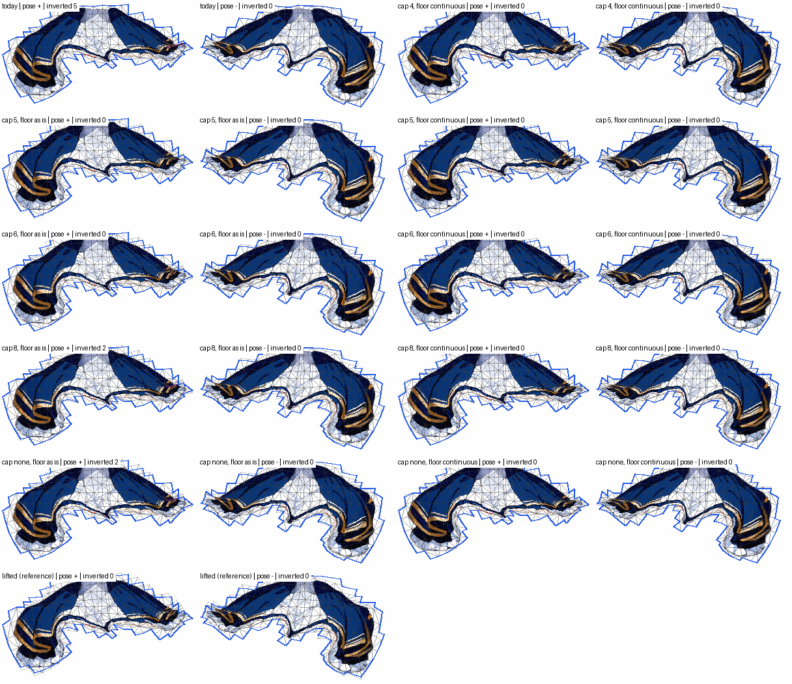
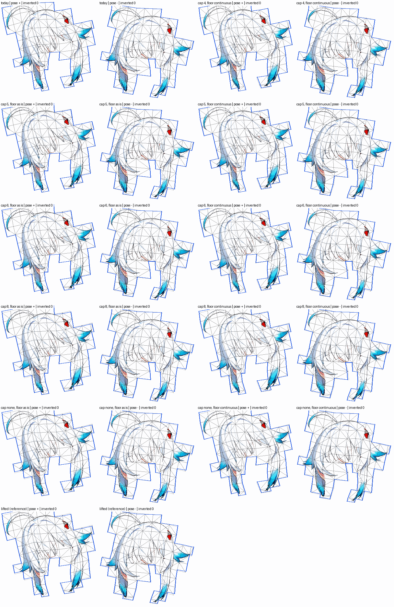
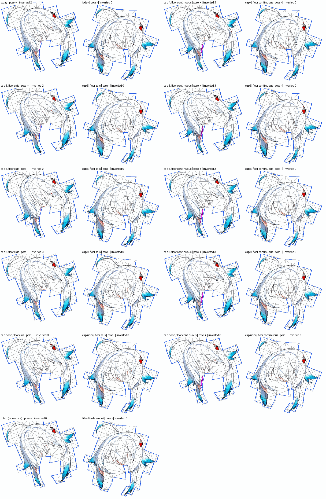
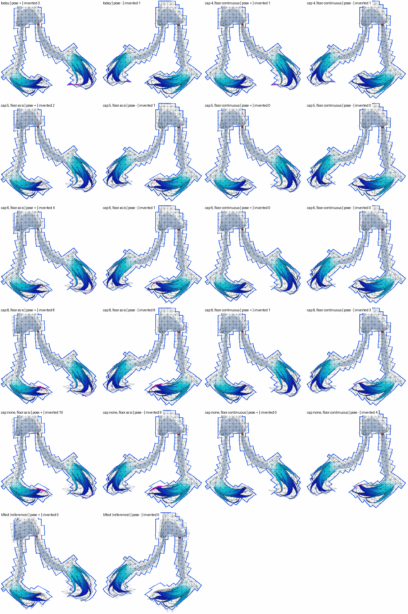

# The influence cap swept (issue #284, Stage E)

> Measured on rig-c 2.40.0 (`bun.lock` at the merge of PR #299). rig-c 2.45.2 fixed `rigc render`'s physics clock (core#1380), so figures read through `rigc render` move under it: on demo `tools/tear_survey.ts` reads 2.428 → 2.426 and 1.823 → 1.844 (rig-c 2.40.0 against 2.47.0), a move in the second and third decimal that flips no verdict there; no verdict on this page sits within 0.021 of its line, the larger of the two moves. This page is a record and is not re-run (#311).

Stages A–D each tried to make four influences behave: how the list is cut to four (A), which bones the config lets
claim a point (B), the shipped distance through the art (C), the falloff (D). None held the line, and the one variant
that folded nothing on the trailer in every stage was the one that does not cut. This stage keeps today's falloff
(`w = 1/(d + r)^e` with each mesh's own `r` and `exponent`) and sweeps the cap itself, on every lattice mesh of
`demo`, `scarf` and the trailer (`rig-c/trailer` at a99d976, the commit Stages A–D read). Every figure is
`tools/cap_survey.ts`'s. Nothing under `src/` changes.

## The line and the grid, stated before the run

- **The cap ∈ {4, 5, 6, 8, none}.** 4 is today (`MAX_INFLUENCES`, src/weights.ts). "none" keeps every bone the
  mesh's segments name; on these examples that is at most 10.
- **The floor ∈ {as is, continuous}.** *As is* is `influences()` itself with the cap changed and the 0.03 floor
  kept: the `cap` largest normalised, shares under 0.03 dropped, normalised again. *Continuous* is Stage A's
  continuous floor at that cap (the half Stage A found sound): the `cap` largest normalised, 0.03 subtracted from every
  share, clamped at zero, normalised.
- **The lifted reference** (Stage A's): every bone, nothing dropped. It is the line's yardstick, not a candidate.
- **The columns** are Stage D's: the census share, inverted triangles and tears at the idle and at the bend sets
  (#265's ±15° per chain link, and on the trailer ±the film's bends), the worst sample, the largest influence count,
  every `check` bar, and the idle's displacement against today's rig. **Plus the cost**: bindings (one per bone per
  vertex) per mesh and in all, `rig.json`'s length, the compiled `skeleton.json`'s length, and the time
  `rigc render` takes on the idle (timed with no other job in the shared pool beside it; everything else ran in the pool
  normally).
- **The line (HQ, stated before the run):** a cap is adoptable if, on all three examples, it folds no more than the
  lifted reference at the bends and strictly fewer than today wherever today folds, passes every bar, and moves the
  idle by at most 1.0 rig px against today's rig. Among adoptable caps the smallest wins. The cost is reported, not
  judged: if the smallest adoptable cap is "none", the ruling on its cost is HQ's.
- **How the line is read here.** Per example and per bend set, as Stages A–D counted them (demo and scarf: the ±15°
  set; the trailer: the ±15° set and the film's set separately). "Strictly fewer than today" applies to every bend set
  where today folds at least one triangle; on scarf today folds as many as the lifted reference (36), so there the line
  asks for fewer than the reference. The idle is the largest displacement of any lattice vertex at any frame of the
  build's own idle.
- **Controls.** Cap 4 with the floor as is changes no vertex and rewrites `rig.json` byte for byte. Cap 4 equals Stage
  A's "as built" and "continuous floor" exactly at every lattice vertex. Today's weights skinned here match
  `rigc render --geometry`'s idle frames.

## Where four comes from

**The reference implementation's `[:4]`, carried over as a port constant.** The tree says so in two places:
`src/weights.ts:34` ("At most this many bones pull one vertex — Spine's usual budget and the reference's `[:4]`") and
`src/weights.ts:79` ("the reference's `[:4]` and `>= 0.03`"). rig-c's own `segments` generator carries the same three
numbers as its defaults and names their source the same way: `SEGMENTS_DEFAULTS = { power: 2, maxBones: 4,
minWeight: 0.03 }`, "the constants the algorithm was ported with" (rig-c 2.40.0, `src/compile.ts:6346`–`6351`), and
there the author may set `maxBones` to any whole number of at least 1 (`docs/AUTHORING.md:3093`).

**It is not a limit of the format.** spine-core 4.3.13, the runtime this repository's round trip runs, reads a
weighted vertex as a bone count followed by that many bindings, with no bound on the count: `dist/SkeletonJson.js:667`–`669`
(`const boneCount = vertices[i++]` then a loop of `boneCount * 4` numbers), `dist/SkeletonBinary.js:710`–`712`
(`input.readInt(true)` then `boneCount` bindings), and `dist/attachments/Attachment.js:126` and `:142` in
`computeWorldVertices` (`let n = bones[v++]`, a loop to `n`).

**It is not a rule of a rig-c profile.** See the next section: neither `spine` nor `spine-html` reads the count.

**"Spine's usual budget" has no source in the tree.** `src/weights.ts:34` is the only place that says it, and no
document, test or link here backs it. Whether a Spine renderer or editor recommends four is **unknown** from what this
repository holds; it is not claimed here either way.

## Does rig-c refuse or warn above four?

**No, not in rig-c 2.40.0, the version installed here (`package.json` asks for `^2.40.0`; later releases were not
read).** No assertion reads how many bones a vertex binds. The one on a mesh's weights,
`A20_MESH_WEIGHTS_COHERENT` (`src/assertions/bodies/a20.ts`), checks that every vertex is bound, that every weight is
finite and non-negative, that each vertex's weights sum to 1 within 1e-3, and (under `spine-html`, for meshes rig-c
generates) that no binding has weight 0 and that every declared bone is bound. The `build` report prints the largest count for a `segments` mesh (`meshInfluenceNote`,
`src/cli/shared.ts:447`–`454`, "read it against `maxBones`"), and that is a report, not a verdict. The two places
rig-c holds a count are both author-stated limits on its own generators: `segments`' `falloff.maxBones` (default 4,
`src/compile.ts:6434`–`6437`) and the mesh reduction's required `influences.maxInfluences`
(`src/meshreduce.ts:391`–`392`, refused when not stated; `:736`–`740`, refused when protected influences exceed it).
The measurement agrees: every setting below, up to 10 influences on a vertex, passes `check`'s `spine-html` build gate.

## Reading

**No cap is adoptable, "none" included.** The idle line alone refutes every setting that changes a weight, at every
cap and with either floor. The smallest idle departures are cap 4 with the continuous floor: 1.25 rig px on demo
(`hair_back`), 0.68 on scarf (`topwear`), 1.47 on the trailer (`hair_long`). Raising the cap with the floor as is moves
the idle further, monotonically: demo 1.85 → 2.42 → 3.35 → 3.35 rig px at cap 5, 6, 8, none, the trailer 1.87 → 2.24
→ 3.11 → 3.18. The lifted reference itself moves it 3.35 / 1.34 / 3.29 (the same figures Stage D read for it), so
held to the same line it would fail too: on the idle everywhere, and on scarf's "strictly fewer than today" (36
against 36).

**The trailer's ±15° set refutes every setting on folds as well.** Its lifted reference folds nothing; the fewest any
setting folds there is 3 (cap 5 and cap 6, continuous floor), all three on the fringe (`hair_front`). The film's set is
the easy half: the continuous floor folds nothing there at any cap, and cap 6 with the floor as is folds nothing too.

**Above six, a larger cap with the floor as is folds more, not less.** On the trailer at ±15°: 6 today, 5 at cap 5,
7 at cap 6, 20 at cap 8, 22 with no cap. The new folds are on the long hair (`hair_long` 4 → 3 → 5 → 17 → 19) and, at
the film's bends, at the skirt's outer hem corner (`bottomwear` 5 today, 0 at caps 5 and 6, 2 at cap 8 and none). With
the continuous floor the long hair is clean at caps 5 and 6 (0 at ±15° and 0 at the film's, against 4 and 2 today) and folds again at cap 8 and
none (4 at ±15°).

**What still folds once the cap is gone is the floor.** "Cap none" keeps every bone and still cuts at 0.03. With the
floor as is it folds demo's fringe once, as today does, scarf 43 times and the trailer 22 / 3 times;
with the floor made continuous, 1 / 47 / 7 / 0. Only the lifted reference, which has no floor either, folds 0 / 36 /
0 / 0. Demo's one fold is the clearest case: it is there under all ten settings and gone only when nothing is
dropped.

**Scarf's top is the one place a cap above four with the floor as is folds less than today.** Cap 5 folds 35 at ±15°
against today's 36 and the reference's 36; it is the only setting under both on scarf, and it misses the line on the
idle (1.29 rig px on `topwear`). The continuous floor raises scarf's folds at every cap (42–47); the rise is on `topwear` (41–46 against today's 35).

**Tears fall as the cap rises, with the continuous floor most.** Demo at ±15°: 868 today, 578 / 225 / 114 / 0 / 0 at
cap 4 / 5 / 6 / 8 / none with the continuous floor; with the floor as is, 589 / 545 / 502 / 506 at cap 5 / 6 / 8 / none. The trailer's film set:
416 today, 158 / 75 / 50 / 41 / 41 continuous. The skirts gain most: demo's `bottomwear` 681 → 0 and the trailer's
194 → 0 (film) at cap 8 continuous.

**Every setting passes every bar on all three examples**, and every cap writes at most its own count of influences
(the floor keeps "none" at 8 on demo, 10 on scarf, 9 on the trailer).

**The cost.** Raising the cap adds bindings only where a fifth bone clears the floor, so the growth flattens: across
the three examples, cap 5 adds 6.4–8.4 % bindings, cap 6 10.9–14.2 %, cap 8 13.5–18.5 %, no cap 13.4–19.0 % (fewer
than cap 8 on demo and the trailer: with every bone in the sum, more normalised shares fall under 0.03 and are dropped).
`rig.json` grows 5.1–6.5 % at cap 5 and 10.5–14.4 % with no cap; the compiled `skeleton.json` 2.9–3.5 % and
6.0–7.9 %. The lifted reference costs 81–114 % more bindings, 64–87 % more `rig.json` and 34–48 % more skeleton.

**The render's time does not separate the settings.** `rigc render` of the idle, as `check` calls it (`--geometry`),
timed on Nova with no other pool job (`--exclusive`), five interleaved repeats per setting: today's medians are 1522 /
1199 / 2053 ms on demo / scarf / the trailer, and every setting's median lies within 1449–1609 / 1149–1235 /
2030–2362 ms. The noise is as large: today's own five runs span 1408–1629 / 1110–1448 / 1944–2277 ms, and on the
trailer cap 4 with the continuous floor, which writes exactly today's number of bindings, has a median 15 % above
today's (2356 ms). The frames-only render: medians 1438–1569 / 1124–1235 / 1956–2414 ms, today's own runs
1370–1498 / 1156–1522 / 1914–2292 ms. A cost in render time below that spread is not measured here.

## The pictures — the trailer's skirt, fringe and long hair

Each sheet is one part of the trailer, the lattice textured, at the + and the − pose of a bend set. Rows: cap 4 (the
first panel is today), 5, 6, 8, none, then the lifted reference. Columns: the floor as is (+, −), then the continuous
floor (+, −). Today's posed outline is blue on every panel; inverted triangles are filled magenta and counted in each
label. The counts in the labels are recomputed from the posed vertices by the drawing script and agree with the
tables below, part by part.

- **The skirt at the film's bends** (`bottomwear`, 24° per link). Today folds 5 at the outer hem corner under the +
  pose; caps 5 and 6 fold nothing with either floor; caps 8 and none fold 2 there with the floor as is and nothing
  with the continuous floor.
- **The fringe at the film's bends** (`hair_front`, 9° per link). Nothing folds under any setting. The red shape at
  the upper right is painted art, not a fold.
- **The fringe at ±15°.** Its folds are one thin sliver along the left lock under the + pose: 2 today, 2–3 under
  every cap and either floor, 0 only in the lifted reference. This is the trailer's ±15° set's last 3.
- **The long hair at ±15°** (`hair_long`, Stage A's curls). Today folds 3 + 1 at the curl tips. With the floor as is
  the folds grow past cap 6 (8 + 9 at cap 8, 10 + 9 with no cap); with the continuous floor they are gone at caps 5
  and 6 and come back at cap 8 and none (1 + 3, 0 + 4).

Generated by `tools/cap_survey.ts --page`; every figure below is the tool's. A setting is the cap (how many of the largest influences are kept) and the floor ("as is": shares under 0.03 dropped; "continuous": 0.03 subtracted from every kept share, clamped at zero); the falloff is each mesh's own, unchanged. A tear is a pair of reference samples at most 3 px apart whose posed distance exceeds their rest distance by more than 3 rig px; "inverted" counts a triangle once per pose it folds in; "worst" is the largest distance between a sample carried by the written mesh and the same sample skinned by that setting's rule, unrounded. "fallback" is #265's bend set (every chain link ±15°), "film" the trailer's own bends.

## The line, read

| setting | demo | scarf | trailer | adoptable |
| --- | --- | --- | --- | --- |
| cap 4, floor as is | fallback 1 > reference 0; fallback 1 not < today 1 | fallback 36 not < today 36 | fallback 6 > reference 0; fallback 6 not < today 6; film 7 > reference 0; film 7 not < today 7 | no |
| cap 4, floor continuous | fallback 1 > reference 0; fallback 1 not < today 1; idle 1.25 > 1.0 (hair_back) | fallback 42 > reference 36; fallback 42 not < today 36 | fallback 5 > reference 0; idle 1.47 > 1.0 (hair_long) | no |
| cap 5, floor as is | fallback 1 > reference 0; fallback 1 not < today 1; idle 1.85 > 1.0 (hair_back) | idle 1.29 > 1.0 (topwear) | fallback 5 > reference 0; film 1 > reference 0; idle 1.87 > 1.0 (hair_long) | no |
| cap 5, floor continuous | fallback 1 > reference 0; fallback 1 not < today 1; idle 1.29 > 1.0 (hair_back) | fallback 46 > reference 36; fallback 46 not < today 36; idle 1.14 > 1.0 (topwear) | fallback 3 > reference 0; idle 1.58 > 1.0 (hair_long) | no |
| cap 6, floor as is | fallback 1 > reference 0; fallback 1 not < today 1; idle 2.42 > 1.0 (hair_back) | fallback 41 > reference 36; fallback 41 not < today 36; idle 1.27 > 1.0 (topwear) | fallback 7 > reference 0; fallback 7 not < today 6; idle 2.24 > 1.0 (hair_long) | no |
| cap 6, floor continuous | fallback 1 > reference 0; fallback 1 not < today 1; idle 1.33 > 1.0 (hair_back) | fallback 45 > reference 36; fallback 45 not < today 36; idle 1.13 > 1.0 (topwear) | fallback 3 > reference 0; idle 1.75 > 1.0 (hair_long) | no |
| cap 8, floor as is | fallback 1 > reference 0; fallback 1 not < today 1; idle 3.35 > 1.0 (hair_back) | fallback 43 > reference 36; fallback 43 not < today 36; idle 1.27 > 1.0 (topwear) | fallback 20 > reference 0; fallback 20 not < today 6; film 3 > reference 0; idle 3.11 > 1.0 (hair_long) | no |
| cap 8, floor continuous | fallback 1 > reference 0; fallback 1 not < today 1; idle 1.37 > 1.0 (hair_back) | fallback 46 > reference 36; fallback 46 not < today 36; idle 1.12 > 1.0 (topwear) | fallback 7 > reference 0; fallback 7 not < today 6; idle 2.25 > 1.0 (hair_long) | no |
| cap none, floor as is | fallback 1 > reference 0; fallback 1 not < today 1; idle 3.35 > 1.0 (hair_back) | fallback 43 > reference 36; fallback 43 not < today 36; idle 1.29 > 1.0 (topwear) | fallback 22 > reference 0; fallback 22 not < today 6; film 3 > reference 0; idle 3.18 > 1.0 (hair_long) | no |
| cap none, floor continuous | fallback 1 > reference 0; fallback 1 not < today 1; idle 1.37 > 1.0 (hair_back) | fallback 47 > reference 36; fallback 47 not < today 36; idle 1.11 > 1.0 (topwear) | fallback 7 > reference 0; fallback 7 not < today 6; idle 2.20 > 1.0 (hair_long) | no |

## The cost

Bindings are one per bone per vertex, over every weighted attachment of rig.json (the lattice meshes this tool rewrites and the meshes it keeps). The compiled skeleton is the `skeleton.json` of the check's own build. The render times are wall clock, the median of the repeats, run with no other job in the shared pool (the run is named in the page's prose); "geometry" is the call `check` makes (`--geometry`), "frames" the same render without it.

| setting | demo: bindings / rig.json bytes / skeleton.json bytes / render geometry, frames (ms) | scarf: bindings / rig.json bytes / skeleton.json bytes / render geometry, frames (ms) | trailer: bindings / rig.json bytes / skeleton.json bytes / render geometry, frames (ms) |
| --- | --- | --- | --- |
| cap 4, floor as is | 3008 / 471635 / 648296 / 1522, 1450 | 4192 / 665178 / 886481 / 1199, 1171 | 5014 / 773228 / 993045 / 2053, 1956 |
| cap 4, floor continuous | 3008 / 471627 / 648282 / 1496, 1513 | 4192 / 665230 / 886533 / 1168, 1175 | 5014 / 773235 / 993052 / 2356, 2008 |
| cap 5, floor as is | 3257 / 502053 / 670404 / 1449, 1501 | 4546 / 707658 / 917493 / 1218, 1124 | 5337 / 812385 / 1021528 / 2081, 2146 |
| cap 5, floor continuous | 3257 / 502059 / 670410 / 1506, 1446 | 4546 / 707681 / 917516 / 1149, 1196 | 5337 / 812407 / 1021550 / 2030, 2127 |
| cap 6, floor as is | 3423 / 522287 / 685243 / 1520, 1502 | 4787 / 736622 / 938707 / 1169, 1165 | 5562 / 839712 / 1041677 / 2128, 2170 |
| cap 6, floor continuous | 3423 / 522272 / 685228 / 1609, 1484 | 4787 / 736693 / 938778 / 1194, 1216 | 5561 / 839600 / 1041595 / 2030, 2413 |
| cap 8, floor as is | 3532 / 535476 / 694930 / 1468, 1569 | 4969 / 758656 / 954712 / 1189, 1235 | 5692 / 855632 / 1053604 / 2362, 2414 |
| cap 8, floor continuous | 3532 / 535455 / 694909 / 1566, 1491 | 4969 / 758684 / 954740 / 1206, 1205 | 5692 / 855638 / 1053610 / 2245, 2126 |
| cap none, floor as is | 3514 / 533305 / 693337 / 1484, 1519 | 4987 / 760874 / 956381 / 1227, 1191 | 5684 / 854648 / 1052864 / 2286, 2151 |
| cap none, floor continuous | 3513 / 533169 / 693238 / 1499, 1438 | 4987 / 760956 / 956463 / 1162, 1171 | 5684 / 854631 / 1052847 / 2170, 2189 |
| lifted (reference) | 5446 / 770980 / 866749 / 1517, 1569 | 8969 / 1244841 / 1314917 / 1235, 1216 | 9087 / 1270495 / 1358750 / 2322, 2033 |
- demo: 5 timed renders per setting and form, interleaved; the minimum of each is in the run's JSON.
- scarf: 5 timed renders per setting and form, interleaved; the minimum of each is in the run's JSON.
- trailer: 5 timed renders per setting and form, interleaved; the minimum of each is in the run's JSON.

## demo

Controls: today's weights skinned here are within 4.4e-5 rig px of `rigc render --geometry`'s idle frames (41 frames); cap 4 with the floor as is changes no vertex and writes rig.json byte for byte; cap 4 is Stage A's "as built" and "continuous floor" at every lattice vertex (0 differ). Census share (5 or more bones within 0.1 of the largest raw weight; no setting moves it): 18.0 % of all lattice samples. Meshes not read (their weights are kept): none.

| setting | idle: inverted / tears / worst | fallback: inverted / tears / worst | largest influence count | vertices changed | check | BREATH_VISIBLE | BLINK_NO_HOLE | CHAIN_LAG | TIP_OVER_ROOT | STILL_REGIONS_DARK | TEXTURE_STRETCH | idle vs today (part) |
| --- | --- | --- | ---: | ---: | --- | --- | --- | --- | --- | --- | --- | --- |
| cap 4, floor as is | 0 / 0 / 1.02 | 1 / 868 / 16.41 | 4 | 0 of 1192 | PASS | PASS | PASS | PASS | PASS min 2.428 | PASS | PASS 1.097 | — |
| cap 4, floor continuous | 0 / 0 / 1.09 | 1 / 578 / 16.31 | 4 | 906 of 1192 | PASS | PASS | PASS | PASS | PASS min 2.398 | PASS | PASS 1.101 | 1.252 (hair_back) |
| cap 5, floor as is | 0 / 0 / 1.02 | 1 / 589 / 11.88 | 5 | 263 of 1192 | PASS | PASS | PASS | PASS | PASS min 2.347 | PASS | PASS 1.094 | 1.853 (hair_back) |
| cap 5, floor continuous | 0 / 0 / 1.09 | 1 / 225 / 11.52 | 5 | 906 of 1192 | PASS | PASS | PASS | PASS | PASS min 2.367 | PASS | PASS 1.1 | 1.293 (hair_back) |
| cap 6, floor as is | 0 / 0 / 1.70 | 1 / 545 / 8.81 | 6 | 259 of 1192 | PASS | PASS | PASS | PASS | PASS min 2.325 | PASS | PASS 1.095 | 2.417 (hair_back) |
| cap 6, floor continuous | 0 / 0 / 1.09 | 1 / 114 / 8.89 | 6 | 906 of 1192 | PASS | PASS | PASS | PASS | PASS min 2.359 | PASS | PASS 1.099 | 1.329 (hair_back) |
| cap 8, floor as is | 0 / 0 / 1.60 | 1 / 502 / 8.81 | 8 | 256 of 1192 | PASS | PASS | PASS | PASS | PASS min 2.262 | PASS | PASS 1.115 | 3.350 (hair_back) |
| cap 8, floor continuous | 0 / 0 / 1.09 | 1 / 0 / 8.88 | 8 | 906 of 1192 | PASS | PASS | PASS | PASS | PASS min 2.35 | PASS | PASS 1.099 | 1.365 (hair_back) |
| cap none, floor as is | 0 / 0 / 1.60 | 1 / 506 / 8.81 | 8 | 255 of 1192 | PASS | PASS | PASS | PASS | PASS min 2.269 | PASS | PASS 1.115 | 3.350 (hair_back) |
| cap none, floor continuous | 0 / 0 / 1.09 | 1 / 0 / 8.88 | 8 | 906 of 1192 | PASS | PASS | PASS | PASS | PASS min 2.356 | PASS | PASS 1.099 | 1.365 (hair_back) |
| lifted (reference) | 0 / 0 / 1.02 | 0 / 0 / 8.81 | 10 | 673 of 1192 | PASS | PASS | PASS | PASS | PASS min 1.499 | PASS | PASS 1.083 | 3.350 (hair_back) |

Per part: inverted / tears / worst at each bend set, the idle against today (rig px), and the bindings:

| part | census | cap 4, floor as is | cap 4, floor continuous | cap 5, floor as is | cap 5, floor continuous | cap 6, floor as is | cap 6, floor continuous | cap 8, floor as is | cap 8, floor continuous | cap none, floor as is | cap none, floor continuous | lifted (reference) |
| --- | ---: | --- | --- | --- | --- | --- | --- | --- | --- | --- | --- | --- |
| hair_back | 2.7 % | 0/155/6.17; idle 0.00; 530 b | 0/0/3.94; idle 1.25; 530 b | 0/206/5.66; idle 1.85; 577 b | 0/0/3.88; idle 1.29; 577 b | 0/288/6.79; idle 2.42; 600 b | 0/0/3.86; idle 1.33; 600 b | 0/281/7.43; idle 3.35; 607 b | 0/0/3.84; idle 1.37; 607 b | 0/281/7.43; idle 3.35; 607 b | 0/0/3.84; idle 1.37; 607 b | 0/0/5.46; idle 3.35; 1085 b |
| hair_front | 46.4 % | 1/32/8.84; idle 0.00; 494 b | 1/27/8.91; idle 0.25; 494 b | 1/0/8.84; idle 0.26; 599 b | 1/0/8.90; idle 0.25; 599 b | 1/0/8.81; idle 0.25; 674 b | 1/0/8.89; idle 0.26; 674 b | 1/0/8.81; idle 0.46; 719 b | 1/0/8.88; idle 0.33; 719 b | 1/0/8.81; idle 0.46; 719 b | 1/0/8.88; idle 0.33; 719 b | 0/0/8.81; idle 0.46; 910 b |
| handwear_r | 0.0 % | 0/0/2.07; idle 0.00; 300 b | 0/0/1.57; idle 0.21; 300 b | 0/0/2.07; idle 0.00; 300 b | 0/0/1.57; idle 0.21; 300 b | 0/0/2.07; idle 0.00; 300 b | 0/0/1.57; idle 0.21; 300 b | 0/0/2.07; idle 0.00; 300 b | 0/0/1.57; idle 0.21; 300 b | 0/0/2.07; idle 0.00; 300 b | 0/0/1.57; idle 0.21; 300 b | 0/0/2.29; idle 0.21; 440 b |
| handwear_l | 0.0 % | 0/0/2.23; idle 0.00; 295 b | 0/0/1.41; idle 0.21; 295 b | 0/0/2.23; idle 0.00; 295 b | 0/0/1.41; idle 0.21; 295 b | 0/0/2.23; idle 0.00; 295 b | 0/0/1.41; idle 0.21; 295 b | 0/0/2.23; idle 0.00; 295 b | 0/0/1.41; idle 0.21; 295 b | 0/0/2.23; idle 0.00; 295 b | 0/0/1.41; idle 0.21; 295 b | 0/0/2.09; idle 0.19; 432 b |
| bottomwear | 39.2 % | 0/681/16.41; idle 0.00; 627 b | 0/551/16.31; idle 0.12; 627 b | 0/383/11.88; idle 0.28; 724 b | 0/225/11.52; idle 0.26; 724 b | 0/257/7.11; idle 0.30; 792 b | 0/114/6.00; idle 0.25; 792 b | 0/221/7.11; idle 0.30; 849 b | 0/0/4.13; idle 0.26; 849 b | 0/225/7.11; idle 0.30; 831 b | 0/0/4.11; idle 0.26; 830 b | 0/0/6.07; idle 0.42; 1770 b |

Bindings per lattice mesh (one per bone per vertex), every mesh read:

| part | vertices | cap 4, floor as is | cap 4, floor continuous | cap 5, floor as is | cap 5, floor continuous | cap 6, floor as is | cap 6, floor continuous | cap 8, floor as is | cap 8, floor continuous | cap none, floor as is | cap none, floor continuous | lifted (reference) |
| --- | ---: | ---: | ---: | ---: | ---: | ---: | ---: | ---: | ---: | ---: | ---: | ---: |
| hair_back | 155 | 530 | 530 | 577 | 577 | 600 | 600 | 607 | 607 | 607 | 607 | 1085 |
| hair_front | 130 | 494 | 494 | 599 | 599 | 674 | 674 | 719 | 719 | 719 | 719 | 910 |
| hairpin | 140 | 140 | 140 | 140 | 140 | 140 | 140 | 140 | 140 | 140 | 140 | 140 |
| earring | 75 | 75 | 75 | 75 | 75 | 75 | 75 | 75 | 75 | 75 | 75 | 75 |
| neck | 148 | 265 | 265 | 265 | 265 | 265 | 265 | 265 | 265 | 265 | 265 | 296 |
| handwear_r | 110 | 300 | 300 | 300 | 300 | 300 | 300 | 300 | 300 | 300 | 300 | 440 |
| handwear_l | 108 | 295 | 295 | 295 | 295 | 295 | 295 | 295 | 295 | 295 | 295 | 432 |
| topwear | 149 | 282 | 282 | 282 | 282 | 282 | 282 | 282 | 282 | 282 | 282 | 298 |
| bottomwear | 177 | 627 | 627 | 724 | 724 | 792 | 792 | 849 | 849 | 831 | 830 | 1770 |
| all lattice meshes | 1192 | 3008 | 3008 | 3257 | 3257 | 3423 | 3423 | 3532 | 3532 | 3514 | 3513 | 5446 |
| the whole rig.json | — | 3008 | 3008 | 3257 | 3257 | 3423 | 3423 | 3532 | 3532 | 3514 | 3513 | 5446 |

## scarf

Controls: today's weights skinned here are within 4.2e-5 rig px of `rigc render --geometry`'s idle frames (41 frames); cap 4 with the floor as is changes no vertex and writes rig.json byte for byte; cap 4 is Stage A's "as built" and "continuous floor" at every lattice vertex (0 differ). Census share (5 or more bones within 0.1 of the largest raw weight; no setting moves it): 20.3 % of all lattice samples. Meshes not read (their weights are kept): none.

| setting | idle: inverted / tears / worst | fallback: inverted / tears / worst | largest influence count | vertices changed | check | BREATH_VISIBLE | BLINK_NO_HOLE | CHAIN_LAG | TIP_OVER_ROOT | STILL_REGIONS_DARK | TEXTURE_STRETCH | idle vs today (part) |
| --- | --- | --- | ---: | ---: | --- | --- | --- | --- | --- | --- | --- | --- |
| cap 4, floor as is | 0 / 0 / 1.51 | 36 / 1310 / 10.60 | 4 | 0 of 1583 | PASS | PASS | PASS | PASS | PASS min 2.456 | PASS | PASS 1.211 | — |
| cap 4, floor continuous | 0 / 0 / 1.60 | 42 / 1090 / 9.99 | 4 | 1367 of 1583 | PASS | PASS | PASS | PASS | PASS min 2.45 | PASS | PASS 1.225 | 0.676 (topwear) |
| cap 5, floor as is | 0 / 0 / 1.52 | 35 / 1588 / 10.87 | 5 | 362 of 1583 | PASS | PASS | PASS | PASS | PASS min 2.456 | PASS | PASS 1.211 | 1.291 (topwear) |
| cap 5, floor continuous | 0 / 0 / 1.60 | 46 / 1104 / 8.01 | 5 | 1367 of 1583 | PASS | PASS | PASS | PASS | PASS min 2.45 | PASS | PASS 1.225 | 1.139 (topwear) |
| cap 6, floor as is | 0 / 0 / 1.52 | 41 / 1522 / 11.88 | 6 | 365 of 1583 | PASS | PASS | PASS | PASS | PASS min 2.456 | PASS | PASS 1.211 | 1.274 (topwear) |
| cap 6, floor continuous | 0 / 0 / 1.60 | 45 / 1073 / 8.00 | 6 | 1367 of 1583 | PASS | PASS | PASS | PASS | PASS min 2.45 | PASS | PASS 1.225 | 1.132 (topwear) |
| cap 8, floor as is | 0 / 0 / 1.52 | 43 / 1531 / 14.50 | 8 | 362 of 1583 | PASS | PASS | PASS | PASS | PASS min 2.456 | PASS | PASS 1.211 | 1.274 (topwear) |
| cap 8, floor continuous | 0 / 0 / 1.60 | 46 / 1044 / 8.26 | 8 | 1367 of 1583 | PASS | PASS | PASS | PASS | PASS min 2.45 | PASS | PASS 1.225 | 1.122 (topwear) |
| cap none, floor as is | 0 / 0 / 1.52 | 43 / 1506 / 14.76 | 10 | 360 of 1583 | PASS | PASS | PASS | PASS | PASS min 2.456 | PASS | PASS 1.211 | 1.291 (topwear) |
| cap none, floor continuous | 0 / 0 / 1.60 | 47 / 1038 / 8.05 | 10 | 1367 of 1583 | PASS | PASS | PASS | PASS | PASS min 2.45 | PASS | PASS 1.225 | 1.114 (topwear) |
| lifted (reference) | 0 / 0 / 1.46 | 36 / 330 / 8.18 | 10 | 1414 of 1583 | PASS | PASS | PASS | PASS | PASS min 2.082 | PASS | PASS 1.201 | 1.336 (topwear) |

Per part: inverted / tears / worst at each bend set, the idle against today (rig px), and the bindings:

| part | census | cap 4, floor as is | cap 4, floor continuous | cap 5, floor as is | cap 5, floor continuous | cap 6, floor as is | cap 6, floor continuous | cap 8, floor as is | cap 8, floor continuous | cap none, floor as is | cap none, floor continuous | lifted (reference) |
| --- | ---: | --- | --- | --- | --- | --- | --- | --- | --- | --- | --- | --- |
| hair_front | 32.0 % | 1/42/7.69; idle 0.00; 516 b | 1/46/8.00; idle 0.15; 516 b | 1/42/7.75; idle 0.14; 614 b | 1/46/8.01; idle 0.15; 614 b | 1/42/7.75; idle 0.22; 662 b | 1/46/8.00; idle 0.15; 662 b | 1/42/7.75; idle 0.29; 675 b | 1/46/8.00; idle 0.15; 675 b | 1/42/7.75; idle 0.29; 675 b | 1/46/8.00; idle 0.15; 675 b | 1/40/7.55; idle 0.29; 1001 b |
| handwear_r | 0.0 % | 0/0/1.09; idle 0.00; 847 b | 0/0/0.50; idle 0.11; 847 b | 0/0/1.09; idle 0.00; 847 b | 0/0/0.50; idle 0.11; 847 b | 0/0/1.09; idle 0.00; 847 b | 0/0/0.50; idle 0.11; 847 b | 0/0/1.09; idle 0.00; 847 b | 0/0/0.50; idle 0.11; 847 b | 0/0/1.09; idle 0.00; 847 b | 0/0/0.50; idle 0.11; 847 b | 0/0/0.65; idle 0.14; 1528 b |
| handwear_l | 0.0 % | 0/0/1.39; idle 0.00; 1042 b | 0/0/0.39; idle 0.10; 1042 b | 0/0/1.39; idle 0.00; 1042 b | 0/0/0.39; idle 0.10; 1042 b | 0/0/1.39; idle 0.00; 1042 b | 0/0/0.39; idle 0.10; 1042 b | 0/0/1.39; idle 0.00; 1042 b | 0/0/0.39; idle 0.10; 1042 b | 0/0/1.39; idle 0.00; 1042 b | 0/0/0.39; idle 0.10; 1042 b | 0/0/0.47; idle 0.13; 1912 b |
| topwear | 17.7 % | 35/1156/10.60; idle 0.00; 795 b | 41/954/9.99; idle 0.68; 795 b | 34/1469/10.87; idle 1.29; 908 b | 45/1029/7.98; idle 1.14; 908 b | 40/1452/11.88; idle 1.27; 978 b | 44/1024/7.99; idle 1.13; 978 b | 42/1489/14.50; idle 1.27; 1010 b | 45/998/8.26; idle 1.12; 1010 b | 42/1455/14.76; idle 1.29; 998 b | 46/992/8.05; idle 1.11; 998 b | 35/290/8.18; idle 1.34; 2390 b |
| bottomwear | 47.9 % | 0/112/7.02; idle 0.00; 678 b | 0/90/6.04; idle 0.07; 678 b | 0/77/3.89; idle 0.16; 821 b | 0/29/3.31; idle 0.15; 821 b | 0/28/3.67; idle 0.18; 944 b | 0/3/2.88; idle 0.16; 944 b | 0/0/3.56; idle 0.25; 1081 b | 0/0/2.85; idle 0.18; 1081 b | 0/9/3.56; idle 0.25; 1111 b | 0/0/2.82; idle 0.18; 1111 b | 0/0/4.16; idle 0.28; 1820 b |

Bindings per lattice mesh (one per bone per vertex), every mesh read:

| part | vertices | cap 4, floor as is | cap 4, floor continuous | cap 5, floor as is | cap 5, floor continuous | cap 6, floor as is | cap 6, floor continuous | cap 8, floor as is | cap 8, floor continuous | cap none, floor as is | cap none, floor continuous | lifted (reference) |
| --- | ---: | ---: | ---: | ---: | ---: | ---: | ---: | ---: | ---: | ---: | ---: | ---: |
| hair_back | 159 | 314 | 314 | 314 | 314 | 314 | 314 | 314 | 314 | 314 | 314 | 318 |
| hair_front | 143 | 516 | 516 | 614 | 614 | 662 | 662 | 675 | 675 | 675 | 675 | 1001 |
| handwear_r | 382 | 847 | 847 | 847 | 847 | 847 | 847 | 847 | 847 | 847 | 847 | 1528 |
| handwear_l | 478 | 1042 | 1042 | 1042 | 1042 | 1042 | 1042 | 1042 | 1042 | 1042 | 1042 | 1912 |
| topwear | 239 | 795 | 795 | 908 | 908 | 978 | 978 | 1010 | 1010 | 998 | 998 | 2390 |
| bottomwear | 182 | 678 | 678 | 821 | 821 | 944 | 944 | 1081 | 1081 | 1111 | 1111 | 1820 |
| all lattice meshes | 1583 | 4192 | 4192 | 4546 | 4546 | 4787 | 4787 | 4969 | 4969 | 4987 | 4987 | 8969 |
| the whole rig.json | — | 4192 | 4192 | 4546 | 4546 | 4787 | 4787 | 4969 | 4969 | 4987 | 4987 | 8969 |

## trailer

Controls: today's weights skinned here are within 3.9e-5 rig px of `rigc render --geometry`'s idle frames (49 frames); cap 4 with the floor as is changes no vertex and writes rig.json byte for byte; cap 4 is Stage A's "as built" and "continuous floor" at every lattice vertex (0 differ). Census share (5 or more bones within 0.1 of the largest raw weight; no setting moves it): 7.3 % of all lattice samples. Meshes not read (their weights are kept): topwear: contour mesh: keeps its weights.

| setting | idle: inverted / tears / worst | fallback: inverted / tears / worst | film: inverted / tears / worst | largest influence count | vertices changed | check | BREATH_VISIBLE | BLINK_NO_HOLE | CHAIN_LAG | TIP_OVER_ROOT | STILL_REGIONS_DARK | TEXTURE_STRETCH | idle vs today (part) |
| --- | --- | --- | --- | ---: | ---: | --- | --- | --- | --- | --- | --- | --- | --- |
| cap 4, floor as is | 0 / 0 / 1.26 | 6 / 590 / 17.38 | 7 / 416 / 11.75 | 4 | 0 of 1561 | PASS | PASS | PASS | PASS | PASS min 2.756 | PASS | PASS 1.226 | — |
| cap 4, floor continuous | 0 / 0 / 1.26 | 5 / 240 / 16.46 | 0 / 158 / 9.94 | 4 | 1363 of 1561 | PASS | PASS | PASS | PASS | PASS min 2.769 | PASS | PASS 1.137 | 1.471 (hair_long) |
| cap 5, floor as is | 0 / 0 / 1.26 | 5 / 595 / 15.10 | 1 / 467 / 9.12 | 5 | 341 of 1561 | PASS | PASS | PASS | PASS | PASS min 2.756 | PASS | PASS 1.226 | 1.875 (hair_long) |
| cap 5, floor continuous | 0 / 0 / 1.26 | 3 / 139 / 16.51 | 0 / 75 / 9.97 | 5 | 1363 of 1561 | PASS | PASS | PASS | PASS | PASS min 2.769 | PASS | PASS 1.137 | 1.580 (hair_long) |
| cap 6, floor as is | 0 / 0 / 1.26 | 7 / 701 / 15.38 | 0 / 447 / 9.29 | 6 | 338 of 1561 | PASS | PASS | PASS | PASS | PASS min 2.756 | PASS | PASS 1.226 | 2.235 (hair_long) |
| cap 6, floor continuous | 0 / 0 / 1.27 | 3 / 140 / 16.60 | 0 / 50 / 10.03 | 6 | 1363 of 1561 | PASS | PASS | PASS | PASS | PASS min 2.769 | PASS | PASS 1.137 | 1.750 (hair_long) |
| cap 8, floor as is | 0 / 0 / 1.26 | 20 / 694 / 15.38 | 3 / 474 / 9.78 | 8 | 338 of 1561 | PASS | PASS | PASS | PASS | PASS min 2.756 | PASS | PASS 1.226 | 3.106 (hair_long) |
| cap 8, floor continuous | 0 / 0 / 1.27 | 7 / 140 / 16.60 | 0 / 41 / 10.03 | 8 | 1363 of 1561 | PASS | PASS | PASS | PASS | PASS min 2.769 | PASS | PASS 1.137 | 2.248 (hair_long) |
| cap none, floor as is | 0 / 0 / 1.26 | 22 / 678 / 15.38 | 3 / 468 / 9.29 | 9 | 338 of 1561 | PASS | PASS | PASS | PASS | PASS min 2.756 | PASS | PASS 1.226 | 3.179 (hair_long) |
| cap none, floor continuous | 0 / 0 / 1.27 | 7 / 140 / 16.60 | 0 / 41 / 10.03 | 9 | 1363 of 1561 | PASS | PASS | PASS | PASS | PASS min 2.769 | PASS | PASS 1.137 | 2.197 (hair_long) |
| lifted (reference) | 0 / 0 / 1.11 | 0 / 112 / 14.57 | 0 / 4 / 8.80 | 10 | 902 of 1561 | PASS | PASS | PASS | PASS | PASS min 2.756 | PASS | PASS 1.123 | 3.286 (hair_long) |

Per part: inverted / tears / worst at each bend set, the idle against today (rig px), and the bindings:

| part | census | cap 4, floor as is | cap 4, floor continuous | cap 5, floor as is | cap 5, floor continuous | cap 6, floor as is | cap 6, floor continuous | cap 8, floor as is | cap 8, floor continuous | cap none, floor as is | cap none, floor continuous | lifted (reference) |
| --- | ---: | --- | --- | --- | --- | --- | --- | --- | --- | --- | --- | --- |
| hair_front | 61.0 % | 2/190/15.11 · 0/38/9.13; idle 0.00; 414 b | 3/192/16.46 · 0/43/9.94; idle 0.65; 414 b | 2/132/15.10 · 0/19/9.12; idle 0.76; 510 b | 3/139/16.51 · 0/38/9.97; idle 0.66; 510 b | 2/122/15.38 · 0/19/9.29; idle 0.64; 591 b | 3/140/16.60 · 0/41/10.03; idle 0.73; 590 b | 3/119/15.38 · 0/18/9.29; idle 0.95; 657 b | 3/140/16.60 · 0/41/10.03; idle 0.83; 657 b | 3/119/15.38 · 0/18/9.29; idle 0.95; 657 b | 3/140/16.60 · 0/41/10.03; idle 0.83; 657 b | 0/112/14.57 · 0/4/8.80; idle 0.95; 728 b |
| hairpin | 0.0 % | 0/27/4.04 · 0/27/4.04; idle 0.00; 277 b | 0/0/1.21 · 0/0/1.21; idle 1.34; 277 b | 0/27/4.04 · 0/27/4.04; idle 0.00; 277 b | 0/0/1.21 · 0/0/1.21; idle 1.34; 277 b | 0/27/4.04 · 0/27/4.04; idle 0.00; 277 b | 0/0/1.21 · 0/0/1.21; idle 1.34; 277 b | 0/27/4.04 · 0/27/4.04; idle 0.00; 277 b | 0/0/1.21 · 0/0/1.21; idle 1.34; 277 b | 0/27/4.04 · 0/27/4.04; idle 0.00; 277 b | 0/0/1.21 · 0/0/1.21; idle 1.34; 277 b | 0/0/1.58 · 0/0/1.58; idle 1.35; 369 b |
| handwear_r | 0.0 % | 0/0/0.90 · 0/0/1.90; idle 0.00; 347 b | 0/0/0.63 · 0/0/1.33; idle 0.06; 347 b | 0/0/0.90 · 0/0/1.90; idle 0.00; 347 b | 0/0/0.63 · 0/0/1.33; idle 0.06; 347 b | 0/0/0.90 · 0/0/1.90; idle 0.00; 347 b | 0/0/0.63 · 0/0/1.33; idle 0.06; 347 b | 0/0/0.90 · 0/0/1.90; idle 0.00; 347 b | 0/0/0.63 · 0/0/1.33; idle 0.06; 347 b | 0/0/0.90 · 0/0/1.90; idle 0.00; 347 b | 0/0/0.63 · 0/0/1.33; idle 0.06; 347 b | 0/0/0.59 · 0/0/1.25; idle 0.05; 368 b |
| handwear_l | 0.0 % | 0/75/3.45 · 0/75/3.45; idle 0.00; 347 b | 0/0/0.75 · 0/0/0.75; idle 0.17; 347 b | 0/75/3.45 · 0/75/3.45; idle 0.00; 347 b | 0/0/0.75 · 0/0/0.75; idle 0.17; 347 b | 0/75/3.45 · 0/75/3.45; idle 0.00; 347 b | 0/0/0.75 · 0/0/0.75; idle 0.17; 347 b | 0/75/3.45 · 0/75/3.45; idle 0.00; 347 b | 0/0/0.75 · 0/0/0.75; idle 0.17; 347 b | 0/75/3.45 · 0/75/3.45; idle 0.00; 347 b | 0/0/0.75 · 0/0/0.75; idle 0.17; 347 b | 0/0/1.16 · 0/0/1.16; idle 0.11; 462 b |
| bottomwear | 27.5 % | 0/92/6.51 · 5/194/10.27; idle 0.00; 741 b | 0/25/6.15 · 0/94/9.70; idle 0.24; 741 b | 0/35/3.64 · 0/206/5.78; idle 0.37; 857 b | 0/0/2.17 · 0/37/3.41; idle 0.34; 857 b | 0/49/3.70 · 0/141/5.86; idle 0.47; 948 b | 0/0/2.15 · 0/9/3.51; idle 0.40; 948 b | 0/42/3.89 · 2/136/6.17; idle 0.48; 969 b | 0/0/1.82 · 0/0/2.93; idle 0.36; 969 b | 0/42/3.89 · 2/136/6.17; idle 0.48; 969 b | 0/0/1.82 · 0/0/2.93; idle 0.36; 969 b | 0/0/2.89 · 0/0/4.61; idle 0.64; 1712 b |
| hair_long | 4.2 % | 4/202/17.38 · 2/82/11.75; idle 0.00; 1270 b | 2/23/12.65 · 0/21/8.57; idle 1.47; 1270 b | 3/322/12.35 · 1/140/8.28; idle 1.87; 1381 b | 0/0/3.18 · 0/0/2.12; idle 1.58; 1381 b | 5/424/12.35 · 0/185/8.28; idle 2.24; 1434 b | 0/0/3.48 · 0/0/2.31; idle 1.75; 1434 b | 17/427/14.65 · 1/218/9.78; idle 3.11; 1477 b | 4/0/3.67 · 0/0/2.48; idle 2.25; 1477 b | 19/411/13.24 · 1/212/9.01; idle 3.18; 1469 b | 4/0/3.54 · 0/0/2.40; idle 2.20; 1469 b | 0/0/5.64 · 0/0/3.80; idle 3.29; 3780 b |
| legwear | 0.0 % | 0/4/2.55 · 0/0/2.04; idle 0.00; 307 b | 0/0/1.71 · 0/0/1.37; idle 0.51; 307 b | 0/4/2.55 · 0/0/2.04; idle 0.00; 307 b | 0/0/1.71 · 0/0/1.37; idle 0.51; 307 b | 0/4/2.55 · 0/0/2.04; idle 0.00; 307 b | 0/0/1.71 · 0/0/1.37; idle 0.51; 307 b | 0/4/2.55 · 0/0/2.04; idle 0.00; 307 b | 0/0/1.71 · 0/0/1.37; idle 0.51; 307 b | 0/4/2.55 · 0/0/2.04; idle 0.00; 307 b | 0/0/1.71 · 0/0/1.37; idle 0.51; 307 b | 0/0/2.35 · 0/0/1.88; idle 0.41; 342 b |

Bindings per lattice mesh (one per bone per vertex), every mesh read:

| part | vertices | cap 4, floor as is | cap 4, floor continuous | cap 5, floor as is | cap 5, floor continuous | cap 6, floor as is | cap 6, floor continuous | cap 8, floor as is | cap 8, floor continuous | cap none, floor as is | cap none, floor continuous | lifted (reference) |
| --- | ---: | ---: | ---: | ---: | ---: | ---: | ---: | ---: | ---: | ---: | ---: | ---: |
| hair_back | 120 | 239 | 239 | 239 | 239 | 239 | 239 | 239 | 239 | 239 | 239 | 240 |
| hair_front | 104 | 414 | 414 | 510 | 510 | 591 | 590 | 657 | 657 | 657 | 657 | 728 |
| hairpin | 123 | 277 | 277 | 277 | 277 | 277 | 277 | 277 | 277 | 277 | 277 | 369 |
| neck | 170 | 326 | 326 | 326 | 326 | 326 | 326 | 326 | 326 | 326 | 326 | 340 |
| handwear_r | 184 | 347 | 347 | 347 | 347 | 347 | 347 | 347 | 347 | 347 | 347 | 368 |
| handwear_l | 154 | 347 | 347 | 347 | 347 | 347 | 347 | 347 | 347 | 347 | 347 | 462 |
| bottomwear | 214 | 741 | 741 | 857 | 857 | 948 | 948 | 969 | 969 | 969 | 969 | 1712 |
| hair_long | 378 | 1270 | 1270 | 1381 | 1381 | 1434 | 1434 | 1477 | 1477 | 1469 | 1469 | 3780 |
| legwear | 114 | 307 | 307 | 307 | 307 | 307 | 307 | 307 | 307 | 307 | 307 | 342 |
| all lattice meshes | 1561 | 4268 | 4268 | 4591 | 4591 | 4816 | 4815 | 4946 | 4946 | 4938 | 4938 | 8341 |
| the whole rig.json | — | 5014 | 5014 | 5337 | 5337 | 5562 | 5561 | 5692 | 5692 | 5684 | 5684 | 9087 |
