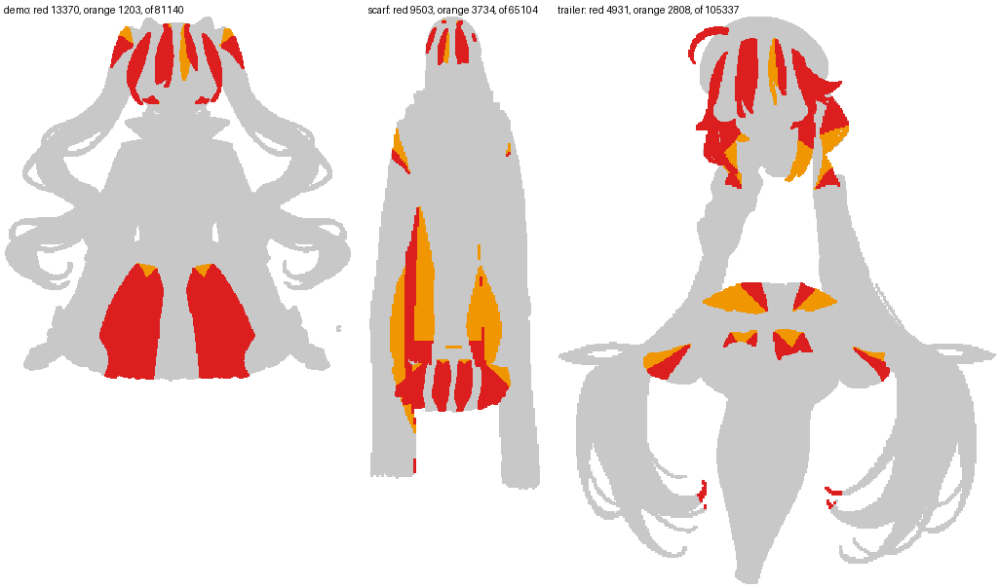

# Who claims a point (issue #284, Stage B)

Stage A found the rule's remaining trouble where five or more bones hold nearly the same weight. This stage asks which
bones those are, proposes an exclusion from the config's own terms, and measures it beside today's cut and the
continuous floor, in Stage A's columns. Every figure is `tools/tear_survey.ts`'s. Nothing under `src/` changes.

## Reading

**The census.** A bone claims an art sample when its raw weight is at least 0.1 of the sample's largest. That share
was fixed before the run: such a bone is still above the floor (0.03) whenever it is among four. Samples with five or
more claimants:

| example | part | samples with 5+ claimants |
| --- | --- | --- |
| demo | `bottomwear` | 39.2 % |
| demo | `hair_front` | 46.4 % |
| demo | `hair_back` | 2.7 % |
| scarf | `bottomwear` | 47.9 % |
| scarf | `hair_front` | 32.0 % |
| scarf | `topwear` | 17.7 % |
| trailer | `hair_front` | 61.0 % |
| trailer | `bottomwear` | 27.5 % |
| trailer | `hair_long` | 4.2 % |

No other part has any.

**Who they are: overwhelmingly a sibling chain.** A sibling chain is another chain hanging from the same bone: the
skirt panels from the hip, the bangs from the head, the tails and robes from the chest. Of demo `bottomwear`'s 7613
such samples, 7417 hold a sibling chain; of scarf `bottomwear`'s 8900, 7421; of the trailer `hair_front`'s 4038, 3134.
"Another limb" (a chain hanging from a different bone) is a minority: 206 samples on scarf `topwear`, 361 on the
trailer's `bottomwear`, 376 on `hair_long`. The picture shows where the samples lie: between the skirt panels, across
the fringes, along the robes, and at the long hair's curls.

**The rule the census supports, in the config's terms (the "family" rule).** When a point's largest bone is a link of
chain C, only C's links, the bone C hangs from and the part's declared segments that are no chain's link may claim it.
When its largest bone is a declared segment, nothing changes. Today's cut, or the continuous floor, then applies to the
survivors.

**It is not adoptable, and the reason is the census's own.** Against Stage A's lines:
- **Bars:** every bar passes on all three examples.
- **Influences:** at most four everywhere.
- **No part's bone set changes,** so the idle line applies to every part.
- **Inverted at the bends:** family has 13 / 38 / 2 / 1 (demo / scarf / trailer 15° / trailer film) against the lifted
  reference's 0 / 36 / 0 / 0. Family plus the continuous floor has 18 / 43 / 3 / 0.
- **Idle:** family moves demo `hair_back` 1.624, scarf `topwear` 1.026 and the trailer's `hair_long` 2.621.
  Family plus the floor moves demo `hair_back` 1.262, demo `bottomwear` 1.006, scarf `topwear` 1.157, the trailer's
  `hairpin` 1.341 and `hair_long` 3.098.

**Where family helps: the tails.** On the trailer's `hair_long` the other tail is barred from the curl. With the
continuous floor the part reads 0 inverted triangles, 7 / 0 tears and a worst of 2.72 / 1.82 at 15° and the film's
bends, better than the lifted reference (5.64 / 3.80).

**Where it tears: between two panels of one garment.** Between demo's skirt panels the largest bone changes from
one sibling chain to the other inside continuous fabric. There each side drops the other's weight at once, at
(338.5, 637.5): a 70.56 px tear, 12 inverted triangles, worst 65.01.

The census cannot separate those two cases, because by the config they are the same relation: two chains hanging from
one bone. What separates them is the art — two strands with a gap between them, against one cloth. So a claim rule
read only off the config cannot be right on both.

[not measured here] The candidate this points to is a rule that measures distance through the art rather than
across it. The package already has one such field, bone heat (`rule: "heat"`, `src/heat.ts`, issue #161).

**The continuous floor, again beside it:** its idle stays within 1.0 everywhere except demo `hair_back` (1.252), the
trailer's `hairpin` (1.341) and `hair_long` (1.471). Its inverted count is 1 / 42 / 5 / 0.

**scarf's 36 folds.** 35 are on `topwear`, in the band between each robe and the body's centre line: x 337–400 under
+15° on the right robe, x 440–562 under −15° on the left, y 622–884. Their corners hold robe links on one side and
hip/chest on the other. At those signs every robe link rolls toward the body, so the robe sweeps over the hip-weighted
band and presses it past zero area. The remaining fold is on `hair_front`. The lifted rule keeps all 36, so the bend
set itself makes them; no cut is involved.

## For #265: (G′) plus Stage B's draft ribs on scarf `topwear`

The variant is (G′) plus "rows on a chain that runs through the interior, only where the art takes them". Four numbers
under the rule as built:

| figure | (G′) + ribs | (G′) |
| --- | --- | --- |
| idle against the lattice | 2.590 | 1.586 |
| worst at 15° | 12.53 | 12.53 |
| inverted at 15° | 28 | 24 |
| triangles | 372 | 350 |

Under the lifted rule: 2.881, 11.88 and 32.

The rows do not reach the miss. The draft keeps ribs on `robe_r` (one station, eight rows). It drops `robe_l` because
`robe_l`'s first row crosses `robe_r`'s (`CONTOUR_RIB_CROSSING` at link 0, twice). So no row runs where (G′)'s worst
sample sits, on `robe_l2`. Meanwhile `robe_r`'s rows displace the hem's interior points. The idle's worst sample
there, at (414.5, 654.5), is carried by corners holding 0.27–0.63 of `hip` where the sample holds 0.85.

Generated by `tools/tear_survey.ts --page`; every figure below is the tool's. A tear is a pair of reference samples at most 3 px apart at rest (4-neighbours on the dense reference's grid) whose posed distance exceeds their rest distance by more than 3 rig px under some pose of the set, both skinned by the rule itself. "Inverted" counts a triangle once per pose it folds in (#265's convention). "Worst" is the largest distance between a sample carried by the written mesh and the same sample skinned by that rule, unrounded.

## demo

Controls: today's weights skinned here are within 4.4e-5 rig px of `rigc render --geometry`'s idle frames; the as-built rule recomputed here is within 1.0e-5 of every written weight. Meshes not in the census (their weights are kept): none.

| rule | idle: inverted / tears / worst | fallback: inverted / tears / worst | largest influence count | vertices changed | weight values changed | rig.json bytes | check | BREATH_VISIBLE | BLINK_NO_HOLE | CHAIN_LAG | TIP_OVER_ROOT | STILL_REGIONS_DARK | TEXTURE_STRETCH | idle vs today (part) |
| --- | --- | --- | ---: | ---: | ---: | ---: | --- | --- | --- | --- | --- | --- | --- | --- |
| as built | 0 / 0 / 1.02 | 1 / 868 / 16.41 | 4 | 0 of 1192 | 0 | 471635 | PASS | PASS | PASS | PASS | PASS min 2.428 | PASS | PASS 1.097 | — |
| continuous floor | 0 / 0 / 1.09 | 1 / 578 / 16.31 | 4 | 906 of 1192 | 2718 | 471627 | PASS | PASS | PASS | PASS | PASS min 2.398 | PASS | PASS 1.101 | 1.252 (hair_back) |
| lifted | 0 / 0 / 1.02 | 0 / 0 / 8.81 | 10 | 673 of 1192 | 4515 | 770980 | PASS | PASS | PASS | PASS | PASS min 1.499 | PASS | PASS 1.083 | 3.350 (hair_back) |
| family | 0 / 0 / 1.68 | 13 / 717 / 65.01 | 4 | 184 of 1192 | 827 | 458669 | PASS | PASS | PASS | PASS | PASS min 2.403 | PASS | PASS 1.097 | 1.624 (hair_back) |
| family + continuous floor | 0 / 0 / 1.77 | 18 / 457 / 68.07 | 4 | 906 of 1192 | 2813 | 458661 | PASS | PASS | PASS | PASS | PASS min 2.348 | PASS | PASS 1.101 | 1.262 (hair_back) |
- continuous floor, check: `..    51 assertions: 25 measured (25 passed, 0 failed), 26 skipped, 0 not in profile "spine-html"`; `..    51 assertions: 26 measured (26 passed, 0 failed), 25 skipped, 0 not in profile "spine-html"`
- lifted, check: `..    51 assertions: 25 measured (25 passed, 0 failed), 26 skipped, 0 not in profile "spine-html"`; `..    51 assertions: 26 measured (26 passed, 0 failed), 25 skipped, 0 not in profile "spine-html"`
- family, check: `..    51 assertions: 25 measured (25 passed, 0 failed), 26 skipped, 0 not in profile "spine-html"`; `..    51 assertions: 26 measured (26 passed, 0 failed), 25 skipped, 0 not in profile "spine-html"`
- family + continuous floor, check: `..    51 assertions: 25 measured (25 passed, 0 failed), 26 skipped, 0 not in profile "spine-html"`; `..    51 assertions: 26 measured (26 passed, 0 failed), 25 skipped, 0 not in profile "spine-html"`

Per part, the idle against today's rig (rig px) and whether the rule leaves the part's bone set as it is today (the bones it drops or adds when not):

| part | continuous floor | lifted | family | family + continuous floor |
| --- | --- | --- | --- | --- |
| hair_back | 1.252 | 3.350 | 1.624 | 1.262 |
| hair_front | 0.246 | 0.462 | 0.446 | 0.441 |
| hairpin | 0.000 | 0.000 | 0.000 | 0.000 |
| earring | 0.000 | 0.000 | 0.000 | 0.000 |
| neck | 0.025 | 0.024 | 0.000 | 0.025 |
| handwear_r | 0.205 | 0.208 | 0.000 | 0.205 |
| handwear_l | 0.206 | 0.191 | 0.000 | 0.206 |
| topwear | 0.144 | 0.130 | 0.000 | 0.144 |
| bottomwear | 0.123 | 0.425 | 0.967 | 1.006 |

The census: per lattice part, its art samples (the dense reference's grid), how many have 5 or more claimants — bones whose raw weight is at least 0.1 of the sample's largest — and, of those, how many count each relation to the sample's largest bone among their claimants; the nearest segment's distance (least, median); and the three commonest claimant lists.

| part | samples | 5+ claimants | relations (samples having one) | nearest segment: least / median px | commonest lists |
| --- | ---: | ---: | --- | --- | --- |
| hair_back | 18446 | 504 (2.7 %) | the bone its chain hangs from 347; a sibling chain 347; its own chain 347; a chain hanging from it 157 | 59.8 / 80.5 | 109× hairback_r0, head, hairback_l0, hairback_r1, hairback_r2; 108× hairback_l0, head, hairback_r0, hairback_l1, hairback_l2; 79× head, hairback_r0, hairback_l0, hairback_r1, hairback_r2 |
| hair_front | 13899 | 6456 (46.4 %) | the bone its chain hangs from 5606; a sibling chain 5606; its own chain 5606; a chain hanging from it 850 | 6.3 / 16.6 | 882× bang_r1, bang_r0, bang_c1, head, bang_c0; 845× bang_l1, bang_l0, head, bang_c1, bang_c0; 536× bang_l0, bang_l1, head, bang_c0, bang_c1 |
| hairpin | 6254 | 0 | — | — | — |
| earring | 759 | 0 | — | — | — |
| neck | 2715 | 0 | — | — | — |
| handwear_r | 5424 | 0 | — | — | — |
| handwear_l | 5460 | 0 | — | — | — |
| topwear | 8784 | 0 | — | — | — |
| bottomwear | 19399 | 7613 (39.2 %) | a sibling chain 7417; its own chain 7417; the bone its chain hangs from 6134; a chain hanging from it 196 | 20.5 / 48.2 | 137× skirt_l1, skirt_l0, skirt_l2, skirt_c1, skirt_c2, skirt_c0, hip; 123× skirt_c2, skirt_c1, skirt_l2, skirt_c0, skirt_l1, skirt_l0; 108× skirt_c2, skirt_c1, skirt_r2, skirt_c0, skirt_r1, skirt_r0 |

Per part — inverted / tears (of them, pairs that keep different bones) / worst, under each rule:

| part | set | as built | continuous floor | lifted | family | family + continuous floor |
| --- | --- | --- | --- | --- | --- | --- |
| hair_back | idle | 0 / 0 (0) / 0.71 | 0 / 0 (0) / 0.48 | 0 / 0 (0) / 0.74 | 0 / 0 (0) / 1.01 | 0 / 0 (0) / 0.48 |
| hair_back | fallback | 0 / 155 (155) / 6.17 | 0 / 0 (0) / 3.94 | 0 / 0 (0) / 5.46 | 0 / 265 (265) / 8.48 | 0 / 55 (55) / 5.44 |
| hair_front | idle | 0 / 0 (0) / 0.67 | 0 / 0 (0) / 0.66 | 0 / 0 (0) / 0.66 | 0 / 0 (0) / 0.67 | 0 / 0 (0) / 0.66 |
| hair_front | fallback | 1 / 32 (32) / 8.84 | 1 / 27 (27) / 8.91 | 0 / 0 (0) / 8.81 | 1 / 136 (136) / 8.84 | 1 / 130 (130) / 8.91 |
| hairpin | idle | 0 / 0 (0) / 0.00 | 0 / 0 (0) / 0.00 | 0 / 0 (0) / 0.00 | 0 / 0 (0) / 0.00 | 0 / 0 (0) / 0.00 |
| earring | idle | 0 / 0 (0) / 0.00 | 0 / 0 (0) / 0.00 | 0 / 0 (0) / 0.00 | 0 / 0 (0) / 0.00 | 0 / 0 (0) / 0.00 |
| neck | idle | 0 / 0 (0) / 0.03 | 0 / 0 (0) / 0.01 | 0 / 0 (0) / 0.01 | 0 / 0 (0) / 0.03 | 0 / 0 (0) / 0.01 |
| handwear_r | idle | 0 / 0 (0) / 0.13 | 0 / 0 (0) / 0.09 | 0 / 0 (0) / 0.12 | 0 / 0 (0) / 0.13 | 0 / 0 (0) / 0.09 |
| handwear_r | fallback | 0 / 0 (0) / 2.07 | 0 / 0 (0) / 1.57 | 0 / 0 (0) / 2.29 | 0 / 0 (0) / 2.07 | 0 / 0 (0) / 1.57 |
| handwear_l | idle | 0 / 0 (0) / 0.12 | 0 / 0 (0) / 0.09 | 0 / 0 (0) / 0.11 | 0 / 0 (0) / 0.12 | 0 / 0 (0) / 0.09 |
| handwear_l | fallback | 0 / 0 (0) / 2.23 | 0 / 0 (0) / 1.41 | 0 / 0 (0) / 2.09 | 0 / 0 (0) / 2.23 | 0 / 0 (0) / 1.41 |
| topwear | idle | 0 / 0 (0) / 1.02 | 0 / 0 (0) / 1.09 | 0 / 0 (0) / 1.02 | 0 / 0 (0) / 1.02 | 0 / 0 (0) / 1.09 |
| bottomwear | idle | 0 / 0 (0) / 0.42 | 0 / 0 (0) / 0.42 | 0 / 0 (0) / 0.19 | 0 / 0 (0) / 1.68 | 0 / 0 (0) / 1.77 |
| bottomwear | fallback | 0 / 681 (681) / 16.41 | 0 / 551 (551) / 16.31 | 0 / 0 (0) / 6.07 | 12 / 316 (316) / 65.01 | 17 / 272 (272) / 68.07 |

Largest tear per part and rule at the bend sets (posed gap beyond the rest distance, rig px, where):

- hair_back (stride 2): as built fallback 5.64 at (661.50, 476.50); continuous floor fallback 1.83 at (537.50, 146.50); lifted fallback 0.73 at (381.50, 44.50); family fallback 10.64 at (318.50, 59.50); family + continuous floor fallback 7.29 at (318.50, 59.50).
- hair_front (stride 1): as built fallback 3.89 at (394.00, 95.50); continuous floor fallback 3.90 at (394.00, 95.50); lifted fallback 2.61 at (414.00, 143.50); family fallback 9.02 at (391.50, 125.00); family + continuous floor fallback 9.06 at (391.50, 125.00).
- handwear_r (stride 2): as built fallback 2.03 at (354.50, 326.50); continuous floor fallback 0.37 at (333.50, 311.50); lifted fallback 0.44 at (233.50, 577.50); family fallback 2.03 at (354.50, 326.50); family + continuous floor fallback 0.37 at (333.50, 311.50).
- handwear_l (stride 2): as built fallback 2.01 at (513.50, 439.50); continuous floor fallback 0.37 at (493.50, 309.50); lifted fallback 0.43 at (593.50, 577.50); family fallback 2.01 at (513.50, 439.50); family + continuous floor fallback 0.37 at (493.50, 309.50).
- bottomwear (stride 2): as built fallback 24.24 at (334.50, 561.50); continuous floor fallback 24.07 at (334.50, 561.50); lifted fallback 0.79 at (548.50, 631.50); family fallback 70.56 at (338.50, 637.50); family + continuous floor fallback 74.03 at (338.50, 637.50).

## scarf

Controls: today's weights skinned here are within 4.2e-5 rig px of `rigc render --geometry`'s idle frames; the as-built rule recomputed here is within 1.0e-5 of every written weight. Meshes not in the census (their weights are kept): none.

| rule | idle: inverted / tears / worst | fallback: inverted / tears / worst | largest influence count | vertices changed | weight values changed | rig.json bytes | check | BREATH_VISIBLE | BLINK_NO_HOLE | CHAIN_LAG | TIP_OVER_ROOT | STILL_REGIONS_DARK | TEXTURE_STRETCH | idle vs today (part) |
| --- | --- | --- | ---: | ---: | ---: | ---: | --- | --- | --- | --- | --- | --- | --- | --- |
| as built | 0 / 0 / 1.51 | 36 / 1310 / 10.60 | 4 | 0 of 1583 | 0 | 665178 | PASS | PASS | PASS | PASS | PASS min 2.456 | PASS | PASS 1.211 | — |
| continuous floor | 0 / 0 / 1.60 | 42 / 1090 / 9.99 | 4 | 1367 of 1583 | 3922 | 665230 | PASS | PASS | PASS | PASS | PASS min 2.45 | PASS | PASS 1.225 | 0.676 (topwear) |
| lifted | 0 / 0 / 1.46 | 36 / 330 / 8.18 | 10 | 1414 of 1583 | 8603 | 1244841 | PASS | PASS | PASS | PASS | PASS min 2.082 | PASS | PASS 1.201 | 1.336 (topwear) |
| family | 0 / 0 / 1.51 | 38 / 1455 / 19.50 | 4 | 190 of 1583 | 849 | 649811 | PASS | PASS | PASS | PASS | PASS min 2.427 | PASS | PASS 1.211 | 1.026 (topwear) |
| family + continuous floor | 0 / 0 / 1.60 | 43 / 1241 / 20.30 | 4 | 1367 of 1583 | 4018 | 649869 | PASS | PASS | PASS | PASS | PASS min 2.45 | PASS | PASS 1.225 | 1.157 (topwear) |
- continuous floor, check: `..    51 assertions: 25 measured (25 passed, 0 failed), 26 skipped, 0 not in profile "spine-html"`; `..    51 assertions: 26 measured (26 passed, 0 failed), 25 skipped, 0 not in profile "spine-html"`
- lifted, check: `..    51 assertions: 25 measured (25 passed, 0 failed), 26 skipped, 0 not in profile "spine-html"`; `..    51 assertions: 26 measured (26 passed, 0 failed), 25 skipped, 0 not in profile "spine-html"`
- family, check: `..    51 assertions: 25 measured (25 passed, 0 failed), 26 skipped, 0 not in profile "spine-html"`; `..    51 assertions: 26 measured (26 passed, 0 failed), 25 skipped, 0 not in profile "spine-html"`
- family + continuous floor, check: `..    51 assertions: 25 measured (25 passed, 0 failed), 26 skipped, 0 not in profile "spine-html"`; `..    51 assertions: 26 measured (26 passed, 0 failed), 25 skipped, 0 not in profile "spine-html"`

Per part, the idle against today's rig (rig px) and whether the rule leaves the part's bone set as it is today (the bones it drops or adds when not):

| part | continuous floor | lifted | family | family + continuous floor |
| --- | --- | --- | --- | --- |
| hair_back | 0.041 | 0.027 | 0.000 | 0.041 |
| hair_front | 0.145 | 0.289 | 0.394 | 0.386 |
| handwear_r | 0.113 | 0.136 | 0.000 | 0.113 |
| handwear_l | 0.103 | 0.127 | 0.000 | 0.103 |
| topwear | 0.676 | 1.336 | 1.026 | 1.157 |
| bottomwear | 0.066 | 0.279 | 0.260 | 0.268 |

The census: per lattice part, its art samples (the dense reference's grid), how many have 5 or more claimants — bones whose raw weight is at least 0.1 of the sample's largest — and, of those, how many count each relation to the sample's largest bone among their claimants; the nearest segment's distance (least, median); and the three commonest claimant lists.

| part | samples | 5+ claimants | relations (samples having one) | nearest segment: least / median px | commonest lists |
| --- | ---: | ---: | --- | --- | --- |
| hair_back | 15481 | 0 | — | — | — |
| hair_front | 5363 | 1714 (32.0 %) | the bone its chain hangs from 1365; a sibling chain 1365; its own chain 1350; a chain hanging from it 349 | 5.2 / 10.3 | 159× bang_r0, bang_r1, head, bang_c0, bang_c1; 127× bang_r1, bang_r0, head, bang_c1, bang_c0; 66× bang_c1, head, bang_c0, bang_l1, bang_l0 |
| handwear_r | 5361 | 0 | — | — | — |
| handwear_l | 5536 | 0 | — | — | — |
| topwear | 14798 | 2623 (17.7 %) | a body segment 2433; its own chain 1440; the bone its chain hangs from 1432; a chain hanging from it 977; a sibling chain 511; a chain hanging elsewhere 206 | 19.5 / 46.1 | 106× robe_l1, robe_l0, chest, hip, robe_l2; 80× chest, robe_r0, robe_r1, hip, robe_l0, robe_l1, robe_r2; 73× chest, robe_r0, robe_l0, robe_r1, robe_l1 |
| bottomwear | 18565 | 8900 (47.9 %) | a sibling chain 7421; its own chain 7421; the bone its chain hangs from 5310; a chain hanging from it 1479 | 6.5 / 18.5 | 370× skirt_r1, skirt_r2, skirt_r0, hip, skirt_c1, skirt_c2, skirt_c0, skirt_l2, skirt_l1, skirt_l0; 260× hip, skirt_r0, skirt_r1, skirt_r2, skirt_c0, skirt_c1, skirt_c2; 232× hip, skirt_l0, skirt_l1, skirt_l2, skirt_c0, skirt_c1, skirt_c2 |

Per part — inverted / tears (of them, pairs that keep different bones) / worst, under each rule:

| part | set | as built | continuous floor | lifted | family | family + continuous floor |
| --- | --- | --- | --- | --- | --- | --- |
| hair_back | idle | 0 / 0 (0) / 0.09 | 0 / 0 (0) / 0.09 | 0 / 0 (0) / 0.08 | 0 / 0 (0) / 0.09 | 0 / 0 (0) / 0.09 |
| hair_front | idle | 0 / 0 (0) / 0.56 | 0 / 0 (0) / 0.58 | 0 / 0 (0) / 0.55 | 0 / 0 (0) / 0.56 | 0 / 0 (0) / 0.58 |
| hair_front | fallback | 1 / 42 (3) / 7.69 | 1 / 46 (3) / 8.00 | 1 / 40 (0) / 7.55 | 1 / 101 (62) / 7.69 | 1 / 101 (58) / 8.00 |
| handwear_r | idle | 0 / 0 (0) / 0.07 | 0 / 0 (0) / 0.04 | 0 / 0 (0) / 0.04 | 0 / 0 (0) / 0.07 | 0 / 0 (0) / 0.04 |
| handwear_r | fallback | 0 / 0 (0) / 1.09 | 0 / 0 (0) / 0.50 | 0 / 0 (0) / 0.65 | 0 / 0 (0) / 1.09 | 0 / 0 (0) / 0.50 |
| handwear_l | idle | 0 / 0 (0) / 0.06 | 0 / 0 (0) / 0.03 | 0 / 0 (0) / 0.03 | 0 / 0 (0) / 0.06 | 0 / 0 (0) / 0.03 |
| handwear_l | fallback | 0 / 0 (0) / 1.39 | 0 / 0 (0) / 0.39 | 0 / 0 (0) / 0.47 | 0 / 0 (0) / 1.39 | 0 / 0 (0) / 0.39 |
| topwear | idle | 0 / 0 (0) / 1.51 | 0 / 0 (0) / 1.60 | 0 / 0 (0) / 1.46 | 0 / 0 (0) / 1.51 | 0 / 0 (0) / 1.60 |
| topwear | fallback | 35 / 1156 (626) / 10.60 | 41 / 954 (96) / 9.99 | 35 / 290 (0) / 8.18 | 33 / 1175 (645) / 10.60 | 37 / 967 (108) / 9.99 |
| bottomwear | idle | 0 / 0 (0) / 0.16 | 0 / 0 (0) / 0.14 | 0 / 0 (0) / 0.10 | 0 / 0 (0) / 0.47 | 0 / 0 (0) / 0.49 |
| bottomwear | fallback | 0 / 112 (112) / 7.02 | 0 / 90 (90) / 6.04 | 0 / 0 (0) / 4.16 | 4 / 179 (179) / 19.50 | 5 / 173 (173) / 20.30 |

Largest tear per part and rule at the bend sets (posed gap beyond the rest distance, rig px, where):

- hair_front (stride 1): as built fallback 5.36 at (413.00, 165.50); continuous floor fallback 5.70 at (413.00, 165.50); lifted fallback 5.25 at (413.00, 165.50); family fallback 6.53 at (431.50, 151.00); family + continuous floor fallback 6.61 at (431.50, 151.00).
- handwear_r (stride 2): as built fallback 1.26 at (312.50, 481.50); continuous floor fallback 0.40 at (352.50, 341.50); lifted fallback 0.44 at (314.50, 349.50); family fallback 1.26 at (312.50, 481.50); family + continuous floor fallback 0.40 at (352.50, 341.50).
- handwear_l (stride 2): as built fallback 1.29 at (498.50, 482.50); continuous floor fallback 0.40 at (478.50, 340.50); lifted fallback 0.44 at (518.50, 348.50); family fallback 1.29 at (498.50, 482.50); family + continuous floor fallback 0.40 at (478.50, 340.50).
- topwear (stride 3): as built fallback 19.36 at (338.00, 705.50); continuous floor fallback 17.56 at (338.00, 705.50); lifted fallback 4.06 at (347.00, 780.50); family fallback 19.36 at (338.00, 705.50); family + continuous floor fallback 17.56 at (338.00, 705.50).
- bottomwear (stride 1): as built fallback 8.84 at (330.50, 743.00); continuous floor fallback 7.51 at (330.50, 743.00); lifted fallback 0.84 at (334.50, 673.00); family fallback 23.52 at (428.00, 755.50); family + continuous floor fallback 24.48 at (428.00, 755.50).

### The probe — alternative meshes of one part, weighted unrounded by the rule (T 2, S 30)

| mesh | triangles | hull | as built: idle vs the lattice | lifted: idle vs the lattice | as built, idle: worst / inverted (where; the lattice there) | as built, fallback: worst / inverted (where; the lattice there) | lifted, idle: worst / inverted (where; the lattice there) | lifted, fallback: worst / inverted (where; the lattice there) |
| --- | ---: | ---: | ---: | ---: | --- | --- | --- | --- |
| L (grid 29) | 392 | 84 | 0.000 | 0.000 | 1.51 / 0 ((414.50, 645.50); 1.51) | 10.60 / 35 ((336.50, 705.50); 10.60) | 1.46 / 0 ((414.50, 645.50); 1.46) | 8.18 / 35 ((285.50, 702.50); 8.18) |
| LS (grid 30) | 372 | 80 | 1.885 | 2.071 | 1.87 / 0 ((414.50, 654.50); 0.89) | 11.63 / 30 ((312.50, 864.50); 9.33) | 1.99 / 0 ((414.50, 654.50); 0.84) | 9.92 / 34 ((522.50, 723.50); 7.42) |
| G (T 2, interior 30) | 300 | 62 | 2.823 | 2.992 | 3.62 / 0 ((414.50, 675.50); 0.17) | 20.19 / 15 ((420.50, 675.50); 5.03) | 3.86 / 0 ((414.50, 675.50); 0.13) | 22.80 / 13 ((414.50, 675.50); 0.02) |
| G' (edges <= 30) | 350 | 112 | 1.586 | 1.701 | 1.65 / 0 ((333.50, 609.50); 0.74) | 12.53 / 24 ((510.50, 801.50); 8.94) | 1.73 / 0 ((414.50, 654.50); 0.84) | 11.88 / 27 ((522.50, 735.50); 6.60) |
| G' edges <= 15 | 417 | 179 | 1.657 | 1.869 | 1.71 / 0 ((414.50, 654.50); 0.89) | 12.03 / 30 ((510.50, 810.50); 8.96) | 1.89 / 0 ((414.50, 654.50); 0.84) | 11.93 / 37 ((522.50, 735.50); 6.60) |
| G' interior 15 | 1204 | 112 | 1.512 | 1.430 | 1.53 / 0 ((333.50, 609.50); 0.74) | 12.68 / 69 ((339.50, 708.50); 10.16) | 1.63 / 0 ((414.50, 651.50); 1.14) | 4.76 / 66 ((291.50, 729.50); 4.88) |
| G' both 15 | 1271 | 179 | 1.512 | 1.430 | 1.53 / 0 ((333.50, 609.50); 0.74) | 8.87 / 80 ((333.50, 609.50); 5.40) | 1.63 / 0 ((414.50, 651.50); 1.14) | 4.76 / 78 ((291.50, 729.50); 4.88) |
| G' + ribs | 372 | 120 | 2.590 | 2.881 | 2.95 / 0 ((414.50, 654.50); 0.89) | 12.53 / 28 ((510.50, 801.50); 8.94) | 3.04 / 0 ((414.50, 654.50); 0.84) | 11.88 / 32 ((522.50, 735.50); 6.60) |

- **L (grid 29)** — the lattice as built.
  - as built, idle: the worst sample 44.5 px in from the outline, 13.5 px from a vertex; hip 0.73 there, at its triangle's corners interior 0.33, interior 0.90, interior 0.47.
  - as built, fallback: the worst sample 19.5 px in from the outline, 16.5 px from a vertex; robe_r2 0.42 there, at its triangle's corners interior 0.43, interior 0.52, outline 0.24.
  - lifted, idle: the worst sample 44.5 px in from the outline, 13.5 px from a vertex; hip 0.70 there, at its triangle's corners interior 0.32, interior 0.86, interior 0.41.
  - lifted, fallback: the worst sample 16.5 px in from the outline, 17.7 px from a vertex; robe_r2 0.90 there, at its triangle's corners outline 0.56, outline 0.66, interior 0.59.
- **LS (grid 30)** — the lattice at the figure's spacing.
  - as built, idle: the worst sample 52.5 px in from the outline, 8.7 px from a vertex; hip 0.85 there, at its triangle's corners interior 0.65, interior 0.63, interior 0.90.
  - as built, fallback: the worst sample 22.5 px in from the outline, 15.4 px from a vertex; robe_r3 0.86 there, at its triangle's corners interior 0.95, outline 0.83, interior 0.65.
  - lifted, idle: the worst sample 52.5 px in from the outline, 8.7 px from a vertex; hip 0.81 there, at its triangle's corners interior 0.61, interior 0.53, interior 0.83.
  - lifted, fallback: the worst sample 43.5 px in from the outline, 19.1 px from a vertex; robe_l2 0.92 there, at its triangle's corners interior 0.69, interior 0.73, interior 0.65.
- **G (T 2, interior 30)** — Stage D's (G): the traced outline, the contour mode's interior grid.
  - as built, idle: the worst sample 6.9 px in from the outline, 25.3 px from a vertex; hip 0.94 there, at its triangle's corners outline 0.45, interior 0.65, outline 0.66.
  - as built, fallback: the worst sample 7.0 px in from the outline, 28.5 px from a vertex; hip 0.88 there, at its triangle's corners outline 0.45, interior 0.65, outline 0.66.
  - lifted, idle: the worst sample 6.9 px in from the outline, 25.3 px from a vertex; hip 0.89 there, at its triangle's corners outline 0.38, interior 0.61, outline 0.56.
  - lifted, fallback: the worst sample 6.9 px in from the outline, 25.3 px from a vertex; hip 0.89 there, at its triangle's corners outline 0.38, interior 0.61, outline 0.56.
- **G' (edges <= 30)** — PR #286's (G′): (G)'s outline with every edge cut to at most S.
  - as built, idle: the worst sample 61.9 px in from the outline, 8.7 px from a vertex; robe_r1 0.42 there, at its triangle's corners interior 0.45, interior 0.45, interior 0.22.
  - as built, fallback: the worst sample 16.3 px in from the outline, 19.9 px from a vertex; robe_l2 0.50 there, at its triangle's corners outline 0.42, interior 0.52, outline 0.45.
  - lifted, idle: the worst sample 27.9 px in from the outline, 8.7 px from a vertex; hip 0.81 there, at its triangle's corners outline 0.86, interior 0.61, interior 0.42.
  - lifted, fallback: the worst sample 29.8 px in from the outline, 13.6 px from a vertex; robe_l2 0.92 there, at its triangle's corners outline 0.55, interior 0.73, outline 0.58.
- **G' edges <= 15** — (G′) with the outline's edges cut to at most S/2, the interior at S.
  - as built, idle: the worst sample 27.9 px in from the outline, 8.7 px from a vertex; hip 0.85 there, at its triangle's corners outline 0.86, interior 0.65, interior 0.48.
  - as built, fallback: the worst sample 15.8 px in from the outline, 16.8 px from a vertex; robe_l3 0.51 there, at its triangle's corners outline 0.46, interior 0.48, outline 0.44.
  - lifted, idle: the worst sample 27.9 px in from the outline, 8.7 px from a vertex; hip 0.81 there, at its triangle's corners outline 0.73, interior 0.61, interior 0.42.
  - lifted, fallback: the worst sample 29.8 px in from the outline, 13.6 px from a vertex; robe_l2 0.92 there, at its triangle's corners outline 0.57, interior 0.73, outline 0.58.
- **G' interior 15** — (G′) with the edges cut to at most S, the interior grid at S/2.
  - as built, idle: the worst sample 61.9 px in from the outline, 8.7 px from a vertex; robe_r1 0.42 there, at its triangle's corners interior 0.46, interior 0.45, interior 0.33.
  - as built, fallback: the worst sample 6.9 px in from the outline, 9.0 px from a vertex; robe_r2 0.40 there, at its triangle's corners interior 0.48, interior 0.51, outline 0.34.
  - lifted, idle: the worst sample 30.9 px in from the outline, 6.4 px from a vertex; hip 0.78 there, at its triangle's corners interior 0.53, interior 0.67, interior 0.61.
  - lifted, fallback: the worst sample 15.5 px in from the outline, 10.6 px from a vertex; robe_r2 0.92 there, at its triangle's corners interior 0.86, interior 0.84, interior 0.80.
- **G' both 15** — edges and interior at S/2.
  - as built, idle: the worst sample 61.9 px in from the outline, 8.7 px from a vertex; robe_r1 0.42 there, at its triangle's corners interior 0.46, interior 0.45, interior 0.33.
  - as built, fallback: the worst sample 61.9 px in from the outline, 8.7 px from a vertex; robe_r1 0.42 there, at its triangle's corners interior 0.46, interior 0.45, interior 0.33.
  - lifted, idle: the worst sample 30.9 px in from the outline, 6.4 px from a vertex; hip 0.78 there, at its triangle's corners interior 0.53, interior 0.67, interior 0.61.
  - lifted, fallback: the worst sample 15.5 px in from the outline, 10.6 px from a vertex; robe_r2 0.92 there, at its triangle's corners interior 0.86, interior 0.84, interior 0.80.
- **G' + ribs** — (G′) with Stage B's draft ribs, 8 rows, each an edge the triangulation keeps; the draft: topwear: contour at tolerance 2, margin 2, interior from ribs only (spacing 4096); ribs on 1 of 2 chain(s): robe_r stations 1, robe_l none; stations lowered on the stage's refusals, in order: robe_l 1 -> 0 (CONTOUR_RIB_CROSSING: rib robe_l link 0 station 0 meets rib robe_r link 0 station 0); robe_l 0 -> none (CONTOUR_RIB_CROSSING: rib robe_l link 0 station 0 meets rib robe_r link 0 station 0); bone segment(s) chest, hip get no row (ribs take chains only).
  - as built, idle: the worst sample 27.9 px in from the outline, 15.5 px from a vertex; hip 0.85 there, at its triangle's corners interior 0.27, interior 0.48, interior 0.63.
  - as built, fallback: the worst sample 16.3 px in from the outline, 19.9 px from a vertex; robe_l2 0.50 there, at its triangle's corners outline 0.42, interior 0.52, outline 0.45.
  - lifted, idle: the worst sample 27.9 px in from the outline, 15.5 px from a vertex; hip 0.81 there, at its triangle's corners interior 0.24, interior 0.42, interior 0.58.
  - lifted, fallback: the worst sample 29.8 px in from the outline, 13.6 px from a vertex; robe_l2 0.92 there, at its triangle's corners outline 0.55, interior 0.73, outline 0.58.

## trailer

Controls: today's weights skinned here are within 3.9e-5 rig px of `rigc render --geometry`'s idle frames; the as-built rule recomputed here is within 1.0e-5 of every written weight. Meshes not in the census (their weights are kept): topwear: contour mesh: keeps its weights.

| rule | idle: inverted / tears / worst | fallback: inverted / tears / worst | film: inverted / tears / worst | largest influence count | vertices changed | weight values changed | rig.json bytes | check | BREATH_VISIBLE | BLINK_NO_HOLE | CHAIN_LAG | TIP_OVER_ROOT | STILL_REGIONS_DARK | TEXTURE_STRETCH | idle vs today (part) |
| --- | --- | --- | --- | ---: | ---: | ---: | ---: | --- | --- | --- | --- | --- | --- | --- | --- |
| as built | 0 / 0 / 1.26 | 6 / 590 / 17.38 | 7 / 416 / 11.75 | 4 | 0 of 1561 | 0 | 773228 | PASS | PASS | PASS | PASS | PASS min 2.756 | PASS | PASS 1.226 | — |
| continuous floor | 0 / 0 / 1.26 | 5 / 240 / 16.46 | 0 / 158 / 9.94 | 4 | 1363 of 1561 | 4005 | 773235 | PASS | PASS | PASS | PASS | PASS min 2.769 | PASS | PASS 1.137 | 1.471 (hair_long) |
| lifted | 0 / 0 / 1.11 | 0 / 112 / 14.57 | 0 / 4 / 8.80 | 10 | 902 of 1561 | 6802 | 1270495 | PASS | PASS | PASS | PASS | PASS min 2.756 | PASS | PASS 1.123 | 3.286 (hair_long) |
| family | 0 / 0 / 1.26 | 2 / 641 / 14.63 | 1 / 483 / 14.24 | 4 | 167 of 1561 | 759 | 762615 | PASS | PASS | PASS | PASS | PASS min 2.756 | PASS | PASS 1.226 | 2.621 (hair_long) |
| family + continuous floor | 0 / 0 / 1.25 | 3 / 304 / 16.35 | 0 / 257 / 14.32 | 4 | 1363 of 1561 | 4096 | 762642 | PASS | PASS | PASS | PASS | PASS min 2.769 | PASS | PASS 1.137 | 3.098 (hair_long) |
- continuous floor, check: `..    51 assertions: 24 measured (24 passed, 0 failed), 27 skipped, 0 not in profile "spine-html"`; `..    51 assertions: 25 measured (25 passed, 0 failed), 26 skipped, 0 not in profile "spine-html"`; `requirements: 0 declared — 0 measured (0 PASS, 0 FAIL), 0 NOT MEASURABLE; not declared: contact, follow, aim, range, stretch, seam`
- lifted, check: `..    51 assertions: 24 measured (24 passed, 0 failed), 27 skipped, 0 not in profile "spine-html"`; `..    51 assertions: 25 measured (25 passed, 0 failed), 26 skipped, 0 not in profile "spine-html"`; `requirements: 0 declared — 0 measured (0 PASS, 0 FAIL), 0 NOT MEASURABLE; not declared: contact, follow, aim, range, stretch, seam`
- family, check: `..    51 assertions: 24 measured (24 passed, 0 failed), 27 skipped, 0 not in profile "spine-html"`; `..    51 assertions: 25 measured (25 passed, 0 failed), 26 skipped, 0 not in profile "spine-html"`; `requirements: 0 declared — 0 measured (0 PASS, 0 FAIL), 0 NOT MEASURABLE; not declared: contact, follow, aim, range, stretch, seam`
- family + continuous floor, check: `..    51 assertions: 24 measured (24 passed, 0 failed), 27 skipped, 0 not in profile "spine-html"`; `..    51 assertions: 25 measured (25 passed, 0 failed), 26 skipped, 0 not in profile "spine-html"`; `requirements: 0 declared — 0 measured (0 PASS, 0 FAIL), 0 NOT MEASURABLE; not declared: contact, follow, aim, range, stretch, seam`

Per part, the idle against today's rig (rig px) and whether the rule leaves the part's bone set as it is today (the bones it drops or adds when not):

| part | continuous floor | lifted | family | family + continuous floor |
| --- | --- | --- | --- | --- |
| hair_back | 0.039 | 0.027 | 0.000 | 0.039 |
| hair_front | 0.645 | 0.952 | 0.919 | 0.880 |
| hairpin | 1.341 | 1.346 | 0.000 | 1.341 |
| neck | 0.029 | 0.020 | 0.000 | 0.029 |
| handwear_r | 0.062 | 0.047 | 0.000 | 0.062 |
| handwear_l | 0.167 | 0.109 | 0.000 | 0.167 |
| bottomwear | 0.242 | 0.642 | 0.423 | 0.461 |
| hair_long | 1.471 | 3.286 | 2.621 | 3.098 |
| legwear | 0.511 | 0.408 | 0.000 | 0.511 |

The census: per lattice part, its art samples (the dense reference's grid), how many have 5 or more claimants — bones whose raw weight is at least 0.1 of the sample's largest — and, of those, how many count each relation to the sample's largest bone among their claimants; the nearest segment's distance (least, median); and the three commonest claimant lists.

| part | samples | 5+ claimants | relations (samples having one) | nearest segment: least / median px | commonest lists |
| --- | ---: | ---: | --- | --- | --- |
| hair_back | 10075 | 0 | — | — | — |
| hair_front | 6615 | 4038 (61.0 %) | its own chain 3134; a sibling chain 3134; the bone its chain hangs from 3134; a chain hanging from it 904 | 3.5 / 30.3 | 364× bang_l1, bang_l0, head, bang_c1, bang_c0; 315× head, bang_r1, bang_c1, bang_l1, bang_r0, bang_c0, bang_l0; 241× bang_l1, bang_l0, head, bang_c1, bang_c0, bang_r1, bang_r0 |
| hairpin | 10248 | 0 | — | — | — |
| neck | 2892 | 0 | — | — | — |
| handwear_r | 13266 | 0 | — | — | — |
| handwear_l | 19033 | 0 | — | — | — |
| bottomwear | 10797 | 2965 (27.5 %) | a body segment 2430; a chain hanging from it 1700; the bone its chain hangs from 904; its own chain 904; a sibling chain 904; a chain hanging elsewhere 361 | 12.5 / 39.5 | 183× hip, skirt_r1, skirt_r0, skirt_c0, skirt_c1; 117× skirt_r1, skirt_r0, hip, skirt_c1, skirt_c0; 94× skirt_l1, hip, skirt_l0, skirt_c1, skirt_c0, chest |
| hair_long | 17668 | 736 (4.2 %) | a body segment 684; a chain hanging elsewhere 376; a chain hanging from it 204; a sibling chain 156; its own chain 156; the bone its chain hangs from 104 | 60.0 / 95.2 | 159× head, chest, tail_r0, tail_l0, tail_r1; 128× head, chest, tail_l0, tail_r0, tail_l1; 99× chest, head, tail_l0, tail_r0, tail_l1 |
| legwear | 14743 | 0 | — | — | — |

Per part — inverted / tears (of them, pairs that keep different bones) / worst, under each rule:

| part | set | as built | continuous floor | lifted | family | family + continuous floor |
| --- | --- | --- | --- | --- | --- | --- |
| hair_back | idle | 0 / 0 (0) / 0.19 | 0 / 0 (0) / 0.21 | 0 / 0 (0) / 0.19 | 0 / 0 (0) / 0.19 | 0 / 0 (0) / 0.21 |
| hair_front | idle | 0 / 0 (0) / 1.14 | 0 / 0 (0) / 1.26 | 0 / 0 (0) / 1.11 | 0 / 0 (0) / 1.09 | 0 / 0 (0) / 1.25 |
| hair_front | fallback | 2 / 190 (98) / 15.11 | 3 / 192 (85) / 16.46 | 0 / 112 (0) / 14.57 | 2 / 248 (160) / 14.63 | 3 / 264 (163) / 16.35 |
| hair_front | film | 0 / 38 (22) / 9.13 | 0 / 43 (12) / 9.94 | 0 / 4 (0) / 8.80 | 0 / 130 (117) / 8.83 | 0 / 145 (117) / 9.87 |
| hairpin | idle | 0 / 0 (0) / 1.26 | 0 / 0 (0) / 0.37 | 0 / 0 (0) / 0.49 | 0 / 0 (0) / 1.26 | 0 / 0 (0) / 0.37 |
| hairpin | fallback | 0 / 27 (27) / 4.04 | 0 / 0 (0) / 1.21 | 0 / 0 (0) / 1.58 | 0 / 27 (27) / 4.04 | 0 / 0 (0) / 1.21 |
| hairpin | film | 0 / 27 (27) / 4.04 | 0 / 0 (0) / 1.21 | 0 / 0 (0) / 1.58 | 0 / 27 (27) / 4.04 | 0 / 0 (0) / 1.21 |
| neck | idle | 0 / 0 (0) / 0.01 | 0 / 0 (0) / 0.01 | 0 / 0 (0) / 0.01 | 0 / 0 (0) / 0.01 | 0 / 0 (0) / 0.01 |
| handwear_r | idle | 0 / 0 (0) / 0.05 | 0 / 0 (0) / 0.04 | 0 / 0 (0) / 0.04 | 0 / 0 (0) / 0.05 | 0 / 0 (0) / 0.04 |
| handwear_r | fallback | 0 / 0 (0) / 0.90 | 0 / 0 (0) / 0.63 | 0 / 0 (0) / 0.59 | 0 / 0 (0) / 0.90 | 0 / 0 (0) / 0.63 |
| handwear_r | film | 0 / 0 (0) / 1.90 | 0 / 0 (0) / 1.33 | 0 / 0 (0) / 1.25 | 0 / 0 (0) / 1.90 | 0 / 0 (0) / 1.33 |
| handwear_l | idle | 0 / 0 (0) / 0.08 | 0 / 0 (0) / 0.03 | 0 / 0 (0) / 0.03 | 0 / 0 (0) / 0.08 | 0 / 0 (0) / 0.03 |
| handwear_l | fallback | 0 / 75 (75) / 3.45 | 0 / 0 (0) / 0.75 | 0 / 0 (0) / 1.16 | 0 / 75 (75) / 3.45 | 0 / 0 (0) / 0.75 |
| handwear_l | film | 0 / 75 (75) / 3.45 | 0 / 0 (0) / 0.75 | 0 / 0 (0) / 1.16 | 0 / 75 (75) / 3.45 | 0 / 0 (0) / 0.75 |
| bottomwear | idle | 0 / 0 (0) / 0.46 | 0 / 0 (0) / 0.42 | 0 / 0 (0) / 0.48 | 0 / 0 (0) / 0.46 | 0 / 0 (0) / 0.42 |
| bottomwear | fallback | 0 / 92 (92) / 6.51 | 0 / 25 (25) / 6.15 | 0 / 0 (0) / 2.89 | 0 / 85 (85) / 9.00 | 0 / 33 (33) / 9.04 |
| bottomwear | film | 5 / 194 (194) / 10.27 | 0 / 94 (94) / 9.70 | 0 / 0 (0) / 4.61 | 1 / 184 (184) / 14.24 | 0 / 112 (112) / 14.32 |
| hair_long | idle | 0 / 0 (0) / 1.12 | 0 / 0 (0) / 0.74 | 0 / 0 (0) / 0.41 | 0 / 0 (0) / 0.39 | 0 / 0 (0) / 0.24 |
| hair_long | fallback | 4 / 202 (202) / 17.38 | 2 / 23 (23) / 12.65 | 0 / 0 (0) / 5.64 | 0 / 202 (202) / 6.46 | 0 / 7 (7) / 2.72 |
| hair_long | film | 2 / 82 (82) / 11.75 | 0 / 21 (21) / 8.57 | 0 / 0 (0) / 3.80 | 0 / 67 (67) / 4.29 | 0 / 0 (0) / 1.82 |
| legwear | idle | 0 / 0 (0) / 0.26 | 0 / 0 (0) / 0.23 | 0 / 0 (0) / 0.27 | 0 / 0 (0) / 0.26 | 0 / 0 (0) / 0.23 |
| legwear | fallback | 0 / 4 (4) / 2.55 | 0 / 0 (0) / 1.71 | 0 / 0 (0) / 2.35 | 0 / 4 (4) / 2.55 | 0 / 0 (0) / 1.71 |
| legwear | film | 0 / 0 (0) / 2.04 | 0 / 0 (0) / 1.37 | 0 / 0 (0) / 1.88 | 0 / 0 (0) / 2.04 | 0 / 0 (0) / 1.37 |

Largest tear per part and rule at the bend sets (posed gap beyond the rest distance, rig px, where):

- hair_front (stride 2): as built fallback 8.41 at (282.50, 109.50); as built film 5.01 at (282.50, 109.50); continuous floor fallback 7.55 at (282.50, 109.50); continuous floor film 4.50 at (282.50, 109.50); lifted fallback 5.10 at (397.50, 228.50); lifted film 3.09 at (397.50, 228.50); family fallback 16.49 at (326.50, 305.50); family film 9.81 at (326.50, 305.50); family + continuous floor fallback 15.08 at (326.50, 305.50); family + continuous floor film 8.95 at (327.50, 304.50).
- hairpin (stride 1): as built fallback 4.72 at (503.50, 148.00); as built film 4.72 at (503.50, 148.00); continuous floor fallback 0.36 at (489.50, 179.00); continuous floor film 0.36 at (489.50, 179.00); lifted fallback 0.33 at (489.50, 179.00); lifted film 0.33 at (489.50, 179.00); family fallback 4.72 at (503.50, 148.00); family film 4.72 at (503.50, 148.00); family + continuous floor fallback 0.36 at (489.50, 179.00); family + continuous floor film 0.36 at (489.50, 179.00).
- handwear_r (stride 1): as built fallback 0.98 at (364.00, 284.50); as built film 2.08 at (364.00, 284.50); continuous floor fallback 0.15 at (327.00, 279.50); continuous floor film 0.29 at (327.00, 279.50); lifted fallback 0.14 at (327.00, 279.50); lifted film 0.27 at (327.00, 279.50); family fallback 0.98 at (364.00, 284.50); family film 2.08 at (364.00, 284.50); family + continuous floor fallback 0.15 at (327.00, 279.50); family + continuous floor film 0.29 at (327.00, 279.50).
- handwear_l (stride 1): as built fallback 4.14 at (549.00, 670.50); as built film 4.14 at (549.00, 670.50); continuous floor fallback 0.27 at (532.00, 660.50); continuous floor film 0.27 at (532.00, 660.50); lifted fallback 0.24 at (530.00, 655.50); lifted film 0.24 at (530.00, 655.50); family fallback 4.14 at (549.00, 670.50); family film 4.14 at (549.00, 670.50); family + continuous floor fallback 0.27 at (532.00, 660.50); family + continuous floor film 0.27 at (532.00, 660.50).
- bottomwear (stride 2): as built fallback 7.61 at (456.50, 641.50); as built film 12.95 at (456.50, 641.50); continuous floor fallback 7.21 at (456.50, 641.50); continuous floor film 12.33 at (456.50, 641.50); lifted fallback 1.16 at (573.50, 620.50); lifted film 1.81 at (573.50, 618.50); family fallback 17.15 at (446.50, 645.50); family film 28.02 at (446.50, 645.50); family + continuous floor fallback 17.36 at (446.50, 645.50); family + continuous floor film 28.35 at (446.50, 645.50).
- hair_long (stride 3): as built fallback 27.18 at (296.50, 887.00); as built film 18.35 at (296.50, 887.00); continuous floor fallback 18.88 at (296.50, 887.00); continuous floor film 12.73 at (296.50, 887.00); lifted fallback 1.63 at (535.00, 936.50); lifted film 1.11 at (541.00, 939.50); family fallback 7.57 at (574.00, 1002.50); family film 5.10 at (574.00, 1002.50); family + continuous floor fallback 3.74 at (512.50, 332.00); family + continuous floor film 2.39 at (512.50, 332.00).
- legwear (stride 2): as built fallback 3.08 at (418.50, 952.50); as built film 2.48 at (418.50, 952.50); continuous floor fallback 0.45 at (420.50, 950.50); continuous floor film 0.37 at (420.50, 950.50); lifted fallback 0.40 at (420.50, 950.50); lifted film 0.33 at (420.50, 950.50); family fallback 3.08 at (418.50, 952.50); family film 2.48 at (418.50, 952.50); family + continuous floor fallback 0.45 at (420.50, 950.50); family + continuous floor film 0.37 at (420.50, 950.50).
