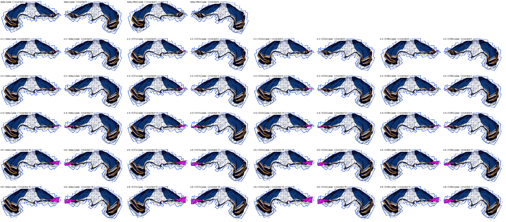
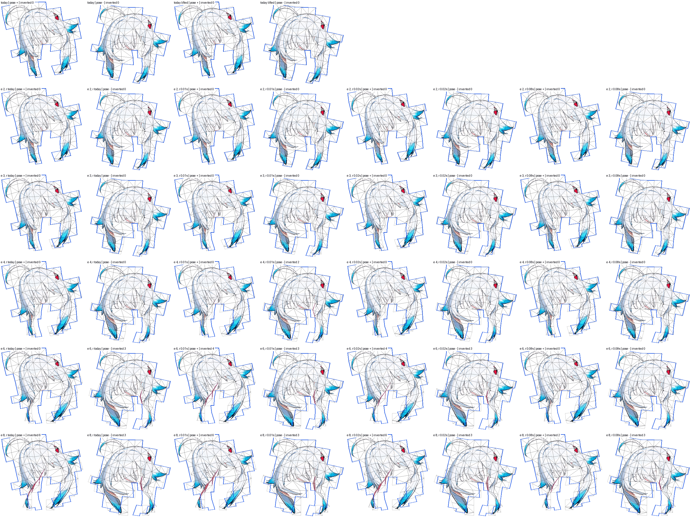
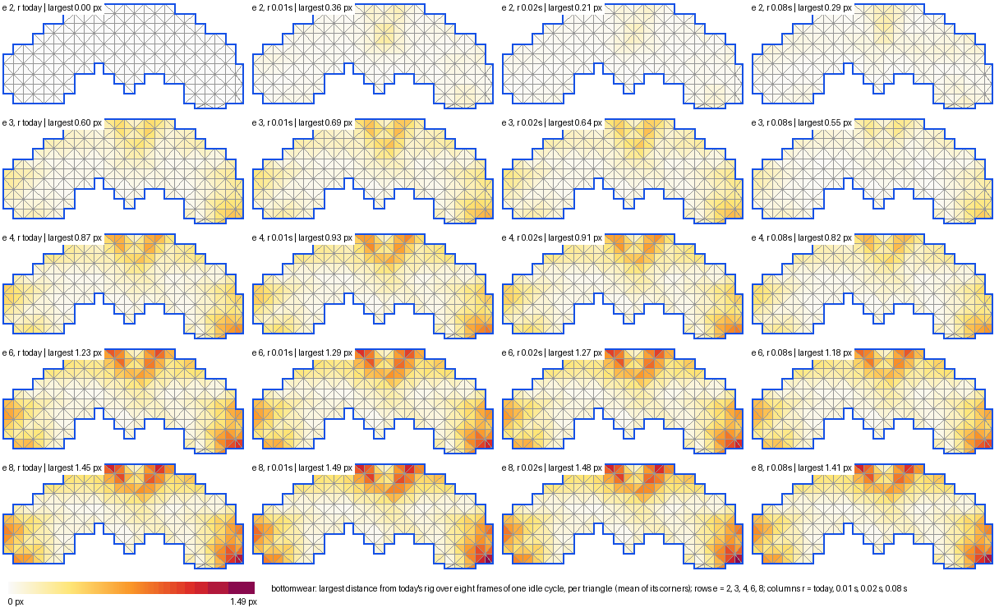
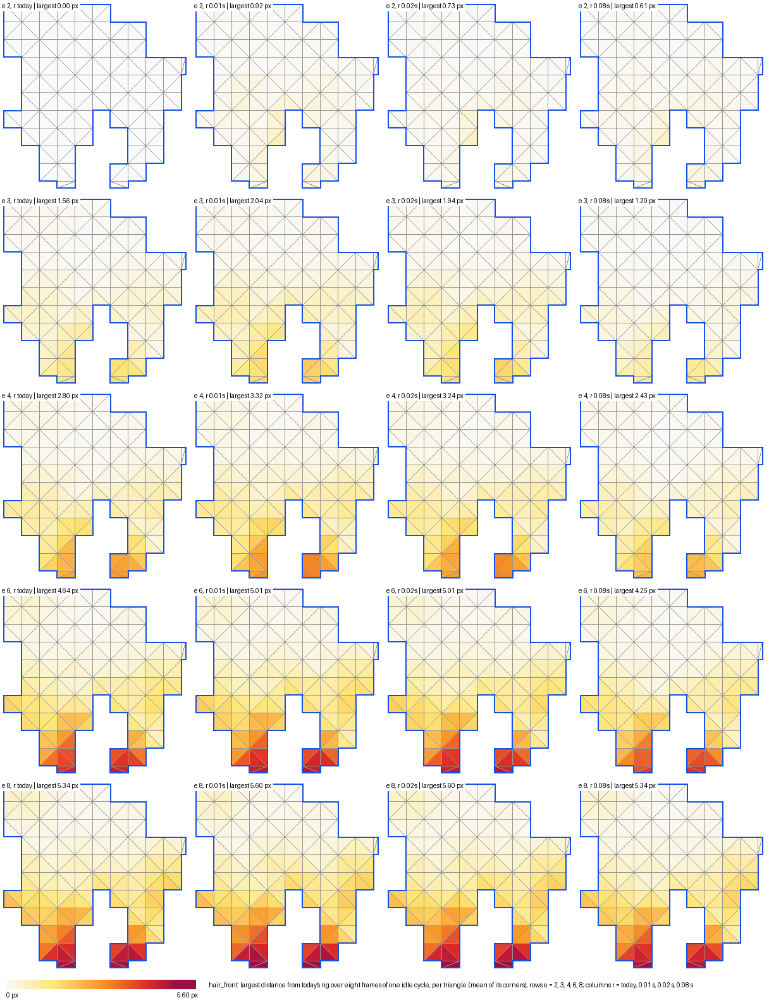

# The falloff swept (issue #284, Stage D)

> Measured on rig-c 2.40.0 (`bun.lock` at the merge of PR #297). rig-c 2.45.2 fixed `rigc render`'s physics clock (core#1380), so figures read through `rigc render` move under it: on demo `tools/tear_survey.ts` reads 2.428 → 2.426 and 1.823 → 1.844 (rig-c 2.40.0 against 2.47.0), a move in the second and third decimal that flips no verdict there; no verdict on this page sits within 0.021 of its line, the larger of the two moves. This page is a record and is not re-run (#311).

Stage B's census found the weight field flat on skirts and fringes: 27–61 % of their samples hold five or more bones
within a tenth of the largest raw weight. This stage keeps the distance rule's form, `w = 1/(d + r)^e`, and its cut
(the four largest, the 0.03 floor), and sweeps the falloff on every lattice mesh of `demo`, `scarf` and the trailer.
Every figure is `tools/falloff_survey.ts`'s. Nothing under `src/` changes.

## The grid, stated before the run

- **The exponent e ∈ {2, 3, 4, 6, 8}.** 2 is today's rule. The census counts a bone at distance d₂ as a claimant
  beside the nearest at d₁ while `(d₂ + r)/(d₁ + r) ≤ 10^(1/e)`: 3.16 at e 2, 2.15 at 3, 1.78 at 4, 1.47 at 6, 1.33 at 8.
  The lower bound is today, because the card asks for sharper, not flatter. The upper bound is 8. There the share
  changes hands within a third of the distance, which is close to nearest-bone skinning. It is also twice the
  exponent #161 measured best on the torso (4).
- **The radius r: today's authored r, and r = f · s with f ∈ {0.01, 0.02, 0.08}.** Here s is the part's size,
  `min(w, h)` of its box. `propose` drafts r from the same measure (`gridR`, src/propose.ts: grid = min(w, h)/10
  clamped to 5..36, r = 0.42 · grid, at least 3). So today's r already sits at 0.033–0.071 · s on these examples
  (demo `hair_back` 15 of 457, demo `neck` 3 of 42). 0.08 is twice today, on the flat side. It checks that the census
  moves the way the arithmetic says. 0.02 is half of today. 0.01 is a quarter: on the smallest part (demo `neck`,
  s 42) it is 0.42 px. r changes a weight's ratio to another only where d is not much larger than r, and on demo the
  census's cases sit at least 6.3 px (the fringe) and 20.5 px (the skirt) from the nearest segment (Stage C's census
  table), so a smaller r has little left to change there.
- **Two rules per setting.** *The cut as is* is the candidate. *Lifted at that falloff* (every bone, nothing dropped)
  is read only to tell the falloff's own folds from the cut's.
- **The line that stays (HQ):** no more inverted triangles at the bends than the lifted reference at today's
  falloff (demo 0, scarf 36, trailer 0 at 15° and 0 at the film's bends), every bar passing, at most four
  influences. There is no line on the idle. The idle is reported, and the pictures are for HQ.
- **Controls.** The setting (e 2, r today) must change no vertex. On every example, the real `rig-parts build` with
  every lattice mesh declaring `exponent: 4` and `r = 0.02 · s` must write the weights this tool writes for that
  setting.

## Reading

**No setting holds the line on all three examples.** The trailer refutes every one: its lifted reference folds
nothing at either bend set, and every setting folds at least 3 triangles there. Today's rule folds 6 and 7.

**Sharpening does what the census asks, and folds more.** The census falls monotonically as e rises and as r
shrinks. Skirt and fringe go from 42 / 44 / 40 % today to 12 / 9 / 4 % at e 4 and to 0–3 % at e 8. The inverted
triangles at the bends rise with e on every example. At (e 4, r today) they are 6 / 47 / 10 / 23 against today's
1 / 36 / 6 / 7. At (e 8, r today) they are 19 / 53 / 38 / 42. The folds are the falloff's own, not the cut's. Lifted
at the same falloff, the counts are within a few of the cut's (e 4, r today lifted: 6 / 45 / 10 / 24).

**Where the new folds sit.** On the trailer's skirt they are at the outer panels' hem corners: x 540–610 under the
+ pose and x 180–230 under the − pose, y 620–670. That is 5 at the film's bends today, 23 at (e 4, r today) and 33 at
(e 8, r today). The same folds appear on demo's skirt from e 6 (2 at e 6, 9 at e 8) and on scarf's skirt from e 6 (1 at e 6, 8 at
e 8; also 1 at (e 2, r 0.08 · s)). On the fringe
they are at the bang tips: the trailer 2 → 10 → 19 at 15°, demo 1 → 6 → 10, scarf 1 → 9 → 14. Scarf's
`topwear` keeps 27–41 bend-set folds under every setting (35 today), as Stage B found it would under every rule.

**Tears fall where the census falls, until the folds take over.** The trailer at 15° goes 590 today → 255 at e 3
→ 220 at e 4 → 668 at e 8. Demo goes 868 → 480 → 400 → 934. Scarf's tears barely move (1209–1476): they are its
`topwear` bend set's.

**The nearest miss is (e 3, r 0.08 · s).** It folds 0 / 38 / 4 / 3 against the reference's 0 / 36 / 0 / 0, which is
fewer than today on demo and on the trailer. It halves the skirt and fringe census (25 / 27 / 19 %), and it moves the
idle 2.4 / 1.0 / 2.7 rig px. It misses the line by 2 on scarf and by 4 and 3 on the trailer. The flat side of r helps
at every e: at each exponent, r 0.08 · s folds least. This is the opposite of what "sharpen the falloff" predicts for
r.

**Sharpening moves the idle on parts that had no flatness.** The largest idle departure is on the trailer's
`hairpin` (3.7 at e 3, 5.3–5.5 from e 4) and demo's `hair_back` (3.0 → 6.0), parts whose census is 0 % or 2.7 %. The
exponent changes every vertex that is held by more than one bone, not only the flat ones. The skirt itself moves
little through the idle: the trailer's `bottomwear` at most 1.56 px, at (e 8, r 0.01 · s). The fringe moves at its tips: the
trailer's `hair_front` 0.6–0.9 at e 2, 1.2–2.0 at e 3, 2.4–3.3 at e 4, up to 5.6 at e 8 (the idle pictures).

**Everything else holds.** Every cut setting passes every bar on all three examples and keeps at most four
influences. The weights this tool writes for (e 4, r 0.02 · s) are the real build's on all three examples: 0
vertices keep other bones, and the largest weight and offset differences are 0. The lifted rows exceed four
influences by design (10). One of them fails a bar: (e 2, r 0.08 · s) lifted fails demo's `TIP_OVER_ROOT` (bottomwear
ratio 1.299 against the floor 1.4725). It is also the only lifted setting with no tears on demo and the trailer.

So the flatness is not the fold's cause in a form this rule can fix. Removing it by the exponent trades tears for
folds at the same bends. The one direction that folds less is a larger r, the flatter side, at a moderate exponent,
and it still misses the line on scarf and the trailer.

| setting (the cut as is) | census, all lattice parts, %: demo / scarf / trailer | census, skirt and fringe, % | inverted at the bends: demo / scarf / trailer 15° / trailer film | tears at the bends (same order) | idle vs today, rig px (part) |
| --- | --- | --- | --- | --- | --- |
| e 2, r today | 18.0 / 20.3 / 7.3 | 42.3 / 44.4 / 40.2 | 1 / 36 / 6 / 7 | 868 / 1310 / 590 / 416 | — / — / — |
| e 2, r 0.01·s | 13.9 / 16.0 / 5.4 | 33.2 / 35.8 / 28.9 | 1 / 44 / 7 / 7 | 856 / 1428 / 617 / 474 | 0.80 (hair_back) / 2.30 (topwear) / 1.42 (hairpin) |
| e 2, r 0.02·s | 15.1 / 17.3 / 6.1 | 35.9 / 38.4 / 32.1 | 1 / 37 / 8 / 7 | 858 / 1378 / 628 / 473 | 0.71 (hair_back) / 1.17 (topwear) / 1.42 (hairpin) |
| e 2, r 0.08·s | 23.6 / 27.3 / 11.7 | 53.3 / 57.6 / 55.3 | 0 / 28 / 7 / 7 | 1003 / 1209 / 782 / 594 | 1.20 (hair_back) / 1.03 (topwear) / 2.31 (hair_long) |
| e 3, r today | 8.0 / 8.8 / 2.0 | 19.4 / 20.9 / 12.4 | 3 / 44 / 9 / 9 | 480 / 1378 / 255 / 200 | 2.98 (hair_back) / 1.59 (topwear) / 3.71 (hairpin) |
| e 3, r 0.01·s | 6.4 / 6.7 / 1.2 | 15.7 / 16.1 / 7.3 | 6 / 46 / 9 / 13 | 527 / 1476 / 276 / 208 | 3.28 (hair_back) / 3.07 (topwear) / 3.87 (hairpin) |
| e 3, r 0.02·s | 6.9 / 7.3 / 1.4 | 16.8 / 17.5 / 8.6 | 6 / 45 / 9 / 12 | 522 / 1427 / 271 / 213 | 3.15 (hair_back) / 2.43 (topwear) / 3.87 (hairpin) |
| e 3, r 0.08·s | 10.3 / 11.8 / 3.3 | 25.0 / 27.3 / 19.1 | 0 / 38 / 4 / 3 | 542 / 1295 / 333 / 191 | 2.42 (hair_back) / 0.97 (topwear) / 2.69 (hairpin) |
| e 4, r today | 4.8 / 3.6 / 0.6 | 11.6 / 8.7 / 3.7 | 6 / 47 / 10 / 23 | 400 / 1430 / 220 / 151 | 4.81 (hair_back) / 2.79 (topwear) / 5.29 (hairpin) |
| e 4, r 0.01·s | 3.8 / 2.4 / 0.3 | 9.2 / 5.8 / 1.9 | 7 / 51 / 14 / 29 | 437 / 1414 / 280 / 201 | 4.96 (hair_back) / 3.77 (topwear) / 5.48 (hairpin) |
| e 4, r 0.02·s | 4.1 / 2.7 / 0.4 | 10.0 / 6.7 / 2.5 | 6 / 49 / 13 / 27 | 420 / 1419 / 251 / 157 | 4.90 (hair_back) / 3.66 (topwear) / 5.48 (hairpin) |
| e 4, r 0.08·s | 6.0 / 5.4 / 1.0 | 14.7 / 12.9 / 6.1 | 6 / 41 / 6 / 21 | 393 / 1365 / 200 / 118 | 3.80 (hair_back) / 2.37 (topwear) / 5.29 (hairpin) |
| e 6, r today | 2.2 / 0.9 / 0.1 | 5.4 / 2.3 / 0.7 | 12 / 49 / 32 / 36 | 776 / 1271 / 340 / 654 | 5.57 (hair_back) / 4.08 (topwear) / 5.48 (hairpin) |
| e 6, r 0.01·s | 1.8 / 0.6 / 0.0 | 4.3 / 1.5 / 0.1 | 16 / 50 / 34 / 40 | 893 / 1258 / 422 / 792 | 5.97 (hair_back) / 4.43 (topwear) / 5.48 (hairpin) |
| e 6, r 0.02·s | 1.9 / 0.7 / 0.1 | 4.7 / 1.8 / 0.4 | 16 / 49 / 34 / 40 | 856 / 1260 / 374 / 767 | 5.97 (hair_back) / 4.43 (topwear) / 5.48 (hairpin) |
| e 6, r 0.08·s | 2.8 / 1.4 / 0.3 | 6.9 / 3.5 / 1.5 | 9 / 48 / 27 / 33 | 581 / 1314 / 242 / 474 | 5.39 (hair_back) / 3.82 (topwear) / 5.48 (hairpin) |
| e 8, r today | 1.3 / 0.4 / 0.0 | 3.1 / 1.0 / 0.0 | 19 / 53 / 38 / 42 | 934 / 1225 / 668 / 894 | 5.97 (hair_back) / 4.43 (topwear) / 5.48 (hairpin) |
| e 8, r 0.01·s | 1.0 / 0.2 / 0.0 | 2.4 / 0.7 / 0.0 | 22 / 54 / 41 / 42 | 1006 / 1247 / 857 / 966 | 5.97 (hair_back) / 4.43 (topwear) / 5.60 (hair_front) |
| e 8, r 0.02·s | 1.1 / 0.3 / 0.0 | 2.6 / 0.8 / 0.0 | 20 / 53 / 38 / 42 | 1001 / 1239 / 804 / 937 | 5.97 (hair_back) / 4.43 (topwear) / 5.60 (hair_front) |
| e 8, r 0.08·s | 1.6 / 0.6 / 0.1 | 4.0 / 1.6 / 0.5 | 16 / 49 / 36 / 37 | 871 / 1200 / 506 / 802 | 5.97 (hair_back) / 4.43 (topwear) / 5.48 (hairpin) |
| e 2, r today, lifted (the reference) | 18.0 / 20.3 / 7.3 | 42.3 / 44.4 / 40.2 | 0 / 36 / 0 / 0 | 0 / 330 / 112 / 4 | 3.35 (hair_back) / 1.34 (topwear) / 3.29 (hair_long) |

The trailer's lifted reference at 15° and the film's bends is 0 / 0; demo's 0; scarf's 36. Every cut setting passes
every bar and keeps at most four influences on all three examples (the tables below).

## The pictures — the trailer's skirt and fringe

The bend sheets show the trailer's `bottomwear` (the skirt, 24° per link) and `hair_front` (the fringe, 9° per
link) at the film's bends. Each panel is the lattice, textured, at the + and the − pose. The first row is today and
today lifted; then one row per exponent (2, 3, 4, 6, 8) and, in each row, r today, 0.01 · s, 0.02 · s and 0.08 · s,
each at + then −. Today's posed outline is blue on every panel. Inverted triangles are filled magenta, and the count
is in the label. The red shape near the fringe's upper right is a painted ornament, not a fold.

The idle sheets show, per setting, how far each triangle of the lattice (the mean of its corners) lies from today's
rig. The figure is the largest over eight evenly spaced frames of one idle cycle (frames 0, 6, …, 42 of 49). Rows are
the exponent and columns are r, in the bend sheets' order, with one colour scale per part (0 to the part's largest:
1.49 px on the skirt, 5.60 px on the fringe). The departure of 1–2 px does not show at any readable scale beside
today's frame, so these maps are the pictures of the cycle. The frame strips, eight frames per setting with today's
outline over each, were drawn as well and are kept with the run's notes, not here.

The sheets are drawn from the tool's `--picture bottomwear,hair_front` output, and the part images are the trailer
lattice build's.

Generated by `tools/falloff_survey.ts --page`; every figure below is the tool's. A setting is the exponent e and the radius r of `w = 1/(d + r)^e`; "r today" is the mesh's authored r, "r f·s" is f times the part's size s = min(w, h). "Cut" is the rule as built at that falloff (four largest, the 0.03 floor); "lifted" is every bone, nothing dropped, at that falloff. The census share is the share of all lattice samples with 5 or more bones within 0.1 of the largest raw weight. A tear is a pair of reference samples at most 3 px apart whose posed distance exceeds their rest distance by more than 3 rig px; "inverted" counts a triangle once per pose it folds in; "worst" is the largest distance between a sample carried by the written mesh and the same sample skinned by that setting's rule, unrounded.

## demo

Controls: today's weights skinned here are within 4.4e-5 rig px of `rigc render --geometry`'s idle frames (41 frames); the setting (e 2, r today) changes no vertex; the real build with every lattice mesh declaring e 4, r 0.02·s exits 0, and against what this tool writes 0 vertices keep other bones, the largest weight difference is 0.0e+0, the largest offset difference 0.0e+0. Meshes not read (their weights are kept): none.

| setting | census share | idle: inverted / tears / worst | fallback: inverted / tears / worst | largest influence count | vertices changed | rig.json bytes | check | BREATH_VISIBLE | BLINK_NO_HOLE | CHAIN_LAG | TIP_OVER_ROOT | STILL_REGIONS_DARK | TEXTURE_STRETCH | idle vs today (part) |
| --- | ---: | --- | --- | ---: | ---: | ---: | --- | --- | --- | --- | --- | --- | --- | --- |
| e 2, r today | 18.0 % | 0 / 0 / 1.02 | 1 / 868 / 16.41 | 4 | 0 of 1192 | 471635 | PASS | PASS | PASS | PASS | PASS min 2.428 | PASS | PASS 1.097 | — |
| e 2, r today, lifted | 18.0 % | 0 / 0 / 1.02 | 0 / 0 / 8.81 | 10 | 690 of 1192 | 770977 | PASS | PASS | PASS | PASS | PASS min 1.499 | PASS | PASS 1.083 | 3.350 (hair_back) |
| e 2, r 0.01·s | 13.9 % | 0 / 0 / 1.65 | 1 / 856 / 16.40 | 4 | 906 of 1192 | 452627 | PASS | PASS | PASS | PASS | PASS min 2.387 | PASS | PASS 1.119 | 0.799 (hair_back) |
| e 2, r 0.01·s, lifted | 13.9 % | 0 / 0 / 1.65 | 1 / 85 / 15.13 | 10 | 977 of 1192 | 771016 | PASS | PASS | PASS | PASS | PASS min 1.664 | PASS | PASS 1.106 | 2.854 (hair_back) |
| e 2, r 0.02·s | 15.1 % | 0 / 0 / 1.39 | 1 / 858 / 16.40 | 4 | 906 of 1192 | 458387 | PASS | PASS | PASS | PASS | PASS min 2.397 | PASS | PASS 1.115 | 0.705 (hair_back) |
| e 2, r 0.02·s, lifted | 15.1 % | 0 / 0 / 1.39 | 1 / 44 / 12.75 | 10 | 977 of 1192 | 770998 | PASS | PASS | PASS | PASS | PASS min 1.61 | PASS | PASS 1.098 | 3.076 (hair_back) |
| e 2, r 0.08·s | 23.6 % | 0 / 0 / 0.74 | 0 / 1003 / 16.44 | 4 | 930 of 1192 | 492753 | PASS | PASS | PASS | PASS | PASS min 2.397 | PASS | PASS 1.075 | 1.199 (hair_back) |
| e 2, r 0.08·s, lifted | 23.6 % | 0 / 0 / 1.03 | 0 / 0 / 6.14 | 10 | 977 of 1192 | 771018 | exit 1 | PASS | PASS | PASS | FAIL min 1.299 | PASS | PASS 1.07 | 4.326 (hair_back) |
| e 3, r today | 8.0 % | 0 / 0 / 1.27 | 3 / 480 / 16.52 | 4 | 906 of 1192 | 415033 | PASS | PASS | PASS | PASS | PASS min 2.38 | PASS | PASS 1.116 | 2.984 (hair_back) |
| e 3, r today, lifted | 8.0 % | 0 / 0 / 1.27 | 3 / 19 / 11.10 | 10 | 977 of 1192 | 771030 | PASS | PASS | PASS | PASS | PASS min 2.142 | PASS | PASS 1.109 | 1.768 (hair_back) |
| e 3, r 0.01·s | 6.4 % | 0 / 0 / 1.78 | 6 / 527 / 16.58 | 4 | 906 of 1192 | 399166 | PASS | PASS | PASS | PASS | PASS min 2.365 | PASS | PASS 1.135 | 3.277 (hair_back) |
| e 3, r 0.01·s, lifted | 6.4 % | 0 / 0 / 1.78 | 6 / 104 / 15.83 | 10 | 977 of 1192 | 768213 | PASS | PASS | PASS | PASS | PASS min 2.197 | PASS | PASS 1.128 | 2.192 (hair_back) |
| e 3, r 0.02·s | 6.9 % | 0 / 0 / 1.58 | 6 / 522 / 16.56 | 4 | 906 of 1192 | 403844 | PASS | PASS | PASS | PASS | PASS min 2.385 | PASS | PASS 1.128 | 3.147 (hair_back) |
| e 3, r 0.02·s, lifted | 6.9 % | 0 / 0 / 1.58 | 6 / 80 / 14.32 | 10 | 977 of 1192 | 770540 | PASS | PASS | PASS | PASS | PASS min 2.181 | PASS | PASS 1.122 | 1.998 (hair_back) |
| e 3, r 0.08·s | 10.3 % | 0 / 0 / 0.91 | 0 / 542 / 16.47 | 4 | 906 of 1192 | 437434 | PASS | PASS | PASS | PASS | PASS min 2.439 | PASS | PASS 1.093 | 2.420 (hair_back) |
| e 3, r 0.08·s, lifted | 10.3 % | 0 / 0 / 0.91 | 0 / 0 / 7.72 | 10 | 977 of 1192 | 771013 | PASS | PASS | PASS | PASS | PASS min 2.048 | PASS | PASS 1.092 | 0.921 (hair_back) |
| e 4, r today | 4.8 % | 0 / 0 / 1.41 | 6 / 400 / 16.89 | 4 | 906 of 1192 | 379242 | PASS | PASS | PASS | PASS | PASS min 2.408 | PASS | PASS 1.164 | 4.812 (hair_back) |
| e 4, r today, lifted | 4.8 % | 0 / 0 / 1.41 | 6 / 53 / 12.61 | 10 | 976 of 1192 | 764629 | PASS | PASS | PASS | PASS | PASS min 2.323 | PASS | PASS 1.156 | 3.888 (hair_back) |
| e 4, r 0.01·s | 3.8 % | 0 / 0 / 1.92 | 7 / 437 / 17.19 | 4 | 906 of 1192 | 364828 | PASS | PASS | PASS | PASS | PASS min 2.375 | PASS | PASS 1.189 | 4.963 (hair_back) |
| e 4, r 0.01·s, lifted | 3.8 % | 0 / 0 / 1.85 | 6 / 124 / 16.42 | 10 | 963 of 1192 | 730039 | PASS | PASS | PASS | PASS | PASS min 2.33 | PASS | PASS 1.183 | 4.206 (hair_back) |
| e 4, r 0.02·s | 4.1 % | 0 / 0 / 1.70 | 6 / 420 / 17.00 | 4 | 906 of 1192 | 369322 | PASS | PASS | PASS | PASS | PASS min 2.393 | PASS | PASS 1.181 | 4.897 (hair_back) |
| e 4, r 0.02·s, lifted | 4.1 % | 0 / 0 / 1.68 | 6 / 96 / 15.09 | 10 | 969 of 1192 | 745215 | PASS | PASS | PASS | PASS | PASS min 2.328 | PASS | PASS 1.174 | 4.068 (hair_back) |
| e 4, r 0.08·s | 6.0 % | 0 / 0 / 1.08 | 6 / 393 / 16.73 | 4 | 906 of 1192 | 400950 | PASS | PASS | PASS | PASS | PASS min 2.431 | PASS | PASS 1.142 | 3.797 (hair_back) |
| e 4, r 0.08·s, lifted | 6.0 % | 0 / 0 / 1.08 | 5 / 2 / 9.31 | 10 | 977 of 1192 | 770889 | PASS | PASS | PASS | PASS | PASS min 2.303 | PASS | PASS 1.133 | 3.211 (hair_back) |
| e 6, r today | 2.2 % | 0 / 0 / 1.64 | 12 / 776 / 17.83 | 4 | 906 of 1192 | 342309 | PASS | PASS | PASS | PASS | PASS min 2.354 | PASS | PASS 1.244 | 5.573 (hair_back) |
| e 6, r today, lifted | 2.2 % | 0 / 0 / 1.57 | 13 / 457 / 14.17 | 10 | 939 of 1192 | 674774 | PASS | PASS | PASS | PASS | PASS min 2.367 | PASS | PASS 1.242 | 5.435 (hair_back) |
| e 6, r 0.01·s | 1.8 % | 0 / 0 / 2.24 | 16 / 893 / 18.32 | 4 | 906 of 1192 | 331880 | PASS | PASS | PASS | PASS | PASS min 2.348 | PASS | PASS 1.276 | 5.969 (hair_back) |
| e 6, r 0.01·s, lifted | 1.8 % | 0 / 0 / 2.13 | 13 / 611 / 16.68 | 10 | 912 of 1192 | 627784 | PASS | PASS | PASS | PASS | PASS min 2.354 | PASS | PASS 1.27 | 5.551 (hair_back) |
| e 6, r 0.02·s | 1.9 % | 0 / 0 / 1.89 | 16 / 856 / 18.15 | 4 | 906 of 1192 | 334963 | PASS | PASS | PASS | PASS | PASS min 2.348 | PASS | PASS 1.262 | 5.969 (hair_back) |
| e 6, r 0.02·s, lifted | 1.9 % | 0 / 0 / 1.80 | 13 / 554 / 15.97 | 10 | 917 of 1192 | 644682 | PASS | PASS | PASS | PASS | PASS min 2.358 | PASS | PASS 1.261 | 5.502 (hair_back) |
| e 6, r 0.08·s | 2.8 % | 0 / 0 / 1.30 | 9 / 581 / 17.39 | 4 | 906 of 1192 | 354613 | PASS | PASS | PASS | PASS | PASS min 2.389 | PASS | PASS 1.217 | 5.392 (hair_back) |
| e 6, r 0.08·s, lifted | 2.8 % | 0 / 0 / 1.30 | 10 / 219 / 11.75 | 10 | 953 of 1192 | 721600 | PASS | PASS | PASS | PASS | PASS min 2.381 | PASS | PASS 1.214 | 5.156 (hair_back) |
| e 8, r today | 1.3 % | 0 / 0 / 1.73 | 19 / 934 / 22.32 | 4 | 906 of 1192 | 323717 | PASS | PASS | PASS | PASS | PASS min 2.352 | PASS | PASS 1.333 | 5.969 (hair_back) |
| e 8, r today, lifted | 1.3 % | 0 / 0 / 1.64 | 18 / 728 / 20.32 | 10 | 906 of 1192 | 563889 | PASS | PASS | PASS | PASS | PASS min 2.347 | PASS | PASS 1.302 | 5.817 (hair_back) |
| e 8, r 0.01·s | 1.0 % | 0 / 0 / 2.32 | 22 / 1006 / 25.26 | 4 | 906 of 1192 | 317130 | PASS | PASS | PASS | PASS | PASS min 2.338 | PASS | PASS 1.345 | 5.969 (hair_back) |
| e 8, r 0.01·s, lifted | 1.0 % | 0 / 0 / 2.28 | 21 / 808 / 23.03 | 10 | 906 of 1192 | 523778 | PASS | PASS | PASS | PASS | PASS min 2.334 | PASS | PASS 1.327 | 5.858 (hair_back) |
| e 8, r 0.02·s | 1.1 % | 0 / 0 / 2.03 | 20 / 1001 / 24.42 | 4 | 906 of 1192 | 319085 | PASS | PASS | PASS | PASS | PASS min 2.343 | PASS | PASS 1.342 | 5.969 (hair_back) |
| e 8, r 0.02·s, lifted | 1.1 % | 0 / 0 / 2.03 | 19 / 792 / 22.05 | 10 | 906 of 1192 | 538687 | PASS | PASS | PASS | PASS | PASS min 2.338 | PASS | PASS 1.32 | 5.841 (hair_back) |
| e 8, r 0.08·s | 1.6 % | 0 / 0 / 1.44 | 16 / 871 / 19.40 | 4 | 906 of 1192 | 332575 | PASS | PASS | PASS | PASS | PASS min 2.364 | PASS | PASS 1.277 | 5.969 (hair_back) |
| e 8, r 0.08·s, lifted | 1.6 % | 0 / 0 / 1.42 | 15 / 624 / 17.56 | 10 | 919 of 1192 | 621979 | PASS | PASS | PASS | PASS | PASS min 2.365 | PASS | PASS 1.276 | 5.707 (hair_back) |
- e 2, r 0.08·s, lifted, check: `..    51 assertions: 25 measured (25 passed, 0 failed), 26 skipped, 0 not in profile "spine-html"`; `..    51 assertions: 26 measured (26 passed, 0 failed), 25 skipped, 0 not in profile "spine-html"`; `TIP_OVER_ROOT: FAIL — instrument geometry; parts part handwear_l, root_rig_px 1.41, tip_rig_px 6.871, ratio 4.873 | part handwear_r, root_rig_px 1.384, tip_rig_px 6.772, ratio 4.893 | part bottomwear, root_rig_px 0.526, tip_rig_px 0.684, ratio 1.299; ratio_floor 1.4725`; `FAIL  CHECK_TIP_OVER_ROOT: part "bottomwear", box 192,400 449x247 rig px, posed by the idle's geometry — the art in its lower half travels 0.684 rig px and in its upper half 0.526 rig px (ratio 1.299); a ratio >= 1.4725 is required — the chain's amplitudes do not grow toward the tip, or the mesh is not weighted to the chain`; `check: FAIL — 1 bar(s) not met; 9 of 9 bar(s) measured, 0 skipped`

Per part, the census share under each falloff (the cut does not enter it), the part's size s and r today:

| part | s | r today | e 2, r today | e 2, r 0.01·s | e 2, r 0.02·s | e 2, r 0.08·s | e 3, r today | e 3, r 0.01·s | e 3, r 0.02·s | e 3, r 0.08·s | e 4, r today | e 4, r 0.01·s | e 4, r 0.02·s | e 4, r 0.08·s | e 6, r today | e 6, r 0.01·s | e 6, r 0.02·s | e 6, r 0.08·s | e 8, r today | e 8, r 0.01·s | e 8, r 0.02·s | e 8, r 0.08·s |
| --- | ---: | ---: | ---: | ---: | ---: | ---: | ---: | ---: | ---: | ---: | ---: | ---: | ---: | ---: | ---: | ---: | ---: | ---: | ---: | ---: | ---: | ---: |
| hair_back | 457 | 15 | 2.7 % | 1.2 % | 1.8 % | 7.8 % | 0.0 % | 0.0 % | 0.0 % | 0.0 % | 0.0 % | 0.0 % | 0.0 % | 0.0 % | 0.0 % | 0.0 % | 0.0 % | 0.0 % | 0.0 % | 0.0 % | 0.0 % | 0.0 % |
| hair_front | 138 | 6 | 46.4 % | 31.3 % | 35.7 % | 63.4 % | 13.4 % | 9.0 % | 10.1 % | 20.8 % | 7.5 % | 5.3 % | 6.0 % | 10.2 % | 3.6 % | 2.6 % | 2.9 % | 4.9 % | 2.2 % | 1.5 % | 1.7 % | 2.9 % |
| hairpin | 107 | 5 | 0.0 % | 0.0 % | 0.0 % | 0.0 % | 0.0 % | 0.0 % | 0.0 % | 0.0 % | 0.0 % | 0.0 % | 0.0 % | 0.0 % | 0.0 % | 0.0 % | 0.0 % | 0.0 % | 0.0 % | 0.0 % | 0.0 % | 0.0 % |
| earring | 338 | 14 | 0.0 % | 0.0 % | 0.0 % | 0.0 % | 0.0 % | 0.0 % | 0.0 % | 0.0 % | 0.0 % | 0.0 % | 0.0 % | 0.0 % | 0.0 % | 0.0 % | 0.0 % | 0.0 % | 0.0 % | 0.0 % | 0.0 % | 0.0 % |
| neck | 42 | 3 | 0.0 % | 0.0 % | 0.0 % | 0.0 % | 0.0 % | 0.0 % | 0.0 % | 0.0 % | 0.0 % | 0.0 % | 0.0 % | 0.0 % | 0.0 % | 0.0 % | 0.0 % | 0.0 % | 0.0 % | 0.0 % | 0.0 % | 0.0 % |
| handwear_r | 208 | 9 | 0.0 % | 0.0 % | 0.0 % | 0.0 % | 0.0 % | 0.0 % | 0.0 % | 0.0 % | 0.0 % | 0.0 % | 0.0 % | 0.0 % | 0.0 % | 0.0 % | 0.0 % | 0.0 % | 0.0 % | 0.0 % | 0.0 % | 0.0 % |
| handwear_l | 207 | 9 | 0.0 % | 0.0 % | 0.0 % | 0.0 % | 0.0 % | 0.0 % | 0.0 % | 0.0 % | 0.0 % | 0.0 % | 0.0 % | 0.0 % | 0.0 % | 0.0 % | 0.0 % | 0.0 % | 0.0 % | 0.0 % | 0.0 % | 0.0 % |
| topwear | 191 | 8 | 0.0 % | 0.0 % | 0.0 % | 0.0 % | 0.0 % | 0.0 % | 0.0 % | 0.0 % | 0.0 % | 0.0 % | 0.0 % | 0.0 % | 0.0 % | 0.0 % | 0.0 % | 0.0 % | 0.0 % | 0.0 % | 0.0 % | 0.0 % |
| bottomwear | 247 | 10 | 39.2 % | 34.5 % | 36.0 % | 46.0 % | 23.8 % | 20.4 % | 21.5 % | 28.1 % | 14.5 % | 12.1 % | 12.8 % | 17.9 % | 6.7 % | 5.6 % | 6.0 % | 8.4 % | 3.7 % | 3.0 % | 3.3 % | 4.7 % |

Per part, inverted / tears / worst at each bend set and the idle against today (rig px), the cut as is:

| part | e 2, r today | e 2, r 0.01·s | e 2, r 0.02·s | e 2, r 0.08·s | e 3, r today | e 3, r 0.01·s | e 3, r 0.02·s | e 3, r 0.08·s | e 4, r today | e 4, r 0.01·s | e 4, r 0.02·s | e 4, r 0.08·s | e 6, r today | e 6, r 0.01·s | e 6, r 0.02·s | e 6, r 0.08·s | e 8, r today | e 8, r 0.01·s | e 8, r 0.02·s | e 8, r 0.08·s |
| --- | --- | --- | --- | --- | --- | --- | --- | --- | --- | --- | --- | --- | --- | --- | --- | --- | --- | --- | --- | --- |
| hair_back | 0/155/6.17; idle 0.00 | 0/122/4.97; idle 0.80 | 0/141/5.41; idle 0.71 | 0/184/5.70; idle 1.20 | 0/12/3.14; idle 2.98 | 0/10/3.05; idle 3.28 | 0/12/3.28; idle 3.15 | 0/16/4.19; idle 2.42 | 0/0/3.11; idle 4.81 | 0/0/3.71; idle 4.96 | 0/0/3.44; idle 4.90 | 0/2/3.00; idle 3.80 | 0/0/4.06; idle 5.57 | 0/0/4.72; idle 5.97 | 0/0/4.41; idle 5.97 | 0/0/3.15; idle 5.39 | 0/0/4.79; idle 5.97 | 0/0/5.46; idle 5.97 | 0/0/5.12; idle 5.97 | 0/0/3.80; idle 5.97 |
| hair_front | 1/32/8.84; idle 0.00 | 1/113/14.67; idle 0.39 | 1/72/12.36; idle 0.31 | 0/37/7.01; idle 0.41 | 3/45/10.70; idle 0.78 | 6/126/16.58; idle 0.99 | 6/103/14.03; idle 0.93 | 0/26/7.61; idle 0.44 | 6/75/12.46; idle 1.19 | 7/149/17.19; idle 1.38 | 6/119/15.71; idle 1.32 | 6/25/9.07; idle 0.99 | 10/111/14.16; idle 1.72 | 10/156/16.86; idle 1.90 | 10/140/16.67; idle 1.80 | 8/61/11.71; idle 1.63 | 10/130/15.69; idle 2.24 | 12/166/18.47; idle 2.24 | 10/160/16.51; idle 2.24 | 10/91/13.20; idle 1.90 |
| handwear_r | 0/0/2.07; idle 0.00 | 0/0/1.68; idle 0.22 | 0/0/1.76; idle 0.17 | 0/0/2.39; idle 0.22 | 0/0/1.42; idle 0.41 | 0/0/1.37; idle 0.45 | 0/0/1.33; idle 0.44 | 0/0/1.99; idle 0.37 | 0/0/1.11; idle 0.58 | 0/0/1.40; idle 0.58 | 0/0/1.29; idle 0.58 | 0/0/1.22; idle 0.49 | 0/0/1.36; idle 0.60 | 0/0/1.56; idle 0.67 | 0/0/1.51; idle 0.67 | 0/0/1.16; idle 0.58 | 0/0/1.54; idle 0.67 | 0/0/1.68; idle 0.67 | 0/0/1.64; idle 0.67 | 0/0/1.35; idle 0.67 |
| handwear_l | 0/0/2.23; idle 0.00 | 0/0/1.69; idle 0.18 | 0/0/1.67; idle 0.17 | 0/0/2.18; idle 0.19 | 0/0/1.32; idle 0.39 | 0/0/1.37; idle 0.43 | 0/0/1.29; idle 0.42 | 0/0/1.87; idle 0.36 | 0/0/1.27; idle 0.55 | 0/0/1.30; idle 0.58 | 0/0/1.21; idle 0.58 | 0/0/1.19; idle 0.47 | 0/0/1.30; idle 0.58 | 0/0/1.54; idle 0.58 | 0/0/1.49; idle 0.58 | 0/0/1.08; idle 0.58 | 0/0/1.53; idle 0.58 | 0/0/1.69; idle 0.58 | 0/0/1.64; idle 0.58 | 0/0/1.29; idle 0.58 |
| bottomwear | 0/681/16.41; idle 0.00 | 0/621/16.40; idle 0.11 | 0/645/16.40; idle 0.11 | 0/782/16.44; idle 0.12 | 0/423/16.52; idle 0.30 | 0/391/16.58; idle 0.38 | 0/407/16.56; idle 0.35 | 0/500/16.47; idle 0.24 | 0/325/16.89; idle 0.52 | 0/288/17.07; idle 0.64 | 0/301/17.00; idle 0.57 | 0/366/16.73; idle 0.45 | 2/665/17.83; idle 0.85 | 6/737/18.32; idle 0.89 | 6/716/18.15; idle 0.89 | 1/520/17.39; idle 0.80 | 9/804/22.32; idle 1.06 | 10/840/25.26; idle 1.06 | 10/841/24.42; idle 1.06 | 6/780/19.40; idle 1.02 |

## scarf

Controls: today's weights skinned here are within 4.2e-5 rig px of `rigc render --geometry`'s idle frames (41 frames); the setting (e 2, r today) changes no vertex; the real build with every lattice mesh declaring e 4, r 0.02·s exits 0, and against what this tool writes 0 vertices keep other bones, the largest weight difference is 0.0e+0, the largest offset difference 0.0e+0. Meshes not read (their weights are kept): none.

| setting | census share | idle: inverted / tears / worst | fallback: inverted / tears / worst | largest influence count | vertices changed | rig.json bytes | check | BREATH_VISIBLE | BLINK_NO_HOLE | CHAIN_LAG | TIP_OVER_ROOT | STILL_REGIONS_DARK | TEXTURE_STRETCH | idle vs today (part) |
| --- | ---: | --- | --- | ---: | ---: | ---: | --- | --- | --- | --- | --- | --- | --- | --- |
| e 2, r today | 20.3 % | 0 / 0 / 1.51 | 36 / 1310 / 10.60 | 4 | 0 of 1583 | 665178 | PASS | PASS | PASS | PASS | PASS min 2.456 | PASS | PASS 1.211 | — |
| e 2, r today, lifted | 20.3 % | 0 / 0 / 1.46 | 36 / 330 / 8.18 | 10 | 1421 of 1583 | 1244842 | PASS | PASS | PASS | PASS | PASS min 2.082 | PASS | PASS 1.201 | 1.336 (topwear) |
| e 2, r 0.01·s | 16.0 % | 0 / 0 / 4.63 | 44 / 1428 / 12.46 | 4 | 1367 of 1583 | 636745 | PASS | PASS | PASS | PASS | PASS min 2.453 | PASS | PASS 1.327 | 2.300 (topwear) |
| e 2, r 0.01·s, lifted | 16.0 % | 0 / 0 / 4.66 | 46 / 691 / 12.51 | 10 | 1531 of 1583 | 1244893 | PASS | PASS | PASS | PASS | PASS min 2.204 | PASS | PASS 1.322 | 2.301 (topwear) |
| e 2, r 0.02·s | 17.3 % | 0 / 0 / 3.01 | 37 / 1378 / 10.85 | 4 | 1367 of 1583 | 646994 | PASS | PASS | PASS | PASS | PASS min 2.455 | PASS | PASS 1.275 | 1.166 (topwear) |
| e 2, r 0.02·s, lifted | 17.3 % | 0 / 0 / 2.98 | 40 / 558 / 9.93 | 10 | 1531 of 1583 | 1244900 | PASS | PASS | PASS | PASS | PASS min 2.159 | PASS | PASS 1.271 | 1.267 (topwear) |
| e 2, r 0.08·s | 27.3 % | 0 / 0 / 1.32 | 28 / 1209 / 11.42 | 4 | 1434 of 1583 | 697707 | PASS | PASS | PASS | PASS | PASS min 2.453 | PASS | PASS 1.149 | 1.026 (topwear) |
| e 2, r 0.08·s, lifted | 27.3 % | 0 / 0 / 0.77 | 20 / 52 / 8.92 | 10 | 1531 of 1583 | 1244886 | PASS | PASS | PASS | PASS | PASS min 2.001 | PASS | PASS 1.129 | 1.902 (topwear) |
| e 3, r today | 8.8 % | 0 / 0 / 2.53 | 44 / 1378 / 11.45 | 4 | 1368 of 1583 | 573384 | PASS | PASS | PASS | PASS | PASS min 2.458 | PASS | PASS 1.262 | 1.587 (topwear) |
| e 3, r today, lifted | 8.8 % | 0 / 0 / 2.52 | 44 / 919 / 10.06 | 10 | 1531 of 1583 | 1242151 | PASS | PASS | PASS | PASS | PASS min 2.465 | PASS | PASS 1.261 | 1.275 (topwear) |
| e 3, r 0.01·s | 6.7 % | 0 / 2 / 5.95 | 46 / 1476 / 15.59 | 4 | 1368 of 1583 | 549972 | PASS | PASS | PASS | PASS | PASS min 2.457 | PASS | PASS 1.354 | 3.074 (topwear) |
| e 3, r 0.01·s, lifted | 6.7 % | 0 / 2 / 5.96 | 46 / 1056 / 15.66 | 10 | 1525 of 1583 | 1208927 | PASS | PASS | PASS | PASS | PASS min 2.465 | PASS | PASS 1.354 | 3.074 (topwear) |
| e 3, r 0.02·s | 7.3 % | 0 / 0 / 4.43 | 45 / 1427 / 12.73 | 4 | 1368 of 1583 | 557122 | PASS | PASS | PASS | PASS | PASS min 2.459 | PASS | PASS 1.322 | 2.426 (topwear) |
| e 3, r 0.02·s, lifted | 7.3 % | 0 / 0 / 4.46 | 44 / 1016 / 12.81 | 10 | 1530 of 1583 | 1231867 | PASS | PASS | PASS | PASS | PASS min 2.465 | PASS | PASS 1.319 | 2.134 (topwear) |
| e 3, r 0.08·s | 11.8 % | 0 / 0 / 1.18 | 38 / 1295 / 10.79 | 4 | 1368 of 1583 | 604094 | PASS | PASS | PASS | PASS | PASS min 2.454 | PASS | PASS 1.199 | 0.970 (topwear) |
| e 3, r 0.08·s, lifted | 11.8 % | 0 / 0 / 1.15 | 45 / 726 / 6.95 | 10 | 1531 of 1583 | 1244977 | PASS | PASS | PASS | PASS | PASS min 2.464 | PASS | PASS 1.194 | 1.067 (topwear) |
| e 4, r today | 3.6 % | 0 / 0 / 3.37 | 47 / 1430 / 16.97 | 4 | 1369 of 1583 | 519166 | PASS | PASS | PASS | PASS | PASS min 2.471 | PASS | PASS 1.298 | 2.789 (topwear) |
| e 4, r today, lifted | 3.6 % | 0 / 0 / 3.43 | 45 / 1109 / 17.55 | 10 | 1525 of 1583 | 1194443 | PASS | PASS | PASS | PASS | PASS min 2.47 | PASS | PASS 1.293 | 2.644 (topwear) |
| e 4, r 0.01·s | 2.4 % | 0 / 2 / 6.93 | 51 / 1414 / 21.81 | 4 | 1369 of 1583 | 502342 | PASS | PASS | PASS | PASS | PASS min 2.473 | PASS | PASS 1.372 | 3.774 (topwear) |
| e 4, r 0.01·s, lifted | 2.4 % | 0 / 2 / 6.53 | 49 / 1141 / 21.98 | 10 | 1475 of 1583 | 1131492 | PASS | PASS | PASS | PASS | PASS min 2.471 | PASS | PASS 1.365 | 3.391 (topwear) |
| e 4, r 0.02·s | 2.7 % | 0 / 2 / 5.45 | 49 / 1419 / 20.17 | 4 | 1369 of 1583 | 508949 | PASS | PASS | PASS | PASS | PASS min 2.471 | PASS | PASS 1.343 | 3.662 (topwear) |
| e 4, r 0.02·s, lifted | 2.7 % | 0 / 2 / 5.46 | 46 / 1129 / 20.45 | 10 | 1507 of 1583 | 1156494 | PASS | PASS | PASS | PASS | PASS min 2.471 | PASS | PASS 1.342 | 3.090 (topwear) |
| e 4, r 0.08·s | 5.4 % | 0 / 0 / 1.72 | 41 / 1365 / 12.75 | 4 | 1368 of 1583 | 540508 | PASS | PASS | PASS | PASS | PASS min 2.467 | PASS | PASS 1.234 | 2.369 (topwear) |
| e 4, r 0.08·s, lifted | 5.4 % | 0 / 0 / 1.72 | 38 / 1001 / 13.32 | 10 | 1531 of 1583 | 1222015 | PASS | PASS | PASS | PASS | PASS min 2.469 | PASS | PASS 1.233 | 1.856 (topwear) |
| e 6, r today | 0.9 % | 0 / 0 / 4.91 | 49 / 1271 / 32.43 | 4 | 1369 of 1583 | 472564 | PASS | PASS | PASS | PASS | PASS min 2.48 | PASS | PASS 1.331 | 4.083 (topwear) |
| e 6, r today, lifted | 0.9 % | 0 / 0 / 4.92 | 50 / 1088 / 31.93 | 10 | 1427 of 1583 | 992779 | PASS | PASS | PASS | PASS | PASS min 2.479 | PASS | PASS 1.33 | 3.903 (topwear) |
| e 6, r 0.01·s | 0.6 % | 0 / 3 / 7.42 | 50 / 1258 / 38.39 | 4 | 1369 of 1583 | 463248 | PASS | PASS | PASS | PASS | PASS min 2.48 | PASS | PASS 1.372 | 4.426 (topwear) |
| e 6, r 0.01·s, lifted | 0.6 % | 0 / 3 / 7.40 | 50 / 1109 / 37.38 | 10 | 1384 of 1583 | 918593 | PASS | PASS | PASS | PASS | PASS min 2.479 | PASS | PASS 1.371 | 4.174 (topwear) |
| e 6, r 0.02·s | 0.7 % | 0 / 2 / 6.92 | 49 / 1260 / 36.05 | 4 | 1369 of 1583 | 466519 | PASS | PASS | PASS | PASS | PASS min 2.48 | PASS | PASS 1.372 | 4.426 (topwear) |
| e 6, r 0.02·s, lifted | 0.7 % | 0 / 2 / 6.44 | 50 / 1094 / 35.49 | 10 | 1393 of 1583 | 944982 | PASS | PASS | PASS | PASS | PASS min 2.479 | PASS | PASS 1.363 | 4.098 (topwear) |
| e 6, r 0.08·s | 1.4 % | 0 / 0 / 2.84 | 48 / 1314 / 27.16 | 4 | 1369 of 1583 | 486349 | PASS | PASS | PASS | PASS | PASS min 2.479 | PASS | PASS 1.284 | 3.822 (topwear) |
| e 6, r 0.08·s, lifted | 1.4 % | 0 / 0 / 2.91 | 46 / 1100 / 26.79 | 10 | 1481 of 1583 | 1068441 | PASS | PASS | PASS | PASS | PASS min 2.477 | PASS | PASS 1.278 | 3.464 (topwear) |
| e 8, r today | 0.4 % | 0 / 2 / 5.83 | 53 / 1225 / 44.50 | 4 | 1369 of 1583 | 451367 | PASS | PASS | PASS | PASS | PASS min 2.483 | PASS | PASS 1.35 | 4.426 (topwear) |
| e 8, r today, lifted | 0.4 % | 0 / 2 / 5.83 | 51 / 1092 / 44.21 | 10 | 1369 of 1583 | 798122 | PASS | PASS | PASS | PASS | PASS min 2.482 | PASS | PASS 1.35 | 4.275 (topwear) |
| e 8, r 0.01·s | 0.2 % | 0 / 5 / 8.02 | 54 / 1247 / 51.69 | 4 | 1369 of 1583 | 442431 | PASS | PASS | PASS | PASS | PASS min 2.485 | PASS | PASS 1.372 | 4.426 (topwear) |
| e 8, r 0.01·s, lifted | 0.2 % | 0 / 5 / 7.77 | 54 / 1137 / 50.07 | 10 | 1369 of 1583 | 735151 | PASS | PASS | PASS | PASS | PASS min 2.483 | PASS | PASS 1.372 | 4.369 (topwear) |
| e 8, r 0.02·s | 0.3 % | 0 / 3 / 6.99 | 53 / 1239 / 49.30 | 4 | 1369 of 1583 | 445672 | PASS | PASS | PASS | PASS | PASS min 2.484 | PASS | PASS 1.372 | 4.426 (topwear) |
| e 8, r 0.02·s, lifted | 0.3 % | 0 / 3 / 6.93 | 52 / 1128 / 48.12 | 10 | 1369 of 1583 | 755523 | PASS | PASS | PASS | PASS | PASS min 2.483 | PASS | PASS 1.369 | 4.345 (topwear) |
| e 8, r 0.08·s | 0.6 % | 0 / 0 / 3.84 | 49 / 1200 / 38.23 | 4 | 1369 of 1583 | 460699 | PASS | PASS | PASS | PASS | PASS min 2.482 | PASS | PASS 1.307 | 4.426 (topwear) |
| e 8, r 0.08·s, lifted | 0.6 % | 0 / 0 / 3.86 | 49 / 1058 / 37.86 | 10 | 1392 of 1583 | 878601 | PASS | PASS | PASS | PASS | PASS min 2.482 | PASS | PASS 1.306 | 4.080 (topwear) |

Per part, the census share under each falloff (the cut does not enter it), the part's size s and r today:

| part | s | r today | e 2, r today | e 2, r 0.01·s | e 2, r 0.02·s | e 2, r 0.08·s | e 3, r today | e 3, r 0.01·s | e 3, r 0.02·s | e 3, r 0.08·s | e 4, r today | e 4, r 0.01·s | e 4, r 0.02·s | e 4, r 0.08·s | e 6, r today | e 6, r 0.01·s | e 6, r 0.02·s | e 6, r 0.08·s | e 8, r today | e 8, r 0.01·s | e 8, r 0.02·s | e 8, r 0.08·s |
| --- | ---: | ---: | ---: | ---: | ---: | ---: | ---: | ---: | ---: | ---: | ---: | ---: | ---: | ---: | ---: | ---: | ---: | ---: | ---: | ---: | ---: | ---: |
| hair_back | 122 | 5 | 0.0 % | 0.0 % | 0.0 % | 0.0 % | 0.0 % | 0.0 % | 0.0 % | 0.0 % | 0.0 % | 0.0 % | 0.0 % | 0.0 % | 0.0 % | 0.0 % | 0.0 % | 0.0 % | 0.0 % | 0.0 % | 0.0 % | 0.0 % |
| hair_front | 85 | 3 | 32.0 % | 24.2 % | 26.9 % | 50.1 % | 14.8 % | 12.1 % | 12.9 % | 20.2 % | 8.9 % | 7.1 % | 7.8 % | 12.5 % | 3.9 % | 2.9 % | 3.3 % | 5.8 % | 2.0 % | 1.5 % | 1.8 % | 3.1 % |
| handwear_r | 92 | 4 | 0.0 % | 0.0 % | 0.0 % | 0.0 % | 0.0 % | 0.0 % | 0.0 % | 0.0 % | 0.0 % | 0.0 % | 0.0 % | 0.0 % | 0.0 % | 0.0 % | 0.0 % | 0.0 % | 0.0 % | 0.0 % | 0.0 % | 0.0 % |
| handwear_l | 84 | 3 | 0.0 % | 0.0 % | 0.0 % | 0.0 % | 0.0 % | 0.0 % | 0.0 % | 0.0 % | 0.0 % | 0.0 % | 0.0 % | 0.0 % | 0.0 % | 0.0 % | 0.0 % | 0.0 % | 0.0 % | 0.0 % | 0.0 % | 0.0 % |
| topwear | 291 | 12 | 17.7 % | 12.6 % | 14.1 % | 26.9 % | 5.0 % | 3.4 % | 3.9 % | 7.6 % | 1.6 % | 1.0 % | 1.1 % | 2.8 % | 0.2 % | 0.1 % | 0.1 % | 0.4 % | 0.0 % | 0.0 % | 0.0 % | 0.0 % |
| bottomwear | 116 | 5 | 47.9 % | 39.1 % | 41.7 % | 59.8 % | 22.6 % | 17.2 % | 18.8 % | 29.4 % | 8.7 % | 5.4 % | 6.4 % | 13.0 % | 1.9 % | 1.1 % | 1.3 % | 2.9 % | 0.7 % | 0.4 % | 0.5 % | 1.2 % |

Per part, inverted / tears / worst at each bend set and the idle against today (rig px), the cut as is:

| part | e 2, r today | e 2, r 0.01·s | e 2, r 0.02·s | e 2, r 0.08·s | e 3, r today | e 3, r 0.01·s | e 3, r 0.02·s | e 3, r 0.08·s | e 4, r today | e 4, r 0.01·s | e 4, r 0.02·s | e 4, r 0.08·s | e 6, r today | e 6, r 0.01·s | e 6, r 0.02·s | e 6, r 0.08·s | e 8, r today | e 8, r 0.01·s | e 8, r 0.02·s | e 8, r 0.08·s |
| --- | --- | --- | --- | --- | --- | --- | --- | --- | --- | --- | --- | --- | --- | --- | --- | --- | --- | --- | --- | --- |
| hair_front | 1/42/7.69; idle 0.00 | 3/66/12.46; idle 0.19 | 1/56/9.95; idle 0.11 | 0/0/4.67; idle 0.19 | 4/58/9.91; idle 0.36 | 8/71/15.59; idle 0.42 | 6/67/12.73; idle 0.42 | 1/31/6.27; idle 0.24 | 9/67/12.01; idle 0.63 | 12/79/18.15; idle 0.68 | 10/71/15.05; idle 0.66 | 3/47/7.66; idle 0.55 | 14/71/15.27; idle 0.99 | 14/79/19.42; idle 0.99 | 14/79/18.24; idle 0.99 | 10/60/10.13; idle 0.84 | 14/90/17.86; idle 1.07 | 14/102/20.02; idle 1.07 | 14/95/19.18; idle 1.07 | 12/67/12.35; idle 0.99 |
| handwear_r | 0/0/1.09; idle 0.00 | 0/0/0.93; idle 0.12 | 0/0/0.93; idle 0.12 | 0/0/1.60; idle 0.14 | 0/0/0.65; idle 0.20 | 0/0/0.79; idle 0.22 | 0/0/0.80; idle 0.21 | 0/0/0.85; idle 0.18 | 0/0/0.71; idle 0.28 | 0/0/0.90; idle 0.30 | 0/0/0.61; idle 0.30 | 0/0/0.93; idle 0.27 | 0/0/0.53; idle 0.40 | 0/0/0.56; idle 0.41 | 0/0/0.54; idle 0.41 | 0/0/0.52; idle 0.38 | 0/0/0.54; idle 0.46 | 0/0/0.65; idle 0.47 | 0/0/0.61; idle 0.46 | 0/0/0.49; idle 0.45 |
| handwear_l | 0/0/1.39; idle 0.00 | 0/0/0.87; idle 0.10 | 0/0/1.23; idle 0.10 | 0/0/1.70; idle 0.15 | 0/0/0.94; idle 0.18 | 0/0/0.94; idle 0.19 | 0/0/0.88; idle 0.19 | 0/0/0.70; idle 0.15 | 0/0/0.61; idle 0.28 | 0/0/0.73; idle 0.29 | 0/0/0.88; idle 0.29 | 0/0/0.79; idle 0.24 | 0/0/0.45; idle 0.37 | 0/0/0.50; idle 0.38 | 0/0/0.49; idle 0.38 | 0/0/0.48; idle 0.37 | 0/0/0.51; idle 0.38 | 0/0/0.54; idle 0.38 | 0/0/0.52; idle 0.38 | 0/0/0.42; idle 0.38 |
| topwear | 35/1156/10.60; idle 0.00 | 41/1270/11.29; idle 2.30 | 36/1223/10.85; idle 1.17 | 27/1064/11.42; idle 1.03 | 40/1250/11.45; idle 1.59 | 38/1349/12.38; idle 3.07 | 39/1301/12.03; idle 2.43 | 37/1185/10.79; idle 0.97 | 38/1333/16.97; idle 2.79 | 38/1312/21.81; idle 3.77 | 39/1321/20.17; idle 3.66 | 38/1277/12.75; idle 2.37 | 34/1184/32.43; idle 4.08 | 33/1119/38.39; idle 4.43 | 33/1147/36.05; idle 4.43 | 37/1235/27.16; idle 3.82 | 31/1039/44.50; idle 4.43 | 30/975/51.69; idle 4.43 | 31/991/49.30; idle 4.43 | 33/1103/38.23; idle 4.43 |
| bottomwear | 0/112/7.02; idle 0.00 | 0/92/6.70; idle 0.07 | 0/99/6.80; idle 0.03 | 1/145/7.35; idle 0.07 | 0/70/5.11; idle 0.11 | 0/56/5.48; idle 0.16 | 0/59/5.27; idle 0.16 | 0/79/5.06; idle 0.10 | 0/30/5.92; idle 0.19 | 1/23/6.69; idle 0.22 | 0/27/6.41; idle 0.22 | 0/41/5.29; idle 0.17 | 1/16/8.63; idle 0.28 | 3/60/10.36; idle 0.28 | 2/34/9.81; idle 0.28 | 1/19/7.00; idle 0.28 | 8/96/11.17; idle 0.33 | 10/170/12.97; idle 0.34 | 8/153/12.38; idle 0.34 | 4/30/9.62; idle 0.30 |

## trailer

Controls: today's weights skinned here are within 3.9e-5 rig px of `rigc render --geometry`'s idle frames (49 frames); the setting (e 2, r today) changes no vertex; the real build with every lattice mesh declaring e 4, r 0.02·s exits 0, and against what this tool writes 0 vertices keep other bones, the largest weight difference is 0.0e+0, the largest offset difference 0.0e+0. Meshes not read (their weights are kept): topwear: contour mesh: keeps its weights.

| setting | census share | idle: inverted / tears / worst | fallback: inverted / tears / worst | film: inverted / tears / worst | largest influence count | vertices changed | rig.json bytes | check | BREATH_VISIBLE | BLINK_NO_HOLE | CHAIN_LAG | TIP_OVER_ROOT | STILL_REGIONS_DARK | TEXTURE_STRETCH | idle vs today (part) |
| --- | ---: | --- | --- | --- | ---: | ---: | ---: | --- | --- | --- | --- | --- | --- | --- | --- |
| e 2, r today | 7.3 % | 0 / 0 / 1.26 | 6 / 590 / 17.38 | 7 / 416 / 11.75 | 4 | 0 of 1561 | 773228 | PASS | PASS | PASS | PASS | PASS min 2.756 | PASS | PASS 1.226 | — |
| e 2, r today, lifted | 7.3 % | 0 / 0 / 1.11 | 0 / 112 / 14.57 | 0 / 4 / 8.80 | 10 | 953 of 1561 | 1270491 | PASS | PASS | PASS | PASS | PASS min 2.756 | PASS | PASS 1.123 | 3.286 (hair_long) |
| e 2, r 0.01·s | 5.4 % | 0 / 0 / 1.82 | 7 / 617 / 24.42 | 7 / 474 / 14.74 | 4 | 1364 of 1561 | 751707 | PASS | PASS | PASS | PASS | PASS min 2.76 | PASS | PASS 1.21 | 1.421 (hairpin) |
| e 2, r 0.01·s, lifted | 5.4 % | 0 / 0 / 1.84 | 4 / 194 / 24.68 | 0 / 115 / 14.90 | 10 | 1501 of 1561 | 1270537 | PASS | PASS | PASS | PASS | PASS min 2.76 | PASS | PASS 1.126 | 3.228 (hair_long) |
| e 2, r 0.02·s | 6.1 % | 0 / 0 / 1.59 | 8 / 628 / 21.10 | 7 / 473 / 12.74 | 4 | 1368 of 1561 | 764647 | PASS | PASS | PASS | PASS | PASS min 2.759 | PASS | PASS 1.221 | 1.421 (hairpin) |
| e 2, r 0.02·s, lifted | 6.1 % | 0 / 0 / 1.57 | 3 / 168 / 20.93 | 0 / 88 / 12.63 | 10 | 1501 of 1561 | 1270508 | PASS | PASS | PASS | PASS | PASS min 2.758 | PASS | PASS 1.125 | 3.323 (hair_long) |
| e 2, r 0.08·s | 11.7 % | 0 / 0 / 1.47 | 7 / 782 / 23.55 | 7 / 594 / 15.92 | 4 | 1427 of 1561 | 815748 | PASS | PASS | PASS | PASS | PASS min 2.751 | PASS | PASS 1.182 | 2.308 (hair_long) |
| e 2, r 0.08·s, lifted | 11.7 % | 0 / 0 / 0.70 | 0 / 0 / 8.92 | 0 / 0 / 5.59 | 10 | 1501 of 1561 | 1270475 | PASS | PASS | PASS | PASS | PASS min 2.751 | PASS | PASS 1.12 | 4.663 (hair_long) |
| e 3, r today | 2.0 % | 0 / 0 / 1.48 | 9 / 255 / 19.63 | 9 / 200 / 11.86 | 4 | 1364 of 1561 | 683590 | PASS | PASS | PASS | PASS | PASS min 2.795 | PASS | PASS 1.2 | 3.710 (hairpin) |
| e 3, r today, lifted | 2.0 % | 0 / 0 / 1.46 | 5 / 165 / 19.49 | 8 / 80 / 11.77 | 10 | 1501 of 1561 | 1270137 | PASS | PASS | PASS | PASS | PASS min 2.793 | PASS | PASS 1.12 | 2.934 (hairpin) |
| e 3, r 0.01·s | 1.2 % | 0 / 0 / 1.98 | 9 / 276 / 26.83 | 13 / 208 / 16.20 | 4 | 1364 of 1561 | 664643 | PASS | PASS | PASS | PASS | PASS min 2.796 | PASS | PASS 1.206 | 3.872 (hairpin) |
| e 3, r 0.01·s, lifted | 1.2 % | 0 / 0 / 1.96 | 9 / 188 / 26.55 | 14 / 116 / 16.03 | 10 | 1496 of 1561 | 1261080 | PASS | PASS | PASS | PASS | PASS min 2.794 | PASS | PASS 1.14 | 3.119 (hairpin) |
| e 3, r 0.02·s | 1.4 % | 0 / 0 / 1.79 | 9 / 271 / 24.15 | 12 / 213 / 14.58 | 4 | 1364 of 1561 | 674034 | PASS | PASS | PASS | PASS | PASS min 2.796 | PASS | PASS 1.214 | 3.872 (hairpin) |
| e 3, r 0.02·s, lifted | 1.4 % | 0 / 0 / 1.80 | 9 / 193 / 24.30 | 10 / 112 / 14.67 | 10 | 1498 of 1561 | 1269992 | PASS | PASS | PASS | PASS | PASS min 2.794 | PASS | PASS 1.133 | 3.053 (hairpin) |
| e 3, r 0.08·s | 3.3 % | 0 / 0 / 1.27 | 4 / 333 / 14.46 | 3 / 191 / 8.92 | 4 | 1375 of 1561 | 735053 | PASS | PASS | PASS | PASS | PASS min 2.797 | PASS | PASS 1.168 | 2.687 (hairpin) |
| e 3, r 0.08·s, lifted | 3.3 % | 0 / 0 / 1.05 | 0 / 110 / 13.62 | 0 / 2 / 8.22 | 10 | 1501 of 1561 | 1270508 | PASS | PASS | PASS | PASS | PASS min 2.791 | PASS | PASS 1.102 | 2.651 (hairpin) |
| e 4, r today | 0.6 % | 0 / 0 / 1.65 | 10 / 220 / 22.26 | 23 / 151 / 13.44 | 4 | 1364 of 1561 | 627698 | PASS | PASS | PASS | PASS | PASS min 2.806 | PASS | PASS 1.147 | 5.291 (hairpin) |
| e 4, r today, lifted | 0.6 % | 0 / 0 / 1.65 | 10 / 189 / 22.31 | 24 / 106 / 13.47 | 10 | 1495 of 1561 | 1240249 | PASS | PASS | PASS | PASS | PASS min 2.806 | PASS | PASS 1.143 | 4.266 (hairpin) |
| e 4, r 0.01·s | 0.3 % | 0 / 0 / 2.04 | 14 / 280 / 27.71 | 29 / 201 / 16.73 | 4 | 1364 of 1561 | 616247 | PASS | PASS | PASS | PASS | PASS min 2.806 | PASS | PASS 1.181 | 5.477 (hairpin) |
| e 4, r 0.01·s, lifted | 0.3 % | 0 / 0 / 2.03 | 14 / 228 / 27.68 | 28 / 144 / 16.71 | 10 | 1473 of 1561 | 1206232 | PASS | PASS | PASS | PASS | PASS min 2.805 | PASS | PASS 1.174 | 4.382 (hairpin) |
| e 4, r 0.02·s | 0.4 % | 0 / 0 / 1.95 | 13 / 251 / 26.47 | 27 / 157 / 15.98 | 4 | 1364 of 1561 | 622891 | PASS | PASS | PASS | PASS | PASS min 2.807 | PASS | PASS 1.173 | 5.477 (hairpin) |
| e 4, r 0.02·s, lifted | 0.4 % | 0 / 0 / 1.91 | 13 / 208 / 25.97 | 28 / 115 / 15.68 | 10 | 1486 of 1561 | 1234815 | PASS | PASS | PASS | PASS | PASS min 2.806 | PASS | PASS 1.164 | 4.341 (hairpin) |
| e 4, r 0.08·s | 1.0 % | 0 / 0 / 1.33 | 6 / 200 / 17.45 | 21 / 118 / 10.53 | 4 | 1367 of 1561 | 671590 | PASS | PASS | PASS | PASS | PASS min 2.809 | PASS | PASS 1.126 | 5.291 (hairpin) |
| e 4, r 0.08·s, lifted | 1.0 % | 0 / 0 / 1.28 | 5 / 150 / 17.03 | 21 / 57 / 10.29 | 10 | 1501 of 1561 | 1270488 | PASS | PASS | PASS | PASS | PASS min 2.807 | PASS | PASS 1.121 | 4.097 (hairpin) |
| e 6, r today | 0.1 % | 0 / 0 / 1.90 | 32 / 340 / 25.78 | 36 / 654 / 15.57 | 4 | 1364 of 1561 | 577206 | PASS | PASS | PASS | PASS | PASS min 2.809 | PASS | PASS 1.192 | 5.477 (hairpin) |
| e 6, r today, lifted | 0.1 % | 0 / 0 / 1.84 | 31 / 300 / 25.26 | 35 / 623 / 15.26 | 10 | 1426 of 1561 | 1062308 | PASS | PASS | PASS | PASS | PASS min 2.805 | PASS | PASS 1.188 | 5.242 (hairpin) |
| e 6, r 0.01·s | 0.0 % | 0 / 0 / 2.26 | 34 / 422 / 31.20 | 40 / 792 / 18.83 | 4 | 1364 of 1561 | 566149 | PASS | PASS | PASS | PASS | PASS min 2.805 | PASS | PASS 1.219 | 5.477 (hairpin) |
| e 6, r 0.01·s, lifted | 0.0 % | 0 / 0 / 2.24 | 34 / 375 / 31.01 | 38 / 745 / 18.72 | 10 | 1383 of 1561 | 1011897 | PASS | PASS | PASS | PASS | PASS min 2.801 | PASS | PASS 1.217 | 5.280 (hairpin) |
| e 6, r 0.02·s | 0.1 % | 0 / 0 / 2.12 | 34 / 374 / 29.28 | 40 / 767 / 17.68 | 4 | 1364 of 1561 | 571420 | PASS | PASS | PASS | PASS | PASS min 2.807 | PASS | PASS 1.209 | 5.477 (hairpin) |
| e 6, r 0.02·s, lifted | 0.1 % | 0 / 0 / 2.06 | 34 / 340 / 28.45 | 39 / 730 / 17.18 | 10 | 1398 of 1561 | 1049952 | PASS | PASS | PASS | PASS | PASS min 2.802 | PASS | PASS 1.206 | 5.267 (hairpin) |
| e 6, r 0.08·s | 0.3 % | 0 / 0 / 1.58 | 27 / 242 / 21.20 | 33 / 474 / 12.80 | 4 | 1364 of 1561 | 600625 | PASS | PASS | PASS | PASS | PASS min 2.814 | PASS | PASS 1.171 | 5.477 (hairpin) |
| e 6, r 0.08·s, lifted | 0.3 % | 0 / 0 / 1.58 | 25 / 228 / 21.21 | 31 / 441 / 12.81 | 10 | 1468 of 1561 | 1211916 | PASS | PASS | PASS | PASS | PASS min 2.808 | PASS | PASS 1.163 | 5.177 (hairpin) |
| e 8, r today | 0.0 % | 0 / 0 / 2.02 | 38 / 668 / 27.50 | 42 / 894 / 16.61 | 4 | 1364 of 1561 | 550013 | PASS | PASS | PASS | PASS | PASS min 2.796 | PASS | PASS 1.241 | 5.477 (hairpin) |
| e 8, r today, lifted | 0.0 % | 0 / 0 / 2.02 | 36 / 610 / 27.50 | 41 / 832 / 16.61 | 10 | 1365 of 1561 | 877894 | PASS | PASS | PASS | PASS | PASS min 2.794 | PASS | PASS 1.24 | 5.434 (hairpin) |
| e 8, r 0.01·s | 0.0 % | 0 / 0 / 2.39 | 41 / 857 / 33.11 | 42 / 966 / 19.99 | 4 | 1364 of 1561 | 541411 | PASS | PASS | PASS | PASS | PASS min 2.79 | PASS | PASS 1.278 | 5.603 (hair_front) |
| e 8, r 0.01·s, lifted | 0.0 % | 0 / 0 / 2.39 | 38 / 791 / 33.17 | 41 / 890 / 20.02 | 10 | 1364 of 1561 | 836158 | PASS | PASS | PASS | PASS | PASS min 2.789 | PASS | PASS 1.269 | 5.443 (hairpin) |
| e 8, r 0.02·s | 0.0 % | 0 / 0 / 2.25 | 38 / 804 / 31.11 | 42 / 937 / 18.78 | 4 | 1364 of 1561 | 545446 | PASS | PASS | PASS | PASS | PASS min 2.793 | PASS | PASS 1.271 | 5.603 (hair_front) |
| e 8, r 0.02·s, lifted | 0.0 % | 0 / 0 / 2.24 | 38 / 733 / 30.97 | 41 / 868 / 18.69 | 10 | 1365 of 1561 | 864484 | PASS | PASS | PASS | PASS | PASS min 2.791 | PASS | PASS 1.26 | 5.440 (hairpin) |
| e 8, r 0.08·s | 0.1 % | 0 / 0 / 1.73 | 36 / 506 / 23.76 | 37 / 802 / 14.35 | 4 | 1364 of 1561 | 567434 | PASS | PASS | PASS | PASS | PASS min 2.8 | PASS | PASS 1.211 | 5.477 (hairpin) |
| e 8, r 0.08·s, lifted | 0.1 % | 0 / 0 / 1.73 | 35 / 460 / 23.74 | 36 / 759 / 14.34 | 10 | 1396 of 1561 | 1018748 | PASS | PASS | PASS | PASS | PASS min 2.798 | PASS | PASS 1.21 | 5.418 (hairpin) |

Per part, the census share under each falloff (the cut does not enter it), the part's size s and r today:

| part | s | r today | e 2, r today | e 2, r 0.01·s | e 2, r 0.02·s | e 2, r 0.08·s | e 3, r today | e 3, r 0.01·s | e 3, r 0.02·s | e 3, r 0.08·s | e 4, r today | e 4, r 0.01·s | e 4, r 0.02·s | e 4, r 0.08·s | e 6, r today | e 6, r 0.01·s | e 6, r 0.02·s | e 6, r 0.08·s | e 8, r today | e 8, r 0.01·s | e 8, r 0.02·s | e 8, r 0.08·s |
| --- | ---: | ---: | ---: | ---: | ---: | ---: | ---: | ---: | ---: | ---: | ---: | ---: | ---: | ---: | ---: | ---: | ---: | ---: | ---: | ---: | ---: | ---: |
| hair_back | 230 | 10 | 0.0 % | 0.0 % | 0.0 % | 0.0 % | 0.0 % | 0.0 % | 0.0 % | 0.0 % | 0.0 % | 0.0 % | 0.0 % | 0.0 % | 0.0 % | 0.0 % | 0.0 % | 0.0 % | 0.0 % | 0.0 % | 0.0 % | 0.0 % |
| hair_front | 259 | 11 | 61.0 % | 43.6 % | 48.7 % | 85.3 % | 23.4 % | 13.5 % | 16.2 % | 36.6 % | 7.7 % | 3.9 % | 5.1 % | 13.0 % | 1.6 % | 0.2 % | 0.8 % | 3.6 % | 0.0 % | 0.0 % | 0.0 % | 1.3 % |
| hairpin | 132 | 5 | 0.0 % | 0.0 % | 0.0 % | 0.0 % | 0.0 % | 0.0 % | 0.0 % | 0.0 % | 0.0 % | 0.0 % | 0.0 % | 0.0 % | 0.0 % | 0.0 % | 0.0 % | 0.0 % | 0.0 % | 0.0 % | 0.0 % | 0.0 % |
| neck | 54 | 3 | 0.0 % | 0.0 % | 0.0 % | 0.0 % | 0.0 % | 0.0 % | 0.0 % | 0.0 % | 0.0 % | 0.0 % | 0.0 % | 0.0 % | 0.0 % | 0.0 % | 0.0 % | 0.0 % | 0.0 % | 0.0 % | 0.0 % | 0.0 % |
| handwear_r | 110 | 5 | 0.0 % | 0.0 % | 0.0 % | 0.0 % | 0.0 % | 0.0 % | 0.0 % | 0.0 % | 0.0 % | 0.0 % | 0.0 % | 0.0 % | 0.0 % | 0.0 % | 0.0 % | 0.0 % | 0.0 % | 0.0 % | 0.0 % | 0.0 % |
| handwear_l | 153 | 6 | 0.0 % | 0.0 % | 0.0 % | 0.0 % | 0.0 % | 0.0 % | 0.0 % | 0.0 % | 0.0 % | 0.0 % | 0.0 % | 0.0 % | 0.0 % | 0.0 % | 0.0 % | 0.0 % | 0.0 % | 0.0 % | 0.0 % | 0.0 % |
| bottomwear | 180 | 8 | 27.5 % | 19.9 % | 21.9 % | 37.0 % | 5.7 % | 3.5 % | 4.0 % | 8.4 % | 1.3 % | 0.7 % | 0.9 % | 1.9 % | 0.2 % | 0.1 % | 0.1 % | 0.3 % | 0.0 % | 0.0 % | 0.0 % | 0.1 % |
| hair_long | 745 | 12 | 4.2 % | 3.4 % | 4.7 % | 15.3 % | 0.0 % | 0.0 % | 0.0 % | 1.0 % | 0.0 % | 0.0 % | 0.0 % | 0.0 % | 0.0 % | 0.0 % | 0.0 % | 0.0 % | 0.0 % | 0.0 % | 0.0 % | 0.0 % |
| legwear | 241 | 12 | 0.0 % | 0.0 % | 0.0 % | 0.0 % | 0.0 % | 0.0 % | 0.0 % | 0.0 % | 0.0 % | 0.0 % | 0.0 % | 0.0 % | 0.0 % | 0.0 % | 0.0 % | 0.0 % | 0.0 % | 0.0 % | 0.0 % | 0.0 % |

Per part, inverted / tears / worst at each bend set and the idle against today (rig px), the cut as is:

| part | e 2, r today | e 2, r 0.01·s | e 2, r 0.02·s | e 2, r 0.08·s | e 3, r today | e 3, r 0.01·s | e 3, r 0.02·s | e 3, r 0.08·s | e 4, r today | e 4, r 0.01·s | e 4, r 0.02·s | e 4, r 0.08·s | e 6, r today | e 6, r 0.01·s | e 6, r 0.02·s | e 6, r 0.08·s | e 8, r today | e 8, r 0.01·s | e 8, r 0.02·s | e 8, r 0.08·s |
| --- | --- | --- | --- | --- | --- | --- | --- | --- | --- | --- | --- | --- | --- | --- | --- | --- | --- | --- | --- | --- |
| hair_front | 2/190/15.11 · 0/38/9.13; idle 0.00 | 5/265/24.42 · 0/122/14.74; idle 0.92 | 3/242/21.10 · 0/109/12.74; idle 0.73 | 0/104/9.40 · 0/29/5.68; idle 0.61 | 9/191/19.63 · 0/89/11.86; idle 1.56 | 9/221/26.83 · 0/128/16.20; idle 2.04 | 9/207/24.15 · 0/117/14.58; idle 1.94 | 2/154/14.46 · 0/20/8.73; idle 1.20 | 10/213/22.26 · 0/105/13.44; idle 2.80 | 13/275/27.71 · 2/124/16.73; idle 3.32 | 13/245/26.47 · 0/115/15.98; idle 3.24 | 5/169/17.45 · 0/61/10.53; idle 2.43 | 18/340/25.78 · 3/116/15.57; idle 4.64 | 19/395/31.20 · 7/135/18.83; idle 5.01 | 19/374/29.28 · 7/143/17.68; idle 5.01 | 17/240/21.20 · 0/105/12.80; idle 4.25 | 19/507/27.50 · 9/163/16.61; idle 5.34 | 21/580/33.11 · 9/192/19.99; idle 5.60 | 19/563/31.11 · 9/180/18.78; idle 5.60 | 20/425/23.76 · 5/117/14.35; idle 5.34 |
| hairpin | 0/27/4.04 · 0/27/4.04; idle 0.00 | 0/31/3.71 · 0/31/3.71; idle 1.42 | 0/30/3.61 · 0/30/3.61; idle 1.42 | 0/21/3.66 · 0/21/3.66; idle 1.69 | 0/15/4.04 · 0/15/4.04; idle 3.71 | 0/15/3.55 · 0/15/3.55; idle 3.87 | 0/15/4.07 · 0/15/4.07; idle 3.87 | 0/28/4.08 · 0/28/4.08; idle 2.69 | 0/0/1.18 · 0/0/1.18; idle 5.29 | 0/0/1.20 · 0/0/1.20; idle 5.48 | 0/0/1.27 · 0/0/1.27; idle 5.48 | 0/0/1.26 · 0/0/1.26; idle 5.29 | 0/0/1.66 · 0/0/1.66; idle 5.48 | 0/0/1.77 · 0/0/1.77; idle 5.48 | 0/0/1.79 · 0/0/1.79; idle 5.48 | 0/0/1.48 · 0/0/1.48; idle 5.48 | 0/0/1.80 · 0/0/1.80; idle 5.48 | 0/0/2.04 · 0/0/2.04; idle 5.48 | 0/0/1.95 · 0/0/1.95; idle 5.48 | 0/0/1.63 · 0/0/1.63; idle 5.48 |
| handwear_r | 0/0/0.90 · 0/0/1.90; idle 0.00 | 0/0/0.83 · 0/0/1.75; idle 0.08 | 0/0/1.06 · 0/0/2.25; idle 0.06 | 0/0/0.84 · 0/0/1.77; idle 0.06 | 0/0/0.76 · 0/0/1.61; idle 0.21 | 0/0/0.71 · 0/0/1.50; idle 0.22 | 0/0/0.73 · 0/0/1.54; idle 0.22 | 0/0/0.94 · 0/0/1.98; idle 0.19 | 0/0/0.66 · 0/0/1.39; idle 0.33 | 0/0/0.84 · 0/0/1.76; idle 0.35 | 0/0/0.81 · 0/0/1.71; idle 0.34 | 0/0/0.83 · 0/0/1.76; idle 0.32 | 0/0/0.71 · 0/0/1.50; idle 0.50 | 0/0/0.77 · 0/0/1.62; idle 0.50 | 0/0/0.75 · 0/0/1.58; idle 0.50 | 0/0/0.64 · 0/0/1.36; idle 0.50 | 0/0/0.76 · 0/0/1.61; idle 0.50 | 0/0/0.84 · 0/0/1.78; idle 0.50 | 0/0/0.81 · 0/0/1.72; idle 0.50 | 0/0/0.72 · 0/0/1.52; idle 0.50 |
| handwear_l | 0/75/3.45 · 0/75/3.45; idle 0.00 | 0/69/3.48 · 0/69/3.48; idle 0.12 | 0/70/3.70 · 0/70/3.70; idle 0.12 | 0/85/2.91 · 0/85/2.91; idle 0.13 | 0/0/1.32 · 0/0/1.32; idle 0.35 | 0/0/1.10 · 0/0/1.10; idle 0.36 | 0/0/1.03 · 0/0/1.03; idle 0.36 | 0/0/1.88 · 0/0/1.88; idle 0.33 | 0/0/0.97 · 0/0/0.97; idle 0.44 | 0/0/0.92 · 0/0/0.92; idle 0.45 | 0/0/0.85 · 0/0/0.85; idle 0.45 | 0/0/1.20 · 0/0/1.20; idle 0.43 | 0/0/0.79 · 0/0/0.79; idle 0.56 | 0/0/0.98 · 0/0/0.98; idle 0.56 | 0/0/0.88 · 0/0/0.88; idle 0.56 | 0/0/0.95 · 0/0/0.95; idle 0.52 | 0/0/0.95 · 0/0/0.95; idle 0.56 | 0/0/1.02 · 0/0/1.02; idle 0.56 | 0/0/1.05 · 0/0/1.05; idle 0.56 | 0/0/0.77 · 0/0/0.77; idle 0.56 |
| bottomwear | 0/92/6.51 · 5/194/10.27; idle 0.00 | 0/66/6.18 · 5/173/9.74; idle 0.36 | 0/73/6.28 · 5/179/9.91; idle 0.21 | 0/110/6.79 · 5/206/10.71; idle 0.29 | 0/12/5.26 · 9/78/8.30; idle 0.62 | 0/5/4.93 · 13/49/7.80; idle 0.71 | 0/7/5.02 · 12/59/7.94; idle 0.66 | 0/16/5.65 · 3/93/8.92; idle 0.56 | 0/4/4.49 · 23/46/7.10; idle 0.90 | 1/3/4.24 · 27/77/6.71; idle 0.96 | 0/3/4.31 · 27/42/6.82; idle 0.95 | 0/5/4.80 · 21/48/7.59; idle 0.85 | 14/0/5.27 · 33/538/8.51; idle 1.29 | 15/27/6.16 · 33/657/9.96; idle 1.34 | 15/0/5.88 · 33/624/9.51; idle 1.33 | 10/1/4.50 · 33/369/7.28; idle 1.23 | 19/161/7.16 · 33/731/11.57; idle 1.52 | 20/277/8.49 · 33/774/13.60; idle 1.56 | 19/241/8.20 · 33/757/13.12; idle 1.55 | 16/81/6.27 · 32/685/10.13; idle 1.47 |
| hair_long | 4/202/17.38 · 2/82/11.75; idle 0.00 | 2/186/16.70 · 2/79/11.29; idle 1.26 | 5/213/17.80 · 2/85/12.04; idle 0.40 | 7/448/23.55 · 2/253/15.92; idle 2.31 | 0/37/10.77 · 0/18/7.33; idle 2.97 | 0/35/9.96 · 0/16/6.77; idle 2.99 | 0/42/11.23 · 0/22/7.65; idle 2.96 | 2/135/12.18 · 0/50/8.25; idle 1.70 | 0/3/7.74 · 0/0/5.24; idle 4.40 | 0/2/7.34 · 0/0/4.97; idle 4.41 | 0/3/8.73 · 0/0/5.92; idle 4.39 | 1/26/7.83 · 0/9/5.32; idle 3.79 | 0/0/4.15 · 0/0/2.77; idle 4.59 | 0/0/4.33 · 0/0/2.89; idle 4.59 | 0/0/4.05 · 0/0/2.71; idle 4.59 | 0/1/2.89 · 0/0/1.93; idle 4.59 | 0/0/5.21 · 0/0/3.48; idle 4.59 | 0/0/5.46 · 0/0/3.64; idle 4.59 | 0/0/5.05 · 0/0/3.37; idle 4.59 | 0/0/3.51 · 0/0/2.35; idle 4.59 |
| legwear | 0/4/2.55 · 0/0/2.04; idle 0.00 | 0/0/2.61 · 0/0/2.08; idle 0.40 | 0/0/2.56 · 0/0/2.05; idle 0.39 | 0/14/2.92 · 0/0/2.34; idle 0.55 | 0/0/2.27 · 0/0/1.80; idle 0.95 | 0/0/2.19 · 0/0/1.74; idle 1.17 | 0/0/2.13 · 0/0/1.69; idle 1.14 | 0/0/2.49 · 0/0/1.99; idle 0.89 | 0/0/2.23 · 0/0/1.77; idle 1.46 | 0/0/2.10 · 0/0/1.68; idle 1.50 | 0/0/2.27 · 0/0/1.81; idle 1.49 | 0/0/2.10 · 0/0/1.67; idle 1.32 | 0/0/1.93 · 0/0/1.53; idle 1.93 | 0/0/1.97 · 0/0/1.56; idle 1.96 | 0/0/2.04 · 0/0/1.62; idle 1.95 | 0/0/1.85 · 0/0/1.47; idle 1.90 | 0/0/2.25 · 0/0/1.78; idle 2.11 | 0/0/2.07 · 0/0/1.63; idle 2.16 | 0/0/2.11 · 0/0/1.67; idle 2.14 | 0/0/2.06 · 0/0/1.63; idle 2.08 |
