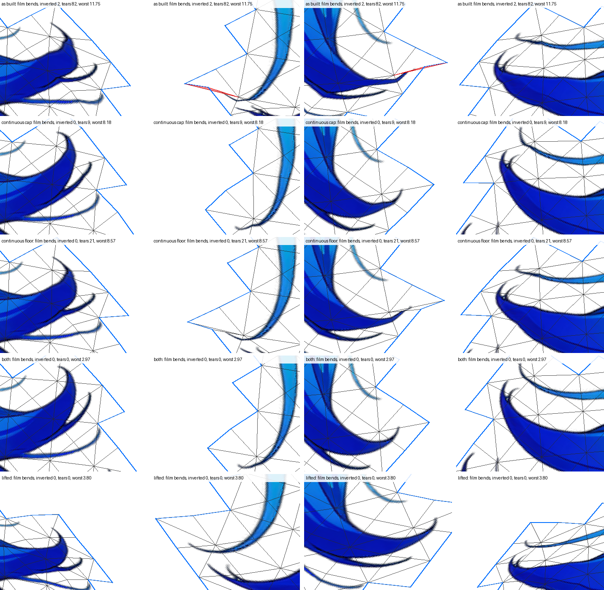

# The weight rule's two cuts, measured (issue #284, Stage A)

The rule keeps a vertex's four largest influences and drops any under 0.03. This page measures the shipped lattice
meshes of `demo`, `scarf` and the trailer under that rule as built and under three candidates that keep the influence
count at four and make a cut continuous, with the cap and floor lifted as a reference. Every figure is
`tools/tear_survey.ts`'s. Nothing under `src/` changes.

## Reading

**Against the lines stated before the run, no candidate is adoptable.** Every candidate passes every bar on all three
examples and keeps at most four influences. Each one misses two lines: inverted triangles at the bends compared with the
lifted reference, and the idle's movement against today's rig.

| rule | inverted at the bends: demo / scarf / trailer 15° / trailer film (lifted: 0 / 36 / 0 / 0) | idle vs today, rig px (line 1.0) | vertices changed |
| --- | --- | --- | --- |
| continuous cap | 5 / 41 / 2 / 0 | 1.823 / 1.673 / 2.795 | 453 / 534 / 667 |
| continuous floor | 1 / 42 / 5 / 0 | 1.252 / 0.676 / 1.471 | 906 / 1367 / 1363 |
| both | 6 / 43 / 2 / 0 | 2.491 / 1.948 / 3.375 | 906 / 1367 / 1363 |

**Where the cuts were the whole story, "both" removes it.** On the trailer's `hair_long`, "both" leaves 0 inverted
triangles and 0 tears at both bend sets, and its worst sample is 4.37 at 15° (lifted 5.64, as built 17.38). The picture
shows the curls at the film's bends. The floor's own tears also go under the continuous floor: demo's `hair_back` (155 to 0)
and the trailer's `handwear_l` (75 to 0, worst 3.45 to 0.75), `hairpin` (27 to 0) and `legwear` (4 to 0).

**What remains, and where.** The tears that survive a continuous cut sit where five or more bones are nearly equal, far
from every segment. A rule bounded at four has to choose among near-equals there. A continuous choice is not a jump,
but it is a cliff.
- **demo `bottomwear`** at (493.5, 564.5), between the centre and left skirt chains, 78–99 px from their segments. The
  lifted weights of five links lie between 0.149 and 0.158. Under the continuous cap, 3 px to the right moves
  `skirt_c2` from 0.279 to 0 and `skirt_l0` from 0 to 0.208. The part's tears go from 681 to 532 and its worst sample
  from 16.41 to 40.71.
- **scarf `topwear`** at (338, 609.5), 56–87 px from five segments (`robe_r1` .276, `chest` .165, `hip` .149,
  `robe_r2` .135, `robe_r0` .130 lifted). Under "both" its worst sample goes from 10.60 to 16.55.

The lifted reference tears nowhere by bone set. Its tear count is not zero (scarf `topwear` 290, the trailer's
`hair_front` 112), but none of those pairs keep different bones: they are steep, continuous stretches at the 15° roll.
So the remaining defect is the one the card named as a different card: **which bones may claim a vertex**. In the
far field the inverse-square rule spreads a vertex over bones of two chains, or of a whole limb, nearly equally.

**scarf's 36 are not tears.** The card presumed the lattice's inverted triangles on demo (1) and scarf (36) were tears.
That holds for demo: lifted, 0. It does not hold for scarf: lifted, 36 remain (35 on `topwear`), as built 36. This run
does not locate them.

## HQ's question: why scarf `topwear` stays outside the line with the cap and floor lifted

It is not a tear, and it is not the outline. The worst sample of PR #286's (G′) under the lifted rule (11.88 at 15°)
is at (522.5, 735.5). That is **29.8 px in from the outline**, 1 px from `robe_l2`'s segment, where the lifted rule gives
`robe_l2` 0.92. The corners of the triangle that carries it hold 0.55, 0.73 and 0.58 of `robe_l2`. No vertex lies on
the robe's line, and the robe's falloff (r = 12) is narrower than the interior spacing (30).

The probe settles it one change at a time (lifted, 15°):

| mesh | result |
| --- | --- |
| edges cut to 15 | 11.93, unchanged |
| interior at 15 | **4.76** |
| the lattice at 30 | 9.92 (beside the same site) |
| the lattice at 29 (as shipped) | 8.18, and 6.60 at that site |

Diagnosis 1's outline-edge cap does not miss on the outline. The miss is **a chain that runs through the part's
interior**: the robes cross the sweater, and a coarse interior grid has no vertex along them. Under the rule as built
the same holds (12.53 at (510.5, 801.5), `robe_l2` 0.50). The lattice reads better there by where its grid happens to
fall, not by construction.

The picture shows the trailer's `hair_long` lattice at the film's bends, one row per rule (as built, continuous cap,
continuous floor, both, lifted). The four crops are fixed in rig px: the +θ pose's two inner curls, then the −θ pose's.
The outline is blue and inverted triangles are filled red. Under the lifted rule the whole part sits elsewhere, so
its crops frame different art.

Generated by `tools/tear_survey.ts --page`; every figure below is the tool's. A tear is a pair of reference samples at most 3 px apart at rest (4-neighbours on the dense reference's grid) whose posed distance exceeds their rest distance by more than 3 rig px under some pose of the set, both skinned by the rule itself. "Inverted" counts a triangle once per pose it folds in (#265's convention). "Worst" is the largest distance between a sample carried by the written mesh and the same sample skinned by that rule, unrounded.

## demo

Controls: today's weights skinned here are within 4.4e-5 rig px of `rigc render --geometry`'s idle frames; the as-built rule recomputed here is within 1.0e-5 of every written weight. Meshes not in the census (their weights are kept): none.

| rule | idle: inverted / tears / worst | fallback: inverted / tears / worst | largest influence count | vertices changed | weight values changed | rig.json bytes | check | BREATH_VISIBLE | BLINK_NO_HOLE | CHAIN_LAG | TIP_OVER_ROOT | STILL_REGIONS_DARK | TEXTURE_STRETCH | idle vs today (part) |
| --- | --- | --- | ---: | ---: | ---: | ---: | --- | --- | --- | --- | --- | --- | --- | --- |
| as built | 0 / 0 / 1.02 | 1 / 868 / 16.41 | 4 | 0 of 1192 | 0 | 471635 | PASS | PASS | PASS | PASS | PASS min 2.428 | PASS | PASS 1.097 | — |
| continuous cap | 0 / 0 / 1.12 | 5 / 579 / 40.71 | 4 | 453 of 1192 | 1640 | 438319 | PASS | PASS | PASS | PASS | PASS min 2.517 | PASS | PASS 1.093 | 1.823 (hair_back) |
| continuous floor | 0 / 0 / 1.09 | 1 / 578 / 16.31 | 4 | 906 of 1192 | 2718 | 471627 | PASS | PASS | PASS | PASS | PASS min 2.398 | PASS | PASS 1.101 | 1.252 (hair_back) |
| both | 0 / 0 / 1.17 | 6 / 549 / 42.45 | 4 | 906 of 1192 | 2719 | 438292 | PASS | PASS | PASS | PASS | PASS min 2.519 | PASS | PASS 1.104 | 2.491 (hair_back) |
| lifted | 0 / 0 / 1.02 | 0 / 0 / 8.81 | 10 | 673 of 1192 | 4515 | 770980 | PASS | PASS | PASS | PASS | PASS min 1.499 | PASS | PASS 1.083 | 3.350 (hair_back) |
- continuous cap, check: `..    51 assertions: 25 measured (25 passed, 0 failed), 26 skipped, 0 not in profile "spine-html"`; `..    51 assertions: 26 measured (26 passed, 0 failed), 25 skipped, 0 not in profile "spine-html"`
- continuous floor, check: `..    51 assertions: 25 measured (25 passed, 0 failed), 26 skipped, 0 not in profile "spine-html"`; `..    51 assertions: 26 measured (26 passed, 0 failed), 25 skipped, 0 not in profile "spine-html"`
- both, check: `..    51 assertions: 25 measured (25 passed, 0 failed), 26 skipped, 0 not in profile "spine-html"`; `..    51 assertions: 26 measured (26 passed, 0 failed), 25 skipped, 0 not in profile "spine-html"`
- lifted, check: `..    51 assertions: 25 measured (25 passed, 0 failed), 26 skipped, 0 not in profile "spine-html"`; `..    51 assertions: 26 measured (26 passed, 0 failed), 25 skipped, 0 not in profile "spine-html"`

Per part — inverted / tears (of them, pairs that keep different bones) / worst, under each rule:

| part | set | as built | continuous cap | continuous floor | both | lifted |
| --- | --- | --- | --- | --- | --- | --- |
| hair_back | idle | 0 / 0 (0) / 0.71 | 0 / 0 (0) / 0.41 | 0 / 0 (0) / 0.48 | 0 / 0 (0) / 0.34 | 0 / 0 (0) / 0.74 |
| hair_back | fallback | 0 / 155 (155) / 6.17 | 0 / 21 (21) / 3.20 | 0 / 0 (0) / 3.94 | 0 / 0 (0) / 2.34 | 0 / 0 (0) / 5.46 |
| hair_front | idle | 0 / 0 (0) / 0.67 | 0 / 0 (0) / 0.63 | 0 / 0 (0) / 0.66 | 0 / 0 (0) / 0.68 | 0 / 0 (0) / 0.66 |
| hair_front | fallback | 1 / 32 (32) / 8.84 | 0 / 26 (26) / 8.43 | 1 / 27 (27) / 8.91 | 2 / 26 (26) / 8.65 | 0 / 0 (0) / 8.81 |
| hairpin | idle | 0 / 0 (0) / 0.00 | 0 / 0 (0) / 0.00 | 0 / 0 (0) / 0.00 | 0 / 0 (0) / 0.00 | 0 / 0 (0) / 0.00 |
| earring | idle | 0 / 0 (0) / 0.00 | 0 / 0 (0) / 0.00 | 0 / 0 (0) / 0.00 | 0 / 0 (0) / 0.00 | 0 / 0 (0) / 0.00 |
| neck | idle | 0 / 0 (0) / 0.03 | 0 / 0 (0) / 0.03 | 0 / 0 (0) / 0.01 | 0 / 0 (0) / 0.01 | 0 / 0 (0) / 0.01 |
| handwear_r | idle | 0 / 0 (0) / 0.13 | 0 / 0 (0) / 0.13 | 0 / 0 (0) / 0.09 | 0 / 0 (0) / 0.09 | 0 / 0 (0) / 0.12 |
| handwear_r | fallback | 0 / 0 (0) / 2.07 | 0 / 0 (0) / 2.07 | 0 / 0 (0) / 1.57 | 0 / 0 (0) / 1.57 | 0 / 0 (0) / 2.29 |
| handwear_l | idle | 0 / 0 (0) / 0.12 | 0 / 0 (0) / 0.12 | 0 / 0 (0) / 0.09 | 0 / 0 (0) / 0.09 | 0 / 0 (0) / 0.11 |
| handwear_l | fallback | 0 / 0 (0) / 2.23 | 0 / 0 (0) / 2.23 | 0 / 0 (0) / 1.41 | 0 / 0 (0) / 1.41 | 0 / 0 (0) / 2.09 |
| topwear | idle | 0 / 0 (0) / 1.02 | 0 / 0 (0) / 1.02 | 0 / 0 (0) / 1.09 | 0 / 0 (0) / 1.09 | 0 / 0 (0) / 1.02 |
| bottomwear | idle | 0 / 0 (0) / 0.42 | 0 / 0 (0) / 1.12 | 0 / 0 (0) / 0.42 | 0 / 0 (0) / 1.17 | 0 / 0 (0) / 0.19 |
| bottomwear | fallback | 0 / 681 (681) / 16.41 | 5 / 532 (209) / 40.71 | 0 / 551 (551) / 16.31 | 4 / 523 (98) / 42.45 | 0 / 0 (0) / 6.07 |

Largest tear per part and rule at the bend sets (posed gap beyond the rest distance, rig px, where):

- hair_back (stride 2): as built fallback 5.64 at (661.50, 476.50); continuous cap fallback 3.39 at (647.50, 482.50); continuous floor fallback 1.83 at (537.50, 146.50); both fallback 0.47 at (536.50, 221.50); lifted fallback 0.73 at (381.50, 44.50).
- hair_front (stride 1): as built fallback 3.89 at (394.00, 95.50); continuous cap fallback 7.40 at (394.00, 95.50); continuous floor fallback 3.90 at (394.00, 95.50); both fallback 7.78 at (394.00, 95.50); lifted fallback 2.61 at (414.00, 143.50).
- handwear_r (stride 2): as built fallback 2.03 at (354.50, 326.50); continuous cap fallback 2.03 at (354.50, 326.50); continuous floor fallback 0.37 at (333.50, 311.50); both fallback 0.37 at (333.50, 311.50); lifted fallback 0.44 at (233.50, 577.50).
- handwear_l (stride 2): as built fallback 2.01 at (513.50, 439.50); continuous cap fallback 2.01 at (513.50, 439.50); continuous floor fallback 0.37 at (493.50, 309.50); both fallback 0.37 at (493.50, 309.50); lifted fallback 0.43 at (593.50, 577.50).
- bottomwear (stride 2): as built fallback 24.24 at (334.50, 561.50); continuous cap fallback 29.98 at (493.50, 564.50); continuous floor fallback 24.07 at (334.50, 561.50); both fallback 34.40 at (493.50, 564.50); lifted fallback 0.79 at (548.50, 631.50).

## scarf

Controls: today's weights skinned here are within 4.2e-5 rig px of `rigc render --geometry`'s idle frames; the as-built rule recomputed here is within 1.0e-5 of every written weight. Meshes not in the census (their weights are kept): none.

| rule | idle: inverted / tears / worst | fallback: inverted / tears / worst | largest influence count | vertices changed | weight values changed | rig.json bytes | check | BREATH_VISIBLE | BLINK_NO_HOLE | CHAIN_LAG | TIP_OVER_ROOT | STILL_REGIONS_DARK | TEXTURE_STRETCH | idle vs today (part) |
| --- | --- | --- | ---: | ---: | ---: | ---: | --- | --- | --- | --- | --- | --- | --- | --- |
| as built | 0 / 0 / 1.51 | 36 / 1310 / 10.60 | 4 | 0 of 1583 | 0 | 665178 | PASS | PASS | PASS | PASS | PASS min 2.456 | PASS | PASS 1.211 | — |
| continuous cap | 0 / 0 / 1.51 | 41 / 1345 / 16.53 | 4 | 534 of 1583 | 1959 | 621745 | PASS | PASS | PASS | PASS | PASS min 2.456 | PASS | PASS 1.213 | 1.673 (topwear) |
| continuous floor | 0 / 0 / 1.60 | 42 / 1090 / 9.99 | 4 | 1367 of 1583 | 3922 | 665230 | PASS | PASS | PASS | PASS | PASS min 2.45 | PASS | PASS 1.225 | 0.676 (topwear) |
| both | 0 / 0 / 1.60 | 43 / 1195 / 16.55 | 4 | 1367 of 1583 | 3922 | 621625 | PASS | PASS | PASS | PASS | PASS min 2.45 | PASS | PASS 1.227 | 1.948 (topwear) |
| lifted | 0 / 0 / 1.46 | 36 / 330 / 8.18 | 10 | 1414 of 1583 | 8603 | 1244841 | PASS | PASS | PASS | PASS | PASS min 2.082 | PASS | PASS 1.201 | 1.336 (topwear) |
- continuous cap, check: `..    51 assertions: 25 measured (25 passed, 0 failed), 26 skipped, 0 not in profile "spine-html"`; `..    51 assertions: 26 measured (26 passed, 0 failed), 25 skipped, 0 not in profile "spine-html"`
- continuous floor, check: `..    51 assertions: 25 measured (25 passed, 0 failed), 26 skipped, 0 not in profile "spine-html"`; `..    51 assertions: 26 measured (26 passed, 0 failed), 25 skipped, 0 not in profile "spine-html"`
- both, check: `..    51 assertions: 25 measured (25 passed, 0 failed), 26 skipped, 0 not in profile "spine-html"`; `..    51 assertions: 26 measured (26 passed, 0 failed), 25 skipped, 0 not in profile "spine-html"`
- lifted, check: `..    51 assertions: 25 measured (25 passed, 0 failed), 26 skipped, 0 not in profile "spine-html"`; `..    51 assertions: 26 measured (26 passed, 0 failed), 25 skipped, 0 not in profile "spine-html"`

Per part — inverted / tears (of them, pairs that keep different bones) / worst, under each rule:

| part | set | as built | continuous cap | continuous floor | both | lifted |
| --- | --- | --- | --- | --- | --- | --- |
| hair_back | idle | 0 / 0 (0) / 0.09 | 0 / 0 (0) / 0.09 | 0 / 0 (0) / 0.09 | 0 / 0 (0) / 0.09 | 0 / 0 (0) / 0.08 |
| hair_front | idle | 0 / 0 (0) / 0.56 | 0 / 0 (0) / 0.54 | 0 / 0 (0) / 0.58 | 0 / 0 (0) / 0.57 | 0 / 0 (0) / 0.55 |
| hair_front | fallback | 1 / 42 (3) / 7.69 | 1 / 54 (11) / 7.37 | 1 / 46 (3) / 8.00 | 2 / 57 (12) / 7.84 | 1 / 40 (0) / 7.55 |
| handwear_r | idle | 0 / 0 (0) / 0.07 | 0 / 0 (0) / 0.07 | 0 / 0 (0) / 0.04 | 0 / 0 (0) / 0.04 | 0 / 0 (0) / 0.04 |
| handwear_r | fallback | 0 / 0 (0) / 1.09 | 0 / 0 (0) / 1.09 | 0 / 0 (0) / 0.50 | 0 / 0 (0) / 0.50 | 0 / 0 (0) / 0.65 |
| handwear_l | idle | 0 / 0 (0) / 0.06 | 0 / 0 (0) / 0.06 | 0 / 0 (0) / 0.03 | 0 / 0 (0) / 0.03 | 0 / 0 (0) / 0.03 |
| handwear_l | fallback | 0 / 0 (0) / 1.39 | 0 / 0 (0) / 1.39 | 0 / 0 (0) / 0.39 | 0 / 0 (0) / 0.39 | 0 / 0 (0) / 0.47 |
| topwear | idle | 0 / 0 (0) / 1.51 | 0 / 0 (0) / 1.51 | 0 / 0 (0) / 1.60 | 0 / 0 (0) / 1.60 | 0 / 0 (0) / 1.46 |
| topwear | fallback | 35 / 1156 (626) / 10.60 | 40 / 1273 (355) / 16.53 | 41 / 954 (96) / 9.99 | 41 / 1116 (34) / 16.55 | 35 / 290 (0) / 8.18 |
| bottomwear | idle | 0 / 0 (0) / 0.16 | 0 / 0 (0) / 0.19 | 0 / 0 (0) / 0.14 | 0 / 0 (0) / 0.20 | 0 / 0 (0) / 0.10 |
| bottomwear | fallback | 0 / 112 (112) / 7.02 | 0 / 18 (12) / 8.67 | 0 / 90 (90) / 6.04 | 0 / 22 (10) / 9.56 | 0 / 0 (0) / 4.16 |

Largest tear per part and rule at the bend sets (posed gap beyond the rest distance, rig px, where):

- hair_front (stride 1): as built fallback 5.36 at (413.00, 165.50); continuous cap fallback 5.41 at (413.00, 165.50); continuous floor fallback 5.70 at (413.00, 165.50); both fallback 5.76 at (413.00, 165.50); lifted fallback 5.25 at (413.00, 165.50).
- handwear_r (stride 2): as built fallback 1.26 at (312.50, 481.50); continuous cap fallback 1.26 at (312.50, 481.50); continuous floor fallback 0.40 at (352.50, 341.50); both fallback 0.40 at (352.50, 341.50); lifted fallback 0.44 at (314.50, 349.50).
- handwear_l (stride 2): as built fallback 1.29 at (498.50, 482.50); continuous cap fallback 1.29 at (498.50, 482.50); continuous floor fallback 0.40 at (478.50, 340.50); both fallback 0.40 at (478.50, 340.50); lifted fallback 0.44 at (518.50, 348.50).
- topwear (stride 3): as built fallback 19.36 at (338.00, 705.50); continuous cap fallback 9.87 at (338.00, 609.50); continuous floor fallback 17.56 at (338.00, 705.50); both fallback 10.90 at (338.00, 609.50); lifted fallback 4.06 at (347.00, 780.50).
- bottomwear (stride 1): as built fallback 8.84 at (330.50, 743.00); continuous cap fallback 5.34 at (431.00, 718.50); continuous floor fallback 7.51 at (330.50, 743.00); both fallback 5.47 at (431.00, 718.50); lifted fallback 0.84 at (334.50, 673.00).

### The probe — alternative meshes of one part, weighted unrounded by the rule (T 2, S 30)

| mesh | triangles | hull | as built, idle: worst / inverted (where; the lattice there) | as built, fallback: worst / inverted (where; the lattice there) | lifted, idle: worst / inverted (where; the lattice there) | lifted, fallback: worst / inverted (where; the lattice there) |
| --- | ---: | ---: | --- | --- | --- | --- |
| L (grid 29) | 392 | 84 | 1.51 / 0 ((414.50, 645.50); 1.51) | 10.60 / 35 ((336.50, 705.50); 10.60) | 1.46 / 0 ((414.50, 645.50); 1.46) | 8.18 / 35 ((285.50, 702.50); 8.18) |
| LS (grid 30) | 372 | 80 | 1.87 / 0 ((414.50, 654.50); 0.89) | 11.63 / 30 ((312.50, 864.50); 9.33) | 1.99 / 0 ((414.50, 654.50); 0.84) | 9.92 / 34 ((522.50, 723.50); 7.42) |
| G (T 2, interior 30) | 300 | 62 | 3.62 / 0 ((414.50, 675.50); 0.17) | 20.19 / 15 ((420.50, 675.50); 5.03) | 3.86 / 0 ((414.50, 675.50); 0.13) | 22.80 / 13 ((414.50, 675.50); 0.02) |
| G' (edges <= 30) | 350 | 112 | 1.65 / 0 ((333.50, 609.50); 0.74) | 12.53 / 24 ((510.50, 801.50); 8.94) | 1.73 / 0 ((414.50, 654.50); 0.84) | 11.88 / 27 ((522.50, 735.50); 6.60) |
| G' edges <= 15 | 417 | 179 | 1.71 / 0 ((414.50, 654.50); 0.89) | 12.03 / 30 ((510.50, 810.50); 8.96) | 1.89 / 0 ((414.50, 654.50); 0.84) | 11.93 / 37 ((522.50, 735.50); 6.60) |
| G' interior 15 | 1204 | 112 | 1.53 / 0 ((333.50, 609.50); 0.74) | 12.68 / 69 ((339.50, 708.50); 10.16) | 1.63 / 0 ((414.50, 651.50); 1.14) | 4.76 / 66 ((291.50, 729.50); 4.88) |
| G' both 15 | 1271 | 179 | 1.53 / 0 ((333.50, 609.50); 0.74) | 8.87 / 80 ((333.50, 609.50); 5.40) | 1.63 / 0 ((414.50, 651.50); 1.14) | 4.76 / 78 ((291.50, 729.50); 4.88) |

- **L (grid 29)** — the lattice as built.
  - as built, idle: the worst sample 44.5 px in from the outline, 13.5 px from a vertex; hip 0.73 there, at its triangle's corners interior 0.33, interior 0.90, interior 0.47.
  - as built, fallback: the worst sample 19.5 px in from the outline, 16.5 px from a vertex; robe_r2 0.42 there, at its triangle's corners interior 0.43, interior 0.52, outline 0.24.
  - lifted, idle: the worst sample 44.5 px in from the outline, 13.5 px from a vertex; hip 0.70 there, at its triangle's corners interior 0.32, interior 0.86, interior 0.41.
  - lifted, fallback: the worst sample 16.5 px in from the outline, 17.7 px from a vertex; robe_r2 0.90 there, at its triangle's corners outline 0.56, outline 0.66, interior 0.59.
- **LS (grid 30)** — the lattice at the figure's spacing.
  - as built, idle: the worst sample 52.5 px in from the outline, 8.7 px from a vertex; hip 0.85 there, at its triangle's corners interior 0.65, interior 0.63, interior 0.90.
  - as built, fallback: the worst sample 22.5 px in from the outline, 15.4 px from a vertex; robe_r3 0.86 there, at its triangle's corners interior 0.95, outline 0.83, interior 0.65.
  - lifted, idle: the worst sample 52.5 px in from the outline, 8.7 px from a vertex; hip 0.81 there, at its triangle's corners interior 0.61, interior 0.53, interior 0.83.
  - lifted, fallback: the worst sample 43.5 px in from the outline, 19.1 px from a vertex; robe_l2 0.92 there, at its triangle's corners interior 0.69, interior 0.73, interior 0.65.
- **G (T 2, interior 30)** — Stage D's (G): the traced outline, the contour mode's interior grid.
  - as built, idle: the worst sample 6.9 px in from the outline, 25.3 px from a vertex; hip 0.94 there, at its triangle's corners outline 0.45, interior 0.65, outline 0.66.
  - as built, fallback: the worst sample 7.0 px in from the outline, 28.5 px from a vertex; hip 0.88 there, at its triangle's corners outline 0.45, interior 0.65, outline 0.66.
  - lifted, idle: the worst sample 6.9 px in from the outline, 25.3 px from a vertex; hip 0.89 there, at its triangle's corners outline 0.38, interior 0.61, outline 0.56.
  - lifted, fallback: the worst sample 6.9 px in from the outline, 25.3 px from a vertex; hip 0.89 there, at its triangle's corners outline 0.38, interior 0.61, outline 0.56.
- **G' (edges <= 30)** — PR #286's (G′): (G)'s outline with every edge cut to at most S.
  - as built, idle: the worst sample 61.9 px in from the outline, 8.7 px from a vertex; robe_r1 0.42 there, at its triangle's corners interior 0.45, interior 0.45, interior 0.22.
  - as built, fallback: the worst sample 16.3 px in from the outline, 19.9 px from a vertex; robe_l2 0.50 there, at its triangle's corners outline 0.42, interior 0.52, outline 0.45.
  - lifted, idle: the worst sample 27.9 px in from the outline, 8.7 px from a vertex; hip 0.81 there, at its triangle's corners outline 0.86, interior 0.61, interior 0.42.
  - lifted, fallback: the worst sample 29.8 px in from the outline, 13.6 px from a vertex; robe_l2 0.92 there, at its triangle's corners outline 0.55, interior 0.73, outline 0.58.
- **G' edges <= 15** — (G′) with the outline's edges cut to at most S/2, the interior at S.
  - as built, idle: the worst sample 27.9 px in from the outline, 8.7 px from a vertex; hip 0.85 there, at its triangle's corners outline 0.86, interior 0.65, interior 0.48.
  - as built, fallback: the worst sample 15.8 px in from the outline, 16.8 px from a vertex; robe_l3 0.51 there, at its triangle's corners outline 0.46, interior 0.48, outline 0.44.
  - lifted, idle: the worst sample 27.9 px in from the outline, 8.7 px from a vertex; hip 0.81 there, at its triangle's corners outline 0.73, interior 0.61, interior 0.42.
  - lifted, fallback: the worst sample 29.8 px in from the outline, 13.6 px from a vertex; robe_l2 0.92 there, at its triangle's corners outline 0.57, interior 0.73, outline 0.58.
- **G' interior 15** — (G′) with the edges cut to at most S, the interior grid at S/2.
  - as built, idle: the worst sample 61.9 px in from the outline, 8.7 px from a vertex; robe_r1 0.42 there, at its triangle's corners interior 0.46, interior 0.45, interior 0.33.
  - as built, fallback: the worst sample 6.9 px in from the outline, 9.0 px from a vertex; robe_r2 0.40 there, at its triangle's corners interior 0.48, interior 0.51, outline 0.34.
  - lifted, idle: the worst sample 30.9 px in from the outline, 6.4 px from a vertex; hip 0.78 there, at its triangle's corners interior 0.53, interior 0.67, interior 0.61.
  - lifted, fallback: the worst sample 15.5 px in from the outline, 10.6 px from a vertex; robe_r2 0.92 there, at its triangle's corners interior 0.86, interior 0.84, interior 0.80.
- **G' both 15** — edges and interior at S/2.
  - as built, idle: the worst sample 61.9 px in from the outline, 8.7 px from a vertex; robe_r1 0.42 there, at its triangle's corners interior 0.46, interior 0.45, interior 0.33.
  - as built, fallback: the worst sample 61.9 px in from the outline, 8.7 px from a vertex; robe_r1 0.42 there, at its triangle's corners interior 0.46, interior 0.45, interior 0.33.
  - lifted, idle: the worst sample 30.9 px in from the outline, 6.4 px from a vertex; hip 0.78 there, at its triangle's corners interior 0.53, interior 0.67, interior 0.61.
  - lifted, fallback: the worst sample 15.5 px in from the outline, 10.6 px from a vertex; robe_r2 0.92 there, at its triangle's corners interior 0.86, interior 0.84, interior 0.80.

## trailer

Controls: today's weights skinned here are within 3.9e-5 rig px of `rigc render --geometry`'s idle frames; the as-built rule recomputed here is within 1.0e-5 of every written weight. Meshes not in the census (their weights are kept): topwear: contour mesh: keeps its weights.

| rule | idle: inverted / tears / worst | fallback: inverted / tears / worst | film: inverted / tears / worst | largest influence count | vertices changed | weight values changed | rig.json bytes | check | BREATH_VISIBLE | BLINK_NO_HOLE | CHAIN_LAG | TIP_OVER_ROOT | STILL_REGIONS_DARK | TEXTURE_STRETCH | idle vs today (part) |
| --- | --- | --- | --- | ---: | ---: | ---: | ---: | --- | --- | --- | --- | --- | --- | --- | --- |
| as built | 0 / 0 / 1.26 | 6 / 590 / 17.38 | 7 / 416 / 11.75 | 4 | 0 of 1561 | 0 | 773228 | PASS | PASS | PASS | PASS | PASS min 2.756 | PASS | PASS 1.226 | — |
| continuous cap | 0 / 0 / 1.26 | 2 / 319 / 15.94 | 0 / 173 / 9.62 | 4 | 667 of 1561 | 2392 | 726454 | PASS | PASS | PASS | PASS | PASS min 2.756 | PASS | PASS 1.226 | 2.795 (hair_long) |
| continuous floor | 0 / 0 / 1.26 | 5 / 240 / 16.46 | 0 / 158 / 9.94 | 4 | 1363 of 1561 | 4005 | 773235 | PASS | PASS | PASS | PASS | PASS min 2.769 | PASS | PASS 1.137 | 1.471 (hair_long) |
| both | 0 / 0 / 1.30 | 2 / 181 / 16.65 | 0 / 54 / 10.05 | 4 | 1363 of 1561 | 4005 | 726500 | PASS | PASS | PASS | PASS | PASS min 2.769 | PASS | PASS 1.137 | 3.375 (hair_long) |
| lifted | 0 / 0 / 1.11 | 0 / 112 / 14.57 | 0 / 4 / 8.80 | 10 | 902 of 1561 | 6802 | 1270495 | PASS | PASS | PASS | PASS | PASS min 2.756 | PASS | PASS 1.123 | 3.286 (hair_long) |
- continuous cap, check: `..    51 assertions: 24 measured (24 passed, 0 failed), 27 skipped, 0 not in profile "spine-html"`; `..    51 assertions: 25 measured (25 passed, 0 failed), 26 skipped, 0 not in profile "spine-html"`; `requirements: 0 declared — 0 measured (0 PASS, 0 FAIL), 0 NOT MEASURABLE; not declared: contact, follow, aim, range, stretch, seam`
- continuous floor, check: `..    51 assertions: 24 measured (24 passed, 0 failed), 27 skipped, 0 not in profile "spine-html"`; `..    51 assertions: 25 measured (25 passed, 0 failed), 26 skipped, 0 not in profile "spine-html"`; `requirements: 0 declared — 0 measured (0 PASS, 0 FAIL), 0 NOT MEASURABLE; not declared: contact, follow, aim, range, stretch, seam`
- both, check: `..    51 assertions: 24 measured (24 passed, 0 failed), 27 skipped, 0 not in profile "spine-html"`; `..    51 assertions: 25 measured (25 passed, 0 failed), 26 skipped, 0 not in profile "spine-html"`; `requirements: 0 declared — 0 measured (0 PASS, 0 FAIL), 0 NOT MEASURABLE; not declared: contact, follow, aim, range, stretch, seam`
- lifted, check: `..    51 assertions: 24 measured (24 passed, 0 failed), 27 skipped, 0 not in profile "spine-html"`; `..    51 assertions: 25 measured (25 passed, 0 failed), 26 skipped, 0 not in profile "spine-html"`; `requirements: 0 declared — 0 measured (0 PASS, 0 FAIL), 0 NOT MEASURABLE; not declared: contact, follow, aim, range, stretch, seam`

Per part — inverted / tears (of them, pairs that keep different bones) / worst, under each rule:

| part | set | as built | continuous cap | continuous floor | both | lifted |
| --- | --- | --- | --- | --- | --- | --- |
| hair_back | idle | 0 / 0 (0) / 0.19 | 0 / 0 (0) / 0.19 | 0 / 0 (0) / 0.21 | 0 / 0 (0) / 0.21 | 0 / 0 (0) / 0.19 |
| hair_front | idle | 0 / 0 (0) / 1.14 | 0 / 0 (0) / 1.25 | 0 / 0 (0) / 1.26 | 0 / 0 (0) / 1.30 | 0 / 0 (0) / 1.11 |
| hair_front | fallback | 2 / 190 (98) / 15.11 | 2 / 161 (15) / 15.94 | 3 / 192 (85) / 16.46 | 2 / 181 (11) / 16.65 | 0 / 112 (0) / 14.57 |
| hair_front | film | 0 / 38 (22) / 9.13 | 0 / 34 (0) / 9.62 | 0 / 43 (12) / 9.94 | 0 / 51 (0) / 10.05 | 0 / 4 (0) / 8.80 |
| hairpin | idle | 0 / 0 (0) / 1.26 | 0 / 0 (0) / 1.26 | 0 / 0 (0) / 0.37 | 0 / 0 (0) / 0.37 | 0 / 0 (0) / 0.49 |
| hairpin | fallback | 0 / 27 (27) / 4.04 | 0 / 27 (27) / 4.04 | 0 / 0 (0) / 1.21 | 0 / 0 (0) / 1.21 | 0 / 0 (0) / 1.58 |
| hairpin | film | 0 / 27 (27) / 4.04 | 0 / 27 (27) / 4.04 | 0 / 0 (0) / 1.21 | 0 / 0 (0) / 1.21 | 0 / 0 (0) / 1.58 |
| neck | idle | 0 / 0 (0) / 0.01 | 0 / 0 (0) / 0.01 | 0 / 0 (0) / 0.01 | 0 / 0 (0) / 0.01 | 0 / 0 (0) / 0.01 |
| handwear_r | idle | 0 / 0 (0) / 0.05 | 0 / 0 (0) / 0.05 | 0 / 0 (0) / 0.04 | 0 / 0 (0) / 0.04 | 0 / 0 (0) / 0.04 |
| handwear_r | fallback | 0 / 0 (0) / 0.90 | 0 / 0 (0) / 0.90 | 0 / 0 (0) / 0.63 | 0 / 0 (0) / 0.63 | 0 / 0 (0) / 0.59 |
| handwear_r | film | 0 / 0 (0) / 1.90 | 0 / 0 (0) / 1.90 | 0 / 0 (0) / 1.33 | 0 / 0 (0) / 1.33 | 0 / 0 (0) / 1.25 |
| handwear_l | idle | 0 / 0 (0) / 0.08 | 0 / 0 (0) / 0.08 | 0 / 0 (0) / 0.03 | 0 / 0 (0) / 0.03 | 0 / 0 (0) / 0.03 |
| handwear_l | fallback | 0 / 75 (75) / 3.45 | 0 / 75 (75) / 3.45 | 0 / 0 (0) / 0.75 | 0 / 0 (0) / 0.75 | 0 / 0 (0) / 1.16 |
| handwear_l | film | 0 / 75 (75) / 3.45 | 0 / 75 (75) / 3.45 | 0 / 0 (0) / 0.75 | 0 / 0 (0) / 0.75 | 0 / 0 (0) / 1.16 |
| bottomwear | idle | 0 / 0 (0) / 0.46 | 0 / 0 (0) / 0.40 | 0 / 0 (0) / 0.42 | 0 / 0 (0) / 0.35 | 0 / 0 (0) / 0.48 |
| bottomwear | fallback | 0 / 92 (92) / 6.51 | 0 / 0 (0) / 5.89 | 0 / 25 (25) / 6.15 | 0 / 0 (0) / 5.30 | 0 / 0 (0) / 2.89 |
| bottomwear | film | 5 / 194 (194) / 10.27 | 0 / 28 (27) / 9.32 | 0 / 94 (94) / 9.70 | 0 / 3 (0) / 8.40 | 0 / 0 (0) / 4.61 |
| hair_long | idle | 0 / 0 (0) / 1.12 | 0 / 0 (0) / 1.02 | 0 / 0 (0) / 0.74 | 0 / 0 (0) / 0.36 | 0 / 0 (0) / 0.41 |
| hair_long | fallback | 4 / 202 (202) / 17.38 | 0 / 52 (52) / 12.02 | 2 / 23 (23) / 12.65 | 0 / 0 (0) / 4.37 | 0 / 0 (0) / 5.64 |
| hair_long | film | 2 / 82 (82) / 11.75 | 0 / 9 (9) / 8.18 | 0 / 21 (21) / 8.57 | 0 / 0 (0) / 2.97 | 0 / 0 (0) / 3.80 |
| legwear | idle | 0 / 0 (0) / 0.26 | 0 / 0 (0) / 0.26 | 0 / 0 (0) / 0.23 | 0 / 0 (0) / 0.23 | 0 / 0 (0) / 0.27 |
| legwear | fallback | 0 / 4 (4) / 2.55 | 0 / 4 (4) / 2.55 | 0 / 0 (0) / 1.71 | 0 / 0 (0) / 1.71 | 0 / 0 (0) / 2.35 |
| legwear | film | 0 / 0 (0) / 2.04 | 0 / 0 (0) / 2.04 | 0 / 0 (0) / 1.37 | 0 / 0 (0) / 1.37 | 0 / 0 (0) / 1.88 |

Largest tear per part and rule at the bend sets (posed gap beyond the rest distance, rig px, where):

- hair_front (stride 2): as built fallback 8.41 at (282.50, 109.50); as built film 5.01 at (282.50, 109.50); continuous cap fallback 5.97 at (397.50, 226.50); continuous cap film 3.62 at (397.50, 228.50); continuous floor fallback 7.55 at (282.50, 109.50); continuous floor film 4.50 at (282.50, 109.50); both fallback 6.36 at (397.50, 228.50); both film 3.86 at (397.50, 228.50); lifted fallback 5.10 at (397.50, 228.50); lifted film 3.09 at (397.50, 228.50).
- hairpin (stride 1): as built fallback 4.72 at (503.50, 148.00); as built film 4.72 at (503.50, 148.00); continuous cap fallback 4.72 at (503.50, 148.00); continuous cap film 4.72 at (503.50, 148.00); continuous floor fallback 0.36 at (489.50, 179.00); continuous floor film 0.36 at (489.50, 179.00); both fallback 0.36 at (489.50, 179.00); both film 0.36 at (489.50, 179.00); lifted fallback 0.33 at (489.50, 179.00); lifted film 0.33 at (489.50, 179.00).
- handwear_r (stride 1): as built fallback 0.98 at (364.00, 284.50); as built film 2.08 at (364.00, 284.50); continuous cap fallback 0.98 at (364.00, 284.50); continuous cap film 2.08 at (364.00, 284.50); continuous floor fallback 0.15 at (327.00, 279.50); continuous floor film 0.29 at (327.00, 279.50); both fallback 0.15 at (327.00, 279.50); both film 0.29 at (327.00, 279.50); lifted fallback 0.14 at (327.00, 279.50); lifted film 0.27 at (327.00, 279.50).
- handwear_l (stride 1): as built fallback 4.14 at (549.00, 670.50); as built film 4.14 at (549.00, 670.50); continuous cap fallback 4.14 at (549.00, 670.50); continuous cap film 4.14 at (549.00, 670.50); continuous floor fallback 0.27 at (532.00, 660.50); continuous floor film 0.27 at (532.00, 660.50); both fallback 0.27 at (532.00, 660.50); both film 0.27 at (532.00, 660.50); lifted fallback 0.24 at (530.00, 655.50); lifted film 0.24 at (530.00, 655.50).
- bottomwear (stride 2): as built fallback 7.61 at (456.50, 641.50); as built film 12.95 at (456.50, 641.50); continuous cap fallback 2.52 at (454.50, 641.50); continuous cap film 4.75 at (454.50, 641.50); continuous floor fallback 7.21 at (456.50, 641.50); continuous floor film 12.33 at (456.50, 641.50); both fallback 2.19 at (452.50, 643.50); both film 4.18 at (452.50, 643.50); lifted fallback 1.16 at (573.50, 620.50); lifted film 1.81 at (573.50, 618.50).
- hair_long (stride 3): as built fallback 27.18 at (296.50, 887.00); as built film 18.35 at (296.50, 887.00); continuous cap fallback 12.07 at (536.50, 1001.00); continuous cap film 8.28 at (536.50, 1001.00); continuous floor fallback 18.88 at (296.50, 887.00); continuous floor film 12.73 at (296.50, 887.00); both fallback 0.76 at (518.50, 887.00); both film 0.49 at (518.50, 887.00); lifted fallback 1.63 at (535.00, 936.50); lifted film 1.11 at (541.00, 939.50).
- legwear (stride 2): as built fallback 3.08 at (418.50, 952.50); as built film 2.48 at (418.50, 952.50); continuous cap fallback 3.08 at (418.50, 952.50); continuous cap film 2.48 at (418.50, 952.50); continuous floor fallback 0.45 at (420.50, 950.50); continuous floor film 0.37 at (420.50, 950.50); both fallback 0.45 at (420.50, 950.50); both film 0.37 at (420.50, 950.50); lifted fallback 0.40 at (420.50, 950.50); lifted film 0.33 at (420.50, 950.50).
